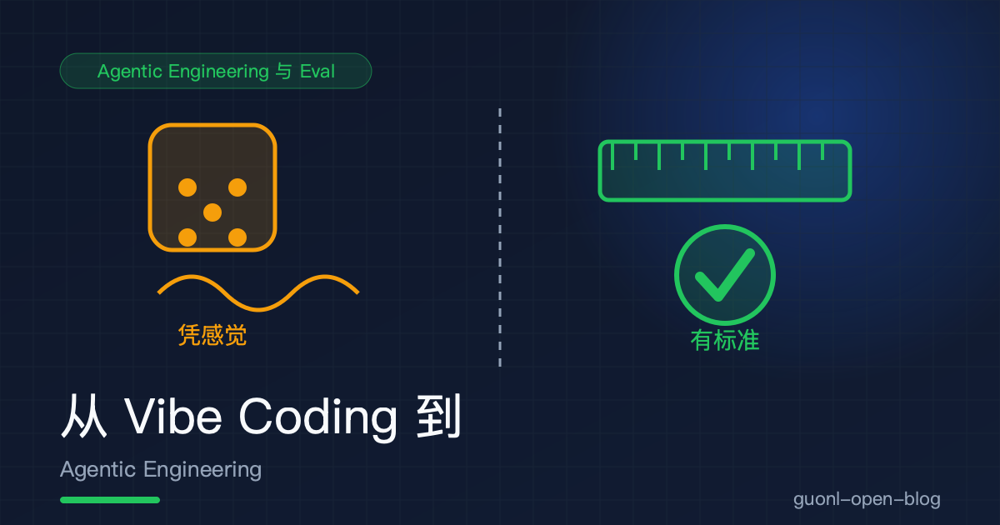
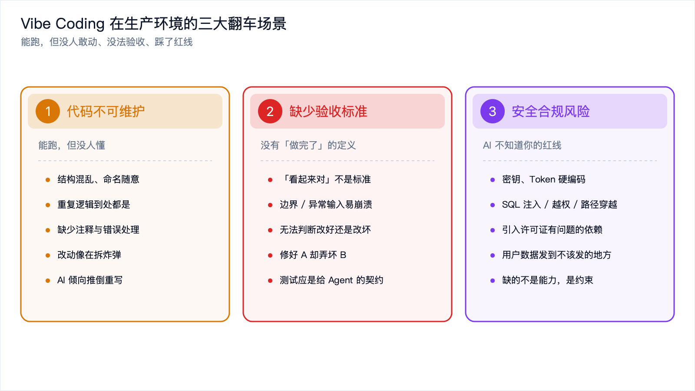
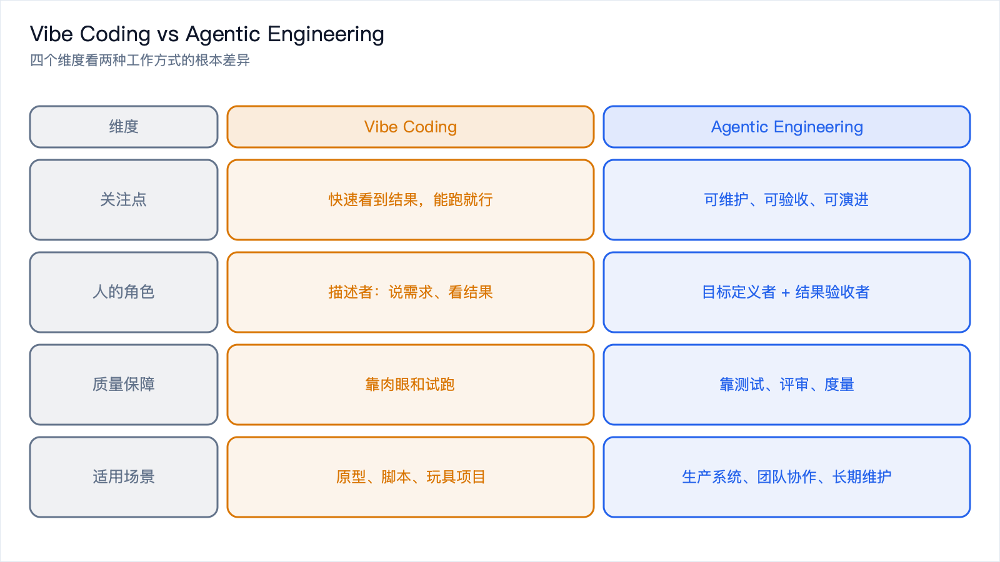
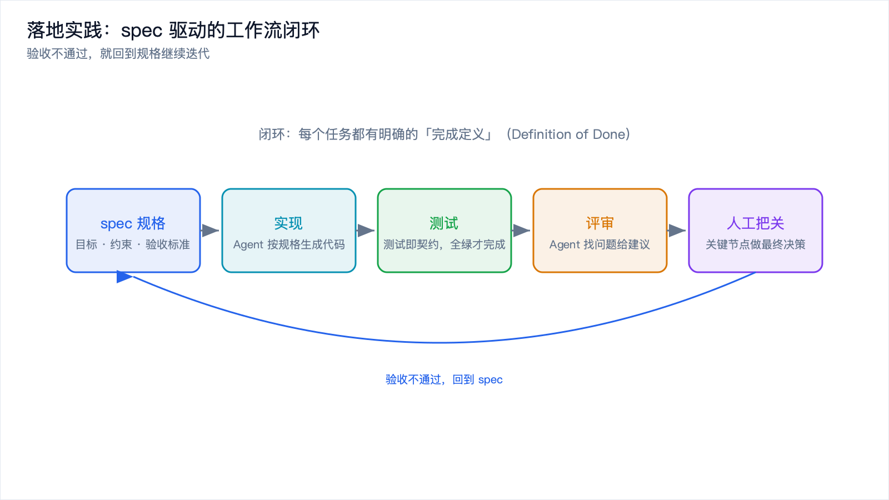
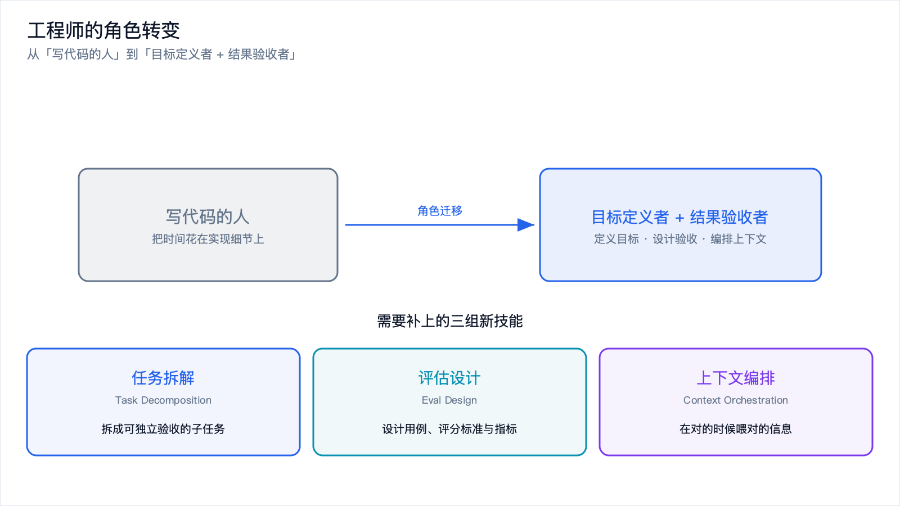

# 从 Vibe Coding 到 Agentic Engineering



*2026-10-27 · Agentic Engineering 与 Eval*

## 那个周五下午的"惊喜"

2024 年前后，"Vibe Coding"（氛围编程）这个词火了起来。它描述的开发方式确实爽：打开 AI 编辑器，用自然语言说清楚你想要什么，AI 哗啦啦吐出一大段代码，你跑一下，能用就接着往下写，不能用就再描述一遍。整个过程你几乎不看代码细节，只跟着感觉走。

这种方式在 2024 到 2025 年解决了两个真问题，起步门槛和验证速度。不会写前端的人，可以让 AI 在十分钟里搭出一个能看的页面；想验证产品想法的人，可以让 AI 在一天内做出可点击的原型。说它是生产力解放并不夸张。

转折出现在 2026 年。大量团队把 Vibe Coding 生成的原型往生产环境推的时候翻车了。JetBrains 在 2026 年那份 AI 编程智能体采纳率调研里有个挺耐人寻味的结论：智能体的采纳率和留存率之间存在明显落差。用了 AI 写代码的团队很多，但真正让 AI 参与生产流程、并且长期稳定跑下去的团队，比例低得多。落差的那部分，就是被 Vibe Coding 的"爽"盖住的工程债。

新的词于是接过了接力棒，Agentic Engineering，智能体工程。下面把三件事讲清楚：Vibe Coding 到底解决了什么，它在生产环境为什么翻车，以及 Agentic Engineering 是什么、怎么落地。

## Vibe Coding 真正解决了什么

批评之前先把价值说清楚，不然容易变成老工程师看不上新工具的偏见。

Vibe Coding 的本质是把"表达意图"和"实现细节"解耦。传统开发里，你脑子里想的是"我要一个能筛选的列表"，落到键盘上却得先想清楚用什么框架、数据结构怎么定义、事件怎么绑定、边界怎么处理。中间这一大段翻译成本，Vibe Coding 交给大模型承担了。

它真正解决的三件事：

- 降低起步门槛。不用先把整个技术栈学一遍，才能做出第一个能跑的东西。
- 快速验证想法。产品经理、设计师，甚至非技术背景的人，都能把想法直接变成可交互的原型。
- 探索未知领域。碰到一个你完全不熟的技术，比如某个小众图表库，让 AI 先给一版能跑的代码，比从头读文档快得多。

这些价值是真实的。所以正确的态度不是抛弃 Vibe Coding，而是分清它适合什么场景。原型、脚本、一次性工具、个人玩具项目，它依然是效率神器。可一旦进入要长期维护、要被别人接手、要承担线上责任的生产级软件，就得换到 Agentic Engineering。

## 生产环境里的三个翻车场景



*图 1：三大翻车场景，能跑，但没人敢动、没法验收、踩了红线。*

下面三个场景，几乎每个把 AI 生成代码推上生产的团队都踩过至少一个。

### 代码不可维护

典型的产出是这样的：功能能跑，但结构混乱、命名随意、重复逻辑到处都是、没注释、错误处理敷衍。根子在于 AI 是按当前这个需求生成代码的，它不关心你未来的需求。

三个月后你要加一个新功能，问题就来了。你不敢改这段代码，因为你不知道动哪里会不会连带弄坏别的地方。让 AI 来改，它又得把整段代码重读一遍，而它读到的是一团没有结构的逻辑，于是倾向于推倒重写，结果引入新 bug。这就是维护性债务：代码能跑，但每次改动都像拆炸弹。

判断一段 AI 生成的代码是否可维护，有个很省事的测试：你能不能在不运行的情况下，通过阅读代码说出它的数据流？说不出来，这段代码就处在不可维护的状态。

### 没有"做完了"的定义

Vibe Coding 的工作循环是生成、跑一下、看起来对、继续。这里藏着一个致命问题："看起来对"不是验收标准。AI 生成的代码经常能通过你随手试的那两个输入，但在边界情况、异常输入、并发场景下直接崩。

更麻烦的是，没有测试时你没法回答"这次改动让系统变好了还是变坏了"。只能凭感觉。而感觉在复杂系统里极不可靠，修好了 A 场景，弄坏了 B 场景，你甚至不会立刻发现，直到线上出问题。

测试在这里的角色变了。它不只是质量保障，更是给 Agent 的验收契约，这一点后面还会展开。

### AI 不知道你的红线在哪

这类风险最容易被低估，代价却最高。AI 生成代码时优化的是功能正确，不是符合你的安全与合规要求。它可能：

- 把密钥、Token 硬编码进代码；
- 写出存在 SQL 注入、路径穿越、越权访问的代码；
- 引入一个许可证有问题的依赖；
- 把用户数据发到一个不该发的地方。

个人玩具项目无所谓。要过合规审查、要处理用户隐私的生产系统，任何一条都是事故。Vibe Coding 缺的不是能力，是约束。它不知道你的红线画在哪里，因为你从来没告诉过它。

## Agentic Engineering 是什么

我给它的定义是：

> Agentic Engineering 是一种以目标为驱动、以验收为闭环、以度量为基础的 AI 编程方式。它把 AI 从"帮你打字的工具"升级为"承担明确任务的协作者"，同时由工程师定义目标、约束与验收标准。

三个关键词拆开看。

以目标为驱动。你给 Agent 的不是"帮我写个函数"，而是"实现这个功能，满足这些约束，通过这些测试"。目标越清晰，输出越可控。

以验收为闭环。每个任务都有明确的完成定义（Definition of Done）。验收通过，任务才算完成；不通过，Agent 继续迭代。闭环让"完成"从主观感受变成客观判断。

以度量为基础。Agent 写得好不好、这次改动是变好还是变坏，要用数据说话。这就是 Eval，也是本专题下一篇的主题，见 [Eval：怎么知道你的 Agent 变好了](./agent-eval.md)。

打个比方。Vibe Coding 像请一个很聪明、但没看过你项目规范的临时工，你说个大概他就开干。Agentic Engineering 像带一个正式员工：你先给他写清需求文档（spec），告诉他验收标准（测试），定好代码规范（约束），他干活，你验收。

### 从"生成代码"到"编排协作"

2026 年另一个明显的趋势是，提示词工程（Prompt Engineering）退居二线，编排工程（Orchestration）、记忆工程（Memory）、工具工程（Tool）接过接力棒。

原因是当 Agent 辅助开发成为默认工作方式之后，核心问题不再是"怎么把一句话问好"，而是"怎么让多个 Agent 协作完成一件复杂的事"。关注点从怎么问转向怎么协作。一条典型的协作流水线大概是这样：

1. 需求拆解 Agent，把一个大需求拆成若干可独立验收的子任务；
2. 代码生成 Agent，逐个实现子任务，每个任务带自己的测试；
3. 测试补充 Agent，检查测试覆盖，补边界用例；
4. 评审 Agent，按代码规范和安全规则审查，给出修改意见；
5. 工程师，定义目标、设定约束、做最终验收和关键决策。

最后一条要划重点：人的角色没有被取消，只是被重新定位了。

## 两种方式放在一起对比



*图 2：从关注点、人的角色、质量保障、适用场景四个维度对比两种工作方式。*

下面这张表建议收藏，它回答的是"什么时候该用哪种方式"。

| 维度 | Vibe Coding | Agentic Engineering |
| --- | --- | --- |
| 关注点 | 快速看到结果，"能跑就行" | 可维护、可验收、可演进 |
| 驱动方式 | 感觉驱动，边写边调 | 目标驱动，先定义后实现 |
| 人的角色 | 描述者（说需求、看结果） | 目标定义者 + 结果验收者 |
| 质量保障 | 靠肉眼和试跑 | 靠测试、评审、度量 |
| 上下文管理 | 临时对话，聊完即弃 | 规格文档、记忆系统、可复用上下文 |
| 验收标准 | 主观（"看起来对"） | 客观（测试即契约、Eval 指标） |
| 安全合规 | 基本不考虑 | 显式约束 + 自动化检查 |
| 适合场景 | 原型、脚本、玩具项目 | 生产系统、团队协作、长期维护 |
| 失败代价 | 低（大不了重做） | 高（线上事故、技术债） |
| 迭代方式 | 推倒重来 | 小步验证，回归测试保护 |

一句话总结这张表：Vibe Coding 优化的是从零到能跑的速度，Agentic Engineering 优化的是从能跑到长期可靠的成本。

## 落地：四个可以直接用的做法



*图 3：spec → 实现 → 测试 → 评审 → 人工把关，验收不通过则回到 spec 迭代。*

理念讲完，得落到具体动作上。

### 用规格（spec）驱动 Agent

别给 Agent 一句模糊的指令，给它一份结构化的规格。规格是你和 Agent 之间的合同。一份好用的任务规格大致长这样：

```markdown
# 任务：为文章列表增加按标签筛选

## 目标
在文章列表页顶部增加标签筛选器，点击标签后只显示该标签下的文章。

## 输入 / 输出
- 输入：标签名（字符串），来自 URL query 参数 `?tag=xxx`
- 输出：过滤后的文章列表；无匹配时显示空状态提示

## 约束
- 复用现有的 `filterArticles(list, predicate)` 工具函数，不要新写过滤逻辑
- 不引入新依赖
- 保持现有组件风格，使用项目已有的 `Tag` 组件
- 筛选状态需要反映到 URL，支持刷新后保持

## 验收标准（必须全部通过）
1. 给定 3 篇文章、2 个不同标签，点击某标签后只显示匹配文章
2. URL 参数变化后刷新页面，筛选状态保持
3. 无匹配标签时显示"没有相关文章"空状态
4. 单元测试覆盖上述 3 条，且全部通过

## 交付物
- 修改后的组件代码
- 新增/修改的测试文件
- 一段说明改动点的简短描述
```

这份模板的关键在于，目标、约束、验收标准三件事都写死了。Agent 不用猜，你也知道怎么验收。

### 测试即契约

这是 Agentic Engineering 里最重要的一条实践：把测试当作你和 Agent 之间的契约。

流程是：

1. 你先（或让一个 Agent）把验收测试写好；
2. 把测试和规格一起交给实现 Agent；
3. Agent 的目标变成"让这些测试全绿"；
4. 测试全绿之前，任务不算完成。

好处在于验收标准从人肉判断变成了机器判断。Agent 可以自己反复迭代，因为它有一个客观信号（测试结果）告诉它离目标还有多远。人只需要在最后看一眼测试有没有覆盖真正重要的场景。

```python
# 验收测试即契约：Agent 的实现必须让这些测试全绿
def test_filter_by_tag_returns_only_matching():
    """点击标签后只返回匹配的文章（对应验收标准 1）"""
    articles = [
        {"title": "A", "tags": ["rust"]},
        {"title": "B", "tags": ["python"]},
        {"title": "C", "tags": ["rust", "python"]},
    ]
    result = filter_articles_by_tag(articles, "rust")   # 待实现的目标函数
    assert [a["title"] for a in result] == ["A", "C"]   # 断言即验收标准

def test_empty_state_when_no_match():
    """无匹配时返回空列表（对应验收标准 3）"""
    articles = [{"title": "A", "tags": ["rust"]}]
    result = filter_articles_by_tag(articles, "golang")
    assert result == []
```

### 让 Agent 参与代码评审

不要只让 Agent 写代码，也让它审代码。一个专门的评审 Agent 可以配置成"找问题"模式，关注这些点：

- 是否违反项目约定，包括命名、目录结构、错误处理风格；
- 是否存在安全隐患，硬编码密钥、注入风险、越权；
- 是否有未被测试覆盖的分支；
- 是否引入了不必要的新依赖或重复逻辑。

评审 Agent 的价值不在于它能发现所有问题，而在于它不知疲倦、标准统一。人评审容易因为疲劳或者赶进度放水，Agent 不会。当然它会有误报，所以输出是建议清单，采纳哪些最终由人决定。

### 人工把关的节点

Agentic Engineering 不是全自动，而是把人的精力从"写"转移到"决策"。下面几个节点人应该介入：

- 目标定义。需求拆解得对不对、边界划得清不清，这决定成败；
- 约束设定。安全红线、技术选型、兼容性要求；
- 验收标准的评审。测试是否覆盖了真正重要的场景，Agent 容易只测 happy path；
- 高风险改动的最终确认。涉及数据、支付、权限的改动，人必须看。

记住一句话：Agent 可以承担 90% 的工作量，但 100% 的责任依然在人身上。

## 工程师的角色会怎么变



*图 4：从「写代码的人」到「目标定义者 + 结果验收者」，需补上任务拆解、评估设计、上下文编排三组新技能。*

这是很多人最关心的问题：Agentic Engineering 会不会让工程师失业？我的判断是不会失业，但会重新分层。会写代码但不会定义目标、不会设计验收标准的工程师，价值会被压缩；能拆解复杂任务、能设计评估体系、能编排上下文的工程师，价值会被放大。

要完成这个转变，需要三组新技能。

任务拆解（Task Decomposition）是最核心的一项。把一个模糊的大需求，拆成一组可独立验收、边界清晰、依赖明确的子任务。拆得不好，Agent 会在错误的方向上高效地跑偏。判断标准很简单：每个子任务都应该能回答"怎么算做完了"。

评估设计（Eval Design）。能为一类任务设计出合理的评估方式，用哪些测试用例、用什么评分标准、关注哪些指标（准确率、成本、延迟）。这也是 2026 年最稀缺的技能之一，详见 [Eval：怎么知道你的 Agent 变好了](./agent-eval.md)。

上下文编排（Context Orchestration）。知道在什么时候、给 Agent 喂什么信息。Agent 的表现高度依赖上下文，喂对了事半功倍，喂错了它一本正经地跑偏。上下文工程已经成为一个独立方向，可参考 [提示词工程不够用了：Context Engineering 入门](../context-engineering/context-engineering-intro.md)。

还有一项软技能越来越重要，验收的品味。你得知道什么是真正的好，因为 Agent 只优化你告诉它的目标，目标之外的质量，可读性、优雅、长期可维护性，得靠人把关。

## 回到最初的问题

Vibe Coding 错了吗？没有。它非常适合原型、脚本和玩具项目，降低了起步门槛，加速了想法验证，这些价值是真实的。

问题出在把 Vibe Coding 的方式直接套到生产级软件上。生产软件需要长期维护、需要别人接手、需要承担线上责任，这些要求它天然不满足：不关心可维护性，不定义验收标准，不考虑安全合规。

Agentic Engineering 不是对 Vibe Coding 的否定，而是它的生产级升级版。它保留了用自然语言驱动 AI 的效率，同时补上三样 Vibe Coding 缺失的东西：清晰的目标、客观的验收、持续的度量。

落地时记住四件事就行：用规格驱动 Agent，用测试当验收契约，让 Agent 参与评审，在关键节点人工把关。而工程师自己的角色，会从写代码的人变成目标定义者和结果验收者，需要补上任务拆解、评估设计、上下文编排这三组技能。

下一篇深入 Agentic Engineering 里最关键、也最容易做错的一环，评估（Eval）：怎么用数据而不是感觉，判断你的 Agent 到底变好了还是变坏了。
