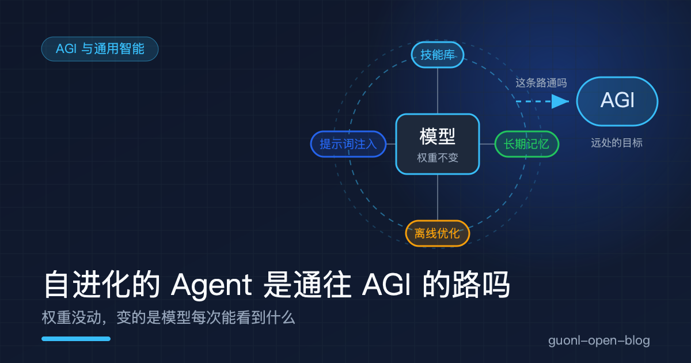
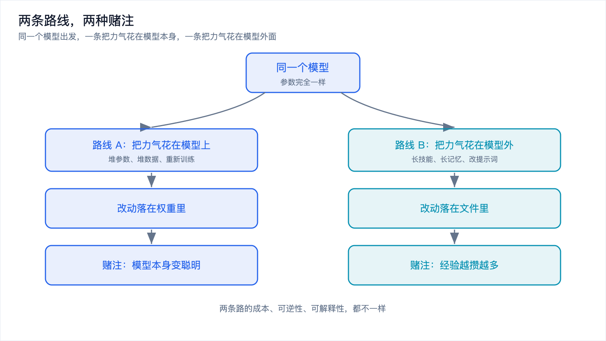
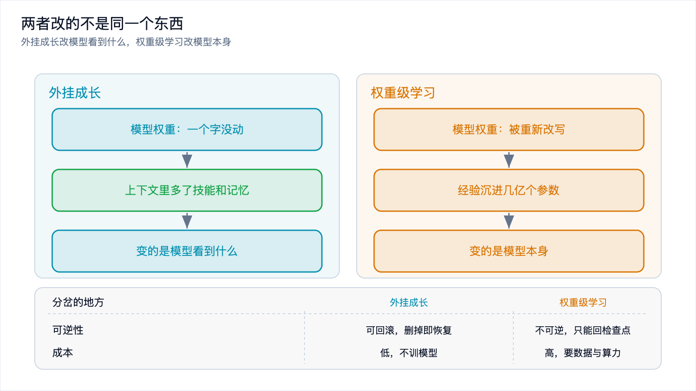
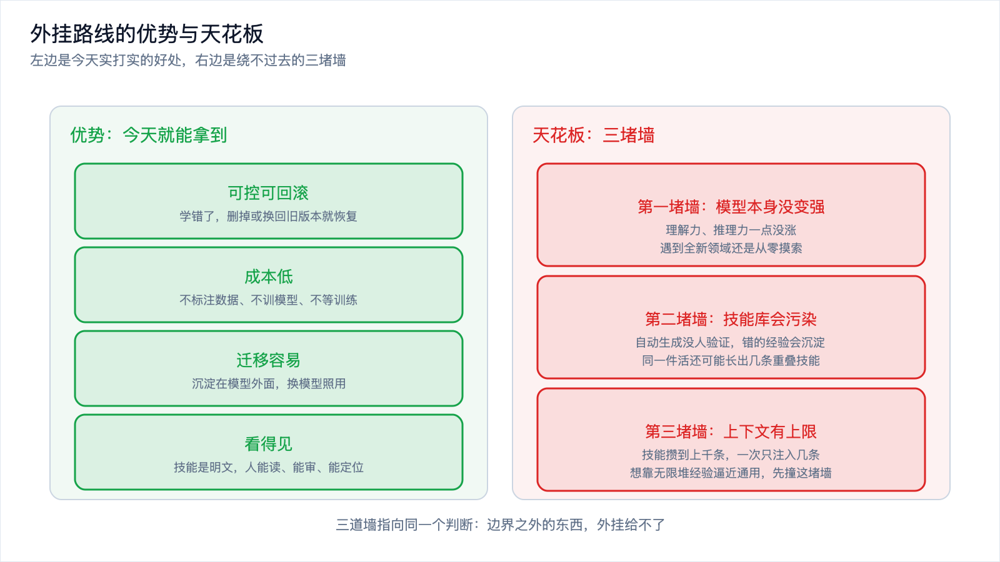
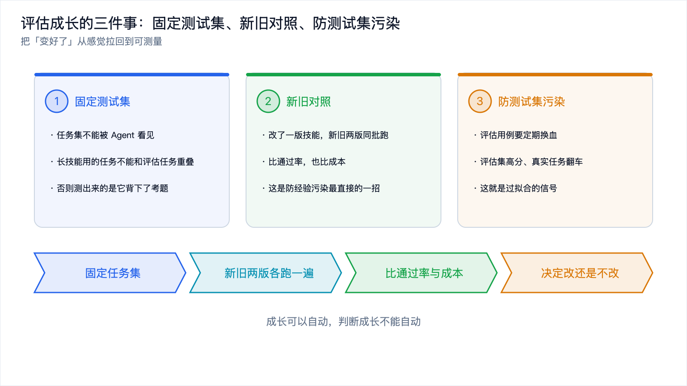

# 自进化的 Agent 是通往 AGI 的路吗

*2026-11-10 · AGI 与通用智能*

## 从一句宣传语说起

据公开报道，有云厂商在宣传自家 Agent 产品时，把「自进化能力」说成是「更接近通用人工智能」。这大概率是营销口径，但它戳到的位置很准：它把两个本来分开讨论的东西绑在了一起，一边是会自己长技能的 Agent，一边是那个还没定义清楚的目标 AGI。

多数人的反应走两个极端，一种直接买单，一种直接翻白眼，觉得把技能文件存本地也叫进化。两种反应都太快了。这个说法里藏着一个真问题：如果一个系统能持续从经验里改进，它和通用智能之间到底还差什么？

这是「AGI 与通用智能」专题的第二篇。上一篇 [《AGI 到底是什么》](what-is-agi.md) 把这个概念本身掰开过，这一篇接着问一个更尖的问题：自进化这条路，通不通向它。

## 有一派认为，缺的不是参数

AGI 没有公认定义，常见的几类说法上一篇列过，其中「通用学习式」这一派最值得拎出来，因为自进化 Agent 正好撞在这条线上。

这一派的主张可以概括成一句话：智能的关键不在于你现在会多少，而在于你面对一个没见过的任务，能不能用很少的样本学会它。一个系统哪怕能力清单很长，只要学不会新东西、每换一个领域都得重训，就不算通用；反过来，一个今天看起来笨、但能持续学习和自我改进的系统，反倒走在通往通用的路上。

顺着这个逻辑推下去：通往 AGI 缺的不是参数，而是几样「活着」的能力，持续学习、长期记忆、从经验里自我改进。自进化 Agent 恰好把这三样都挂在嘴上，技能库对应自我改进，长期记忆对应记忆，任务后复盘对应持续学习。宣传语说它「更接近通用智能」，逻辑起点就在这里。

问题出在这套推理的下一步：它有这些能力，等于它真的有这些能力吗？名字对上，不等于机制对上。

*图 1：一条路把力气花在模型本身，一条路把力气花在模型外面，两条路的赌注不一样。*

## 拆开「自进化」：它到底动了什么

前面 [《Agent 怎么从经验里长出技能》](../harness-agent/self-evolving-skills.md) 已经把这套机制拆得很细，这里只取结论：自进化 Agent 干的是四件事，技能库、长期记忆、提示词注入、离线优化。

任务做完，它复盘执行轨迹，把解法写成一份结构化的技能文件存进本地目录，这是技能库。跨会话记住的事实和偏好单独存一层，这是长期记忆。下次遇到同类任务，把命中的技能和记忆检索出来塞进提示词，让模型照着做，这是提示词注入。技能还会被拿去和旧版本对比、打分、迭代，用一批任务当测试集筛出更好的版本，这是离线优化。四件事连起来，效果确实像「成长」，同一个 Agent 用得越久，能调用的技能越多，处理同类任务越顺。

只要多问一句「模型权重动了吗」，性质就变了。这四个动作里，没有任何一个改动了模型本身，参数一个没变，变的是它每次生成时能看到什么：以前看不到「这类任务该这么做」，现在看得到了。这就是关键判断：这不是真正的在线学习，而是工程层的外挂，成长发生在模型外面那一圈，不在模型里面。

*图 2：两者改的是两个不同的东西，可逆性和可解释性也跟着分岔。*

## 外挂成长和权重级学习，差在哪

最根本的一条：外挂改的是模型能看到什么，权重级学习改的是模型本身。前者的成长停在提示词里，后者把经验写进了参数。

可逆性和可解释性。外挂成长可回滚、可审计，一条技能学错了，删掉或换成旧版本就恢复，技能本身就是一份人能读的 Markdown；权重级学习两样都缺，一次糟糕的微调把模型带偏，只能拿更早的检查点重来，经验沉在几亿几十亿个参数里，没法定位。迁移性和成本。外挂成长跟着文件走，换个模型照用，而且几乎不花钱，它连模型都不训，一次迭代的成本据公开报道可能只有几美元量级，这个数字是厂商或专家口径，只能当方向参考；权重级学习的成果长在权重里，换模型就得重新训，成本高好几个台阶。

| 维度 | 外挂成长 | 权重级学习 |
| --- | --- | --- |
| 改的是什么 | 模型看到什么 | 模型本身 |
| 载体 | 技能文件、记忆条目 | 模型参数 |
| 可逆性 | 可回滚，删掉即恢复 | 不可逆，只能回检查点 |
| 可解释性 | 人能读、能审计 | 沉在参数里，难定位 |
| 迁移性 | 跟着文件走 | 绑在权重上，换模型即失效 |
| 成本 | 低，不训模型 | 高，要数据与算力 |

这张表右边那一列，才是「学习」这个词通常的意思，左边这一列是「外挂」。

有句话被广泛引用，大意是「所有问题都是上下文长度问题」，出自月之暗面的创始人，这是一个人的观点，不是定论，但它点出了外挂路线的内核：与其改模型，不如把该知道的东西塞进它看得见的上下文里。

## 外挂路线的优势：为什么它可能是更务实的选择

「外挂」听起来像个贬义词，这个印象要纠正过来，在今天的工程现实里，外挂路线有一串实打实的好处。

可控，而且可回滚。技能和记忆都是明文资产，你能看到它学了什么，随时能改，出错时一键退回上一个可用版本，等于给「自动」装了个安全阀。权重级学习是个黑箱，模型学偏了你只能在行为上观察到，改起来无从下手，也没有这个阀。对要上生产的系统，可控往往比「学得更深」更重要。

成本低，不依赖重训。不用标注数据，不用 GPU 集群，不用等训练。模型是通用件，今天用 A 明天换 B，外挂沉淀在模型外面，换模型时那份积累不用推倒重来。外挂路线不是在「真正的学习」面前偷懒，它是把「让今天的模型更好用」这件事，用低风险、低成本、可审计的方式做到了。

## 外挂路线的天花板

优势讲够了，得把天花板也讲清楚，否则又滑回「它就能通向 AGI」那一边。

第一道墙：模型本身不会因为经验变强。外挂成长让模型在「见过的事」上表现更好，但它的理解力、推理力、举一反三的能力一点没涨。遇到技能库里没有、记忆里也没覆盖的全新领域，它还是那个它，还得从零摸索。外挂能把经验喂给它，喂不出它本身变聪明。

第二道墙：技能库会污染、会冗余。技能是自动生成的，没有对照实验和回放验证，完全可能是错的。有第三方评测称，智能体自动化知识积累的成功率只有大约六成，一段经验存不存，几乎全凭模型主观判断。错误一旦沉淀成技能，后续任务反复引用，越用越离谱。自动生成也很难保证粒度一致，同一个活可能长出三条彼此重叠的技能。

第三道墙：上下文容量有限。外挂的成长方式是把技能和记忆塞进提示词，而提示词是有上限的。技能攒到几百上千条，一次能注入的就那么几条，剩下的要么被挤掉，要么互相干扰，想靠无限堆经验逼近通用，先撞上的就是这堵墙。三道墙指向同一个判断：外挂成长有明确的边界，边界之外的东西它给不了。

*图 3：左边是外挂路线今天实打实的优势，右边是它绕不过去的三堵墙。*

## 那它到底是不是通往 AGI 的路

把优势和天花板都摆完，回到标题的问题，可以给一个分层的答案，而不是一句「是」或「不是」。

它是「让今天的模型更好用」的路。这一层它站得很稳。在模型能力趋同、领先往往只维持几个月的当下，把力气花在模型外面那一圈，是投入产出比最高的做法。

它也可能是「AGI 若真会来、很可能需要的一环」。如果 AGI 真的会实现，一个能持续学习、能从经验里改进的系统几乎是必要条件，冻结的模型不可能通用。自进化 Agent 摸到了正确的方向，它承认学习和记忆是智能的一部分，而不是只盯着模型有多大。

但它本身不等于 AGI，也不能替代模型能力的跃迁，原因就是那三道墙。它改的是模型看到什么，不是模型是什么；它能让经验不断累积，不能让理解力自己长出来。一个技能库攒到几万条、记忆分了几十层的 Agent，底子还是那个没变过的模型。所以这句话对了一半：宣传语把「有类似学习的行为」和「有学习的能力」混为一谈，这一步跳跃，是它经不起推敲的地方。更接近事实的说法也许是，自进化 Agent 是通往 AGI 这条路上工程界今天能踏实踩下的一块石头，它是路的一部分，不是路的终点。

## 一个绕不开的难点：怎么知道它真的变好了

一个「会成长」的 Agent，你怎么判断它到底有没有变好？这件事比看起来难，原因有三个。

成长是渐进的，它一天好一点，没有明确的台阶，你很难指出「就是这次改动让它变强了」。技能是自动生成的，没人写、没人审，它什么时候多了条技能、那条技能对不对，你不主动去查根本不知道。好坏标准会漂移，今天「好」的定义，到下个月任务分布变了，可能就不作数了。三个因素叠在一起，「变好了」这件事本身变得难以度量。

这和第 5 篇 [《Eval：怎么知道你的 Agent 变好了》](../agentic-engineering/agent-eval.md) 是同一个问题的两面：那篇讲改动前后怎么比，这里要补的是自进化特有的麻烦，评估的对象和标准都在变。给几条可操作的建议，都能从评估那套老办法里借来。

固定一套测试集，且它不能被 Agent 看见，它自己长技能时用的任务不能和评估用的任务重叠，否则测出来的是「它背下了考题」。新旧对照，而不是只看当前成绩，改了一版技能，把新旧两版在同一批任务上各跑一遍，比通过率和成本，这也是防经验污染最直接的一招。防止测试集污染，评估用例要定期换血，如果发现它在评估集上分数很高、在真实任务上却频繁翻车，那就是过拟合的信号。

*图 4：固定测试集、新旧对照、防污染，把成长从感觉拉回到可测量。*

## 把这一批六篇串起来

到这篇为止，「养虾 / 养马 与 AGI」这批六篇走完了。起点是两个开源 Agent 的对照，[《养虾还是养马》](../harness-agent/openclaw-vs-hermes.md) 问的是同一个模型，为什么换个壳子就是两种命运。答案在第二篇 [《Harness》](../harness-agent/agent-harness.md) 里：决定 Agent 好不好用的，是模型外面那一圈，工具、上下文、记忆、反思、护栏。第三篇 [《自进化的原理与代价》](../harness-agent/self-evolving-skills.md) 把那圈里最特别的反思循环单独拎出来，讲它怎么让 Agent 从经验里长出技能，又为什么会带来经验污染。第四篇 [《动手：加一个自进化技能库》](../harness-agent/hands-on-skill-library.md) 把这条闭环用代码搭了一遍。视角也就此从「怎么让 Agent 更好用」，抬到了「通用智能到底是什么」。

第五篇 [《AGI 到底是什么》](what-is-agi.md) 先把这个没有公认定义的目标掰开，第六篇，也就是这篇，把它和自进化 Agent 接上。串起来的结论是：harness 决定今天能走多远，自进化技能决定它能不能越走越远，而 AGI 是一个比这两者都远的目标。自进化是通往 AGI 路上的一块石头，踩得住，但别把它当成终点。这条路最后通向哪里，[《从「对话」到「行动」：AI Agent 到底是什么》](../ai-agent/from-chat-to-action.md) 那个起点上提出的问题，到今天依然没有确定的答案。能确定的只是：把模型外面那一圈打磨好，是无论 AGI 来不来都不亏的事。

## 写在最后

回到开头那句宣传语。把自进化能力说成「更接近通用人工智能」，对了一半，也错了一半。对的一半是，它承认了持续学习和记忆是智能的一部分；错的一半是，它把「有类似学习的行为」偷换成了「有学习的能力」。模型权重没动，外挂再厚，壳里那颗核也没变。

这不意味着外挂路线就不值得做。恰恰相反，它可控、可回滚、成本低、不依赖重训，是今天最务实的工程选择，它的价值不在于能不能通向 AGI，而在于它让今天的模型立刻就能多干很多事。真正需要留心的，是别被「成长」这个词骗过去：一个会自己长技能的 Agent 到底有没有变好，需要认真度量，固定测试集、新旧对照、防止污染，这些老办法一个都不能省。成长可以自动，判断成长不能自动。

AGI 会不会来、什么时候来，没人说得准，历史预测几乎全错。能确定的是，无论它来不来，把 Agent 外面那一圈做好，让它在可控的边界里持续变好，都是一件当下就值得做的事。
