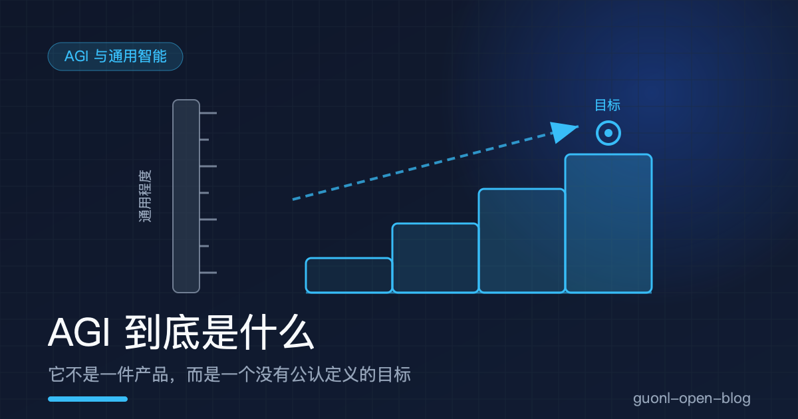
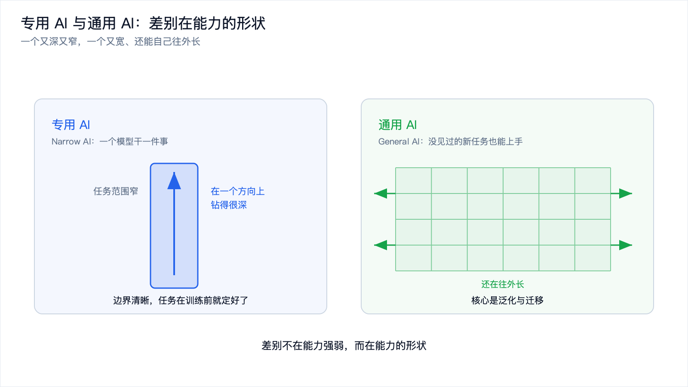
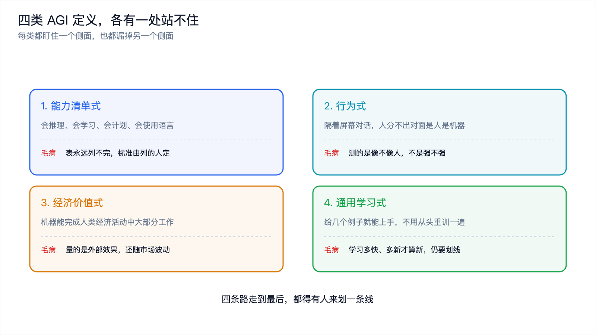
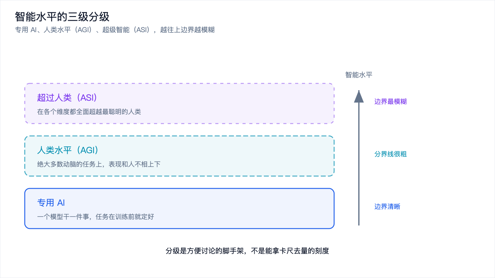
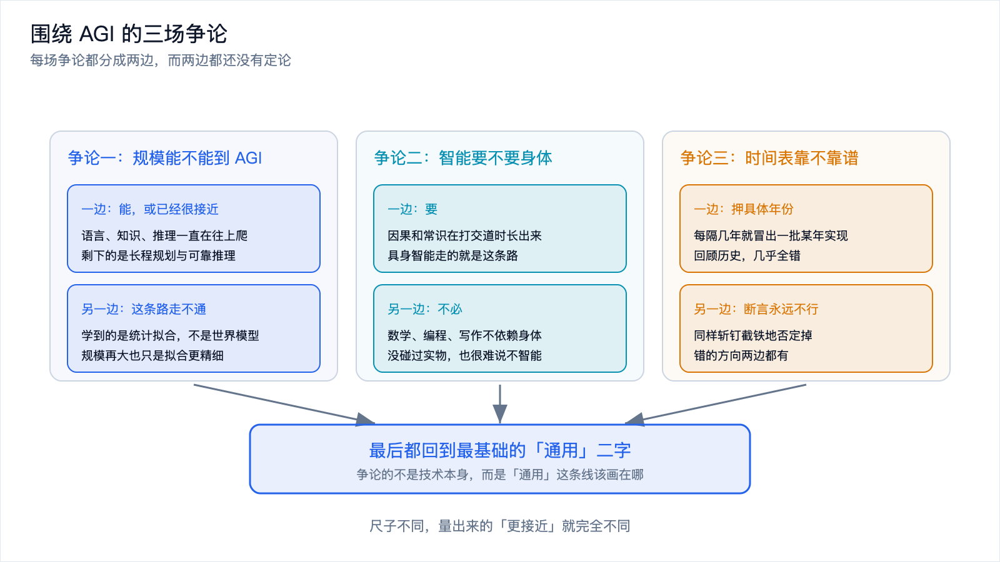

# AGI 到底是什么：一个没有公认定义的目标

*2026-11-10 · AGI 与通用智能*

## 一句宣传语引出的问题

2026 年这波 Agent 热潮里，「更接近 AGI」是个高频说法。据公开报道，有云厂商在宣传稿里就用过这个口径，说自己的智能体产品又向 AGI 迈进了一步。

这句话听着提气，但它其实没法验证。想判断它成不成立，得先回答一个更基础的问题：AGI 到底指什么？如果连它指的是什么都说不清，「更接近」就没有刻度，往前走一步还是退后一步，谁也量不出来。

这一篇只干一件事：把 AGI 这个概念拆开，讲清它为什么至今没有公认定义，以及围绕它的争论到底在争什么。它不聊末日，也不画大饼，只想把这个被说得最响、却最含糊的词，放到桌面上看清楚。

## AGI 是什么：一个目标，不是一项技术

AGI 是 Artificial General Intelligence 的缩写，中文叫通用人工智能。

它和我们平时说的「某个模型」「某项技术」不是一回事。它更像一个目标，或者说一把标准：我们希望机器最终能达到的那个状态。既然是目标，它天生就是可以争论的，因为目标是人定的，标准也是人定的。

要和它对照，先看我们现在有什么。今天的 AI，绝大多数是专用 AI（Narrow AI）：一个模型干一件事。翻译的只管翻译，人脸识别的只管识别，推荐算法只管猜你想看什么。它们能力很强，但边界清晰，任务在训练之前就已经定义好了。你让一个识别猫狗的模型去下棋，它不会下得差，它压根不会下。

AGI 的设想正好相反。给它一个从没见过的任务，不用重新训练，它就能上手，还能把在别处学到的东西搬过来用。这里的关键词是泛化与迁移：不是「已经会多少」，而是「面对新的东西能不能学会」。

所以专用 AI 和通用 AI 的差别，不在能力强弱，而在能力的形状。专用 AI 是一条又深又窄的沟，通用 AI 想要的是一张又宽、又能自己往外延伸的网。

打个生活化的比方。专用 AI 像一台只会干一件事的家电，微波炉热饭又快又好，可你没法让它去洗衣服。通用 AI 想要的，是一个能自己看说明书、上手任何新家电的人：第一次见到的机器，摸索一会儿也能用起来。这两种东西的价值都不低，但它们是两个物种，不该拿同一把尺子去比。

*图 1：专用 AI 能力边界清晰、任务事先定义；通用 AI 的核心是泛化与迁移。*

## 为什么没有公认定义：四类说法，各有各的毛病

「通用人工智能」这几个字，每个人心里都有一幅图，可这些图彼此对不上。学界业界给过的定义大致能归成四类，每一类都有人用，每一类也都有它的漏洞。

### 能力清单式：给人类的能力打勾

最直觉的做法是列一张表：会推理、会学习、会计划、会使用语言、有创造力，机器把这些都打上勾，就算通用智能了。

问题是这张表永远列不完。智能包含多少种能力，本身就是个没有定论的问题。列到二十项，有人会问为什么不是五十项；列到五十项，总还能再补一项「幽默感」或者「共情」。表由谁来列，标准就由谁来定，换个作者就是另一张表。它看起来客观，其实是最主观的一种。

### 行为式：分不出人机就算数

图灵测试是这一类里最出名的。它的思路是：隔着屏幕对话，如果人分不出对面是人还是机器，那就可以认为机器具有智能。

这个标准好操作，也很有画面感，但它测的是「像不像人」，不是「强不强」。一个专门练过话术、把对话玩得滴水不漏的系统，能骗过测试，可它可能什么都不会干；反过来，一个能独立证明数学猜想、却不擅长闲聊的系统，会被判成不通过。用像不像人来定义智能，等于把表演当成了能力。

### 经济价值式：能替掉大部分工作

还有一类说法盯着产出：什么时候机器能完成人类经济活动中大部分的工作，什么时候就算 AGI 到了。

这个标准把技术问题和社会经济绑在了一起，可它量的是外部效果，不是内在能力。同样一套系统，在人工便宜的地方替代率就低，在人工贵的地方替代率就高，结论随市场波动。工作被替代，还牵扯政策、法律、行业结构，这些都不是「这个系统有多聪明」能回答的。用一个经济和社会的指标去定义技术能力，尺子的两头量的根本不是同一样东西。

### 通用学习式：能多快学会新东西

第四类把焦点从「已经会什么」挪到「能多快学会」。核心是少量样本就能掌握一个新任务：给几个例子、几句说明，它就能上手，而不是靠喂几千条数据从头训一遍。

这一类最接近研究者的本意。它把「通用」理解成一种学习的能力，而不是一份成绩单，避开了前几类「表列不完」「测的是表演」「混进社会因素」的坑。代价是它很难直接测：学习速度怎么量、新任务多新才算新，依然要人来划线。

把这四类摆在一起看，会发现它们有个共同的难处：不管走哪条路，最后都得有人来划一条线。能力列到哪一项算齐、对话像到什么程度算过、替代率到几成算达标、学习快到什么程度算通用，这些界都不是从技术里长出来的，而是人给的。给一个本来就没有自然边界的概念下定义，争的往往不是技术本身，而是这条线该画在哪。

*图 2：四类定义各盯一个侧面，也都各有一处站不住的地方。*

## 常见分级：从专用，到人类水平，再到超越人类

把「通用」当成一条轴，常见的分法是把智能水平切成几段。

最底下是专用 AI，就是现在满地的这类系统。往上一段是达到人类水平，也就是通常说的 AGI：在绝大多数需要动脑的任务上，表现和人不相上下。再往上一段是超过人类，有时被单独拎出来叫超级智能，缩写 ASI，Artificial Superintelligence，指的是在各个维度都全面超越最聪明的人类。

这套分级有用，它给了一个粗略的坐标系，让「更接近 AGI」这种话至少能落到某个位置上。但它的局限也很明显。那条「人类水平」的分界线画得极粗，人的能力本身就不均等，拿谁来当标尺都是一种选择；而从「人类水平」到「超级智能」之间，是不是只有两级、要不要再细分，同样没人能给出公认答案。分级是方便讨论的脚手架，不是能拿卡尺去量的刻度。

*图 3：专用 AI、人类水平（AGI）、超级智能（ASI）三级，越往上边界越模糊。*

## 围绕 AGI，到底在争什么

定义吵不出结果，争论就换了战场，转向几个更具体、也更难有答案的问题。

### 争论一：把模型继续放大，能不能到 AGI

一边认为能，或者至少已经很接近。理由是这类模型在语言、知识、推理上的表现这些年一直在往上爬，离人类水平不算远，剩下没解决的，是长程规划、可靠推理、和真实世界交互这几块。把这些补上，通用智能就成形了。

另一边认为这条路线本质上走不通。他们的理由是，这样训练出来的东西是统计拟合：它学到的是「在什么上下文里下一个词更可能出现」，而不是一个真正的世界模型，也没有因果理解。规模再大，也只是把拟合做得更精细，不会凭空长出理解。这两种立场对应的是完全不同的技术判断，短期内谁也说服不了谁。

### 争论二：智能要不要身体

一条线认为要。智能是在和物理世界打交道的过程中长出来的，没有身体，不去抓取、不去移动、不去承受后果，就学不会这个世界的因果和常识。这是具身智能的思路，本博客「具身智能」专题讲的正是这条路，想深入了解可以从[《具身智能是什么》](../embodied-ai/embodied-ai-intro.md)读起。

另一条线认为不必。数学、编程、写作、法律、研究，这些高度抽象的活动本来就不依赖身体。一个能证明定理、能写出可运行代码、能做出严密论证的系统，你很难说它不智能，可它从头到尾没碰过任何实物。身体对某些智能是必需的，对另一些，未必。

### 争论三：时间表靠不靠谱

每隔几年，就会冒出一批关于「某年就能实现 AGI」的预测，也会有一批同样斩钉截铁的「永远不可能」。回顾历史，这些预测几乎全错，错的方向还两边都有：有人把日期押得太早，也有人把可能性直接否定掉了。

原因不复杂。AGI 连定义都没有，时间表就更无从谈起：你连终点长什么样、怎么算到了都不知道，凭什么估到达的时间。所以听到任何年份，都只当它是说话人的一种判断，听听方向就好，别当成结论。

*图 4：规模路线、身体之争、时间表，三场争论最终都分叉在最基础的「通用」二字上。*

## 把 AGI 拉回现实：它是一把尺子

绕了一圈，可以把 AGI 放回它该在的位置。

它不是一个能买到的产品，也不是某天会突然降临的东西。它更像一把尺子，用来量「通用」这件事走到了哪一步。而围绕它的大部分争论，剥到底，争的都是同一件事：通用该怎么量。是看能力清单打了多少个勾，是看行为像不像人，是看能替代多少工作，还是看学新东西有多快。尺子不同，得出的「更接近」就完全不同。

这也是为什么「更接近 AGI」这类说法需要打折扣。它不是一句描述，而是一句判断，背后一定藏着某一把特定的尺子。据公开报道，那家云厂商的宣传口径，用的是自家产品在某些任务上的表现；换一把尺子，同一个产品可能离 AGI 更近，也可能更远。听懂一句话里的尺子是什么，比记住这句话本身有用得多。

## 写在最后

AGI 指的是通用人工智能，是一个目标或标准，不是一项具体技术。它至今没有公认定义，四类常见说法里，能力清单列不完、行为式测的是像不像人、经济价值式混进了社会因素，相对最贴近研究者本意的，是强调少量样本学会新任务的通用学习式。常见的分级是专用 AI、人类水平、超级智能三级，能当粗略的坐标系，但分界线画得很粗。

围绕它的三场争论，争的是规模能不能到、智能要不要身体、时间表靠不靠谱。这些问题都还没有定论。唯一清楚的是，AGI 是「通用」这个目标，不是已经存在的东西。真正值得关注的，不是某天它会不会来，而是「通用」这件事正在被怎么定义、怎么度量。

把尺子看清楚之后，接下来就该问：那些被说成「更接近 AGI」的东西，到底是哪一点变了。下一篇[《自进化的 Agent 是通往 AGI 的路吗》](is-self-evolving-agent-agi.md)，就来拆这个说法，看看一个会从经验里成长的 Agent，动的到底是模型本身，还是模型外面的那一圈。
