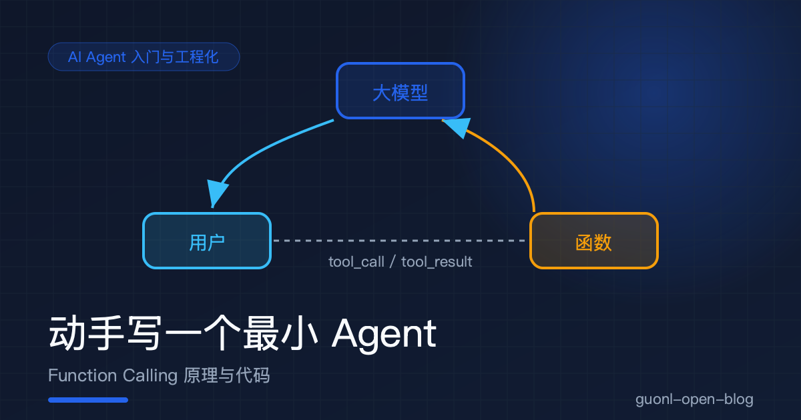
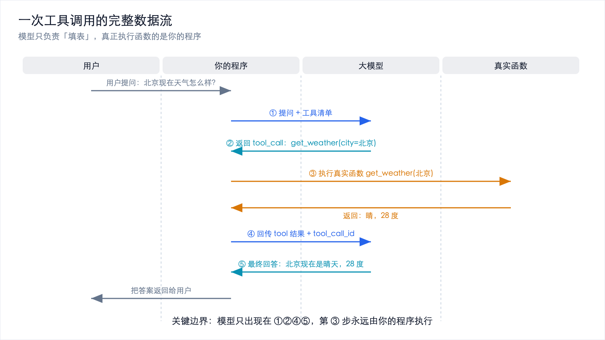
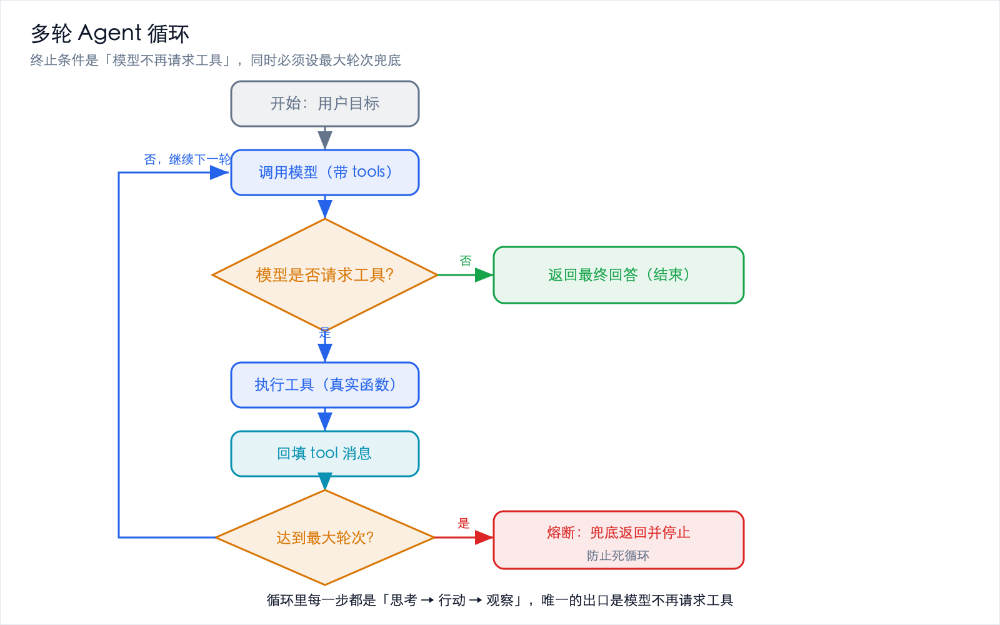
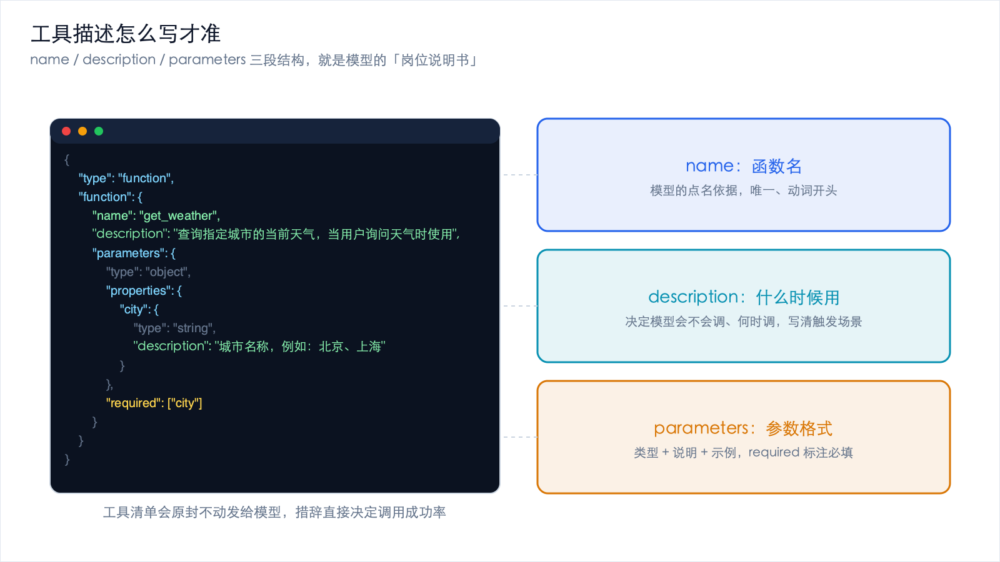
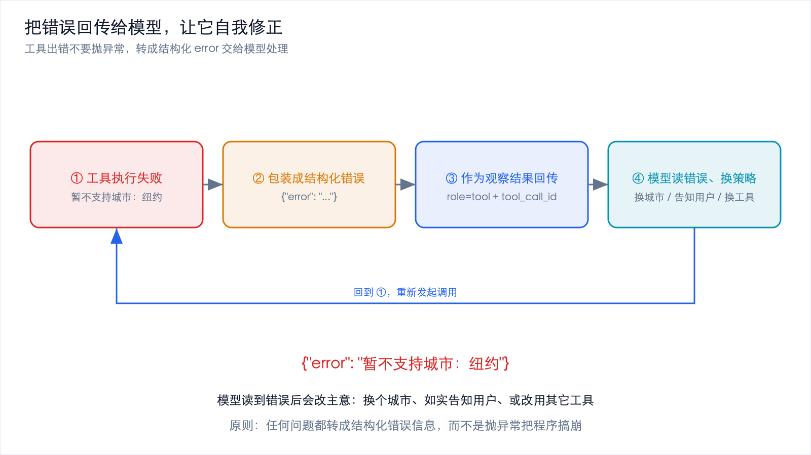

# 动手写一个最小 Agent：Function Calling 原理与代码



*2026-10-27 · AI Agent 入门与工程化*

## Agent 的基石，就一个接口

上一篇讲了 Agent 的四大件和它的 ReAct 循环，最后留了个悬念：那个"思考 → 行动 → 观察"的 `while` 循环，到底怎么写？

这一篇就来动手写。写之前先说清楚一件事：所有 Agent 框架，不管叫什么名字，最底下都依赖同一个东西，工具调用（Function Calling，也叫 Tool Use）。你理解了它，就等于拿到了打开所有 Agent 框架的钥匙。它不是什么深奥的技术，本质就是让模型按格式填一张申请表。

目标很朴素：让你亲手跑通一个最小 Agent。它不联网、不炫技，但能查天气、能做加法，而且代码你能完整看懂。看完之后，你再看任何 Agent 框架的源码，都会觉得亲切。

## 先破一个误解：模型不会真的"执行"函数

初学者最常见的误解是，以为 Function Calling 是模型在"调用函数"。

不是的。模型从头到尾都只做一件事：生成文本。

它不能读你的文件，不能发网络请求，不能连数据库，不能执行任何代码。Function Calling 的真相是：

> 模型根据你的提问，生成一段结构化的文本，这段文本的格式是"我想调用某个函数，参数填成这些值"。至于这个函数到底存不存在、参数合不合法、要不要真的执行，全都是你的程序说了算。

打个比方。模型就像一个坐在办公室里、看不到外面的顾问。你说"帮我看看外面冷不冷"，他没法亲自出去看，但他能写一张便签递给你："建议你去查一下天气，城市填『北京』。"注意，他只是写了这张便签，真正出门查天气的人是你。

这就是 Function Calling 的全貌：模型负责填表，你的程序负责办事。记住这个分工，后面所有代码都会变得理所当然。

## 一次工具调用的完整数据流



*图 1：用户提问到最终回答的五个步骤，第 ③ 步永远由你的程序执行*

把上一节那张便签的传递过程拆成五个明确的步骤。假设用户问："北京现在天气怎么样？"

1. 你发起请求：把你的问题，以及一张"可用工具清单"（比如"我这儿有个 `get_weather` 函数，需要 `city` 参数"），一起发给模型。
2. 模型返回 tool_call：模型读完清单，发现 `get_weather` 正好能用，于是返回一段结构化数据，大意是"请调用 `get_weather`，参数 `city='北京'`"。它不返回天气，因为它根本不知道。
3. 你的程序执行真实函数：你的代码看到这个请求，去调用真正的 `get_weather("北京")`，可能是查数据库、可能是发 HTTP 请求，反正是你的代码在干活。
4. 你把结果回传给模型：函数返回"晴，28 度"，你的程序把这句结果作为一个新消息追加到对话里，再发给模型。
5. 模型给出最终回答：模型看到"晴，28 度"，这次不再请求工具，而是直接输出自然语言："北京现在是晴天，气温 28 度。"

用一张图表示：

```text
  你的程序                                        模型
     │                                             │
     │ ① 用户问题 + 工具清单 ──────────────────────> │
     │                                             │  (模型决定填哪张表)
     │ <────────────── ② tool_call(函数名+参数) ──── │
     │                                             │
     │ ③ 执行真实函数 get_weather("北京")            │
     │      （查库 / 发请求，模型完全不参与）         │
     │                                             │
     │ ④ 工具结果 "晴, 28 度" ─────────────────────> │
     │                                             │  (模型组织语言)
     │ <────────────── ⑤ 最终回答 "北京晴, 28度" ─── │
     │                                             │
```

关键点：模型只出现在第 ①→② 和第 ④→⑤ 两处，中间那段真正"改变世界"的逻辑（第 ③ 步），永远是你的程序在执行。这条边界必须刻在脑子里，因为它决定了 Agent 的安全边界。你想控制 Agent 能做什么，控制第 ③ 步就够了。

### 为什么不用"让模型输出 JSON 文本"？

有人会问：既然模型返回的就是一段结构化的东西，那我直接在提示词里写"请用 JSON 格式回答，字段叫 function 和 arguments"，然后自己解析不就完了？何必用官方接口？

这是个好问题，答案是稳定性。

早期确实有人这么做，俗称"提示词里教模型输出 JSON"。问题是模型是概率生成的，它今天输出合法的 JSON，明天可能多一个逗号、少一个引号，或者给你包上一层"好的，这是结果：`{...}`"的客套话。你的解析代码就得写一堆兜底逻辑，还经常崩。

官方 `tools` 接口把这件事标准化了。模型的输出被约束在固定的结构里（`tool_calls` 数组，每个元素带 `id`、`function.name`、`function.arguments`），参数是纯 JSON 字符串，不会混入客套话。你的程序拿到的永远是干净的、可预测的结构，不需要写正则去猜模型的意思。

提示词输出 JSON 是"求模型守规矩"，而 Function Calling 是"把规矩变成接口契约"。前者靠运气，后者靠协议。这也是它成为所有 Agent 框架公共基石的原因，大家都不想在解析模型输出这件事上反复踩坑。

### 一个容易忽略的细节：tool_call_id

数据流里还有个不起眼但很关键的东西：每个 `tool_call` 都带一个 `id`。当你把工具结果回传时，必须用 `role="tool"` 加上对应的 `tool_call_id`。为什么？因为模型一次可能同时请求调用多个工具（并行调用），比如同时查北京和上海的天气。这两个结果回传时，模型要靠 `id` 才能对上号，哪个结果是北京的、哪个是上海的。漏了这个字段，协议就会报错，或者模型会张冠李戴。

## 环境准备

用一个 OpenAI 兼容的接口（任何兼容 `chat/completions` 的服务都行）来演示。先装依赖：

```bash
pip install openai
```

然后设置环境变量（不要把密钥写进代码）：

```bash
# macOS / Linux
export OPENAI_API_KEY="你的密钥"
export OPENAI_BASE_URL="https://api.openai.com/v1"   # 若用其它兼容服务，替换此处
```

```powershell
# Windows PowerShell
$env:OPENAI_API_KEY="你的密钥"
$env:OPENAI_BASE_URL="https://api.openai.com/v1"
```

## 第一步：让模型"填一次表"

先不写循环，只看一次工具调用长什么样。这段代码的目标是让模型决定该调用哪个函数，然后把结果打印出来。

```python
import os
import json
from openai import OpenAI

# 从环境变量读取配置，避免把密钥硬编码进源码
client = OpenAI(
    api_key=os.environ["OPENAI_API_KEY"],
    base_url=os.environ.get("OPENAI_BASE_URL"),  # 未设置时用默认地址
)

# ── 1. 真实的函数实现（用 mock 数据，方便本地跑通）────────────────
def get_weather(city: str) -> dict:
    """查询城市天气。真实项目里这里会发 HTTP 请求，这里用假数据代替。"""
    fake_db = {
        "北京": {"weather": "晴", "temperature": 28, "wind": "西北风 3 级"},
        "上海": {"weather": "多云", "temperature": 25, "wind": "东风 2 级"},
    }
    # 查不到就返回一个明确的错误结构，而不是抛异常（方便回传给模型）
    return fake_db.get(city, {"error": f"暂不支持城市：{city}"})

def add(a: float, b: float) -> dict:
    """做加法。故意写成一个函数，用来演示多工具场景。"""
    return {"result": a + b}

# ── 2. 工具清单：告诉模型"我这儿有哪些函数可用" ──────────────────
# 这份描述会原封不动地发给模型，所以措辞非常重要（见第五节）
TOOLS = [
    {
        "type": "function",
        "function": {
            "name": "get_weather",
            "description": "查询指定城市的当前天气。当用户询问天气时使用。",
            "parameters": {
                "type": "object",
                "properties": {
                    "city": {
                        "type": "string",
                        "description": "城市名称，例如：北京、上海",
                    }
                },
                "required": ["city"],   # 必填参数，缺了模型应该补上
            },
        },
    },
    {
        "type": "function",
        "function": {
            "name": "add",
            "description": "计算两个数字的和。当用户要求做加法时使用。",
            "parameters": {
                "type": "object",
                "properties": {
                    "a": {"type": "number", "description": "第一个加数"},
                    "b": {"type": "number", "description": "第二个加数"},
                },
                "required": ["a", "b"],
            },
        },
    },
]

# ── 3. 函数名到真实实现的映射表，第 ③ 步靠它找到该执行谁 ──────────
AVAILABLE_FUNCTIONS = {
    "get_weather": get_weather,
    "add": add,
}

# ── 4. 发起一次请求，看看模型返回什么 ─────────────────────────────
messages = [{"role": "user", "content": "北京现在天气怎么样？"}]

response = client.chat.completions.create(
    model="gpt-4o-mini",        # 换成你所用服务支持的模型名
    messages=messages,
    tools=TOOLS,                # 关键：把工具清单传进去
    tool_choice="auto",         # 让模型自己决定要不要调工具
)

msg = response.choices[0].message
print("模型返回的 tool_calls：", msg.tool_calls)
# 你会发现 msg.content 是空的，因为模型这次没说话，它选择了"填表"
```

跑一下你会发现，`msg.content` 是空的，而 `msg.tool_calls` 里躺着模型填好的"申请表"：函数名是 `get_weather`，参数是 `{"city": "北京"}`。

这就是 Function Calling 的核心体验：模型什么都没做，它只是精准地填了一张表。

## 第二步：执行函数并把结果回传

现在补上第 ③ 步和第 ④ 步，执行函数、回传结果，让模型给出最终回答。

```python
# 接着上面的代码。此时 msg.tool_calls 里是模型填好的"申请表"

# 先把模型这条带 tool_calls 的消息原样加入历史（这是协议要求）
messages.append(msg)

# 遍历模型请求调用的每个工具（一次可能请求调用多个）
for tool_call in msg.tool_calls:
    func_name = tool_call.function.name
    # 模型返回的参数是一段 JSON 字符串，需要解析成 dict
    func_args = json.loads(tool_call.function.arguments)

    print(f"模型请求调用：{func_name}，参数：{func_args}")

    # 从映射表里找到真实函数并执行（这一步才是真正"干活"）
    func = AVAILABLE_FUNCTIONS.get(func_name)
    if func is None:
        result = {"error": f"未知函数：{func_name}"}   # 找不到也别崩，回传给模型
    else:
        result = func(**func_args)                     # 执行真实函数

    # 把执行结果作为一条 tool 角色消息追加到历史
    # tool_call_id 必须和请求一一对应，否则协议不认
    messages.append({
        "role": "tool",
        "tool_call_id": tool_call.id,
        "content": json.dumps(result, ensure_ascii=False),
    })

# 第二次请求：把"工具结果"喂回去，让模型组织最终回答
final = client.chat.completions.create(
    model="gpt-4o-mini",
    messages=messages,
    tools=TOOLS,
)
print("最终回答：", final.choices[0].message.content)
# 输出类似：北京现在是晴天，气温 28 度，西北风 3 级。
```

到这里，一次完整的工具调用就走通了。回头看，五个步骤在代码里清清楚楚：构造 `tools`，收到 `tool_calls`，执行函数，回填 `role="tool"` 消息，再次请求拿最终回答。

## 第三步：从"一次调用"到"多轮 Agent 循环"



*图 2：循环终止条件是模型不再请求工具，最大轮次是防死循环的熔断出口*

上面的代码只处理了一次工具调用。但真实任务往往需要好几步，比如"北京比上海热几度？"模型得先查北京、再查上海、再做减法。这就需要把前面所有步骤套进一个循环里。

循环的终止条件非常明确：当模型返回的消息里不再有 `tool_calls` 时，说明它已经不需要工具了，循环结束。此外还要加一个最大轮次上限，防止死循环，这一点后面会讲。

```python
def run_agent(user_input: str, max_turns: int = 10) -> str:
    """最小 Agent 循环：思考 → 行动 → 观察，直到模型不再请求工具。"""
    messages = [{"role": "user", "content": user_input}]

    for turn in range(max_turns):
        # ── 思考：把当前全部上下文交给模型，让它决定下一步 ──
        response = client.chat.completions.create(
            model="gpt-4o-mini",
            messages=messages,
            tools=TOOLS,
            tool_choice="auto",
        )
        msg = response.choices[0].message

        # ── 终止判断：模型不再请求工具，说明它准备给出最终答案 ──
        if not msg.tool_calls:
            return msg.content or ""      # 收工，返回最终回答

        # 把模型这条"请求调用工具"的消息加入历史
        messages.append(msg)

        # ── 行动 + 观察：逐个执行工具，把结果回填 ──
        for tool_call in msg.tool_calls:
            func_name = tool_call.function.name
            try:
                func_args = json.loads(tool_call.function.arguments)
            except json.JSONDecodeError as e:
                # 参数不是合法 JSON：把错误回传给模型，让它自我修正
                result = {"error": f"参数解析失败：{e}"}
            else:
                func = AVAILABLE_FUNCTIONS.get(func_name)
                if func is None:
                    result = {"error": f"未知函数：{func_name}"}
                else:
                    try:
                        result = func(**func_args)      # 真正执行
                    except Exception as e:
                        # 函数执行出错：同样回传给模型，而不是直接崩溃
                        result = {"error": f"函数执行失败：{e}"}

            # 把观察结果作为 tool 消息追加，供下一轮"思考"使用
            messages.append({
                "role": "tool",
                "tool_call_id": tool_call.id,
                "content": json.dumps(result, ensure_ascii=False),
            })

    # 达到最大轮次仍未收敛，兜底返回，避免无限循环
    return "抱歉，任务步骤过多，已停止。请尝试把问题拆得更具体一些。"

# ── 试跑几个例子 ──────────────────────────────────────────────
print(run_agent("北京现在天气怎么样？"))
print(run_agent("3 加 5 等于几？"))
print(run_agent("北京比上海热几度？"))   # 需要多轮：查北京 → 查上海 → 做减法
```

注意最后那个问题"北京比上海热几度"。模型的处理过程会是：第一轮请求调用 `get_weather(北京)`，第二轮请求调用 `get_weather(上海)`，第三轮请求调用 `add` 或直接心算，最后给出答案。整个过程你只写了 `run_agent` 一次，Agent 自己完成了任务的拆解。这就是上一篇说的"规划与循环"在代码里的样子。

## 工程要点：让 Agent 真的可靠

能跑通只是起点，能可靠运行才是工程。下面这几点，是把它从玩具变成工具的关键。

### 工具描述怎么写才准



*图 3：name 决定模型点名，description 决定何时调用，parameters 决定怎么填参*

工具描述（`description` 和参数的 `description`）是模型唯一的说明书。它写得含糊，模型就会乱调、错调、漏调。几条经验规则：

- 写清"什么时候用"。不要只写"查询天气"，要写"当用户询问某城市天气时使用"，给模型判断的依据。
- 写清参数的格式和例子。"城市名称，例如：北京、上海"比"城市"有用得多。
- 标注必填项。`required` 里的字段，模型会更认真地填。
- 描述要具体到能让两个相似工具区分开。如果你有 `search_user` 和 `search_order`，描述里一定要说清楚各自的适用场景，否则模型会犹豫甚至调错。
- 别写废话。描述是给模型做决策用的，不是写给人看的文档，简洁、准确、无歧义最重要。

你写的工具描述，就是模型的"岗位说明书"。说明书越清楚，实习生越少出错。

对比一下好坏两种写法，感受会更直观：

| 写法 | 描述内容 | 后果 |
| --- | --- | --- |
| 差 | `"查询数据"` | 模型不知道查什么数据、什么时候该查，容易漏调或错调 |
| 好 | `"查询指定城市的当前天气，当用户询问某地天气时使用，参数为城市中文名"` | 模型能准确判断时机、正确填参 |

差的描述让模型去猜，好的描述让模型照做。这不是文字游戏，而是实打实影响成功率的工程细节。

### 参数校验不能省

模型填的参数不一定合法。它可能少填必填项、把数字填成字符串、填一个不存在的城市。所以第 ③ 步执行前，一定要校验：

```python
def safe_call(func_name: str, func_args: dict) -> dict:
    """在执行真实函数前做一层参数校验，把问题变成可回传的错误。"""
    # 1. 函数必须存在
    func = AVAILABLE_FUNCTIONS.get(func_name)
    if func is None:
        return {"error": f"未知函数：{func_name}"}

    # 2. 用类型注解或 schema 校验参数（这里用最朴素的方式演示）
    if func_name == "get_weather" and not func_args.get("city"):
        return {"error": "缺少必填参数 city"}

    # 3. 参数合法后再执行，并捕获运行时异常
    try:
        return func(**func_args)
    except Exception as e:
        return {"error": f"执行失败：{e}"}
```

原则是：任何问题都不要抛异常把程序搞崩，而是转成结构化的错误信息，交给模型去处理。

### 把错误回传给模型，让它自我修正



*图 4：工具失败转成结构化 error 回传，模型读到错误后自己换策略*

这是 Agent 最迷人的地方。当工具返回错误时，不要吞掉，也不要直接报错退出，而是把它当成一条"观察结果"回传给模型：

```python
# 假设模型请求 get_weather(city="纽约")，但我们的 mock 数据不支持
# 回传：{"error": "暂不支持城市：纽约"}
# 模型看到这个错误，下一轮往往会：换个城市、或告知用户、或改用其它工具
```

模型看到 `{"error": "暂不支持城市：纽约"}` 之后，通常会回复"抱歉，我目前无法查询纽约的天气"。它会读错误、会改主意。这就是自我修正在工程上的落地方式：你把错误讲清楚，模型自己会想办法。

### 最大轮次限制：防止无限循环

模型有可能陷入"调工具 → 出错 → 再调同一个工具"的死循环。所以 `run_agent` 里的 `max_turns` 不是可选项，而是必须项。它就像电路的保险丝，正常情况下用不到，但没有它，一个 bug 就能让你的账单失控。经验值一般设 5 到 15 轮，视任务复杂度调整。

### 其它几点

| 工程要点 | 做法 | 原因 |
| --- | --- | --- |
| 密钥管理 | 只从环境变量读，不进代码仓库 | 防止泄露 |
| 幂等性 | 有副作用的工具要能安全重试 | 模型可能重复调用 |
| 副作用确认 | 删除、支付等操作前要求人工确认 | 不可逆动作必须设闸门 |
| 日志记录 | 记录每轮的思考、调用、结果 | 出问题才能复盘 |
| 超时控制 | 给工具执行和模型请求都设超时 | 避免卡死 |

## 总结与下一篇预告

这一篇从零跑通了一个最小 Agent。回头看，整件事其实非常朴素。Function Calling 的本质是模型填表、你的程序办事，模型只生成结构化的调用请求，真正执行函数的是你。一次工具调用有五步：发起请求、拿到 `tool_calls`、执行真实函数、回填 `role="tool"` 消息、再次请求拿最终回答。多轮 Agent 循环就是把这五步套进 `while`，终止条件是"模型不再请求工具"，并且一定要有最大轮次兜底。工程上要抓四件事：工具描述写准、参数做校验、错误回传给模型让它自愈、轮次设上限防死循环。

所谓的 Agent 框架，无非是把这些细节替你封装好了，工具注册、循环控制、错误处理、并发执行，都是同一件事的包装。理解了这一个循环，再看任何框架的源码，都能一眼看穿它在做什么。

不过，我们的 `TOOLS` 是硬编码在代码里的，`AVAILABLE_FUNCTIONS` 也是手写的映射表。如果每接一个新工具都要改代码、重启服务，那也太原始了。有没有一种标准化的方式，让工具像 USB 设备一样即插即用，甚至能让别人的工具直接接到你的 Agent 上？

有，那就是 MCP（Model Context Protocol）。它解决的正是工具接入标准化的问题。下一篇《MCP 是什么：给大模型插上 USB-C》，就来聊聊这个协议如何让工具接入从"手写胶水代码"变成"插上就能用"。
