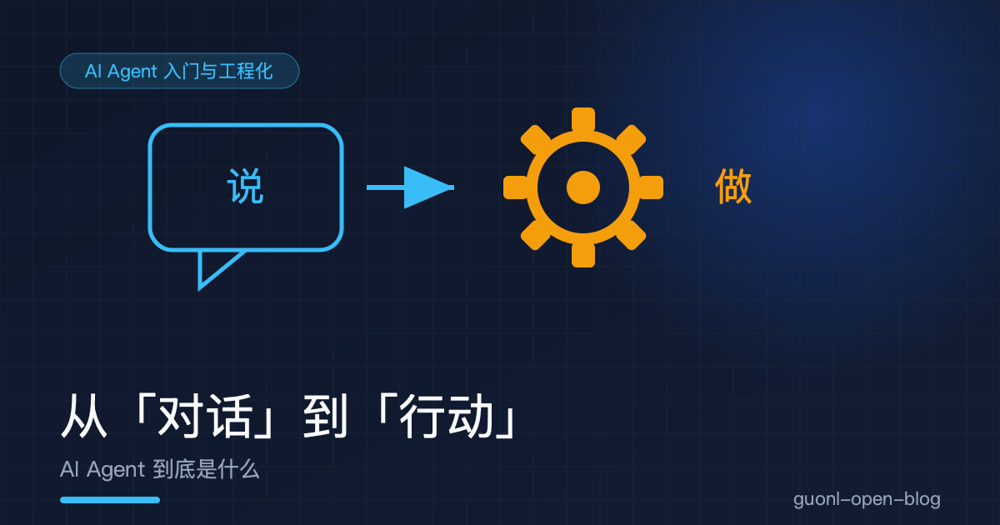
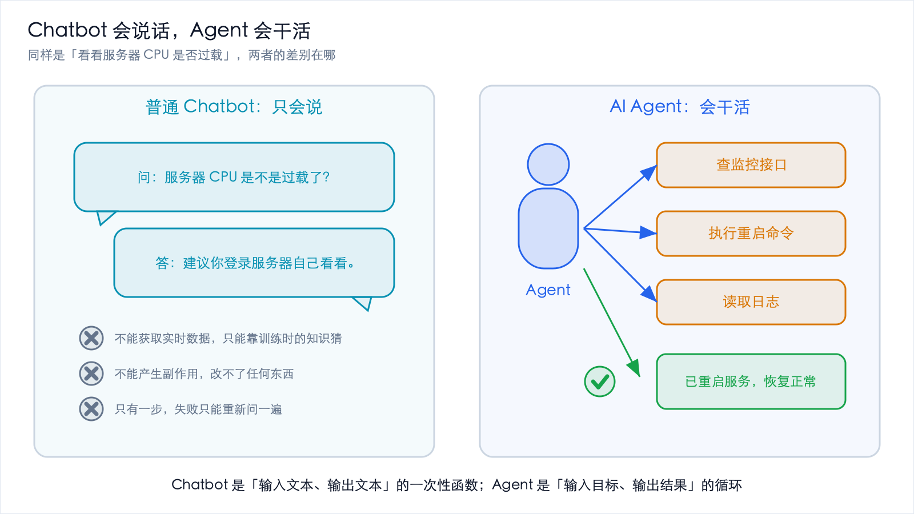
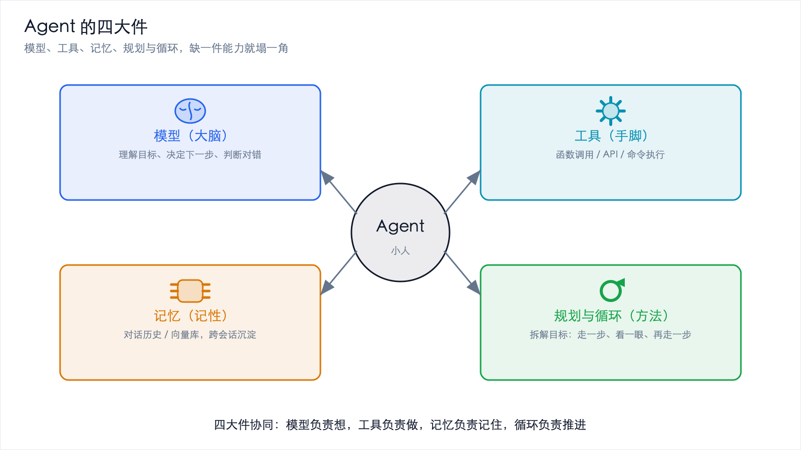
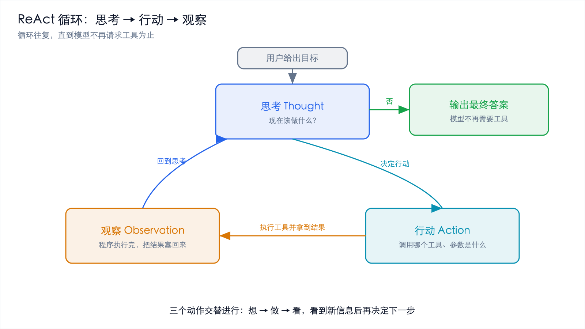
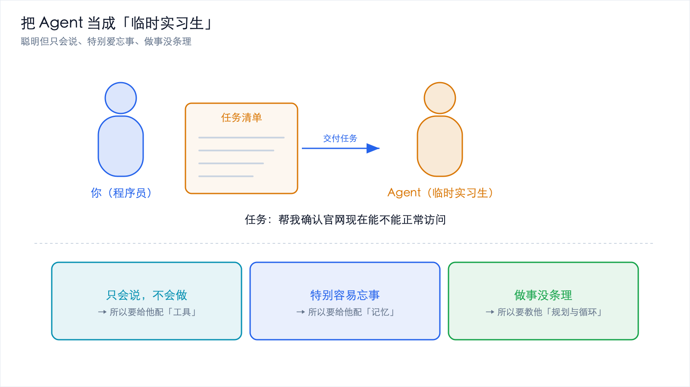

# 从"对话"到"行动"：AI Agent 到底是什么



*2026-10-27 · AI Agent 入门与工程化*

## 大模型的叙事，正在从"说"转向"做"

过去三年，和 AI 聊天变成了一件稀松平常的事。把问题丢进对话框，等一段文字回来，这套流程大家早就习惯了。但如果你留意 2026 年前后主流产品的变化，会发现一个明显的转向：大模型不再满足于回答问题，它开始动手做事了。

你让它"把这个仓库里所有调试用的 console.log 删掉，然后跑一遍测试"，它真的会去改文件、执行命令、读报错、再改。你让它"查一下明天北京到上海最便宜的高铁，帮我订一张下午的票"，它会去调用查询接口、比较价格、再调用下单接口。这种能理解目标、拆解任务、调用工具、自我校验、最终交付结果的软件形态，就是 AI Agent，中文一般叫智能体。

这是"AI Agent 入门与工程化"专题的第一篇。这里先不急着写代码，而是把概念讲透：Agent 和普通聊天机器人差在哪，它由哪些零件组成，它怎么一步步把事情做完，以及作为一个程序员，你为什么现在就该关心它。

## Chatbot 会说话，Agent 会干活



*图 1：同样的任务，Chatbot 只会给建议，Agent 会调用工具真的把事做完*

要理解 Agent，最快的办法是找一个熟悉的参照物：聊天机器人，也就是 Chatbot。

传统 Chatbot 的工作模式一句话就能概括，你问，它答。它的能力边界就是它的语言边界。你问"这段 Python 代码为什么报错"，它能给你一段像模像样的分析。但如果你接着说"那你帮我把它改好并验证一下"，它就无能为力了，它只能继续给你一段文字，比如"你可以这样改……"，然后等着你自己去复制、粘贴、运行、验证。

Agent 不一样。Agent 的目标不是输出一段文字，而是完成一件事。为了完成这件事，它可以主动使用外部工具，可以分好几步去做，可以在做完一步之后看看结果对不对，再决定下一步。

用一个具体例子对比。任务都是：帮我看看现在服务器 CPU 是不是过载了，如果过载就重启服务。

| 维度 | 普通 Chatbot | AI Agent |
| --- | --- | --- |
| 输入 | 一句话问题 | 一个目标 |
| 输出 | 一段文字建议 | 一个完成的结果（或明确的失败原因） |
| 能否获取实时数据 | 不能，只能凭训练时的知识猜 | 能，调用监控接口拿真实数据 |
| 能否产生副作用 | 不能 | 能，真的去执行重启命令 |
| 步骤数 | 一步 | 多步，且步数不固定 |
| 失败后 | 只能重新问一遍 | 观察错误、调整策略、重试 |

本质区别就在这张表里。Chatbot 是一次性的文本函数，输入文本、输出文本；Agent 是一个带循环的控制系统，输入目标、输出状态改变。前者活在对话框里，后者活在真实系统里。

业内把 2025 到 2026 年称作"Agent 元年"，原因也在这里。不是模型突然变聪明了，而是它的可靠性和工具调用能力跨过了一条工程上的及格线，终于可以被放心地派去干活。

## 拆开看：Agent 的四大件



*图 2：模型负责想，工具负责做，记忆负责记住，循环负责推进*

把 Agent 想象成一个人，它需要四样东西才能干活。

### 模型（大脑）

这是 Agent 的推理核心，也就是那个大语言模型（LLM，Large Language Model）。它负责理解你的目标、决定下一步做什么、判断结果对不对。所有思考都发生在这里。

但模型只是大脑，不是全部。一个只有大脑、没有手脚的人，只能空想。很多初学者一提到 Agent 就以为是"更强的模型"，其实不然，模型只是四大件之一。

### 工具（手脚）

工具（Tool）是 Agent 与外部世界交互的通道。查数据库是一个工具，发邮件是一个工具，执行一段 Shell 命令也是一个工具，调用一个 HTTP 接口还是一个工具。

关键在于，模型本身不能上网、不能读文件、不能发请求。它唯一会做的事情是生成文本。那它怎么"调用工具"呢？答案是它生成一段结构化的文本，比如一个 JSON，告诉外面的程序"请帮我调用 get_weather 这个函数，参数是 city=北京"。真正执行函数的是你的程序，不是模型。这一点非常重要，下一篇《动手写一个最小 Agent》会用代码把它彻底讲透。

### 记忆（记性）

记忆（Memory）解决的是它记不记得住的问题。没有记忆的 Agent，每一步都是失忆的：它查完天气，下一步就忘了刚才查过什么。

记忆大致分两种。短期记忆就是当前这次任务的对话历史。模型没有真正的记忆，每次调用都是无状态的，所谓的记忆其实是你的程序把之前的对话（包括它调用过哪些工具、拿到了什么结果）一起塞回给模型，相当于每次开会前你都把会议纪要重新念一遍给它听。长期记忆则是跨任务、跨会话保存的信息，通常存在数据库或向量库（Vector Store，一种专门用来按语义相似度检索文本的存储）里。比如"这个用户偏好用中文回复""上次部署失败是因为端口被占用"，这些经验可以沉淀下来，下次直接取用。

### 规划与循环（做事的方法）

有了大脑、手脚和记性，还需要一套做事的方法，也就是规划（Planning）与循环（Loop）。

规划指的是把一个模糊的大目标拆成一串可执行的小步骤。比如"帮我上线这个功能"可以拆成"跑测试 → 构建镜像 → 推送仓库 → 更新部署 → 验证健康检查"。

循环指的是，Agent 不是想好全部步骤再一口气执行，而是走一步、看一眼、再走一步。这种边做边调整的方式，是 Agent 区别于传统自动化脚本的最大特征。传统脚本是死板的流水线，一步失败全盘皆输；Agent 是活的，它会根据实际情况改主意。

| 四大件 | 类比 | 技术对应物 | 缺了会怎样 |
| --- | --- | --- | --- |
| 模型 | 大脑 | 大语言模型（LLM） | 不会思考，无法决策 |
| 工具 | 手脚 | 函数调用、API、命令执行 | 只能空谈，无法改变世界 |
| 记忆 | 记性 | 对话历史、向量库 | 重复劳动，前后矛盾 |
| 规划/循环 | 做事方法 | 提示词策略、控制循环 | 无法处理多步任务 |

## Agent 是怎么"做事"的：ReAct 循环



*图 3：思考、行动、观察三步交替，循环往复直到模型不再请求工具*

Agent 最经典的工作模式叫 ReAct，是 Reasoning（推理）和 Acting（行动）两个词的拼接。核心思想朴素得惊人：让模型在思考和行动之间交替进行。

一次完整的循环包含三步。

1. 思考（Thought）：模型看着当前掌握的信息，判断现在该干什么。比如"我还不知道天气，应该先调用天气查询工具。"
2. 行动（Action）：模型决定调用某个工具，并给出参数。比如"调用 `get_weather(city='北京')`"。
3. 观察（Observation）：你的程序真的执行了这个工具，把结果塞回给模型。比如"北京：晴，28 度"。

然后循环回到第一步。模型看着新拿到的"北京：晴，28 度"，继续思考"好，现在我知道天气了，可以回答用户了"，于是输出最终答案，循环结束。

用文字画成流程图，大概长这样：

```text
        ┌───────────────────────────────┐
        │        用户给出目标            │
        └───────────────┬───────────────┘
                        │
                        v
        ┌───────────────────────────────┐
   ┌───>│  思考 Thought：现在该做什么？   │
   │    └───────────────┬───────────────┘
   │                    │
   │                    v
   │    ┌───────────────────────────────┐
   │    │  行动 Action：调用某个工具      │
   │    └───────────────┬───────────────┘
   │                    │
   │                    v
   │    ┌───────────────────────────────┐
   │    │  观察 Observation：拿到结果     │
   │    └───────────────┬───────────────┘
   │                    │
   │         还需要继续吗？
   │           是 ┌─────┴─────┐ 否
   └──────────────┘           │
                              v
                 ┌───────────────────────────────┐
                 │  输出最终答案 / 交付结果        │
                 └───────────────────────────────┘
```

用极简伪代码表达，这个循环的本质是这样的：

```python
# 伪代码：Agent 的核心循环，真实实现见下一篇
messages = [用户的目标]

while True:
    # 1. 思考：把当前所有上下文交给模型，让它决定下一步
    response = model.chat(messages)

    # 2. 判断：模型还要调工具吗？不要了就直接收工
    if not response.tool_calls:
        return response.content        # 输出最终答案，循环结束

    # 3. 行动 + 观察：执行每个工具，把结果塞回上下文
    for call in response.tool_calls:
        result = execute_tool(call.name, call.args)   # 真正干活的是你的程序
        messages.append(result)                       # 结果成为下一步的"观察"
```

这个循环里没有任何魔法。它就是一个 `while`，加上"执行工具、回填结果"这两个动作。所有花哨的 Agent 框架，不管叫什么名字，剥到最里层都是这个循环。理解了这个循环，你就理解了所有 Agent 框架的本质。下一篇会亲手把它写出来。

## 一个贯穿全文的类比：把 Agent 当成"临时实习生"



*图 4：聪明但只会说、爱忘事、没条理，恰好对应工具、记忆、规划三大件*

如果上面的术语还是有点抽象，换个更生活化的视角：把 Agent 想象成一个刚入职的临时实习生。

这个实习生很聪明，读过海量的书，这是模型。但他有几个特点。他只会说不会做，能告诉你"应该去查一下数据库"，可他自己没有数据库的账号和工具，所以你需要给他配工具。他特别容易忘事，你上午交代的事，他中午就忘了，所以你每次找他，都得先把前情提要复述一遍，这就是记忆要解决的问题。他做事也没条理，给一个大任务容易一头雾水，所以你得教他方法论：先列清单，再一项项做，做完回头检查，这就是规划与循环。

现在，你要交给这个实习生一个任务："帮我确认一下我们官网现在能不能正常访问。"

一个没有 Agent 能力的实习生，只会回你一句："你可以在浏览器里打开看看。"他给了建议，但活没干。一个有 Agent 能力的实习生，会这样做：先想"我得发个请求探一探"（思考），然后去发请求（行动），拿到"返回 200"（观察）；接着想"单次成功不代表稳定，我再多试几次"（思考），又发了几次（行动），看到"5 次里 1 次超时"（观察）；最后向你汇报："官网基本可用，但存在偶发超时，建议关注。"他把活干了。

这个类比同时解释了三件事：为什么 Agent 需要工具（实习生没有工具就干不了活），为什么需要记忆（实习生会忘事），为什么需要循环（实习生需要边做边看边调整）。下次你看到任何 Agent 系统，都可以用"这相当于给实习生配了什么"来快速理解它的设计。

## 程序员为什么现在必须关注

你可能会想：Agent 是产品经理和算法工程师的事，我一个写业务代码的，关心它干嘛？

因为它正在变成你日常开发的一部分，而且是默认的一部分。

### 变化一：Agent 辅助开发成为默认工作方式

两三年前，用 AI 写代码还是尝鲜。到了 2026 年，它已经是很多团队的默认工作流。你在 IDE 里让它"给这个函数补上单元测试"，它不只是吐出一段测试代码，而是会真的去读你的项目结构、找到相关的 fixture、生成文件、运行测试、根据失败信息修正。这已经是标准的 Agent 行为。

你不需要"去做 Agent 开发"，你已经在"用 Agent 做开发"了。

### 变化二：工程师的角色在迁移

当写代码这件事被大量自动化之后，工程师的价值重心会往两端迁移。

往前端走，是目标定义者：把模糊的业务需求，翻译成清晰、可验收的目标。你要回答"到底要什么""怎样算做完了"。往后端走，是结果验收者：判断 Agent 交付的东西到底对不对、好不好、有没有埋雷，这需要你有扎实的判断力。中间的敲键盘环节被压缩了，两头"想清楚"和"验得准"的价值反而被放大。这对工程师不是威胁，而是要求：你得从实现者变成定义者加验收者。

### 变化三：你会被要求"把 Agent 接进系统"

越来越多的业务系统开始内置 Agent 能力。客服系统要能自动处理工单，运维平台要能自动巡检，数据分析平台要能自动跑报表。这些"接进去"的活，往往落在业务工程师而不是算法团队头上。你需要理解 Agent 的循环、工具怎么定义、错误怎么处理，这正是本专题后面几篇要讲的内容。

## 常见的误解与边界

Agent 很热，但热的地方最容易产生误解。这里澄清几个最常见的。

第一个误解是，Agent 就是更强的模型。不对。再强的模型，没有工具也只会聊天。Agent 的能力上限，往往由你给它配了什么工具、怎么组织循环决定，而不是单看模型跑分。

第二个误解是，Agent 可以完全自主、无人值守。目前阶段，这句话只在一部分边界清晰、结果可验证、副作用可控的场景下成立，比如代码修复、数据清洗。在涉及资金、生产环境、不可逆操作的场景，人工审批环节依然不可或缺。业界的共识是：自动化可以激进，但不可逆动作必须有闸门。

第三个误解是，什么任务都该用 Agent。恰恰相反。很多任务不该用 Agent，用了反而更慢、更贵、更不可靠。判断标准其实很清晰。

| 场景特征 | 建议 |
| --- | --- |
| 单步、确定性、无外部依赖 | 别用 Agent，写死逻辑或用普通函数更稳 |
| 需要实时数据或产生副作用 | 适合用 Agent（配工具） |
| 步骤不固定、需要随机应变 | 适合用 Agent（用循环） |
| 结果无法自动验证 | 谨慎用，最好加人工确认 |
| 操作不可逆（删库、转账） | 必须加人工闸门，不能全自动 |

边界可以这样总结：Agent 擅长"步骤不固定、需要和环境反复交互、结果能验证"的任务，不擅长"逻辑确定、一次算清、结果没法验证"的任务。判断该不该用 Agent，本质上就是在判断这三条。

这一篇没有写一行生产代码，但把最关键的概念立住了。Chatbot 会说话，Agent 会干活，前者是"输入文本、输出文本"的函数，后者是"输入目标、输出结果"的循环。Agent 有四大件，模型是大脑、工具是手脚、记忆是记性、规划与循环是做事的方法，缺一件能力就塌一角。它的工作循环叫 ReAct，思考、行动、观察三步交替，直到模型不再请求工具为止，所有框架的内核都是这个循环。

也别把它神化。步骤固定、结果难验证、操作不可逆的任务，往往不该用 Agent，或者必须加人工闸门。而作为程序员，你大概率已经在用 Agent 做开发了，角色也在从实现者往"目标定义者加结果验收者"迁移。

概念讲完了，下一步就是动手。下一篇《动手写一个最小 Agent：Function Calling 原理与代码》，会把上面那个 `while` 循环真的写出来，用 Python 和 OpenAI 兼容的 `tools` 接口，从零实现一个能查天气、能做加法的迷你 Agent。到那时你会发现，所谓智能体，不过是一个写对了的循环加上几个描述清楚的函数而已。
