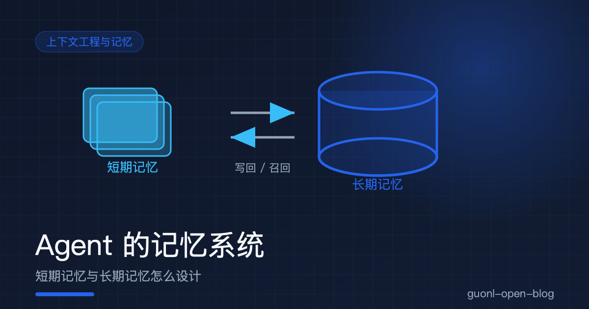
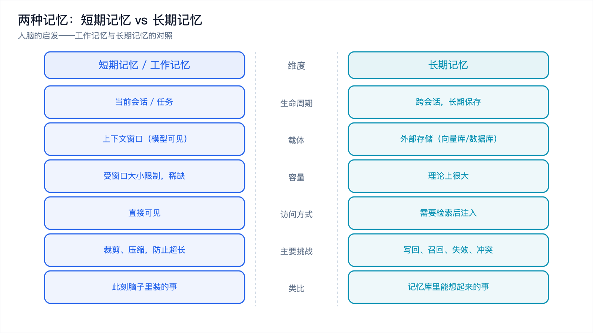
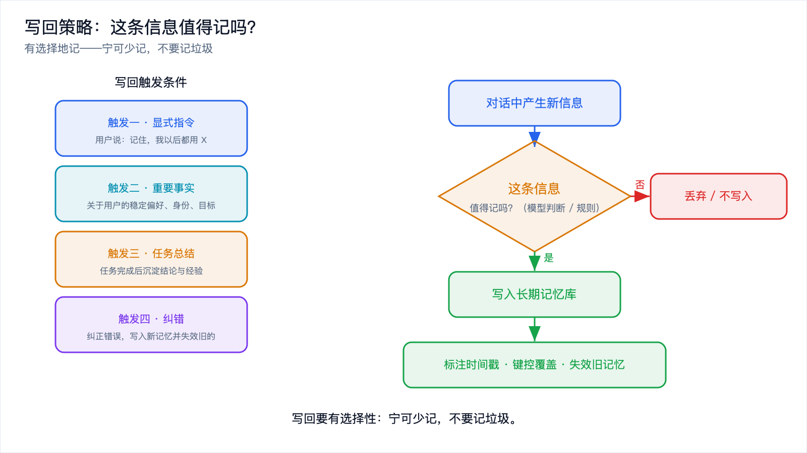
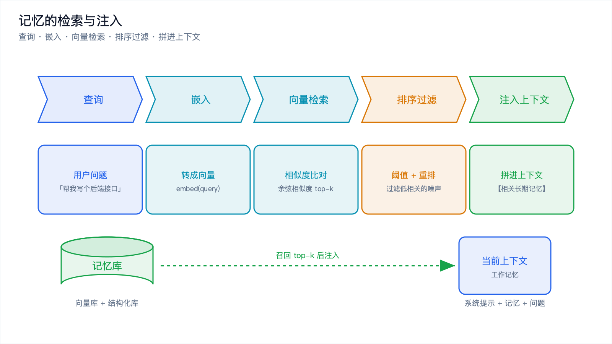
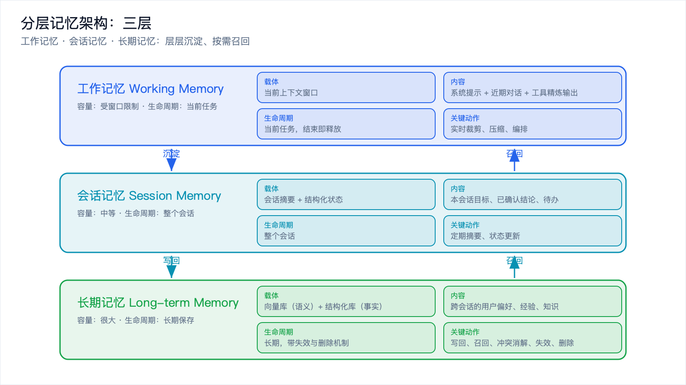

# Agent 的记忆系统：短期记忆与长期记忆怎么设计



*2026-10-27 · 上下文工程与记忆*

## 没有记忆的 Agent，是个失忆的天才

上一篇讲了上下文工程的整体框架，结尾留了一个最硬的话题：记忆。

先看一个场景。你和某个 AI 助手聊了半小时，详细描述了你的项目背景、技术栈、正在踩的坑。第二天你打开它，问"昨天说的那个问题怎么解"，它一脸茫然："抱歉，我们之前聊过吗？"

它很聪明，但没有记忆。每次对话都从头开始，前一次积累的一切归零。

这就是没有记忆的 Agent 的处境，像一个每天失忆的天才。能力很强，却无法积累，无法成长，也没法真正成为你的长期搭档。

但记忆这件事不是"加上就好"。加得不好，会引入两个新麻烦：污染（不该记的记住了，噪声越积越多）和冲突（新旧信息打架，Agent 不知道该信谁）。所以记忆系统的设计，本质上是在"记住"和"忘记"之间找平衡。

下面分三块讲：短期记忆和长期记忆的区别，各自的工程做法，最后给一段可运行的记忆检索代码，并把常见的坑逐个拆开。

## 人脑的启发：两种记忆



*图 1：短期记忆是当前任务的上下文，长期记忆是跨会话沉淀、按需召回的外部存储。*

要理解 Agent 记忆，人脑是个好类比。认知科学里，记忆大致分两层。

**短期记忆（Short-term Memory）**，也叫工作记忆（Working Memory）。它是你此刻正在处理的信息。比如你现在读这句话，脑子里同时装着上文的意思、这个段落的目标、你自己的疑问，这些加起来就是你的工作记忆。它容量很小，而且不断被新信息冲刷，你不刻意记的东西，几秒钟就忘了。

**长期记忆（Long-term Memory）** 是跨会话沉淀下来的知识。你的母语、你的专业知识、你昨天记住的一个电话号码，都在长期记忆里。它容量大、保存久，但平时不在意识里，只有需要时才会被"想起来"，回到工作记忆里参与思考。

这个类比直接映射到 Agent：

- 短期记忆：当前任务或会话的上下文，就是上一篇讲的上下文窗口里的内容。
- 长期记忆：跨会话存储、按需召回的信息，存在数据库里，不常驻上下文。

关键的地方是，长期记忆不是"更大的上下文"，而是 **按需调用的外部存储**。它平时躺在库里，只有被召回时才进入工作记忆。这个"按需召回"的机制，就是记忆系统的核心工程问题。

先看一张总览表。

| 维度 | 短期记忆（工作记忆） | 长期记忆 |
| --- | --- | --- |
| 生命周期 | 当前会话或任务 | 跨会话，长期保存 |
| 载体 | 上下文窗口（模型可见） | 外部存储（向量库或数据库） |
| 容量 | 受窗口大小限制，稀缺 | 理论上很大 |
| 访问方式 | 直接可见 | 需要检索后注入 |
| 主要挑战 | 裁剪、压缩，防止超长 | 写回、召回、失效、冲突 |
| 类比 | 此刻脑子里装的事 | 记忆库里能想起来的事 |

## 短期记忆的工程做法

短期记忆就是当前上下文，它的核心矛盾是：会话会越聊越长，但窗口有限。所以短期记忆的工程，本质是在有限窗口里保住关键信息。

### 对话历史裁剪

最直接的做法是裁剪。常见策略有三种。

滑动窗口（Sliding Window）：只保留最近 N 轮对话，更早的直接丢弃。实现最简单，缺点是"一刀切"，早期的关键信息（比如用户一开始设定的约束）会被误删。

摘要压缩（Summarization）：把较早的对话总结成一段话，替换掉原始逐条记录。这样既大幅压缩了 token，又保住了核心信息。代价是总结本身要花一次模型调用，且是有损的。

实践中常用混合策略：最近的几轮保留原文（保细节），更早的部分做摘要（保要点）。这样兼顾细节和长度。

一个混合裁剪的示意（伪代码）：

```python
def build_history(messages, keep_recent=6):
    # messages: 按时间排序的对话历史列表
    if len(messages) <= keep_recent:
        return messages                       # 历史很短，直接全用

    old = messages[:-keep_recent]             # 较早的部分
    recent = messages[-keep_recent:]          # 最近的部分，保留原文

    # 把较早的部分压缩成一段摘要（调用模型生成）
    summary_text = summarize(old)             # 有损压缩，保住结论与事实
    summary_msg = {"role": "system",
                   "content": f"以下是更早对话的摘要：{summary_text}"}
    return [summary_msg] + recent             # 摘要在前，近期原文在后
```

### 工具输出的精简

Agent 场景里，工具返回值往往是上下文膨胀的最大元凶。一次接口调用返回的 JSON 可能有几千 token，真正有用的可能就几个字段。

做法是在工具返回的那一刻就做精简，而不是等它污染了历史再补救：

- 只提取任务相关字段，丢弃冗余结构。
- 长列表截断，只保留前几条加总数。
- 大段文本先做一次提炼，再入上下文。

原则是：原始工具输出默认不进上下文，进的是它的"精炼版"。原始输出可以落盘存档，需要时再查，不必常驻。

### 用压缩保住关键信息

短期记忆的压缩要遵循"保结论、保事实、保约束，丢过程、丢噪声"。什么算关键信息？

- 用户明确设定的约束和偏好（"必须用 TypeScript"）。
- 已经确认的结论和决策（"我们决定用方案 B"）。
- 任务当前的状态和下一步。

可以丢的则是：试错过程、被否决的方案、冗余的工具原始输出。把"关键信息"的判定标准写进你的压缩逻辑，压缩才不会丢错东西。

## 长期记忆的工程做法

长期记忆的核心是"存得住、取得回、用得对"。它通常不是一种存储，而是几种存储配合。

### 向量数据库：存"语义"

向量数据库（Vector Database）是长期记忆的主力。原理是：把每段文本通过嵌入模型（Embedding Model）转成一个高维向量（一串数字），语义相近的文本，向量也相近。检索时，把查询也转成向量，找距离最近的若干条，就是语义最相关的记忆。

好处是语义检索：用户问"怎么部署"，能召回写着"上线流程"的记忆，哪怕字面不一样。

适合放进向量库的：对话片段、经验总结、文档知识、非结构化的事实。

### 结构化存储：存"确定的事实"

但并非所有记忆都适合向量检索。用户偏好、账户配置、明确的键值对事实，用结构化存储（关系数据库或键值库）更靠谱。

比如"用户偏好语言 = Rust"，语义检索可能召回一堆相关但不精确的东西，而直接查 `preferences` 表拿到确切值，既准又快。

分工原则：需要"模糊语义匹配"的用向量库，需要"精确取值"的用结构化存储。两者配合，各司其职。

### 写回策略：什么时候记下来



*图 4：写回决策。值得记的写入长期记忆，不值得的丢弃，并做好时间戳与失效。*

长期记忆最难的部分不是"怎么存"，而是"什么时候写"。不能什么都记，否则库被垃圾淹没；也不能什么都不记，否则等于没记忆。

常见的写回触发条件：

- 显式指令：用户说"记住，我以后都用 X"，立即写入。
- 重要事实：模型判断这是关于用户的稳定事实（偏好、身份、目标），写入。
- 任务总结：一次任务完成后，把结论和经验总结成记忆写入。
- 纠错：用户纠正了 Agent 的错误，把正确信息写入，并失效旧的。

关键原则是 **写回要有选择性**。加一个判断环节（哪怕是用模型判断"这条值不值得记"），能大幅提升记忆库的质量。宁可少记，不要记垃圾。

## 记忆的检索与注入：一个可运行示例



*图 3：记忆检索与注入的 RAG 式流程。查询向量化、相似度召回、过滤后注入上下文。*

有了存储，接下来是召回（Retrieval）和注入（Injection）：在需要时把相关记忆找出来，放进当前上下文。

这就是一个 RAG 式的流程：查询 -> 向量化 -> 相似度检索 -> 取 top-k -> 注入上下文。

下面给一个完全可运行的 Python 示例。为了让代码零依赖、开箱即跑，用"基于词袋的哈希向量 + 余弦相似度"来模拟嵌入检索。它没有真实嵌入模型的语义能力，但完整演示了记忆存储、召回、注入的流程。真实项目里，把 `embed()` 换成嵌入模型（如 `sentence-transformers`）或向量库客户端（如 FAISS、Milvus）即可。

```python
# memory_demo.py —— 一个最小可运行的长期记忆检索示例（零依赖）
import math
import hashlib
from collections import Counter

# ---------- 1. 极简"嵌入"：把文本转成词袋哈希向量 ----------
# 说明：这里用哈希把每个词映射到固定维度，模拟嵌入向量。
# 真实项目中应替换为嵌入模型，才能获得真正的语义检索能力。
DIM = 64

def tokenize(text):
    # 中文按字切分（够用的最小方案），英文按空格切分并小写
    tokens = []
    for ch in text:
        if '\u4e00' <= ch <= '\u9fff':      # 判断是否为中文字符
            tokens.append(ch)
    tokens += text.lower().split()          # 英文/数字词
    return tokens

def embed(text):
    vec = [0.0] * DIM
    for tok in tokenize(text):
        # 用 md5 哈希把词稳定映射到 [0, DIM) 的某一维
        idx = int(hashlib.md5(tok.encode("utf-8")).hexdigest(), 16) % DIM
        vec[idx] += 1.0
    # L2 归一化，方便后面直接点积算余弦相似度
    norm = math.sqrt(sum(v * v for v in vec)) or 1.0
    return [v / norm for v in vec]

def cosine(a, b):
    # 两个向量都已归一化，点积即为余弦相似度
    return sum(x * y for x, y in zip(a, b))

# ---------- 2. 记忆库：存储 + 检索 ----------
class MemoryStore:
    def __init__(self):
        self.records = []                   # 每条记忆: {"text", "vec", "ts"}

    def write(self, text, ts):
        """写回：把一条记忆写入长期记忆库"""
        self.records.append({"text": text, "vec": embed(text), "ts": ts})
        print(f"[写入记忆] {text}")

    def search(self, query, top_k=3):
        """召回：返回与 query 语义最相近的 top_k 条记忆"""
        qvec = embed(query)
        scored = [(cosine(qvec, r["vec"]), r) for r in self.records]
        scored.sort(key=lambda x: x[0], reverse=True)   # 相似度降序
        return scored[:top_k]

# ---------- 3. 注入：把召回的记忆拼进上下文 ----------
def build_context(system_prompt, memories, user_query, threshold=0.1):
    """把高于阈值的相关记忆注入上下文，再拼接用户问题"""
    lines = []
    for score, rec in memories:
        if score >= threshold:              # 过滤掉相似度太低的噪声记忆
            lines.append(f"- {rec['text']} (相关度 {score:.2f})")
    memory_block = "\n".join(lines) if lines else "（无相关记忆）"

    return (
        f"{system_prompt}\n\n"
        f"【相关长期记忆】\n{memory_block}\n\n"
        f"【当前问题】{user_query}"
    )

# ---------- 4. 跑起来看看 ----------
if __name__ == "__main__":
    store = MemoryStore()

    # 模拟跨会话积累的记忆（ts 为时间戳，越大越新）
    store.write("用户偏好使用 Rust 编写后端服务", ts=1000)
    store.write("用户所在团队代码规范要求函数必须有单元测试", ts=1010)
    store.write("用户的项目使用 PostgreSQL 作为主数据库", ts=1020)
    store.write("用户不喜欢在回答里使用过多的表情符号", ts=1030)
    store.write("用户偏好使用 JavaScript 编写前端页面", ts=1040)

    # 新一轮对话的查询
    query = "帮我写一个后端接口，注意符合我的习惯"
    recalled = store.search(query, top_k=3)

    print("\n[召回结果]")
    for score, rec in recalled:
        print(f"  相似度 {score:.3f} <- {rec['text']}")

    print("\n[组装后的上下文]")
    print(build_context("你是一个资深工程师助手。", recalled, query))
```

运行后你会看到：查询"后端接口"时，召回排在最前的是 Rust 后端偏好、PostgreSQL 主库这几条语义相关的记忆，而"表情符号偏好"因为与查询几乎不重叠，相似度低于阈值被过滤掉了。这就是记忆检索的基本流程，从库里召回相关记忆、注入上下文，让模型在生成时"记得"这些事实。

需要说明的是，这个示例用的是词袋哈希向量，只捕捉"字面重叠"，所以"JavaScript 前端偏好"因为和查询共享"偏好""使用"等词，也会被召回，这恰好暴露了朴素检索的局限。换成真正的嵌入模型后，语义相近但字面不同的记忆也能召回，同时语义无关的记忆会被更好地压下去。

真实项目中要做三处替换：

1. 把 `embed()` 换成真正的嵌入模型，语义能力天差地别。
2. 把内存列表换成向量数据库，支持百万级记忆的快速检索。
3. 在检索前加一层元数据过滤（比如只召回最近 30 天、或某个项目下的记忆），避免全局噪声。

## 长期记忆的典型坑

存储和召回都通了，也别急着上线。长期记忆有四个坑，踩一个就够 Agent 表现劣化。

### 坑一：记忆耦合冲突

用户上个月说"我用 JavaScript"，这个月说"我们全面转 Rust 了"。两条记忆都在库里，检索时可能同时召回，模型就不知道该听谁。

解决思路：

- 带时间戳，新的优先。冲突时用更新时间作为裁决依据。
- 覆盖式写入。偏好类记忆用"键"来管理，同一键的新值覆盖旧值，而不是追加。
- 显式失效。检测到冲突时，主动把旧记忆标记为失效，而不是让它留在库里等召回。

### 坑二：错误记忆放大

如果 Agent 曾经生成过一个错误结论，并被写进了长期记忆，那么之后每次召回它，都会把这个错误当成事实再喂给模型，错误被反复强化。这比一次性错误严重得多，因为它会污染后续所有对话。

解决思路：

- 写回前做质量把关，不要让模型的每一句话都能进长期记忆。
- 关键事实留出人工确认或交叉验证的通道。
- 提供纠错机制：用户纠正后，不仅要写新记忆，还要失效错误的那条。

### 坑三：隐私与遗忘

用户说"忘掉我刚才说的那个手机号"。如果记忆库不支持删除，这个诉求就无法满足。隐私合规（如"被遗忘权"）要求系统能精确定位并删除指定记忆。

解决思路：

- 每条记忆有唯一 ID，支持精确删除。
- 支持按范围删除（某用户、某时间段、某主题）。
- 考虑软删除加定期清理，兼顾合规与审计。

遗忘能力和记忆能力同等重要。一个只会记、不会忘的系统，最终会被自己的记忆压垮。

### 坑四：检索质量与噪声

召回不准，比不召回更糟。不召回至少模型不会瞎猜，召回一堆无关记忆反而会误导它。

解决思路：设相似度阈值过滤（示例代码里的 `threshold` 就是干这个的），加元数据过滤缩小范围，必要时用重排（Rerank）模型对召回结果二次排序。

## 一个可落地的分层记忆架构



*图 2：三层记忆架构。工作记忆、会话记忆、长期记忆，层层沉淀、按需召回。*

把上面所有东西串起来，一个实用的 Agent 记忆系统通常是三层的。这不是严格的三层架构定义，而是一种工程上的分层思路。

```text
┌─────────────────────────────────────────────────────────┐
│  第一层：工作记忆（Working Memory）                        │
│  · 载体：当前上下文窗口                                   │
│  · 内容：系统提示 + 最近几轮对话 + 本轮工具精炼输出        │
│  · 生命周期：当前任务，任务结束即释放                      │
│  · 关键动作：实时裁剪、压缩、编排                         │
└─────────────────────────────────────────────────────────┘
                          ▲ 注入
                          │
┌─────────────────────────────────────────────────────────┐
│  第二层：会话记忆（Session Memory）                        │
│  · 载体：当前会话的摘要 + 结构化状态                       │
│  · 内容：本会话的目标、已确认结论、待办                    │
│  · 生命周期：整个会话                                     │
│  · 关键动作：定期摘要、状态更新                           │
└─────────────────────────────────────────────────────────┘
                          ▲ 沉淀 / 召回
                          │
┌─────────────────────────────────────────────────────────┐
│  第三层：长期记忆（Long-term Memory）                      │
│  · 载体：向量数据库（语义记忆）+ 结构化库（事实/偏好）      │
│  · 内容：跨会话的用户偏好、经验、知识                      │
│  · 生命周期：长期，带失效与删除机制                        │
│  · 关键动作：写回、召回、冲突消解、失效、删除              │
└─────────────────────────────────────────────────────────┘
```

三层的关系是流动的：当前对话在工作记忆里实时处理；一段对话告一段落，其结论沉淀进会话记忆；会话结束后，值得长期保留的部分再写回长期记忆。反过来，当新一轮对话需要时，长期记忆被召回，注入工作记忆。

每一层解决不同的问题。工作记忆解决"现在够不够用"，会话记忆解决"这个任务记得住吗"，长期记忆解决"跨会话能不能积累"。三层配合，Agent 才能既不失忆，又不被记忆淹没。

记忆系统是上下文工程里最难、也最值钱的一块。短期记忆（工作记忆）就是当前上下文，矛盾在于它会越聊越长，靠裁剪、压缩、精简工具输出压住，原则是保结论事实约束、丢过程噪声。长期记忆跨会话沉淀，靠向量库（语义）和结构化库（事实）配合存储，真正的难点在写回策略，得学会有选择地记。检索和注入是 RAG 式流程，查询向量化、相似度召回、top-k 过滤、再注入上下文，生产环境把 `embed()` 换成真实嵌入模型和向量库就行。至于那四个坑，记忆耦合冲突、错误记忆放大、隐私与遗忘、检索噪声，各有各的解法。落地时推荐三层：工作记忆、会话记忆、长期记忆，层层沉淀、按需召回。

把上一篇的上下文工程四层（获取、压缩、编排、维护）和这篇的记忆分层合起来，一套完整的 Agent 上下文治理框架就成型了。想继续深入，可以看专题④关于 [Eval：怎么知道你的 Agent 变好了](../agentic-engineering/agent-eval.md) 的讨论，记忆系统改得好不好，最终要靠评测来验证。
