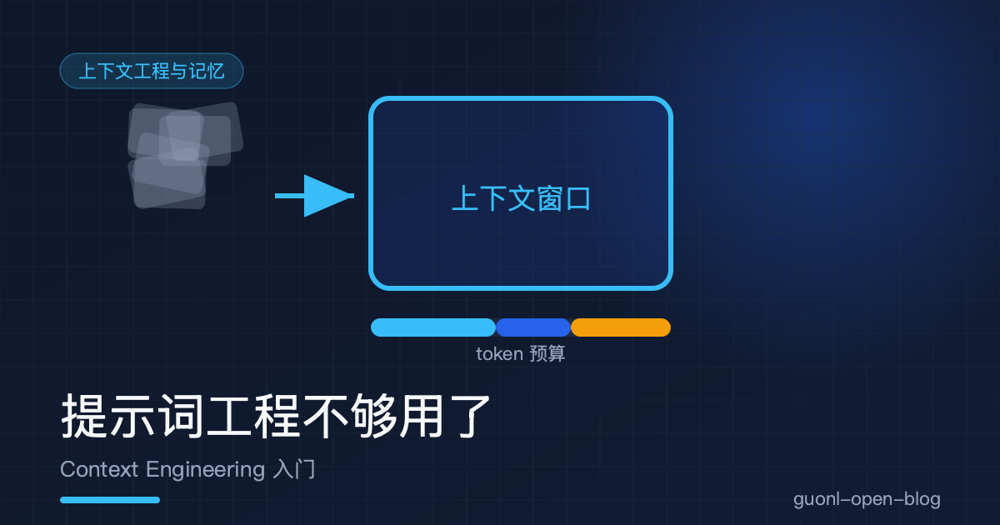
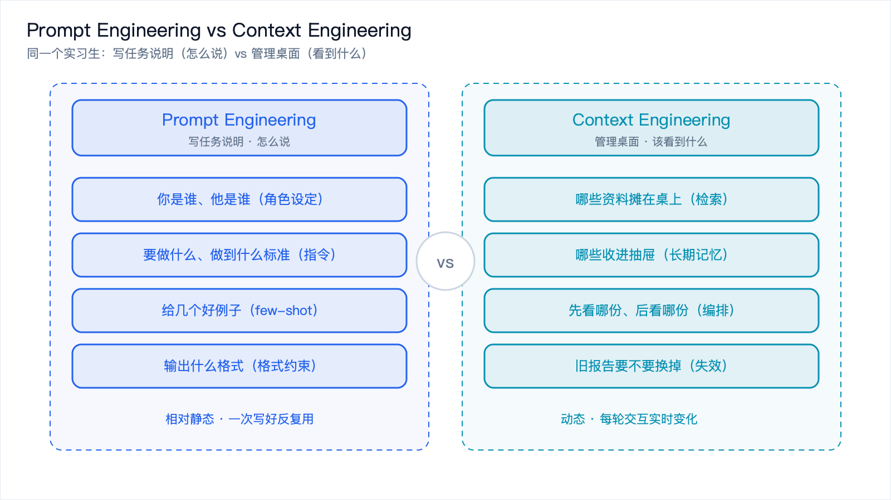
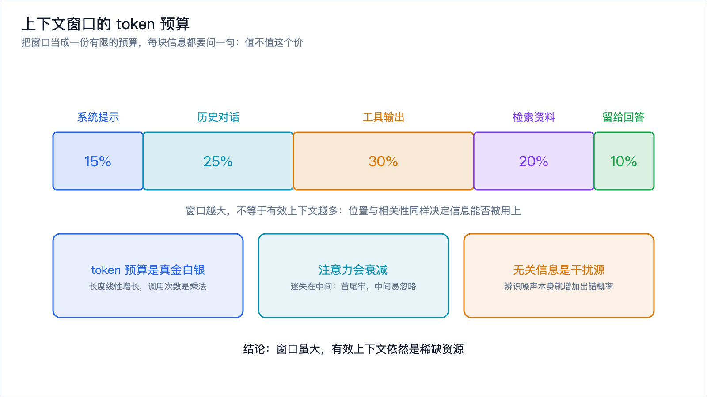
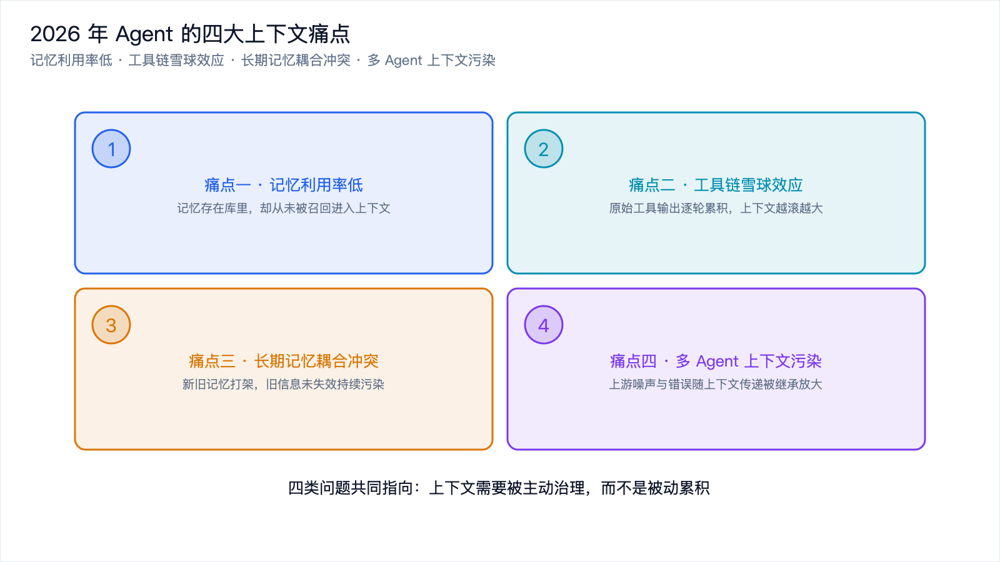
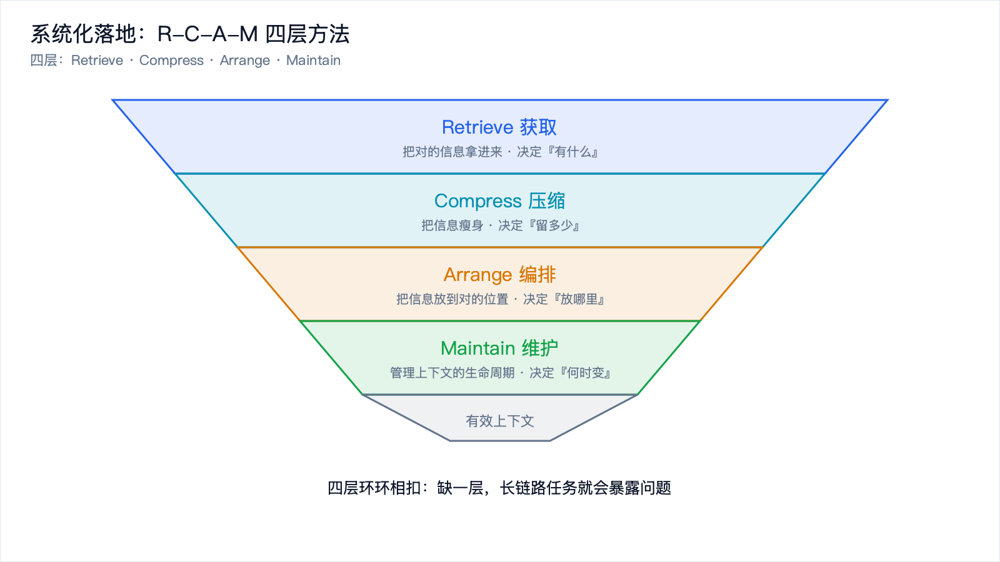

# 提示词工程不够用了：Context Engineering 入门



*2026-10-27 · 上下文工程与记忆*

## 从一个熟悉的翻车现场说起

如果你在 2026 年做过一段时间的 AI Agent，多半经历过这样的场景。

提示词改了十几遍，措辞越来越"专业"，角色设定写得像招聘 JD，示例也堆了五六个。单轮对话测试时，模型答得漂亮极了。可一旦把它接上工具、跑起多轮任务，情况立刻失控。它开始忘记三分钟前的结论，开始重复调用同一个接口，开始把工具返回的一大坨 JSON 当成事实反复引用，最后在一条完全跑偏的路上越走越远。

于是你回去继续改提示词。改到怀疑人生，问题还在。

原因其实很朴素：你一直在修一个不是病因的地方。Agent 跑偏，很多时候不是因为它没听懂指令，而是它的"视野"里塞满了不该看的东西，或者缺了必须看的东西。

这就是 2026 年 Agent 工程里最重要的一个转向：从 **Prompt Engineering（提示词工程）** 走向 **Context Engineering（上下文工程）**。

## 一个类比：实习生与他的桌面



*图 1：同一个实习生。左边是写任务说明（怎么说），右边是管理桌上的资料（看到什么）。*

先别急着看定义，用一个大家都熟的类比来引入。

想象你要让一位实习生帮你完成一项任务。他非常聪明，理解能力极强，但有个致命毛病：记性极差。你跟他说的每句话，他只能记住很短一段时间；你给他的每份资料，他看过之后也可能忘掉。

在这种设定下，你能做的事分成两类。

一类是怎么写任务说明：告诉他你是谁、他是谁、要做什么、做到什么标准、输出什么格式。措辞要清楚，例子要到位，别产生歧义。这是 Prompt Engineering。

另一类是往他桌上放什么资料：哪些文档该摊开、哪些该收进抽屉、先看哪份后看哪份、抽屉里那份旧报告要不要换掉、他干活时新产生的笔记要不要留在桌上。这是 Context Engineering。

关键的地方在于，实习生再聪明，他的桌面也是有限的。桌面就那么大，你摊上去的东西越多，每份能分到的注意力就越少，而且一堆无关的旧资料会持续干扰他对当前任务的判断。

模型就是那位聪明但记性差的实习生，上下文窗口（Context Window）就是他桌面的面积。所谓上下文窗口，指的是模型在生成下一个 token 时能"同时看到"的全部文本，包括系统提示词、历史对话、工具返回值、检索到的文档，全部算在内。它有上限，单位是 token（模型处理文本的最小单位，大约一个英文单词对应一到两个 token，一个汉字通常一到两个）。

你写提示词，是在写任务说明；你设计上下文，是在管理那张桌子。而绝大多数 Agent 翻车，是桌子管理的问题，不是说明书的问题。

## Prompt Engineering 和 Context Engineering 差在哪

两者不是替代关系，是层次不同。Prompt Engineering 依然重要，只是它属于上下文工程的一个子集。下面这张表把区别摊开。

| 维度 | Prompt Engineering | Context Engineering |
| --- | --- | --- |
| 核心问题 | 指令"怎么说" | 模型"该看到什么" |
| 关注点 | 措辞、角色设定、示例、输出格式、思维链引导 | 哪些信息进入上下文窗口、以什么顺序、占多少 token、记忆如何取舍 |
| 作用对象 | 一次输入的那段文本 | 整个上下文窗口的内容编排与生命周期 |
| 时间视角 | 相对静态，一次写好反复用 | 动态，随每一轮交互实时变化 |
| 主要工具 | 提示词模板、few-shot 示例 | 检索、压缩、摘要、缓存、记忆读写、路由 |
| 典型失效场景 | 指令模糊、示例不当导致输出偏差 | 上下文超长、信息污染、历史累积、记忆冲突导致跑偏 |
| 失效后的修法 | 改措辞、加示例 | 改检索策略、加压缩、调整注入顺序、裁剪历史 |
| 类比 | 给实习生写任务说明 | 管理实习生桌面上的资料 |

差异可以压成一句话：Prompt Engineering 优化的是"你说的话"，Context Engineering 优化的是"模型看到的整个世界"。

任务简单、单轮、不需要外部信息时，Prompt Engineering 基本够用。一旦任务变成多轮、多工具、长链路、要跨会话记忆的 Agent 场景，模型看到的世界质量就决定了它的表现上限，这时候只盯着提示词，很快会撞到天花板。

## 为什么上下文窗口是稀缺资源



*图 2：token 预算把窗口切给系统提示、历史、工具输出、检索资料，并留一部分给回答。*

很多人第一次接触大模型时会有个直觉误解：既然 2026 年的模型动辄支持上百万 token 的上下文窗口，那把所有资料都塞进去不就完了？

这个直觉是错的，原因有三层。

### token 预算是真金白银

上下文窗口不免费。每多放一个 token，就要多算一次注意力，多花一份推理成本，多占一份显存。Agent 场景里，一次任务可能触发几十次模型调用，每次调用都要重新把上下文塞一遍。上下文长度是线性增长的成本，而调用次数是乘法关系，你省下的每一个无用 token，都会在几十次调用里被放大。

这就是 token 预算的概念：把上下文窗口当成一份有限的预算，每块信息都要问一句"它值不值这个价"。

### 注意力会衰减

更微妙的是注意力衰减（Attention Dilution）。模型处理长上下文时，并不是对每个位置的信息雨露均沾。实践中反复观察到一个现象，被戏称为"迷失在中间"（Lost in the Middle）：模型对上下文开头和结尾的信息记得比较牢，对中间部分的内容容易忽略。

这意味着什么？你把一份关键资料放在超长上下文的中间，模型很可能根本没"看见"它。信息不是塞进去就有用，位置本身就是信息的一部分。

### 无关信息是干扰源

最后一点，无关信息不是中性的，它是负面的。上下文里混进大量与当前任务无关的历史对话、过期的工具返回值、不相关的文档片段时，模型得花注意力去辨别哪些相关、哪些不相关，这本身就增加了出错概率。有时候一条过期的旧信息比完全没有信息更糟，因为模型可能会一本正经地基于它给出错误答案。

所以结论是：上下文窗口虽然变大，**有效上下文** 依然是稀缺资源。把东西塞进去容易，把对的东西、在对的位置、以对的形式放进去，才是工程。

## 2026 年 Agent 的四大上下文痛点



*图 3：四大上下文痛点。记忆利用率低、工具链雪球效应、长期记忆耦合冲突、多 Agent 上下文污染。*

理论说完了，回到工程现场。当下 Agent 开发里最折磨人的上下文问题，集中在四类。

### 记忆利用率低

Agent 明明"记得"用户三天前说过"我司代码规范要求所有函数必须有单元测试"，可今天用户让它写个工具函数，它写出一个没有测试的版本。

问题不在于模型没能力记住，而在于那份记忆躺在某个数据库里，从来没被召回、没进入当前上下文。记忆存了，但没被用上，这就是记忆利用率低。存储不等于使用，这是新手最常踩的坑。

### 工具链雪球效应

这是多轮工具调用场景的经典病症。第一轮调用搜索接口，返回 2000 token；第二轮读取文件，返回 3000 token；第三轮执行命令，输出 1500 token。每一轮的工具返回值都被原封不动地追加进历史，上下文像滚雪球一样越滚越大。

跑到第十轮，上下文里塞满前九轮的原始工具输出，其中大部分早已过时。模型被这堆历史淹没，开始忽略最新的关键信息，或者反复引用早已被推翻的中间结论。这就是工具链雪球效应。

举个贴近程序员的场景：让 Agent 排查一个线上 bug，它依次查日志、读代码、跑测试、查监控，每步的原始输出都堆在上下文里。等到真要下结论时，上下文已经被几万 token 的日志噪声占满，模型反而漏掉了那条最关键的报错行。

### 长期记忆耦合冲突

Agent 有了长期记忆之后，新问题来了：新旧信息会打架。

用户上个月说"我偏好用 JavaScript"，这个月说"我们团队全面转向 Rust 了"。两条记忆都被存下来，检索时可能同时召回，模型就懵了，它该听哪条？

更麻烦的是隐式冲突。用户换了公司、换了技术栈、改了需求，但旧记忆没被失效，持续污染判断。记忆耦合冲突的本质是：记忆有生命周期，很多实现却把它当成了只增不减的流水账。

### 多 Agent 上下文污染

当一个任务由多个 Agent 协作完成时（比如一个负责规划、一个负责写代码、一个负责审查），每个 Agent 有自己的上下文，但它们之间要传递信息。

传递的过程中，上下文会互相污染。规划 Agent 的中间推理、写代码 Agent 的试错记录、审查 Agent 的质疑，如果全部无差别地塞给下游 Agent，下游就会被上游的噪声带偏。而且一旦某个 Agent 产生了错误结论，这个错误会顺着上下文传递被继承下去，被放大。多 Agent 系统的上下文隔离与传递，比单 Agent 复杂得多。

## 系统化落地：获取、压缩、编排、维护



*图 4：R-C-A-M 四层流水线。Retrieve 获取、Compress 压缩、Arrange 编排、Maintain 维护。*

面对这四大痛点，零敲碎打地打补丁没用，需要一套系统化方法。2026 年比较成熟的实践框架把上下文工程拆成四层，简称 R-C-A-M。

### 获取（Retrieve）：把对的信息拿进来

目标是在需要的那一刻，把与当前任务真正相关的信息从外部（记忆库、文档库、工具）拉进上下文。

常用手段：

- 语义检索（RAG，Retrieval-Augmented Generation，检索增强生成）：用向量相似度找到相关文档片段。
- 关键词与混合检索：语义检索对精确术语不敏感，混合关键词检索能补上这块。
- 结构化查询：用户偏好、配置这类信息，直接查数据库比语义检索更准。
- 工具调用：把工具当成"按需获取信息"的通道，而不是预先把所有数据塞进去。

注意点在于检索的召回质量比数量重要。召回十条，只有一条相关，其余九条都是干扰。宁可少召回、召回准，也不要贪多，同时要控制单次召回的总 token 量。

### 压缩（Compress）：把信息瘦身

目标是在不丢失关键信息的前提下，减少上下文的 token 占用。

常用手段：

- 历史摘要：把较早的多轮对话总结成一段话，替换掉原始逐条记录。
- 工具输出裁剪：工具返回值往往很长，只保留与任务相关的字段，丢弃冗余结构。
- 去重与合并：多轮中重复出现的信息只保留一份。
- 结构化提取：把一大段自然语言输出，提炼成几个关键事实。

注意点在于压缩是有损的，关键在于"保什么、丢什么"。准则可以记成：保留结论和事实，丢弃过程性噪声。压缩做过头会丢关键信息，做得不够又没效果，需要按任务特点调。

### 编排（Arrange）：把信息放到对的位置

目标是决定进入上下文的信息以什么顺序、什么形式呈现。

常用手段：

- 重要性排序：最关键的信息放在开头或结尾，避开"迷失在中间"的衰减区。
- 分区组织：用清晰的分隔符把系统提示、记忆、工具结果、当前任务分开。
- 格式统一：工具结果统一成简洁的结构化格式，降低模型解析负担。
- 优先级标注：明确告诉模型哪些是"必须遵守的约束"，哪些是"参考资料"。

注意点在于编排是位置的艺术。同样一组信息，换个顺序可能效果天差地别。这层最容易被忽视，却常常是"改一个字就变好"的来源。

### 维护（Maintain）：管理上下文的生命周期

目标是让上下文随时间正确地更新、失效、演进，而不是只增不减。

常用手段：

- 记忆写回：判断哪些信息值得沉淀成长期记忆，什么时候写。
- 失效策略：旧信息被新信息取代时，主动失效旧的。
- 冲突消解：新旧记忆矛盾时，用明确的规则处理，比如"新覆盖旧""带时间戳优先"。
- 定期整理：会话结束时做一次总结归档，避免历史无限增长。

注意点在于维护是最被低估的一层。很多 Agent 上线后表现逐渐劣化，根源就是缺少维护，上下文只进不出，旧信息越积越多。维护做得好，Agent 才能越用越聪明，而不是越用越糊涂。

四层的关系可以这样记：获取决定"有什么"，压缩决定"留多少"，编排决定"放哪里"，维护决定"何时变"。任何一层缺失，都会在长链路任务里暴露问题。

## 工程实践建议

把上下文当成数据资产来治理，有几个具体抓手。

### 上下文要版本化

你的提示词模板、上下文编排策略、检索参数，都应该是可版本化的。把"给模型的上下文组装逻辑"当代码来管理：进 Git、可回滚、能 diff。这样当 Agent 表现变化时，你能定位到是哪次上下文策略调整导致的，而不是靠玄学猜。再进一步，把每次实际送入模型的完整上下文也记录下来，打日志，出问题能复现。

### 善用缓存

Prompt Caching（提示词缓存）是 2026 年省钱省时的关键手段。很多模型厂商支持缓存上下文的前缀部分：如果多次调用共享相同的开头（比如一大段固定的系统提示、一份不变的文档），这部分可以被缓存，后续调用直接复用，既省钱又降延迟。

这对 Agent 尤其重要，因为一次任务会调用模型几十次，每次开头往往高度相似。把稳定不变的内容放在上下文前缀，把变化的内容放在后面，是提升缓存命中率的实用技巧。

一个简单的编排示意（伪代码，说明"稳定在前、变化在后"的思路）：

```python
# 组装送入模型的上下文（伪代码，思路示意）
def build_context(system_prompt, stable_docs, memory, tool_results, user_query):
    # 前缀区：稳定、可缓存 —— 系统提示 + 长期不变的知识
    prefix = [
        {"role": "system", "content": system_prompt},
        {"role": "system", "content": stable_docs},   # 内容稳定，利于 prompt caching
    ]
    # 中间区：本次会话的召回记忆（相对稳定，按需注入）
    recalled = [{"role": "system", "content": memory}]
    # 尾部区：高频变化 —— 工具结果与当前问题（放在末尾，避开注意力衰减）
    dynamic = tool_results + [{"role": "user", "content": user_query}]
    return prefix + recalled + dynamic
```

### 失效与事件化

失效：给每块信息打上"有效期"或"版本"标签。新信息到来时，能明确知道哪些旧信息该退场。比如用户偏好，用覆盖式写入而不是追加。

事件化：把上下文的变化当成事件来处理。用户说了新偏好是一次事件，工具返回了关键结论是一次事件，任务阶段切换也是一次事件。每个事件触发相应的上下文更新动作（写入记忆、触发压缩、调整编排）。事件化让上下文管理从"被动累积"变成"主动响应"，这是把上下文工程做扎实的分水岭。

Prompt Engineering 解决的是"指令怎么说"，Context Engineering 解决的是"模型该看到什么"。2026 年的 Agent 场景里，后者往往才是决定成败的那一环。

回头看，上下文窗口从来不是免费的仓库，而是一份要精打细算的预算：token 要花钱，注意力会衰减，无关信息还会主动帮倒忙。真正卡住 Agent 的，往往就是那四个老问题，记忆存了却没用上、工具输出把窗口越滚越满、新旧记忆互相打架、多 Agent 之间互相串味。要压住它们，靠的是获取、压缩、编排、维护这一整条流水线，分别回答"有什么、留多少、放哪里、何时变"；工程上再配上版本化、缓存、失效、事件化这几招，把上下文当成可治理的数据资产来管。

这些方法里，"记忆"是最难也最值钱的一块。怎么存、怎么取、怎么失效，直接决定了 Agent 是越用越聪明还是越用越糊涂。下一篇专门聊 Agent 的记忆系统，从短期记忆讲到长期记忆，并给出一段可运行的记忆检索示例。

想先了解 Agent 的基础概念，可以回看专题①的 [从"对话"到"行动"：AI Agent 到底是什么](../ai-agent/from-chat-to-action.md)。
