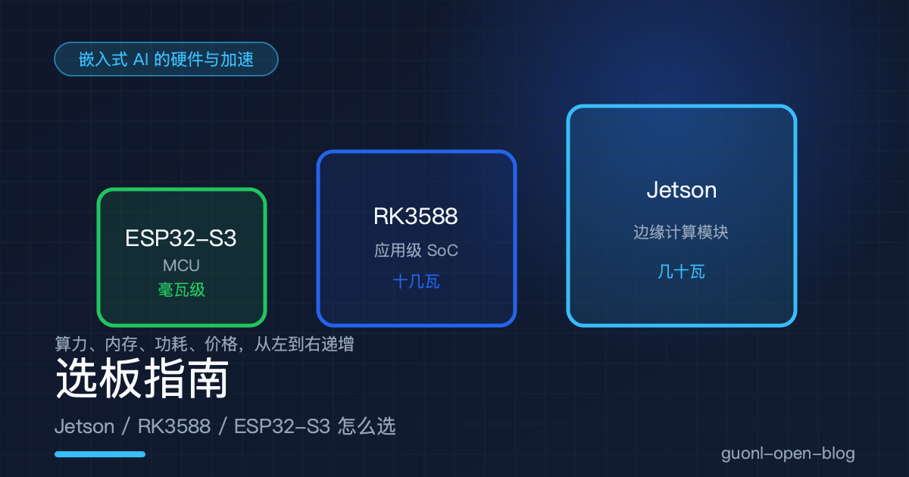
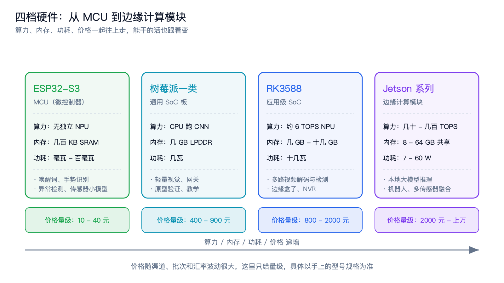
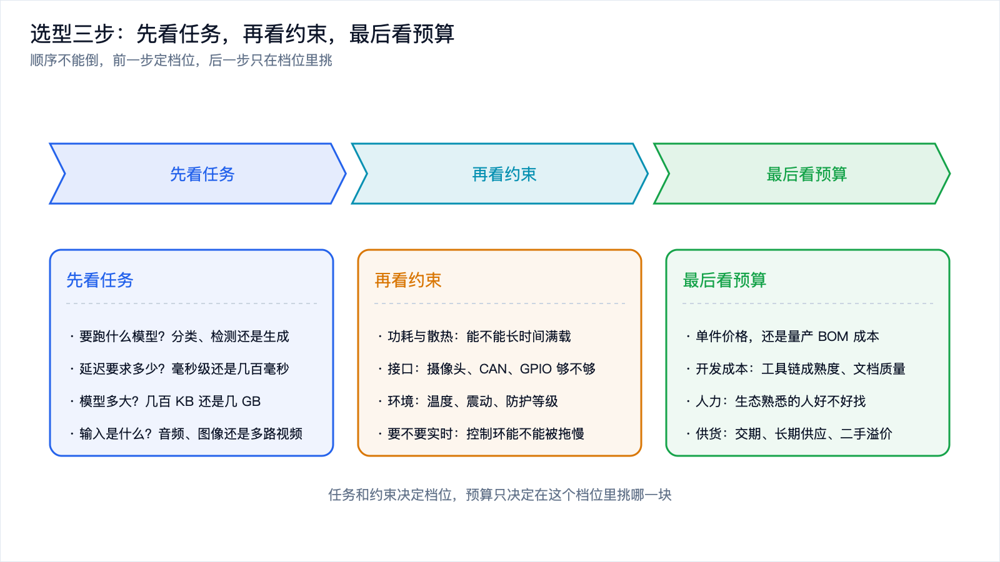
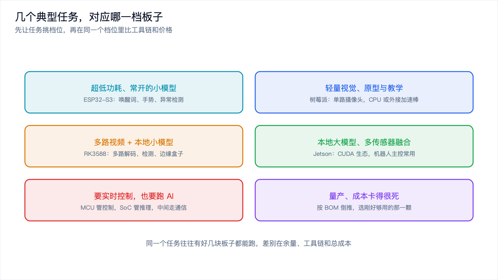
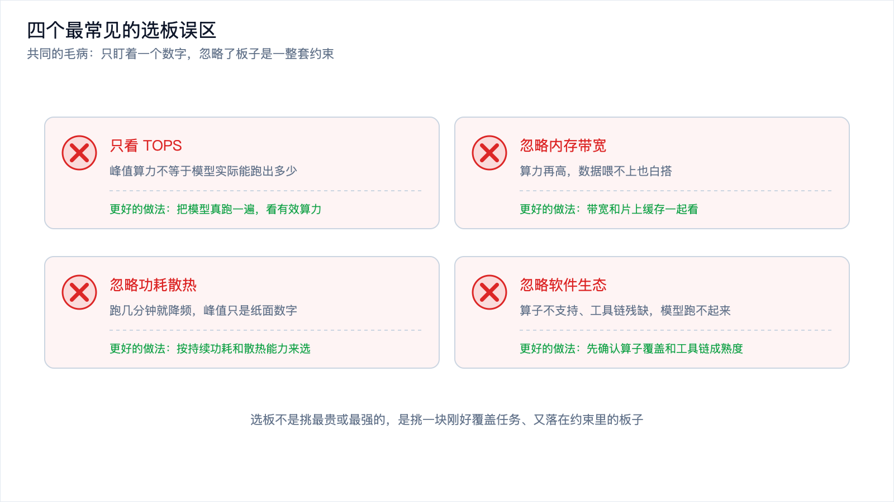

# 选板指南：Jetson / RK3588 / ESP32-S3 怎么选

*2026-10-30 · 嵌入式 AI 的硬件与加速*

## 一场没有结论的争论

你手上有个新项目：一块摄像头，要识别传送带上的缺陷，把结果上报到车间网关。你问同事该用什么板子。

A 说上 Jetson，算力足，以后想换大模型也不慌。B 说 RK3588 就行，便宜一半，六 TOPS 够跑检测了。C 说先用树莓派搭个原型，能跑通再说。

三个人的说法都对，因为他们心里想的任务不一样。A 想的是"以后可能要跑更大的模型"，B 想的是"这个检测模型本来就小"，C 想的是"先把链路跑通，硬件后面再定"。

选板从来不是挑一块最强的板子，是给一组具体的任务和约束找一块刚好覆盖它们的板子。这篇把端侧常见的选择分成四档摆出来，讲清楚每一档的能力边界，再给一套"先看任务、再看约束、最后看预算"的思路，以及几个能直接抄的搭配。

[《NPU、DSP、GPU：端侧推理到底靠什么加速》](npu-dsp-gpu.md)讲的是芯片里有哪些计算单元，这一篇往下走一步：把芯片做成一块能买到、能插线、能装系统的板子之后，怎么挑。

## 先把板子分成四档

端侧硬件听起来五花八门，按算力和形态其实就四档。档与档之间差的是数量级，同一档内部差的是生态、接口和价格。

第一档是 MCU。ESP32-S3 是这一档里最有代表性的板子：双核几百 MHz，没有独立的 NPU，只有几百 KB 的 SRAM，功耗是毫瓦级。它的能力边界很清楚，只能跑几十到几百 KB 量级的小模型，做关键词唤醒、手势识别、异常检测这类输入小、输出小、要求常开的任务。好处是便宜、省电、能一直开着，一块板子十几块钱。

第二档是通用 SoC 板，树莓派是典型。它有完整的 Linux、几 GB 内存、USB 和网口齐全，但算力还是靠 CPU，跑卷积网络要用通用指令硬算，功耗几瓦。它的价值不在算力，在生态和接口：你能在上面用最熟悉的 Python 和 ONNX Runtime 把整条链路跑通，接摄像头、接网络、接屏幕都方便。做原型、做教学、做轻量视觉，它是第一选择。

第三档是应用级 SoC，RK3588 是这一档的主力。八核 CPU 加上一块六 TOPS 量级的 NPU，配几 GB 到十几 GB 内存，功耗十几瓦。它能同时解多路摄像头视频流、跑检测模型、再把结果编码出去，是"边缘盒子"这个形态的标准配置。

第四档是边缘计算模块，Jetson 系列在这一档。几十到几百 TOPS 的算力，内存和 GPU 共享，功耗从几瓦到几十瓦。它的意义是能在本地跑大模型、能同时处理多路传感器，以及一整套 CUDA 生态：你在服务器上写好的 PyTorch 代码，迁移到 Jetson 上改动很小。

*图 1：四档硬件从左到右能力递增，价格、功耗、体积也一起涨。*

这里有个容易忽略的点：档与档之间不是线性的。从树莓派换到 RK3588，算力涨了几十倍，功耗也跟着涨；从 RK3588 换到 Jetson，涨的是"能不能跑大模型"这种质变，价格跟着翻几倍。所以选板的第一步不是比参数，是先确定自己在哪一档。

## 一张对比表

把四档摆在一起看。表里的数字都是量级估算，具体到某个型号以规格书为准。

| 档位 | 代表 | 算力量级 | 内存 | 功耗 | 价格量级 | 适合的任务 | 典型搭配 |
| --- | --- | --- | --- | --- | --- | --- | --- |
| MCU | ESP32-S3 | 无独立 NPU，靠向量指令 | 几百 KB SRAM，可选几 MB PSRAM | 毫瓦到百毫瓦 | 十几到几十元 | 唤醒词、手势、异常检测 | 麦克风加 Wi-Fi 回传 |
| 通用 SoC 板 | 树莓派一类 | CPU 跑卷积网络 | 几 GB LPDDR | 几瓦 | 几百元 | 轻量视觉、网关、原型 | USB 摄像头，或外接加速棒 |
| 应用级 SoC | RK3588 | NPU 约 6 TOPS（INT8） | 几 GB 到十几 GB | 十几瓦 | 几百到两千元 | 多路视频解码与检测、边缘盒子 | 多路摄像头加厂商 NPU 工具链 |
| 边缘计算模块 | Jetson 系列 | 几十到几百 TOPS（INT8，含稀疏标注） | 8 到 64 GB 共享 | 7 到 60 W | 两千元到上万 | 本地大模型、多传感器融合、机器人 | 相机加 ROS 2 加 CUDA / TensorRT |

读这张表要注意三件事。

算力那一列不能直接比。MCU 那一档没有 TOPS 可写，因为它的算力本来就是用来跑小模型的；Jetson 那一列写着含稀疏标注，意思是厂商标的峰值里有一部分要靠结构化稀疏才能拿到，普通稠密模型用不上。看 TOPS 要先问是哪个精度、是峰值还是实测。

内存那一列比算力更容易撞墙。模型权重、激活值、运行时缓冲区、系统本身都要占内存，还要留出余量。跑一个几 GB 的量化模型，8 GB 内存的板子会非常紧张，因为系统和别的进程也要吃饭。带宽同样是约束：算力很高但内存带宽跟不上，计算单元会一直等数据，这个坑在[NPU 那篇](npu-dsp-gpu.md)里展开过。

功耗那一列决定了能不能持续跑。表里写的是典型值，短时间冲峰值谁都能冲，装进没有风扇的塑料外壳里跑半小时之后还剩多少，才是真实能力。工业场景还要算环境温度，夏天车间里的温度比实验室高十几度。

价格那一列只给量级。开发板的价格随渠道、批次、汇率和是否带配件波动很大，量产时的核心板价格又和零售开发板差一大截。真要算账，按核心板加外设加散热加人力的总成本去估，别拿开发板零售价当物料成本。

## 选型三步：先看任务，再看约束，最后看预算

有了这四档，选型可以按三步走。顺序很重要，倒过来就会出问题。

先看任务。把模型的规模、输入的形式、延迟的要求列出来。要跑的是一个几百 KB 的关键词模型，还是一个几 GB 的量化大模型？输入是一路音频、一路图像，还是八路视频？延迟要求是几十毫秒还是几百毫秒？这三问答完，档位基本就定了：几百 KB 的模型用 MCU，几 MB 到几十 MB 的视觉模型在 SoC 档，几 GB 的模型只有边缘计算模块档放得下。

再看约束。任务是上限，约束是下限。功耗和散热决定能不能持续满载；接口决定摄像头、CAN 总线、GPIO 够不够用；环境决定要不要宽温、要不要防护；如果系统里有控制环，还要问一句 AI 推理会不会把它拖慢。这一关经常把看起来合适的板子刷掉：算力够，但只有一路 MIPI 摄像头；或者性能够，但功耗预算只有两瓦。

最后看预算。前两步已经把候选缩到两三块，这时候比价格才有意义。而且要比的不只是板子本身：开发工具链成不成熟、文档全不全、社区里能不能搜到答案、熟悉这个生态的工程师好不好招，这些都会变成人力和时间成本，往往比板子差价大。

*图 2：任务和约束决定档位，预算只决定在这个档位里挑哪一块。*

## 几个能直接抄的搭配

把常见的任务和档位对一下，大致是这样。

常开的小模型放 MCU。语音唤醒、手势识别、振动异常检测，这类任务输入小、模型小、要求功耗低还要求一直在线，ESP32-S3 这一类板子最划算，[《动手：在 ESP32 上跑一个关键词唤醒》](esp32-keyword-spotting.md)给过完整链路。

单路摄像头做轻量视觉，用通用 SoC 板。原型阶段用树莓派最省事，模型用 ONNX 或 TFLite 转一下就能跑，跑不动再外接一个加速棒。这条路的价值在于快，不在性能。

多路视频加本地检测，用应用级 SoC。RK3588 这类板子的强项是多路解码和稳定的 NPU 吞吐，配上厂商的量化工具链，能在十几瓦的预算里同时处理好几路摄像头。车间质检、园区安防、零售分析都是这个形态。

本地大模型、多传感器融合、机器人主控，用边缘计算模块。要跑几 B 参数的量化模型、要同时吃相机和激光雷达的数据、要把训练好的策略网络直接部署上去，这一档的算力和生态是门槛。代价是功耗和价格都上一个台阶。

要实时控制也要跑 AI，用两块芯片。控制环跑在 MCU 或实时核上，AI 推理跑在 SoC 上，中间用串口、CAN 或以太网通信。这不是保守，是因为这两类负载的时间要求根本不在一个量级上，混在一块板子上很容易互相干扰。为什么必须分开，下一篇会专门讲。

*图 3：同一个任务往往有好几块板子都能跑，差别在余量、工具链和总成本。*

## 四个常见误区

选板踩的坑，集中在四个地方。

只看 TOPS。峰值算力是纸面数字，真实能跑出多少取决于精度、算子覆盖率、内存带宽和调度。一颗标称算力高一倍的芯片，如果你的模型里有几个算子它不支持，会一直回退到 CPU 跑，实际可能更慢。判断办法只有一个：把模型真跑一遍，看端到端延迟。

忽略内存带宽。算力高但带宽跟不上，计算单元会一直饿着。这在跑大模型时尤其明显，因为大模型推理是访存密集型，每生成一个 token 都要把权重读一遍。看板子的时候，内存容量、内存类型和带宽要一起看，只看算力会误判。

忽略功耗散热。开发板上的性能数字通常是短时间冲出来的，装进外壳、放进车间、连续跑几小时之后，芯片会降频。选型时要按持续功耗和散热能力来估，工业场景还要把环境温度算进去。带风扇的方案噪音和寿命都是问题，无风扇方案要重新核一遍功耗预算。

忽略软件生态。模型能不能跑起来，一半看硬件，一半看工具链：算子覆盖有多少、量化工具好不好用、文档和例程全不全、出问题能不能搜到答案。Jetson 的 CUDA 和 TensorRT 是这一档里最成熟的；RK3588 要用厂商的 NPU 工具链，成熟度取决于版本和社区；树莓派走 CPU 或 ONNX 路线最省心；MCU 上则是 TFLite Micro 加芯片厂商的算子库。工具链不成熟的板子，省下的钱会变成工程师的时间。

还有一个更基础的误区：先想板子，再想任务。很多需求其实一块 MCU 就够了，硬上 SoC 只会让功耗、成本和开发复杂度全部上升。[TinyML 那篇](tinyml-intro.md)讲过 MCU 的能力边界，值得在选板前先看一眼。

*图 4：四个误区的共同点是只盯着一个数字，忽略了板子是一整套约束。*

## 写在最后

选板是把任务和约束翻译成硬件的动作。四档硬件摆在那里，档与档之间差的是数量级，同一档内部差的是生态和价格。选型顺序是先看任务（模型多大、输入几路、延迟多少），再看约束（功耗散热、接口、环境、要不要实时），最后才比预算。常见搭配也就那么几种：小模型常开用 MCU，轻量视觉用通用 SoC 板，多路视频用应用级 SoC，本地大模型和机器人用边缘计算模块，要实时控制就拆成两块芯片。

这里面有个反复出现的词：实时。上面几次提到"要实时控制就拆成两块芯片"，但没说清楚实时到底意味着什么，为什么它和 AI 推理放在一起会打架。下一篇《RTOS 与实时性：为什么 AI 和实时控制会打架》，就把这件事讲透。
