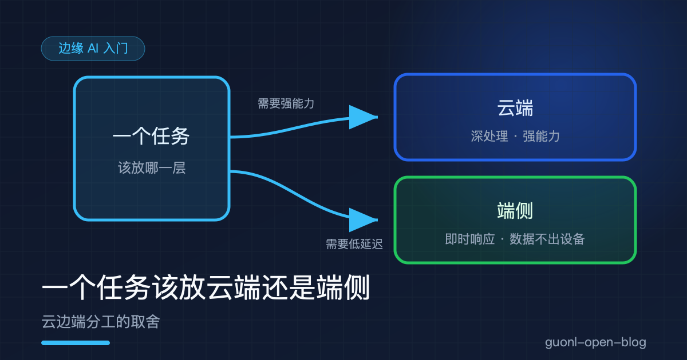
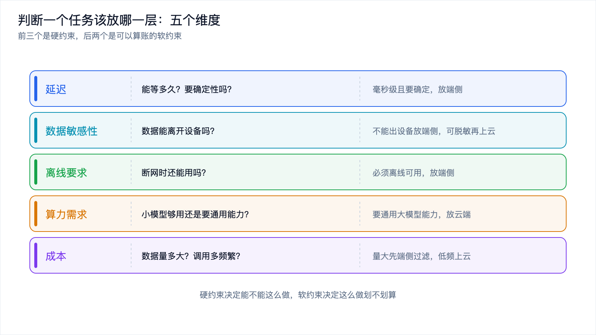
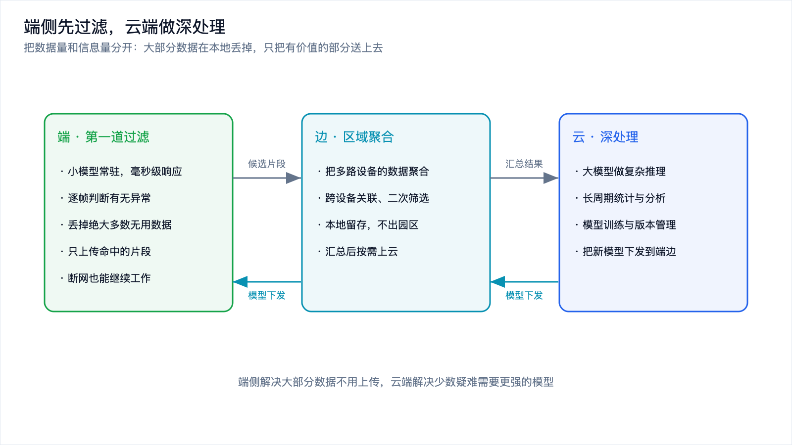
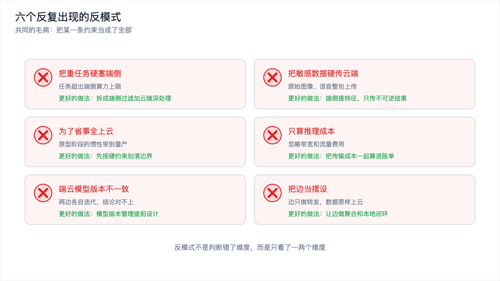
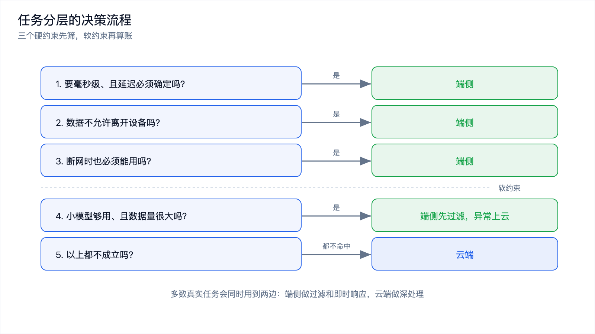

# 一个任务该放云端还是端侧：云边端分工的取舍

*2026-10-30 · 边缘 AI 入门*

## 先把问题问对

上一篇《边缘 AI 是什么》把云、边、端三层摆了出来，也给了一张初步判断表：延迟敏感、数据敏感、需要离线、数据量大的任务往端侧放，需要通用能力、低频非实时的任务往云端放。

那张表能用，但真到项目里会显得不够。因为真实任务很少整块地属于端或者属于云，它几乎总能被切开。人脸检测在端侧跑，人脸比对上云；语音唤醒在端侧，长句转写上云；设备振动监测在端侧出结论，月度趋势分析上云。切得对不对，直接决定这个系统的延迟、成本和隐私边界。

所以问题不该问成"这个任务放哪一层"，该问成两件事：这个任务里哪些部分必须留在本地，哪些部分可以搬走？边界划在哪儿，整体代价最小？

这篇就把这套判断方法拆开讲：五个判断维度、端侧先过滤加云端深处理的分层架构、"边"这一层什么时候值得加、几种混合形态，以及几个反复出现的反模式。

## 五个维度，先分清硬约束和软约束

判断一个任务放哪儿，看五个维度就够了：延迟、数据敏感性、离线要求、算力需求、成本。这五个不是平权的，**前三个是硬约束，后两个是可以算账的软约束**。硬约束决定"能不能这么做"，软约束决定"这么做划不划算"。

先看延迟。要问的是这个任务能等多久。人眼对交互反馈的容忍度大概在一百毫秒上下，超过就觉得卡；工业控制和避障这类场景更严，是毫秒级，而且要的是确定性，不是平均值。云端往返一次要经过网络传输、排队、推理、回传，顺利时几十毫秒，网络一抖就是几百毫秒，这个抖动还没法控制。端侧推理省掉了网络这一段，延迟低而且稳定。任务对延迟有硬指标，端侧几乎是唯一选择。

再看数据敏感性。要问的是这份数据能不能离开设备。人脸、声纹、身份证、病历、车内摄像头画面，很多场景根本不允许上传，这跟技术无关，是合规和信任问题。有些数据可以出设备但必须脱敏，比如只传特征向量不传原图，这时候端侧负责提取特征，云端只拿到脱敏后的结果。还有一类数据可以随便传，这一条就不构成约束。

离线要求。要问的是断网时这个功能还能不能用。工厂内网、野外设备、车载系统、地下车库，网络经常不可靠甚至完全没有。断网时功能必须继续工作，推理就得放在本地。断网时功能可以降级甚至暂停，这一条也不构成约束。

算力需求是软约束里的第一条。要问的是这个任务需要多大的模型。一个小模型就够用，端侧放得下；需要通用大模型的推理能力，端侧放不下，只能上云。这里容易犯错的地方是能力对齐：拿云端旗舰模型的效果当验收标准，然后要求端侧达到同样的效果，这在多数任务上做不到。

成本也是软约束。要问的是数据量和调用频率。云端推理通常按调用量计费，一台 1080p 摄像头如果每帧都上传，费用会很快失控；低频任务比如每天汇总一次报表，上云的成本可以忽略。算成本的时候要把传输算进去，很多人只算了推理费用，忘了带宽和流量也是钱。

把这五条整理成一张表：

| 维度 | 要问的问题 | 判断倾向 |
| --- | --- | --- |
| 延迟 | 能等多久？需要确定性吗 | 毫秒级且要确定，放端侧 |
| 数据敏感性 | 数据能离开设备吗 | 不能出设备放端侧；可脱敏则端侧提特征 |
| 离线要求 | 断网时还能用吗 | 必须离线可用，放端侧 |
| 算力需求 | 小模型够用还是需要通用能力 | 小模型够用放端侧，要通用能力放云端 |
| 成本 | 数据量多大？调用多频繁 | 数据量大放端侧先过滤，低频少量放云端 |

前面三条一旦命中，基本就定了；后面两条用来在"两边都能做"的时候做取舍。

*图 1：延迟、数据、离线是硬约束，算力和成本是可以权衡的软约束。*

## 端侧先过滤，云端做深处理

硬约束判断完，接下来的问题是怎么切。最通用的切法是两段式：端侧做第一道过滤，云端做深处理。

这个切法的关键在于把数据量和信息量分开。原始数据量大，但其中绝大多数是无关的。摄像头拍了一天，真正有异常的片段可能只有几十秒；麦克风一直开着，真正是唤醒词的只有那几个音节。端侧的第一道过滤就是干这个：用一个小模型逐帧、逐窗判断，把大部分无用数据直接丢掉，只把命中的片段或者一个结论送上去。

这样做的收益不只是省钱。带宽占用下降几个数量级，云端只需要处理少量疑难样本，隐私上大部分原始数据根本没离开设备，延迟上用户的即时反馈由端侧给出。四个驱动力同时受益，这就是这套架构流行的原因。

云端负责的是端侧干不了的那部分：需要大模型的复杂判断、需要跨设备长周期汇总的统计、需要历史数据才能做的对比，以及模型的训练和版本管理。端侧模型从哪来？通常是云端训练完再下发。

*图 2：端侧负责丢数据，云端负责解疑难，中间那层负责聚合。*

## "边"这一层什么时候值得加

端云两段式听起来干净，但中间那层边经常不是可有可无的。

设备数量一上来，逐台直连云端就不成立了。一个园区几百路摄像头，每路都建一条到云端的连接、各自上传、各自计费，网络和账单都撑不住。这时候在园区放一台服务器，把几百路的数据先聚起来，在本地做跨设备的关联，比如同一辆车从 A 口进、B 口出，只把聚合后的结论上云，价值立刻显现。

网络不稳的场景也一样。工厂车间、矿井、远洋船舶，上行带宽时有时无。边这一层可以在本地维持一个完整的闭环，网络通的时候同步，不通的时候自己跑。这种区域自治的能力，端侧单机做不到，它只能看到自己；云端也做不到，它够不着。

还有一类是合规边界。有些场景要求数据不能出厂区，但允许在厂区内集中。这时候边这一层就是那条合规边界本身：数据在厂内汇聚、处理、留存，只有统计结果出园区。

反过来，如果设备就一台两台、数据量不大、云端直连的延迟也能接受，那加一层边就是白花钱。加不加，看三件事：设备规模是否大到需要聚合、是否有跨设备协同的需求、是否有本地留存的合规要求。三条都不成立，端云两层就够了。

| 只有端和云就够 | 值得加一层边 |
| --- | --- |
| 设备数量少，任务互相独立 | 设备成百上千台，逐台上云不划算 |
| 数据量不大，直连云端成本可接受 | 需要跨设备、跨摄像头做关联 |
| 云端可达，延迟能满足要求 | 数据可以出设备但不能出厂区 |
| 没有本地留存的合规要求 | 网络不稳，需要区域自治 |

## 几种混合形态

分层切完，落地的形态其实就那么几种，认得出来就不会选错。

级联式，也就是前面讲的两段式。端侧粗筛，云端细判。适合绝大多数样本是负例、少量是正例的任务，比如工业质检和异常检测。

回退式。端侧先做，端侧置信度低的时候把请求转给云端。适合端侧模型在简单样本上够用、复杂样本上不够用的任务。代价是要设计一个可靠的置信度判断，以及一条随时可用的云端通路。

异步式。端侧立即响应，同时把数据攒起来，在空闲或者网络好的时候批量上云做分析和训练。适合用户要即时反馈、后台还想持续改进模型的场景。

协同式。云端训练、端侧推理，定期同步模型；或者云端模型给端侧模型当老师，用蒸馏把能力压进小模型。这是长期演进的做法，端侧模型的能力靠这条链路一点点涨。

这四种可以叠。一个真实的车载系统可能同时是级联、异步和协同。判断形态的时候不用纠结这是哪一种，只用问清两件事：哪些部分不能等，哪些部分不能走。

## 几个反复出现的反模式

方法讲完，说说实践里最常见的翻车方式。它们有个共同点：都是把某一条约束当成了全部。

把重任务硬塞端侧。看到端侧延迟低、数据不出设备，就把需要通用大模型能力的任务往端侧搬，结果是模型压到极小、精度崩掉，或者推理一次要好几秒。端侧的算力和内存是硬上限，任务超出这个上限，再优化也没用。

把敏感数据硬传云端。为了省事，把原始图像、原始语音整包上传。技术上的隐患是传输和存储都可能泄露，合规上的隐患是很多场景这条线不能碰。更稳的做法是端侧先把敏感信息提取成特征或者结论，只把不可逆的结果传上去。

为了省事全上云。原型阶段全上云跑得最快，容易形成惯性，一路做到量产才发现带宽和调用费扛不住，这时候架构已经定型，改起来很痛。

只算推理成本，不算传输成本。云端推理的单价好算，带宽和流量的成本容易被忽略，而数据量大的时候后者往往更贵。

端云模型不一致。端侧和云端的模型各自迭代，版本对不上，同一张图片两边结论不一样，排查起来非常麻烦。混合架构里，模型版本管理是一件必须提前设计的事。

把边当摆设。加了一层边，但边只做了个转发，数据原样上云，那这一层只增加了运维成本，没有产生任何价值。边的价值在于聚合、过滤和本地闭环，转发不算。

*图 3：反模式不是判断错了维度，而是只看了一两个维度。*

## 一张判断表和一套流程

把前面的内容收成可执行的流程。

先问三个硬约束，任意一条命中就往端侧走：

1. 这个任务要毫秒级且确定的响应吗？
2. 这份数据不允许离开设备吗？
3. 断网时这个功能必须继续工作吗？

三条都不命中，再看软约束：

4. 一个小模型能覆盖这个任务吗？能，而且数据量大，就用端侧先过滤。
5. 数据量不大、调用不频繁吗？是，就直连云端，别加中间层。
6. 云端模型能直接够到吗？够不到，或者需要区域自治，就加一层边。

走到最后还剩一个常见答案：任务能切，一半放端侧做过滤和响应，一半放云端做深处理。多数真实系统最终都是这个形态。

这套判断要尽早做。原型阶段图快，很容易顺手全上云，等架构定型、代码写完再回头改分层，成本会高一个量级。边界在第一天划清，后面每一层都只是往里填实现。

*图 4：三个硬约束先筛，软约束再算账，切不开的任务才整块放到某一层。*

## 写在最后

这一篇把"一个任务该放哪层"讲成了一套可操作的判断方法。五个维度里，延迟、数据敏感性、离线要求是硬约束，算力需求和成本是可以算账的软约束。最通用的架构是端侧做第一道过滤、云端做深处理，端侧负责丢数据，云端负责解疑难。中间那层边在设备规模大、需要跨设备协同、或者有本地留存要求的时候才值得加。落地的形态有级联、回退、异步、协同四种，可以叠着用。至于那六个反模式，共同的毛病是把一条约束当成了全部。

下一篇《模型量化入门：为什么 INT8 又快又省》，讲端侧部署绕不开的那一步：怎么把模型压小，同时把精度损失控制在能接受的范围内。
