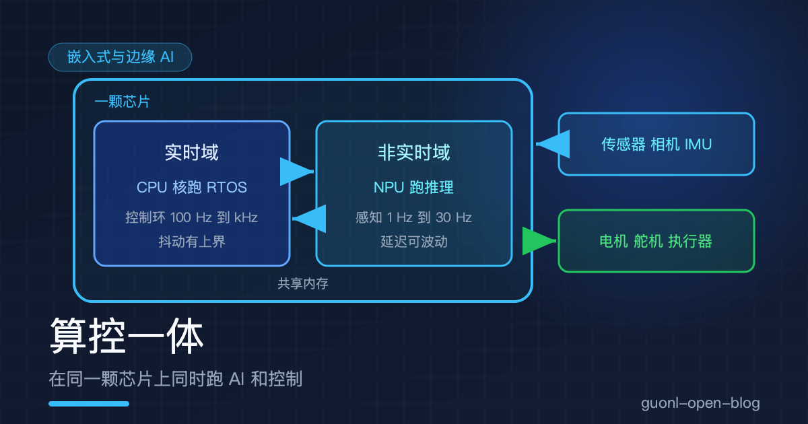
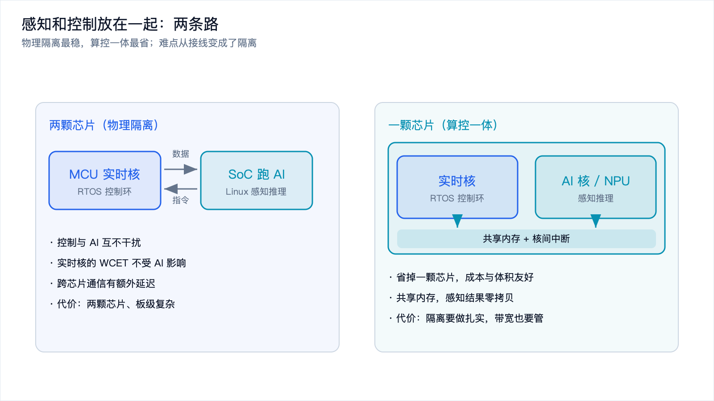
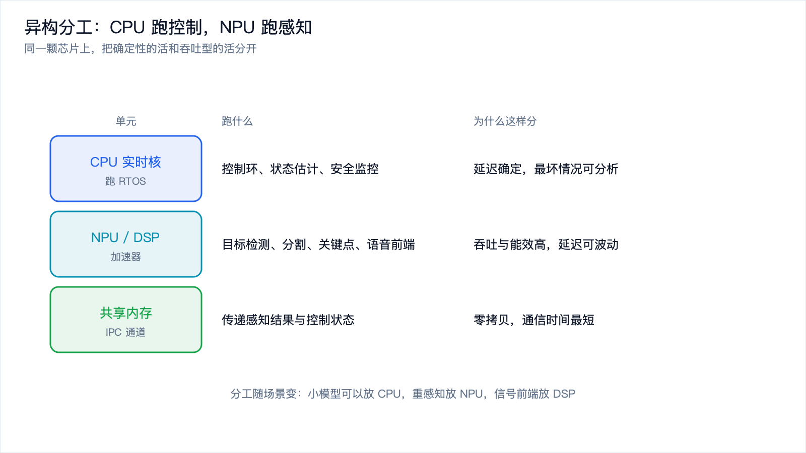
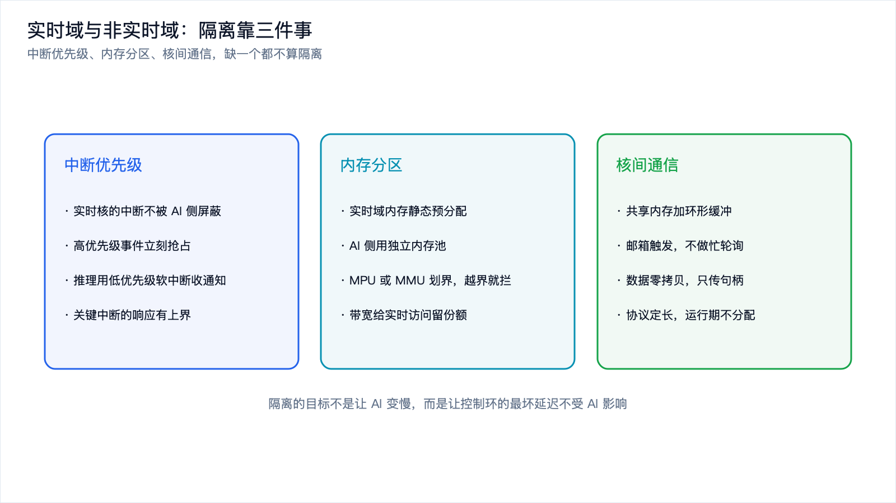
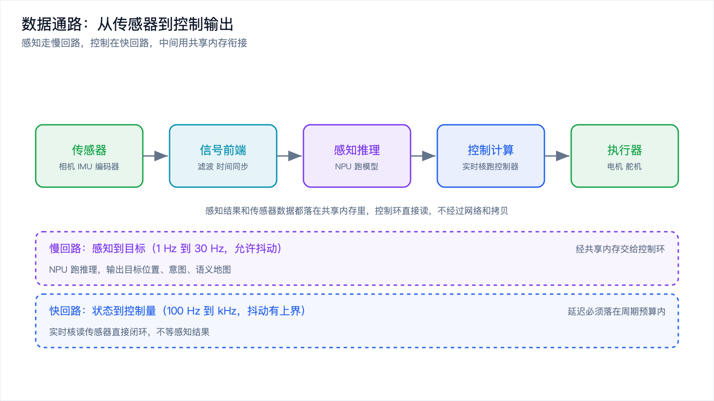

# 算控一体：在同一颗芯片上同时跑 AI 和控制

*2026-10-30 · 实时性与算控一体*

## 一台机器人身上的两个时间尺度

机械臂要抓桌上的杯子，得同时干两件事。一件是看懂：杯子在哪，杯口朝哪，旁边有没有东西挡着。另一件是抓准：六个关节每一刻该出多少力矩。

看懂的活靠相机加模型，一次推理几十毫秒，一秒跑几次就够。抓准的活靠电流环和位置环，一秒跑几千次，每次只有零点几毫秒。

这两件事在时间上差两个数量级，对确定性的要求也正好相反。[《RTOS 与实时性》](rtos-realtime.md)把这条冲突从操作系统那一侧讲过了：控制环要的是最坏情况可证明，模型推理给的是概率。那篇最后留了一条路没展开，就是算控一体，这篇接着往下讲：两类负载怎么放进同一颗芯片，芯片里怎么分工，隔离做在哪几个地方。

算控一体不是"把模型塞进实时核"，那样只会毁掉实时性。它的意思是同一颗芯片上有两种跑法不同的域，一个只求确定，一个只求吞吐。

## 为什么想把它们放到一起

最稳的做法是把它们分到两颗芯片上。控制跑在 MCU 上，模型跑在带 NPU 的 SoC 上，中间用串口、CAN 或者以太网连起来。方案能跑，实时性也最好保证，为什么还要费劲合到一颗芯片上？

省钱和体积是最直接的理由。多一颗芯片，就多一份封装、多一路供电、多一片 PCB 面积、多一套烧录和测试流程，还会多一份静态功耗。消费级产品对这几项都很敏感，一台扫地机或者一个玩具级的机械臂，多几十块钱的物料就可能吃掉全部毛利。

第二个理由更技术一点：片内通信比板级通信快得多，也干净得多。两颗芯片之间最快要走 SPI 或者以太网，延迟在几十微秒到毫秒级。同一颗芯片上，两个核通过共享内存交换一次数据，开销在纳秒到微秒级。对一秒要传几十次的感知结果，差别很实在。

还有一个理由常被忽略：数据不用搬家。相机、IMU 就接在芯片上，感知要的原始数据和控制环要的原始数据本来就是同一份，分两颗芯片就得复制一遍，还可能两边时间戳对不齐。放在一颗芯片上，两边读同一块内存，标定和对齐都省事。

| 维度 | 两颗芯片 | 算控一体 |
| --- | --- | --- |
| 实时性保障 | 最好，互不影响 | 取决于隔离做得如何 |
| 物料成本 | 高 | 低 |
| 板级体积与功耗 | 大 | 小 |
| 跨域通信延迟 | 几十微秒到毫秒 | 纳秒到微秒 |
| 数据共享 | 需要复制，时间戳要对齐 | 读同一块内存 |
| 开发难度 | 各自独立，容易调 | 跨核调试，问题难复现 |

表里最后一行才是真正的代价。两颗芯片的系统，控制侧的 bug 只可能在控制侧，AI 侧的 bug 只可能在 AI 侧。合到一颗芯片上之后，问题会跨域出现：推理把内存带宽吃满，控制环的抖动跟着变大；两边对共享内存的读写顺序没排对，偶发地读到半份数据。这类问题难复现，调起来很折磨。

*图 1：物理隔离最稳，算控一体最省，难点从"接线"变成了"隔离"。*

## 一颗芯片里，谁跑什么

决定要合之后，下一个问题是分工。

CPU 跑控制。控制环的本质是控制流：读寄存器、判断状态、算一个不算大的公式、写回寄存器，中间还有大量中断要处理。这正是通用 CPU 擅长的事，而且它配合 RTOS 的优先级抢占，最坏响应时间算得出来。控制环也不需要很强的算力，一个 kHz 级的 PID 或者几百赫兹的 MPC，普通核绰绰有余。

NPU 跑感知。目标检测、分割、关键点、语音前端这些活，本质是规则的乘加运算，数据量大、并行度高、对能效敏感。NPU 的乘加阵列正好对味，每瓦能干的活比 CPU 高一个数量级。代价是不灵活，它只认固定的算子表，还会出现算子回退。[《NPU、DSP、GPU》](npu-dsp-gpu.md)里讲过回退为什么会让加速效果打折，部署前拿编译器把模型过一遍是必做的功课。

DSP 有时候跑信号前端。图像去马赛克、滤波、IMU 预处理、麦克风阵列的波束成形都是定长向量的活，DSP 又省电又稳。

剩下一个角色是共享内存。它不是计算单元，但地位很关键，因为它是两个域之间唯一的通道。感知结果、时间戳、状态标志都从这里过，设计得好不好直接决定整套系统稳不稳。

反过来分工是不成立的。让 NPU 跑控制，它的编程模型面向张量，处理分支和中断很别扭，时序模型也不是为实时设计的；让 CPU 跑感知，能效上先亏一个数量级，推理还会把 CPU 占满。这两个错误听起来不会有人犯，但"在 CPU 上顺手跑个小模型"很常见，在算控一体的系统里要小心。

*图 2：同一颗芯片里，确定性的活交给 CPU 核，吞吐型的活交给加速器。*

## 隔离做在三件事上

把两类负载放进一颗芯片，最怕互相干扰。隔离不是一句口号，它落在三个具体的地方。

中断优先级。实时核上的中断不能被另一侧屏蔽。硬件上，AI 核有自己的中断控制器，但影响不到实时核的中断入口；软件上，AI 侧不该长时间关中断，更不能去改实时侧的时钟和电源配置。反过来，AI 侧的完成通知要用低优先级的软中断或者轮询来收。中断优先级排错是这类系统里最常见的失稳原因。

内存分区。实时域的内存必须静态预分配，运行期不做动态分配，它的访问延迟才没有意外。AI 侧要有独立的内存池，和实时域不重叠。硬件上通常靠 MPU 或 MMU 划边界，一侧越界访问立刻被拦，而不是等它悄悄改掉对方的数据。不少 SoC 还提供带宽配额，让实时域的访问有份额保障，这在多核抢带宽时很关键。

核间通信。两侧交换数据要有固定的协议和固定的缓冲区。常见做法是环形缓冲加邮箱：写方把数据写进共享内存的槽位，改一下写指针，再通过邮箱或者门铃寄存器通知对方；读方收到通知后按指针取数据。缓冲区大小、消息格式、超时和丢弃策略都要提前定死，运行期不申请内存、不阻塞等待。能零拷贝就零拷贝，传句柄而不是传一整帧数据。

还有一层容易被漏掉：缓存和带宽。就算调度和内存都分开了，AI 侧跑推理时仍然会大量访问内存，把共享的缓存挤掉，让实时核的访存变慢。实时核的 WCET 分析通常假设访存时间是稳定的，这个假设一旦被打破，算出来的余量就不作数了。所以隔离不只做在调度器里，还要做在总线和缓存这一层。

*图 3：中断、内存、通信三件事都做到位，才算真的把两个域分开。*

## 数据从传感器到控制输出

隔离讲完，再看一条完整的数据通路，就更容易理解两个域怎么配合。

传感器采样。相机、IMU、编码器、电流采样同时产生数据。相机帧大、频率低，IMU 和编码器数据小、频率高，从进芯片那一刻就该分流：高频的状态量走实时域，直接给控制环用；大块的图像走非实时域，交给感知。

信号前端。图像先做去马赛克、降噪、缩放，IMU 做温度补偿和低通滤波，处理完才够给模型用。

感知推理。模型在 NPU 上跑，输出目标框、关键点、深度或者语义地图。这一步延迟在几十毫秒量级，还会随场景波动，跑在慢回路上，频率从 1 Hz 到 30 Hz 不等。

跨域交接。感知结果写进共享内存，带上时间戳和一个序号，通过邮箱通知实时域。这里的关键是零拷贝，写进去的是描述信息，不是几百 KB 的图像。实时域读到的永远是最近一次完整的结果。

控制计算。实时核在控制环里读传感器状态，结合最近一次的感知结果，算出关节指令。它不等感知结果，控制环按自己的节拍走。感知还没更新时，用的是上一帧的目标加上状态估计，靠预测把这一段补上。

执行器输出。指令通过 CAN、EtherCAT 或者 PWM 发给电机。从采样到输出，实时域这一段的总延迟要落在周期预算内；感知那一段只要够新就行。

这里有个细节值得单独说：数据的新鲜度。控制环用到的是上一次的感知结果，它必须知道自己手上的数据有多旧。做法是每个感知结果带一个时间戳，控制侧在算之前先比一下，太旧了就降级处理，比如减速、停下，或者只做保守动作。少了这道检查，机器人会拿着一张过期几百毫秒的地图去撞墙。

*图 4：感知走慢回路，控制在快回路，中间靠共享内存衔接，控制环不等感知结果。*

## 什么时候不该用一颗芯片

控制环越硬、越紧，隔离的难度越高。电流环跑到几千赫兹、周期只剩零点几毫秒的系统，芯片上任何一点带宽争抢都可能吃掉余量，这种情况下两颗芯片更省心，多花的钱买的是确定性。

模型越重、越动态，隔离也越难。带动态形状的模型，或者要在设备上跑大语言模型的场景，内存占用和访问模式都不好预测，隔离措施要一层层加，最后可能发现共享总线才是瓶颈。团队和工具链也是现实约束，跨核调试比单核难得多，实时核上通常没有完整的调试工具，两边的时间线要靠共享日志拼起来，没有这方面的积累时，先上两颗芯片把功能跑通再合并，是更稳的路线。

判断顺序是：先把两件事的时间预算分开算清楚，再看芯片给不给得起隔离手段，中断能不能独立、内存能不能划界、带宽能不能分配，最后才去选型号。顺序反过来，多半会在调试时发现控制环被推理拖慢，那时候改架构的成本就高了。[《选板指南》](choose-edge-board.md)里把"要实时控制也要跑 AI"单列成一条选型分支，原因就在这里。

## 这条线通向具身智能

回到开头那台机械臂。它要聪明，就一定会用到模型；要能干活，就一定有控制环。这两件事的约束正好相反，而机器人身上通常只有一颗主控芯片。谁能在一颗芯片上把它们安排好，谁就解决了具身智能最底下那层工程问题。

[《端侧实时控制》](../embodied-ai/on-device-realtime-control.md)从控制环那一侧讲了同一件事：为什么大模型进不了控制环，为什么要分成慢回路和快回路。算控一体是这套分层的硬件落地方式，慢回路和快回路从"两个进程"变成了"两个域"，边界也从代码约定变成了硬件隔离。

这也解释了边缘 AI 的很多设计选择为什么长这样。模型量化不只是省内存，也是让推理时间可预测；静态内存规划不只是为了快，也是为了让延迟没有尖峰。在手机上算优化的事，到机器人身上就是底线。

## 写在最后

算控一体省掉一份物料、一份体积，让跨域通信从毫秒级降到微秒级，也让感知和控制用的原始数据不用复制。做法是把确定性的活交给 CPU 实时核，把吞吐型的活交给 NPU，中间用共享内存衔接。隔离落在三件事上：中断优先级要独立，内存要静态预分配并划界，核间通信要固定协议、零拷贝、不阻塞。缓存和带宽也要管住，否则实时核算好的 WCET 余量会被推理吃掉。

数据通路的核心是两条回路：感知在慢回路，控制在快回路，控制环不等感知结果，但必须知道自己手上的数据有多旧。这套架构有边界，控制环越硬、模型越动态，隔离越难；工具链跟不上的时候，两颗芯片反而是更成熟的选择。

架构立住了，下一个问题会从别的地方冒出来：设备装到现场之后，模型要迭代、固件要修 bug，你怎么把新东西安全地送进去，出了事怎么退回来。下一篇[《边缘设备的 OTA 与模型热更新》](edge-ota.md)，讲的就是这条更新链路。
