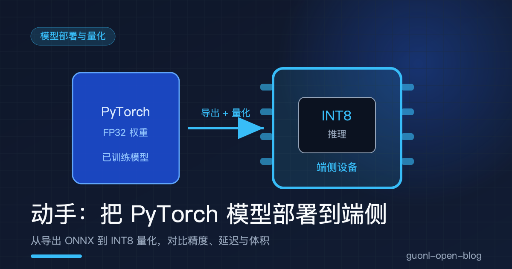
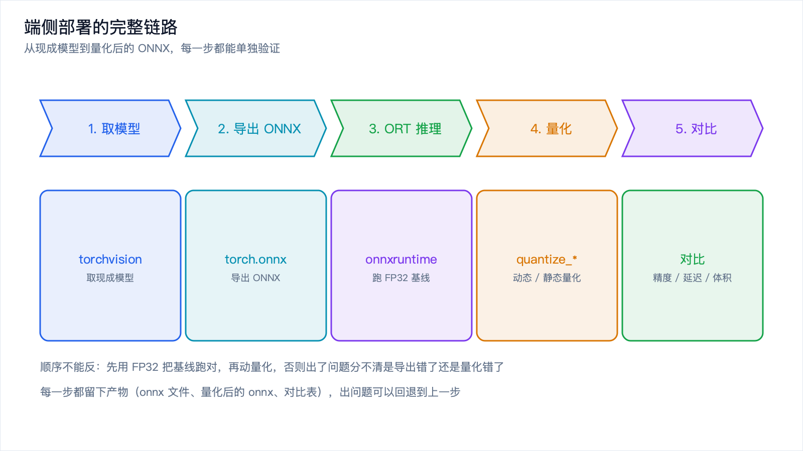
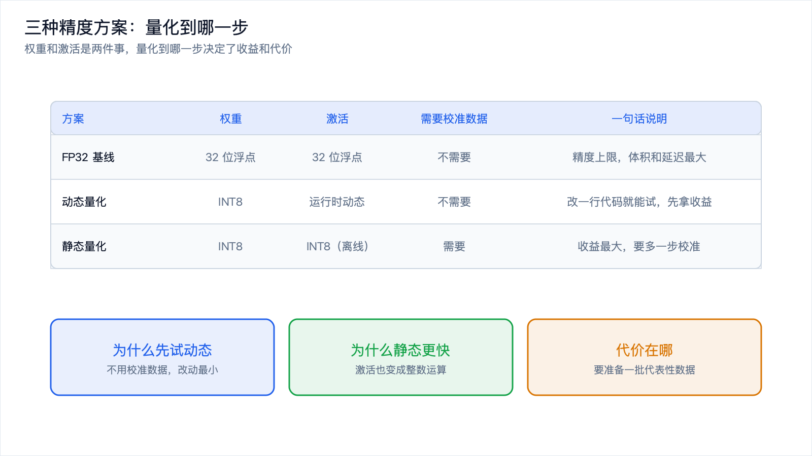
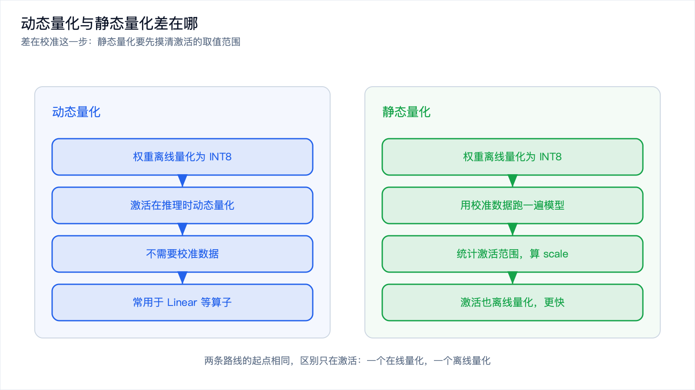
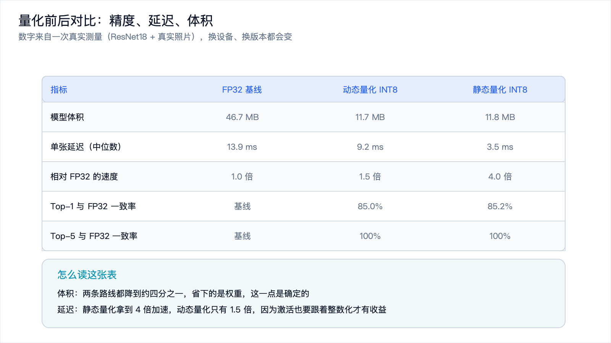

# 动手：把 PyTorch 模型部署到端侧



*2026-10-30 · 模型部署与量化*

## 这条链路要跑通什么

上一篇[《模型量化入门：为什么 INT8 又快又省》](quantization-intro.md)把量化的原理讲完了：定点数怎么表示实数，对称与非对称怎么选，精度损失从哪来，校准在做什么。

原理懂了，落到手上还有一个问题：具体怎么写代码？

这篇给一条完整、可复现的链路。用 torchvision 取一个现成的 ResNet18，导出成 ONNX，用 onnxruntime 跑一遍确认导出没出错，然后做动态量化和静态量化，最后把三个模型的精度、延迟、体积摆在一起对比。

代码全部基于公开的库和公开的模型权重，不需要 API Key，也不需要自己训练。下面的数字来自我在一台 Apple Silicon 笔记本上跑出来的结果，用的版本是 Python 3.11、torch 2.15、torchvision 0.29、onnx 1.23、onnxruntime 1.31。换一台设备、换一个版本，数字都会变，但变化的方向和量级是稳的。



*图 1：五个步骤，每一步都留下一个可以单独验证的产物。*

## 准备环境

一个虚拟环境，四个包：

```bash
python -m venv .venv
source .venv/bin/activate        # Windows 上用 .venv\Scripts\activate

pip install torch torchvision onnx onnxruntime numpy pillow
```

CPU 版就够了。这篇不涉及训练，也不用 GPU。如果你的机器有 NVIDIA 卡，可以按官网的说明装 CUDA 版 torch，但推理延迟的数字会变得没法直接对比。

另外准备一批图片用来评估。任何装了真实照片的目录都行，我这次用的是 Caltech101 的图片集，几千张自然场景照片。图片不参与训练，只用来跑推理、比结果。目录结构随意，脚本里按 `目录/子目录/*.jpg` 抓一遍就行。

## 第一步：取一个现成模型

```python
import os, glob, time, statistics
import numpy as np
import torch
from PIL import Image
from torchvision.models import resnet18, ResNet18_Weights
from torchvision import transforms
import onnxruntime as ort
from onnxruntime.quantization import (
    quantize_dynamic, quantize_static, CalibrationDataReader,
    QuantType, QuantFormat, CalibrationMethod,
)

# 取一个带预训练权重的模型
weights = ResNet18_Weights.DEFAULT
model = resnet18(weights=weights).eval()
print("参数量：%.1f M" % (sum(p.numel() for p in model.parameters()) / 1e6))
```

`eval()` 这一句不能省。PyTorch 的模型有训练和推理两种模式，批归一化和 Dropout 在两种模式下的行为不一样。如果忘了切到推理模式，导出的 ONNX 会带上训练态的分支，结果就是错的，而且错得不明显。

预处理必须和预训练时保持一致。torchvision 把均值方差这些参数挂在 `weights.transforms()` 上，直接拿过来用，比自己填一组数字安全：

```python
preprocess = transforms.Compose([
    transforms.Resize(256),
    transforms.CenterCrop(224),
    transforms.ToTensor(),
    transforms.Normalize(mean=weights.transforms().mean,
                         std=weights.transforms().std),
])
```

`Resize` 加 `CenterCrop` 是 ImageNet 系列模型的标准做法：先把短边缩到 256，再从中心裁一块 224 见方。少了这一步，输入尺寸不对，模型直接报错；用了别的缩放方式，尺寸对了但精度会掉，而且掉得莫名其妙。

然后准备两组数据，一组评估、一组校准，两组不能重叠：

```python
IMG_DIR = "images"                      # 换成你自己的图片目录
files = sorted(glob.glob(os.path.join(IMG_DIR, "*", "*.jpg")))

def load_images(idxs):
    return torch.stack([preprocess(Image.open(files[i]).convert("RGB"))
                        for i in idxs]).numpy()

test_x = load_images(range(0, 500))       # 评估用，500 张
cal_x = load_images(range(1000, 1200))    # 校准用，200 张
```

为什么要分开，后面讲静态量化时会说清楚。

## 第二步：导出 ONNX

```python
fp32_path = "resnet18.onnx"
dummy = torch.randn(1, 3, 224, 224)
with torch.no_grad():
    torch.onnx.export(
        model, dummy, fp32_path,
        input_names=["input"], output_names=["logits"],
        opset_version=17,
        dynamic_axes={"input": {0: "batch"}, "logits": {0: "batch"}},
        dynamo=False,
    )
print("ONNX 体积：%.1f MB" % (os.path.getsize(fp32_path) / 1e6))
```

几个参数值得单独说。

`opset_version` 是 ONNX 的算子集版本。版本越高支持的算子越多，但下游 runtime 不一定跟得上。17 是一个比较稳的选择，近几年的 onnxruntime 都支持。具体选哪个，以你手上 runtime 的支持范围为准。

`dynamic_axes` 声明哪些维度是可变的。这里把 batch 维标成动态，导出的模型就能接受任意批大小。不声明的话 batch 会被写死成 1，之后想批量推理只能重新导出。这也解释了为什么导出时要喂一个 dummy 输入：模型需要知道输入的形状，才能把计算图固化下来。

`dynamo=False` 是导出器的选择。PyTorch 2.9 之后新的导出器成了默认，老的那个叫 legacy TorchScript 导出器，行为有差别。这里显式指定用老的，是为了让这篇的流程稳定复现。你手上的版本如果默认已经是新的，去掉这个参数也能跑，但导出的图可能不一样。

跑完你会得到一个 46.7 MB 的文件。ResNet18 有 11.7 M 个参数，每个 4 字节，算下来就是 46.8 MB，和文件大小对得上。这个对账很有用：如果导出的文件明显比参数量乘 4 大，多半是权重被存了两份或者带了额外的常量。

## 第三步：用 onnxruntime 跑通 FP32 基线

导完不要急着量化。先确认导出这一步没出错。

```python
sess = ort.InferenceSession(fp32_path, providers=["CPUExecutionProvider"])
ort_out = sess.run(None, {"input": test_x[:8]})[0]
with torch.no_grad():
    torch_out = model(torch.from_numpy(test_x[:8])).numpy()
print("torch 与 ort 的最大绝对差：%.2e" % np.abs(ort_out - torch_out).max())
```

拿同一批输入，让 PyTorch 和 onnxruntime 各算一遍，比输出差多少。我这次的结果是 `1.14e-05`，也就是十万分之一这个量级。浮点运算顺序不同会带来这种级别的差异，属于正常。

这一步为什么不能跳？因为后面量化一定会让精度掉一点。如果没做这个校验，量化之后发现结果不对，你没法判断是导出环节出了错，还是量化环节出了错。先把这个基线钉死，问题就只剩下一个方向。

## 第四步：动态量化

```python
dyn_path = "resnet18.dynamic.int8.onnx"
quantize_dynamic(fp32_path, dyn_path, weight_type=QuantType.QInt8)
print("动态量化体积：%.1f MB" % (os.path.getsize(dyn_path) / 1e6))
```

三行代码，体积从 46.7 MB 掉到 11.7 MB，正好是四分之一。

动态量化的做法是：权重离线量化成 INT8，激活值在每次推理时临时算一遍缩放系数再量化。权重占了模型体积的绝大部分，把权重压下去，体积就压下去了。

它最大的好处是不需要校准数据。改一行代码就能试，先拿到体积上的收益，看看精度能不能接受，再决定要不要往静态量化走。

代价在算的时候：每次推理都要额外做一遍激活值的范围统计和量化，这份开销是省不掉的。



*图 2：权重和激活是两件事，量化到哪一步决定了收益和代价。*

## 第五步：静态量化

静态量化多一步校准。先给它一个能一批一批吐数据的读取器：

```python
class CalibReader(CalibrationDataReader):
    def __init__(self, data):
        self.data = data
        self.it = iter(range(len(data)))

    def get_next(self):
        i = next(self.it, None)
        return None if i is None else {"input": self.data[i:i + 1]}


st_path = "resnet18.static.int8.onnx"
quantize_static(
    fp32_path, st_path, CalibReader(cal_x),
    quant_format=QuantFormat.QDQ,
    calibrate_method=CalibrationMethod.MinMax,
    activation_type=QuantType.QUInt8,
    weight_type=QuantType.QInt8,
    per_channel=True,
)
print("静态量化体积：%.1f MB" % (os.path.getsize(st_path) / 1e6))
```

`quantize_static` 会拿校准数据把模型完整跑一遍，只做前向计算，记录每一层激活值的取值范围，据此给每层定出 scale 和 zero point。做完之后激活值也有了固定的量化参数，推理时不用再临时算，这就是它比动态量化快的来源。

几个参数的含义：

`quant_format` 决定生成什么形式的量化图。`QDQ` 是把量化、反量化拆成独立的算子插在原来的算子两边，兼容性好，出问题容易定位，适合调试和跨平台。另一种是 `QOperator`，把量化直接融进算子内部，通常更快，但换一个 runtime 可能就不认了。

`calibrate_method` 是定范围的方法。`MinMax` 直接取校准数据里的最小最大值，实现最简单，但一两个离群点就能把范围撑大。还有 `Entropy` 和 `Percentile` 两种，思路都是把极端值裁掉，用一点截断误差换整体精度。我这次两种都试了，在这个模型上结果几乎一样。

`activation_type` 和 `weight_type` 分别是激活和权重的量化类型。权重常用 `QInt8`，因为权重分布通常关于 0 对称；激活用 `QUInt8`，因为卷积网络的激活经过 ReLU 之后大量落在非负区间。

`per_channel=True` 让每个输出通道各有一套量化参数。代价只是多存几个 scale，收益是通道之间数值范围差异大时精度明显更好。这个开关值得一直开着。

结果：体积 11.8 MB，和动态量化的 11.7 MB 几乎一样。体积主要由权重决定，两条路线都动到了权重，所以体积上没有区别。



*图 3：两条路线的起点相同，区别只在激活是离线量化还是在线量化。*

## 第六步：把三个模型放在一起比

写一个测量函数，把体积、延迟、精度一次测完：

```python
def bench(path, x, runs=40, warmup=8, threads=4):
    so = ort.SessionOptions()
    so.intra_op_num_threads = threads
    s = ort.InferenceSession(path, so, providers=["CPUExecutionProvider"])
    inp = s.get_inputs()[0].name

    for _ in range(warmup):                 # 先热身，把首次开销排除掉
        s.run(None, {inp: x[:1]})

    ts = []
    for _ in range(runs):
        t0 = time.perf_counter()
        s.run(None, {inp: x[:1]})           # batch = 1，模拟端侧单张推理
        ts.append((time.perf_counter() - t0) * 1000)

    logits = np.concatenate([s.run(None, {inp: x[i:i + 32]})[0]
                             for i in range(0, len(x), 32)])
    return os.path.getsize(path) / 1e6, statistics.median(ts), logits


rows = {}
for name, path in [("FP32", fp32_path),
                   ("动态 INT8", dyn_path),
                   ("静态 INT8", st_path)]:
    rows[name] = bench(path, test_x)

base = rows["FP32"][2]
b1 = base.argmax(1)
b5 = np.argsort(-base, axis=1)[:, :5]
print("%-10s %10s %10s %10s %10s %10s" %
      ("方案", "体积(MB)", "延迟(ms)", "Top1一致", "Top5一致", "logit MAE"))
for name, (size, lat, logits) in rows.items():
    agree1 = (logits.argmax(1) == b1).mean()
    agree5 = np.mean([b1[i] in b5[i] for i in range(len(b1))])
    print("%-10s %10.1f %10.2f %9.1f%% %9.1f%% %10.3f" %
          (name, size, lat, agree1 * 100, agree5 * 100,
           np.abs(logits - base).mean()))
```

延迟测量里有两个细节容易做错。一个是热身：第一次推理包含内存分配和算子准备，耗时会明显偏高，不热身会把平均数拉歪。另一个是取中位数而不是平均数：推理耗时的分布有长尾，偶尔被系统调度打断一次，平均数就被带跑了。

还有一点，`intra_op_num_threads` 要固定住。线程数一变，延迟就变，不同方案之间就没法比。这里固定成 4。

跑出来的结果：

| 方案 | 体积 | 延迟（中位数） | 相对速度 | Top-1 与 FP32 一致 | Top-5 与 FP32 一致 | logit 平均绝对差 |
| --- | --- | --- | --- | --- | --- | --- |
| FP32 基线 | 46.7 MB | 13.9 ms | 1.0 倍 | 基线 | 基线 | 0 |
| 动态量化 INT8 | 11.7 MB | 9.2 ms | 1.5 倍 | 85.0% | 100% | 0.196 |
| 静态量化 INT8 | 11.8 MB | 3.5 ms | 4.0 倍 | 85.2% | 100% | 0.109 |



*图 4：同一条链路三个产物的实测结果，数字会随设备和版本变化。*

表里有三件事值得展开。

体积。两条路线都降到约四分之一，和参数量乘以位宽算出来的预期一致。这一项是最确定的：只要权重真的被量化了，体积就一定会掉到这个量级。

延迟。静态量化拿到了 4 倍加速，动态量化只有 1.5 倍。差别的来源就是激活。静态量化把激活也变成整数运算，整个推理走的是整数内核；动态量化只把权重量化成整数，激活还得先在运行时算范围再量化，多出来的这一步吃掉了大部分收益。

精度。这个数字要看清楚它是什么。Caltech101 的类别和 ImageNet 的 1000 类对不上，所以这里没法算真正的准确率，只能算「和 FP32 预测一致的比例」。85% 这个数字看着不高，原因是这批图片对模型来说本身就不轻松：FP32 的 Top-1 logit 领先第二名平均只有 1.26，置信度不高，边界上的样本本来就容易被量化误差推过界。在 ImageNet 验证集上，同样这个流程的一致率通常在 99% 以上。

真正该看的是趋势，不是绝对值：Top-5 一致率两个方案都是 100%，说明排序基本没被破坏，只是前几名之间有轻微换位；logit 的平均绝对差只有 0.1 到 0.2，量级很小。这才是「量化基本无损」的真实含义。

## 几个一定会踩的坑

第一个坑是校准集的分布。这是最容易把量化做废的地方。校准数据必须贴近部署时会遇到的真实输入，数量几百张就够，但分布要对。我一开始图省事，拿一批 32×32 放大到 224 的图片去校准，结果量化后的模型和 FP32 几乎完全对不上，logit 平均绝对差超过 2，比 logit 本身的标准差还大。换成真实照片重新校准，误差立刻掉回 0.2 以下。

第二个坑是模型本身对量化友好不友好。同一个流程换一个模型，结果可能完全不同。我顺手试了 MobileNetV3-Small：FP32 的 ONNX 只有 10.2 MB，量化后 2.7 MB，体积照样掉到四分之一，但精度直接崩了，和 FP32 的 Top-1 一致率掉到个位数，logit 平均绝对差超过 2。它的 hard-swish 激活和 SE 结构对量化不友好，在这种默认配置下就是压不住误差。处理办法是逐层看误差、把敏感层排除掉不量化，或者退回 FP16。这件事说明量化不是套公式，必须拿自己的模型实测。

第三个坑是延迟测量本身。不热身、只跑一次、线程数不固定、拿平均数当结论，这几种做法都会给出误导性的数字。更稳妥的办法是用 runtime 自带的性能工具，或者至少跑几十次取中位数。

第四个坑是量化后的模型不通用。ONNX 的量化表示有好几种，`QDQ` 和 `QOperator` 生成的图不一样，不同 runtime、不同后端认的也不一样。在一个 runtime 上跑得飞快的量化模型，换到另一个可能根本加载不了，或者算子回退到 FP32，速度反而比原来慢。端侧部署前，一定要在目标 runtime 上实测。

还有一层是这个流程没覆盖的：目标设备上的算子支持。这篇用的是 CPU 推理。真正跑到手机或开发板上，你会希望模型走 NPU 或 DSP，而那个后端支持的算子集往往更小，遇到不支持的算子就回退到 CPU，性能断崖式下跌。所以「在笔记本上量化成功」只是第一步，离「在目标设备上跑得好」还有一段路。

## 写在最后

这篇走完了一条从 PyTorch 到端侧的完整链路：取模型、导出 ONNX、用 onnxruntime 验证导出正确、动态量化、静态量化，最后把三个模型的体积、延迟、精度摆在一起比。

回头看，有四个判断可以带走。导出之后必须拿 FP32 基线对一遍，把问题隔离在量化环节之前。动态量化改动最小，先拿体积收益；静态量化多一步校准，换来整数激活的加速。体积的收益是确定的，延迟和精度的收益取决于模型和 runtime，只能实测。校准数据的分布，是整套流程里最容易出错的一环。

不过这条链路针对的是几十兆的视觉模型。如果目标换成几十亿参数的大语言模型，内存的账就完全是另一回事了：权重动辄几个 GB，上下文还会带来一块持续增长的开销。下一篇[《在设备上跑大模型为什么难：内存墙与带宽瓶颈》](on-device-llm.md)，就来算这笔账。
