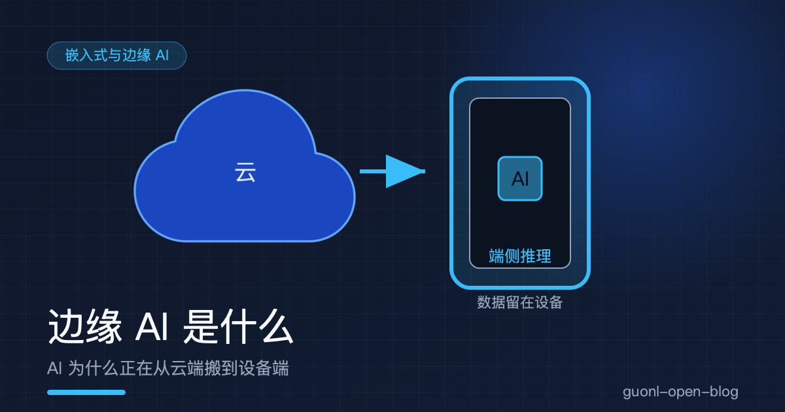
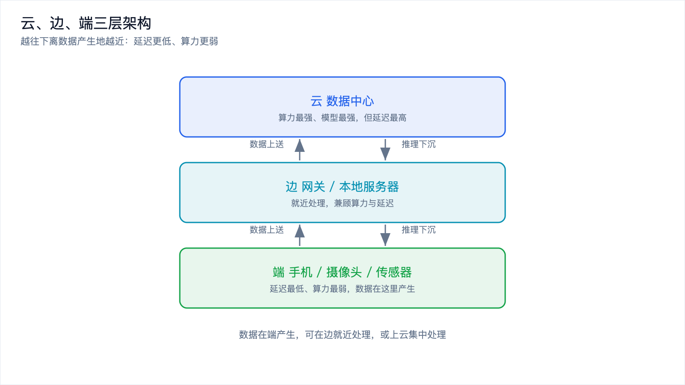
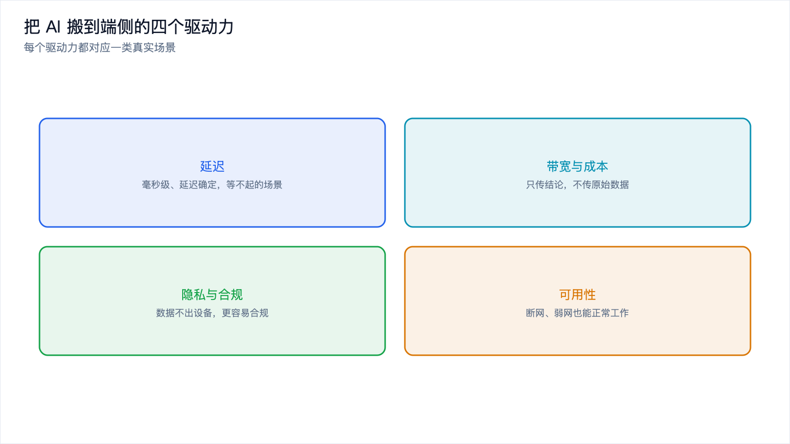
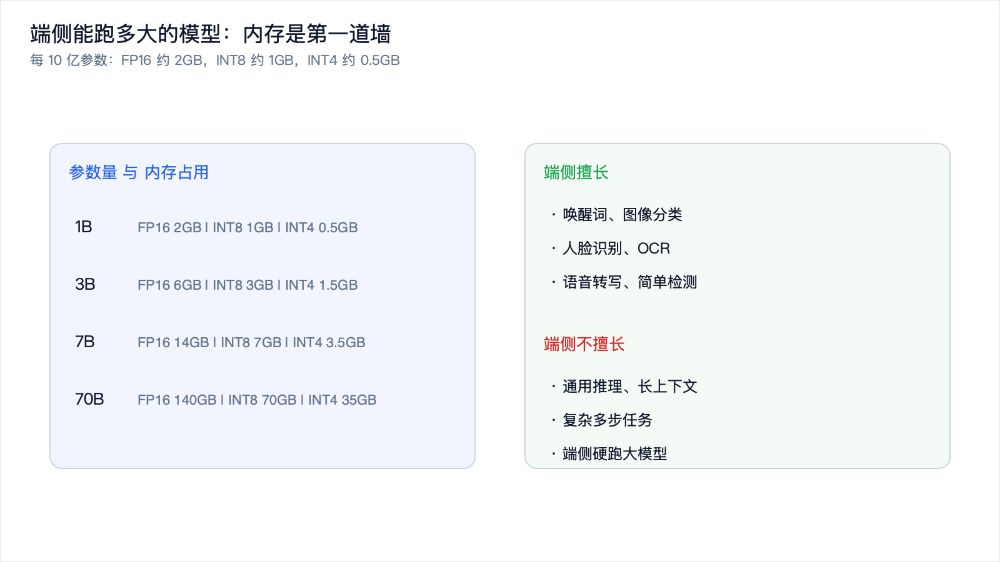
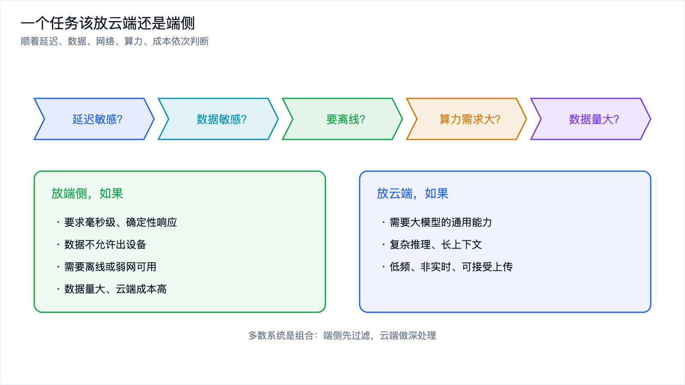

# 边缘 AI 是什么：AI 为什么正在从云端搬到设备端

*2026-10-30 · 边缘 AI 入门*

## 从一个每天都在用的功能说起

你现在打字，输入法会联想下一个词。你拿起手机，人脸解锁几乎是瞬间完成的。你拍照，相机自动识别出"人像""美食""夜景"并调整参数。你喊一声唤醒词，音箱就醒了。

这些功能背后都是模型在跑，但有一件事你可能没注意：它们全都在你的设备上完成，没有一个字、一帧画面被传到云端。

如果反过来，把每次按键、每帧画面、每段音频都传到云端算完再传回来，会发生什么？打字联想要等半秒才出来，人脸解锁要转圈，相机预览卡顿，而且你的输入内容、人脸、语音全都离开了设备。体验和隐私都受不了。

这就是边缘 AI 要解决的问题。这篇作为"嵌入式与边缘 AI"专题的第一篇，先把概念讲清楚：边缘 AI 到底是什么，"边缘"指哪里，为什么大家要把 AI 从云端搬到设备端，以及端侧到底能做到什么程度。

## "边缘"到底指哪里

先把"边缘"这个词说清楚，它容易被误解成地理概念。

完整的系统通常分三层：

- 端：数据产生的地方。手机、摄像头、传感器、车机、工控设备、机器人，都算端。
- 边：离端很近的一层。家庭网关、园区里的本地服务器、运营商的边缘机房，都属于边。
- 云：远端的数据中心，算力最集中、模型最强。

"边缘"指的不是某个具体位置，而是一种相对关系：离数据产生地足够近、能就近处理的地方。端和边都可以叫边缘，区别只在离数据有多近。

所以边缘 AI 的定义可以一句话说清：把模型的推理放在数据产生地附近，而不是全部送到远端数据中心。

这里补一句，为什么中间还要有"边"这一层。只分端和云两层，很多时候不够用：端侧算力太小，干不了稍重的活；全丢云端，又太远、太贵。于是就有了中间这一层，园区里的服务器、工厂的工控机、车里的域控制器都算，它们离设备很近，算力又比设备强，可以先把一个区域的数据聚起来做一轮处理，只把真正需要的部分送上云。端、边、云更像是按"离数据远近"排开的三级台阶，具体用几级，看场景。

*图 1：云、边、端三层。越往下离数据越近，延迟越低、算力越弱。*

## 为什么要把 AI 搬到端侧：四个驱动力

把推理放回端侧，不是为了赶时髦，而是有四个实打实的理由。

**延迟。** 一次云端往返，要经过网络传输、排队、推理、再传回来，顺利的话几十毫秒，网络一抖就是几百毫秒。端侧推理没有网络这一段，可以做到毫秒级，更重要的是延迟是确定的。自动驾驶避障、工业质检、AR 交互这类场景，等不起也赌不起。

**带宽和成本。** 一台 1080p 摄像头，一天产生的视频数据量非常可观。如果全都传到云端处理，带宽先扛不住；就算带宽够，云端推理通常按调用量计费，海量数据的推理成本会迅速失控。在端侧就地处理，只把结论（比如"检测到异常"）传回去，数据量和费用能降几个数量级。

**隐私与合规。** 人脸、语音、身份、医疗、金融这些数据，很多场景根本不允许离开设备。数据不出设备，就没有传输泄露的风险，也更容易满足合规要求。

**可用性。** 工厂内网、野外设备、车载系统，很多时候网络不可靠甚至没有网络。推理放在端侧，断网也能正常工作。

| 维度 | 云端推理 | 端侧推理 |
| --- | --- | --- |
| 延迟 | 几十到几百毫秒，受网络影响 | 毫秒级，延迟确定 |
| 数据是否出设备 | 要上传 | 不出设备 |
| 带宽占用 | 高 | 低，只传结论 |
| 可用性 | 依赖网络 | 可离线 |
| 算力与模型能力 | 强，可跑大模型 | 弱，只能跑小模型 |
| 成本结构 | 按调用量计费 | 一次性硬件成本 |

这张表也点出了端侧的代价：算力和模型能力明显更弱。后面的取舍，都围绕这一点展开。

*图 2：把推理放到端侧的四个驱动力，各自对应一类真实场景。*

## 一个类比：总店和社区便利店

如果上面的术语还是有点抽象，可以换个生活化的视角。

云端像一家总店：货最全，能处理任何复杂需求，但它在远处，去一趟要花时间，高峰期还得排队。

端侧像楼下的社区便利店：货不全，只卖最高频的刚需，但它就在楼下，随时能去，拿了就走。

你要买一瓶水，会去便利店，不会专门跑一趟总店。但你要买一台特定型号的专业设备，还是得去总店。

大多数真实系统也是这样分工的：高频、简单、对延迟敏感的需求放在端侧，复杂、低频、需要强能力的需求交给云端。边缘 AI 不是要取代云端，而是让两者各干各擅长的活。

这个类比还能解释一件事：为什么端侧模型通常都"小而专"。便利店不会把总店的货全搬过来，端侧也不会硬塞一个通用大模型，而是针对具体任务挑一个刚好够用的小模型。

## 端侧能跑多大的模型：现实的边界

理解了分工，接着要问一个更实际的问题：端侧到底能跑多大的模型？

端侧受三个硬约束：内存、算力、功耗。其中内存是最先撞到的墙。

一个粗略的估算方法：模型每 10 亿参数，用 FP16 存储约占 2GB，INT8 约占 1GB，INT4 约占 0.5GB。按这个算，一个 7B 参数的模型，即使用 INT4 量化，光权重就要约 3.5GB，再加上运行时还要给 KV cache 和系统留内存，手机上跑起来非常紧张。这也是为什么端侧大模型是这两年的热门课题，却依然不容易。

算力和功耗是另外两道约束。端侧算力有限，同一个任务在云端几百毫秒能算完，端侧可能要几秒；功耗和散热更麻烦，设备长时间满载推理会发烫、掉电，手机尤其明显。所以端侧模型不只要小，还要在算力和功耗上都划算，这三个约束是绑在一起的。

在这个约束下，端侧擅长和不擅长的东西分得很清楚。

端侧擅长的，是"小模型 + 专用任务"：唤醒词检测、图像分类、人脸识别、OCR、语音转写、简单的目标检测。这些任务模型小、输入输出明确、对延迟敏感，正好是端侧的主场。

端侧不擅长的，是通用推理、长上下文、复杂的多步任务。这些需要大模型的通用能力，端侧放不下，也跑不快。

所以在能力上，端侧小模型和云端旗舰之间有明显差距。选型时真正要做的，是在"能力"和"延迟、隐私、成本"之间做权衡：如果任务本身不复杂，端侧的小模型就够用；如果非要端侧跑通用大模型，那多半是选错了场景。

*图 3：端侧受内存约束，擅长小而专的任务，不擅长通用推理与长上下文。*

## 云边端怎么分工：一张判断表

概念讲完，落到最实用的问题：手上的一个任务，到底该放云端还是端侧？

可以顺着几个问题往下问。

先问延迟：这个任务对延迟敏感吗？要毫秒级、要确定性，那就优先端侧。

再问数据：数据敏感吗？能不能离开设备？不能，那就端侧。

再问网络：需要离线或弱网可用吗？需要，那就端侧。

再问算力：任务复杂吗？需要大模型的通用能力吗？需要，那端侧放不下，只能云端。

最后问成本：数据量大吗？如果数据量很大、云端按量计费会很贵，端侧更划算。

把这几条整理成表：

| 任务特征 | 建议 |
| --- | --- |
| 延迟敏感、要求确定性响应 | 端侧 |
| 数据敏感、不允许出设备 | 端侧 |
| 需要离线或弱网可用 | 端侧 |
| 数据量大、云端成本高 | 端侧 |
| 需要大模型的通用能力、复杂推理 | 云端 |
| 低频、非实时、可接受上传 | 云端 |

真实系统里，更多时候是组合：端侧做第一道过滤和响应，把复杂的、低频的部分交给云端。比如摄像头在端侧判断"这一帧有没有人"，只在有异常时把关键帧传上云端做进一步分析。

*图 4：用几个问题给任务定位，多数场景是端侧先过滤、云端做深处理。*

## 三个常见误解

边缘 AI 很热，热的地方最容易产生误解。澄清三个最常见的。

第一个误解是，边缘 AI 就是把大模型塞进手机。不是。边缘 AI 的主流形态是"小模型 + 专用任务 + 场景裁剪"，把一个刚好够用的小模型放到设备上解决具体问题。把大模型塞进手机只是其中一条探索路线，而且目前还很吃力。

第二个误解是，端侧一定比云端快。不一定。端侧算力弱，重任务在云端反而更快。端侧真正赢的地方是延迟的确定性和数据不出设备，而不是绝对速度。如果任务本身不要求低延迟，云端跑得更快也更好。

第三个误解是，边缘 AI 只是为了省钱。省钱只是其中一个理由。隐私、离线可用、延迟确定性，都是独立的价值，而且在很多场景里比省钱更重要。一个不能把数据传出去的场景，省不省钱都得在端侧做。

## 为什么是现在

边缘 AI 不是新概念，早些年就有研究，但一直停留在实验室。这两年开始真正落地，是因为三个条件同时成熟了。

模型能变小了。量化、蒸馏、剪枝这些技术成熟起来，加上一批原生就是为端侧设计的小模型，让"够用的能力"可以塞进有限的资源里。

硬件变强了。手机 SoC 普遍内置 NPU，开发板的算力也上了一个台阶，端侧跑推理不再是勉强为之。

工具链成熟了。ONNX、TFLite、llama.cpp 这些部署工具让"把模型跑到设备上"有了标准路径，不用再从头造轮子。

三个条件凑齐，边缘 AI 才从一个研究课题，变成了一个工程上可以认真考虑的选项。

## 写在最后

这一篇没有写代码，先把概念立住了。边缘 AI 是把模型推理放到数据产生地附近，端和边都算边缘。把 AI 搬到端侧有四个驱动力：延迟、带宽与成本、隐私与合规、可用性。云和端不是取代关系，而是像总店和便利店一样分工。端侧受内存约束，擅长小而专的任务，不擅长通用推理和长上下文。一个任务该放哪层，可以从延迟、数据、网络、算力、成本这几个问题推出来。至于那三个误解，端侧不等于塞大模型、不等于一定更快、也不只是为了省钱。

概念清楚了，接下来要回答一个更实际的问题：手上一个具体任务，到底该放云端还是端侧。下一篇《一个任务该放云端还是端侧：云边端分工的取舍》，把上面这套判断拆成一套可以照着走的方法。
