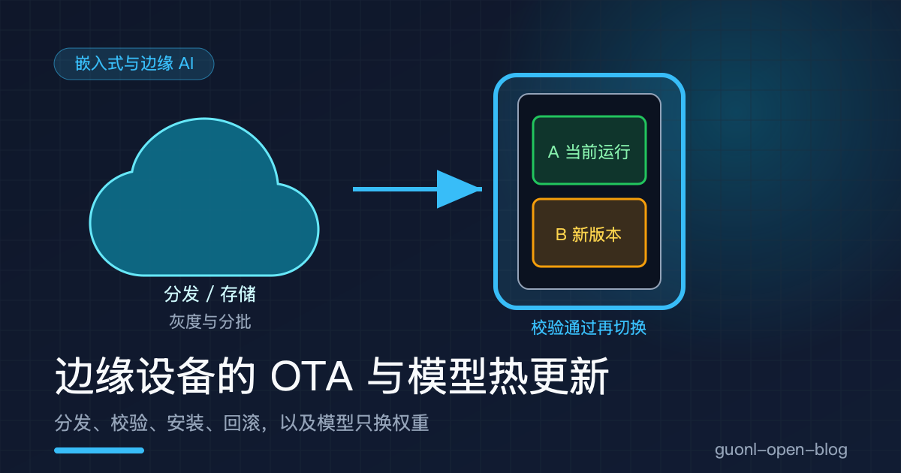
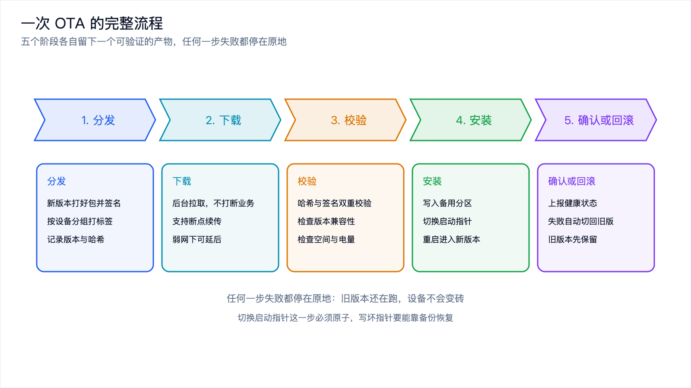
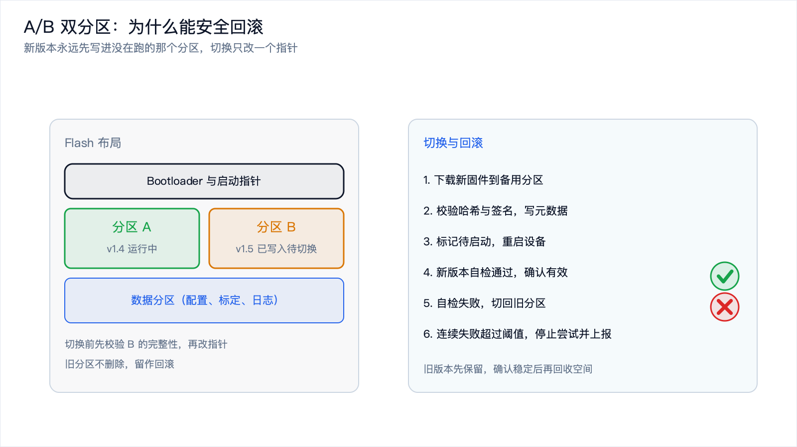
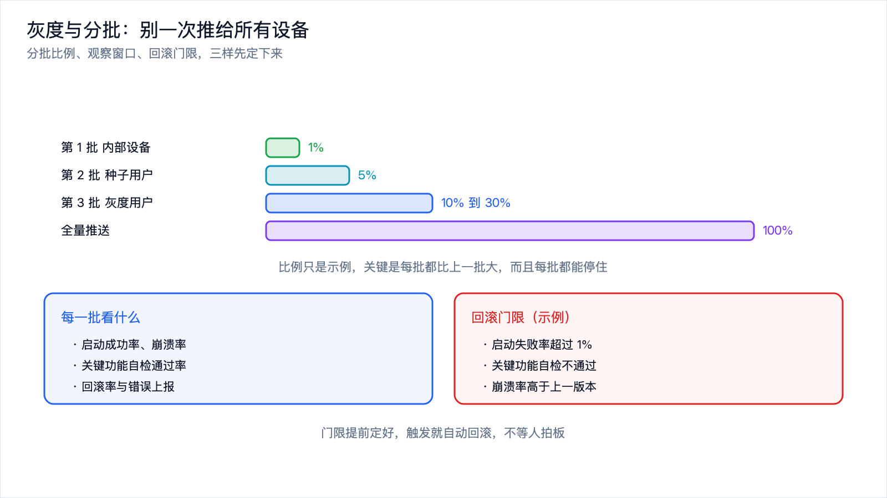
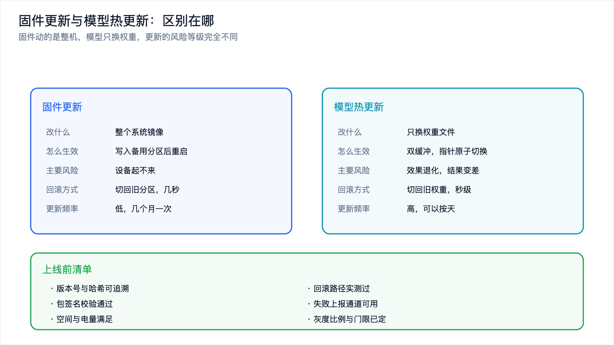

# 边缘设备的 OTA 与模型热更新



*2026-10-30 · 边缘工程化与安全*

## 装到现场的设备，软件还得能换

设备卖出去那一刻软件就冻结了，这是很多人的直觉。真实的边缘设备不是这样。装在厂房屋顶的网关、田里的气象站、后厨的机器人，装上去就是几年，中间要修 bug、要加功能、要换模型，你不可能每次都派人爬上去插一根 USB 线。

远程更新（OTA，Over The Air）解决的就是这件事。它的难点不在"怎么把文件传过去"，传输是最好写的一段代码。难点在另外三件事：怎么保证传过去的包是完整且可信的，装坏了怎么退回来，以及怎么在几万台设备上分批推，出了问题不至于一起坏。

边缘设备还有一条比手机更严的约束：它身边可能没有人。手机刷坏了可以拿去售后，田里的传感器刷坏了只能派人去拔。所以这套流程的设计目标只有一个，让设备在任何一步出错之后都还能自己爬起来。

## 一次 OTA 要走完哪几步

把一次更新拆开是五个阶段，每个阶段都要留下一个能验证的产物，任何一步失败都停在原地。

分发。新版本在构建流水线上打好包，算出哈希，做上签名，上传到服务端。服务端按设备分组管理版本，哪一批设备该拿到哪个版本，在这里决定。

下载。设备在后台拉取安装包，不能打断正在跑的业务。包可能几十兆甚至几百兆，弱网下要能断点续传，中途断了下次接着下。

校验。下载完成后先算哈希对一遍，再验签名确认包来自可信的构建方，然后检查版本兼容性、可用空间和电量。任何一项不过，都不该往下走。

安装。写入备用分区，然后把启动指针指向它。这一步在重启之前都还可以撤销，因为当前运行的版本没被动过。

确认或回滚。设备重启进入新版本，跑一段自检，成功了就把新版本标记为有效；失败了就切回旧版本，并把这个结果上报。



*图 1：五个阶段各自留下一个可验证的产物，任何一步失败都停在原地。*

五步里最容易做错的是校验和确认。有的实现只校验传输完整性，不验签名，等于给攻击者留了一扇门；有的实现装完不确认，设备重启两次就忘了自己该跑哪个版本。

## A/B 双分区：为什么能安全回滚

要让更新可回滚，关键在于一件事：新版本永远先写进当前没在运行的那个分区。

Flash 上划出两块一样大的应用分区，叫 A 和 B。设备正常运行 A，更新时把新固件写进 B，写完改一下启动指针，重启就从 B 启动。A 里的旧版本没被动过，想退回来只要把指针改回 A。

这比"就地覆盖"强在哪里？就地覆盖写到一半掉电，设备变成半新半旧，谁也启动不了，只能靠人去现场。双分区把风险关在备用分区里，写坏了只是浪费一次下载，正在跑的版本毫发无伤。

启动指针这一步必须原子。做法是先写临时文件或者临时扇区，写完再做一次原子替换，让指针要么指向旧值，要么指向新值，不存在中间态。指针本身也要有备份，通常是两份互为冗余。

光有双分区还不够，还要有人判断"新版本到底行不行"。这个判断放在 Bootloader 里：重启后如果发现有标记为待启动的版本，就先跑一段自检，比如关键外设能不能打开、模型能不能加载、网络能不能连上。自检通过就把新版本标记为有效，清掉待启动标记；不通过就切回旧版本，累加一次失败计数。失败次数超过阈值就停止尝试，等人工介入，免得设备在两块分区之间反复重启。



*图 2：新版本只写备用分区，切换只改一个指针，失败就切回去。*

用一段代码把上面的流程跑一遍最清楚。下面这段在本地就能运行，用目录模拟 flash，用文件模拟服务端，不需要网络，也不需要真实设备。

```python
import hashlib, json, os

BLOCK = 4096

def sha256(path):
    h = hashlib.sha256()
    with open(path, "rb") as f:
        for chunk in iter(lambda: f.read(1 << 16), b""):
            h.update(chunk)
    return h.hexdigest()

class Flash:
    """boot.json 是启动指针，A / B 是两个应用分区。"""
    def __init__(self, root="fake_flash"):
        self.root = root
        os.makedirs(root, exist_ok=True)
        for name in ("A", "B"):
            os.makedirs(os.path.join(root, name), exist_ok=True)
        self.boot_path = os.path.join(root, "boot.json")
        if not os.path.exists(self.boot_path):
            self.write_boot({"active": "A", "pending": None, "fail_count": 0})

    def read_boot(self):
        with open(self.boot_path) as f:
            return json.load(f)

    def write_boot(self, state):
        tmp = self.boot_path + ".tmp"
        with open(tmp, "w") as f:
            json.dump(state, f)
        os.replace(tmp, self.boot_path)      # 原子替换，掉电也不会写坏指针

    def partition(self, name):
        return os.path.join(self.root, name)

    def inactive(self):
        return "B" if self.read_boot()["active"] == "A" else "A"
```

下载这一段要能续传，逻辑很简单：先看目标文件已经有多少字节，从那个位置接着写。

```python
def download(src, dest):
    done = os.path.getsize(dest) if os.path.exists(dest) else 0
    with open(src, "rb") as s, open(dest, "ab") as d:
        s.seek(done)
        while True:
            chunk = s.read(BLOCK)
            if not chunk:
                break
            d.write(chunk)
            d.flush()
    return dest
```

安装和开机确认是两个函数。安装只碰备用分区，开机确认负责自检和回滚。

```python
def install(flash, package, manifest):
    """manifest 是服务端下发的元数据，设备侧信任它（真实项目里它带签名）。"""
    slot = flash.inactive()
    dest = os.path.join(flash.partition(slot), "app.bin")
    download(package, dest)
    got = sha256(dest)
    if got != manifest["sha256"]:
        os.remove(dest)                      # 校验不过就删掉，什么都不改
        return False, "校验失败：期望 %s，实际 %s" % (
            manifest["sha256"][:12], got[:12])
    state = flash.read_boot()
    state["pending"] = {"slot": slot, "version": manifest["version"], "sha": got}
    flash.write_boot(state)
    return True, "已写入分区 %s，等待重启" % slot

def boot(flash, self_check):
    state = flash.read_boot()
    pending = state.get("pending")
    if pending is None:
        return state["active"], "正常启动 %s" % state["active"]
    if self_check(pending["version"]):
        state["active"] = pending["slot"]
        state["pending"] = None
        state["fail_count"] = 0
        flash.write_boot(state)
        return state["active"], "自检通过，确认启动 %s" % pending["version"]
    state["pending"] = None
    state["fail_count"] += 1
    flash.write_boot(state)
    return state["active"], "自检失败，回滚到 %s（累计失败 %d 次）" % (
        state["active"], state["fail_count"])
```

跑三个场景，输出是这样的：

```text
场景一：正常更新
  (True, '已写入分区 B，等待重启')
  ('B', '自检通过，确认启动 1.5.0')
场景二：包在传输中被改坏，校验不过
  (False, '校验失败：期望 000000000000，实际 c7362c78db99')
  ('B', '正常启动 B')
场景三：装上了但自检不通过，自动回滚
  (True, '已写入分区 A，等待重启')
  ('B', '自检失败，回滚到 B（累计失败 1 次）')
  最终启动指针： {'active': 'B', 'pending': None, 'fail_count': 1}
```

三个场景对应三种故障：一切正常、包不可信、新版本本身有问题。第二种情况下设备连启动指针都没动过；第三种情况下新版本已经装好了，被自检拦下来，自动退回 B。这两条路径合起来，就是"任何一步出错都还能爬起来"的具体含义。

## 灰度与分批：别一次推给所有设备

更新包本身没问题，不代表所有设备都能装好。硬件批次、外围器件、当地的网络环境，都可能让一批设备出问题，另一批完全正常。一次全量推送，出问题就是全量事故。

分批发布的做法是把设备分成几组，一组一组推。第一批通常是自己手里的测试设备，量最小；第二批是种子用户；后面几批逐步放大比例，最后才是全量。每一批之间留一个观察窗口，够长，让问题有时间暴露出来。有的故障要跑一两天才出现，观察窗口太短等于没看。

每一批要看什么也要提前定好。启动成功率、崩溃率、关键功能自检通过率、回滚率、错误上报的数量，这几项里任何一项越过门限，就停止放量，甚至自动回滚已经推出去的那一批。

门限必须在推之前定好，而不是出事了再讨论。常见的做法是给几个明确数字：启动失败率超过百分之一就停，关键功能自检不通过就停，崩溃率明显高于上一版本就停。定好之后写进发布脚本，让它自动执行。人总是倾向于再等等看，而等待的代价可能是几万台设备。



*图 3：每一批都比上一批大，每一批都能停住，门限提前定好并自动触发。*

分批还有一层意义，它是唯一能拿到真实反馈的手段。实验室里跑通的组合有限，真实环境里的硬件批次和网络状况测不全。第一批设备的作用不是多装几台，而是替后面所有设备探路。

## 模型热更新和固件更新不是一回事

模型也要更新，但它和固件更新是两个不同重量级的事，混在一起会出事。

固件更新动的是整个系统镜像，包含内核、驱动、业务逻辑。它的生效方式是重启，风险是设备起不来，回滚靠 A/B 分区。模型更新只换一个权重文件，可执行文件没变，所以它可以不重启就生效，风险也小得多，最坏情况是这个模型效果变差，而不是设备变砖。

这个区别决定了做法上的不同。模型热更新通常是双缓冲加指针切换：先把新权重加载到另一块内存，用固定的一批样本跑一遍，比对输出是否在预期范围内，通过了再把"当前模型"的指针原子地指向新的那块。旧权重的内存先不释放，留一段时间，随时可以切回去。

```python
def swap_model(loader, new_path, manifest):
    if manifest["input_shape"] != loader.input_shape:
        return False, "输入形状不匹配，拒绝热更新"
    handle = loader.load(new_path)           # 新权重先加载到另一块缓冲
    if not loader.self_test(handle):         # 用固定样本跑一遍，比对输出
        loader.free(handle)
        return False, "自检不通过，保持旧模型"
    loader.activate(handle)                  # 切换指针，这一步是原子的
    return True, "已切换到 %s" % manifest["version"]
```

| 维度 | 固件更新 | 模型热更新 |
| --- | --- | --- |
| 改了什么 | 整个系统镜像 | 只换权重文件 |
| 怎么生效 | 写入备用分区后重启 | 双缓冲加载，指针原子切换 |
| 主要风险 | 设备起不来 | 效果退化，结果变差 |
| 回滚方式 | 切回旧分区，几秒 | 切回旧权重，秒级 |
| 更新频率 | 低，几个月一次 | 高，可以按天 |
| 前置检查 | 空间、电量、签名 | 输入形状、算子、量化参数 |

表里最后一行是模型更新特有的一类坑：兼容性。权重文件换了，输入形状可能跟着变，算子集合可能变，量化参数可能变。这些对不上，模型能加载进去，跑出来的结果却是错的，而且错得不明显。所以模型的元数据里要把输入形状、算子集、量化方式、依赖的运行时版本都写清楚，设备侧逐项检查，不匹配就拒绝。

```json
{
  "model": "detector",
  "version": "2026.10.3",
  "sha256": "…",
  "input_shape": [1, 3, 320, 320],
  "quant": "int8",
  "min_runtime": "1.7.0"
}
```

还有一条边界要划清楚：模型热更新能做的只是换权重。如果这次更新换了推理引擎、换了前处理流程、加了新的算子，那它就不是热更新，而是固件更新，要走完整的分区切换流程。把这类改动当成"换个文件"来处理，是线上事故的常见来源。

## 弱网和断网怎么办

边缘设备的网络条件比手机差得多。厂区里的设备可能只有一条窄带链路，野外设备可能靠蜂窝网，还有些设备常年离线，靠人定期插 U 盘。

分块下载和断点续传是基础。大包切成块，每块带序号和校验，断了之后从最后一块成功的地方接着下。没有这一条，一个几百兆的包在弱网下永远下不完。

差分更新是第二招。新旧两个版本之间只传差异部分，包体能小一个数量级。代价是服务端要为每个版本组合准备一份差分包，版本一多组合数量会涨得很快，所以差分通常只对"当前主流版本到最新版本"这条路径做。

限速和择时也是必要的。更新不该跟业务抢带宽，视频设备在白天上传带宽紧张时下载更新包，直接影响业务，做法是给下载限速，或者把下载安排在业务低谷时段。电量同理，电池供电的设备要先看电量够不够撑完整个更新，不够就等到充电时再下。

完全离线的设备还有一条路：离线介质更新。把包放进 U 盘或者 SD 卡，插上去之后设备自己做校验和安装，流程和在线更新一样，只是下载这一步换成了读本地文件。这时候签名校验更重要，因为介质是可以被替换的。

## 更新失败之后

前面每一步都有失败处理，把这些兜底措施列成一张清单，在项目开始时先对一遍。

- 校验失败：删除已下载的包，设备保持原样，记录一次失败，按退避策略重试。
- 安装失败：只影响备用分区，当前版本照常运行，下次重新下载。
- 启动自检失败：Bootloader 切回旧分区，累加失败计数，上报。
- 连续失败超过阈值：停止自动尝试，进入只读的安全模式，等人工介入。
- 指针损坏：双份启动指针互为备份，或者按固定顺序尝试启动，直到有一个能跑。
- 上报通道不可用：把失败信息写进本地日志，等网络恢复后补报。
- 人工恢复：保留串口或者 USB 的刷机入口，让现场人员能用一根线救回来。

清单里最后一条最容易被忽略，也最重要。所有自动回滚都有失效的可能，两块分区都坏了、Bootloader 自己有问题、指针区被擦掉了，这些情况发生概率不高，但一旦发生，唯一的路就是人能接上手。留一个硬件层面的刷机入口成本很低，救回来一次就值了。



*图 4：两类更新的风险等级不同，兜底措施要在发布前逐项对过。*

还有一件工程上的事：版本可追溯。每一台设备当前跑的是哪个固件版本、哪个模型版本，历史上更新过几次、失败过几次，这些信息要能从服务端查到。没有这份账，出问题时你连"是哪一批设备"都说不清，分批发布也就失去了意义。

## 写在最后

边缘设备的更新，难点不在传文件，在于传完之后设备还能不能好好活着。一次完整的 OTA 是五个阶段：分发、下载、校验、安装、确认或回滚，每个阶段都要有能验证的产物。A/B 双分区把新版本关在备用分区里，写坏了只是浪费一次下载；启动指针的原子切换加上开机自检，让回滚变成一次重启的事。分批发布把风险摊开，门限提前定好并自动触发。

模型热更新和固件更新是两件事：前者只换权重，双缓冲加指针切换，秒级生效也秒级回退；后者动整个镜像，必须走分区切换。前者的风险是效果退化，后者的风险是设备变砖。弱网下靠分块、续传、差分和限时下载，断网设备走离线介质。还有一点，把所有失败路径和人工恢复手段列成清单，在发布之前逐项确认，比在事故现场想对策便宜得多。

更新链路通了，设备能自己活下去。同一板块里还有另一条线，是它怎么在一颗芯片上把实时性守住：[《算控一体：在同一颗芯片上同时跑 AI 和控制》](compute-control-unified.md)。两条线合起来，才是一台边缘设备能在现场跑上几年的样子。
