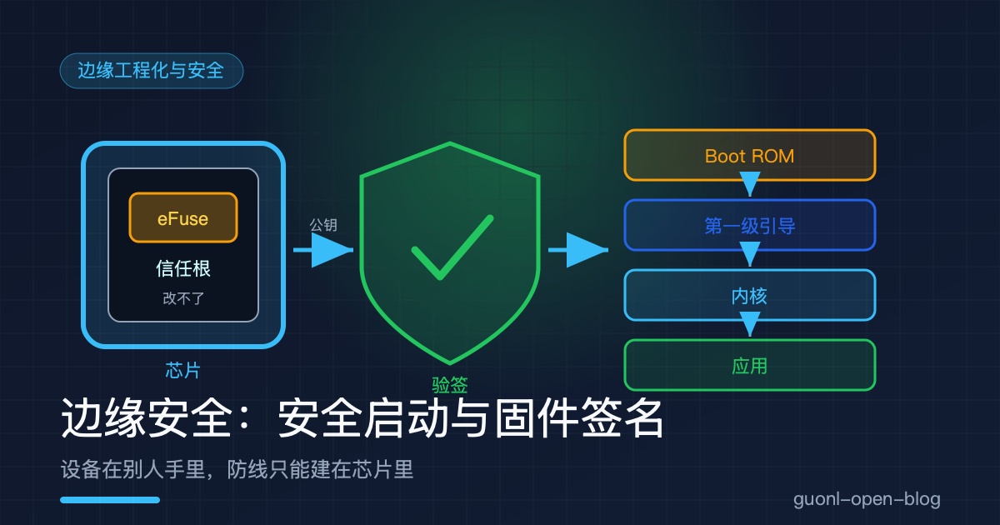
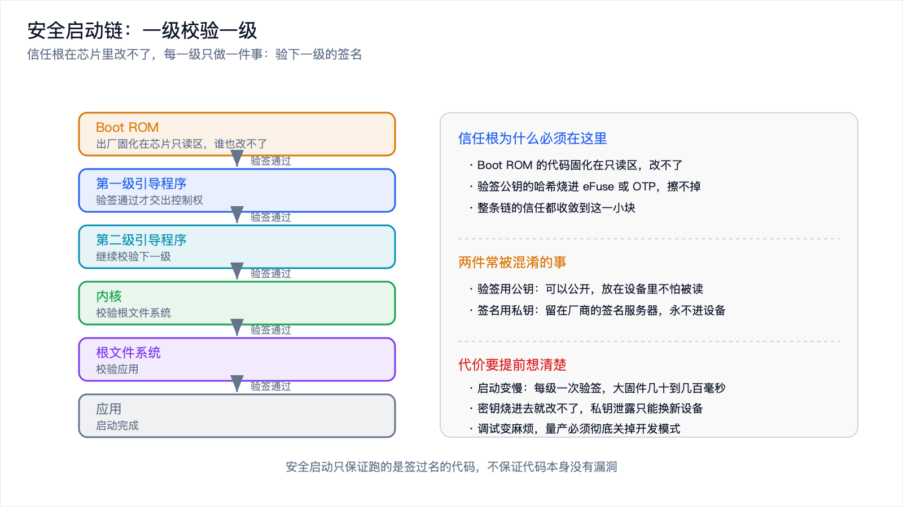
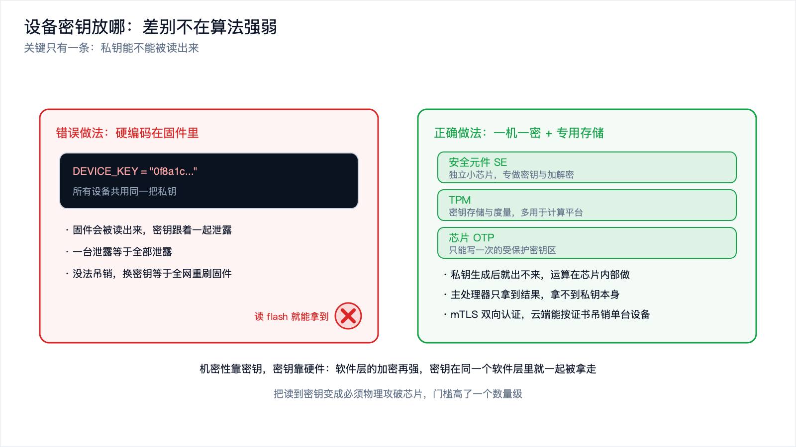
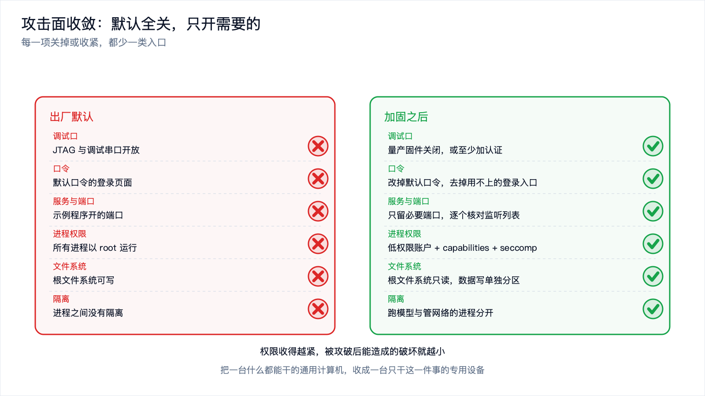
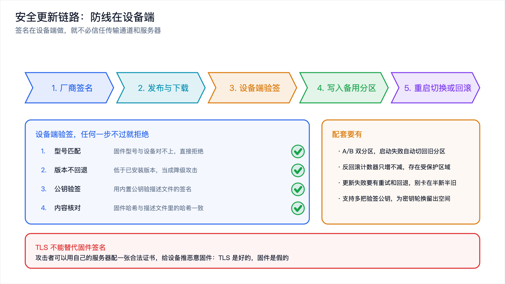

# 边缘安全：安全启动、固件签名与最小权限



*2026-10-30 · 边缘工程化与安全*

## 你的设备在别人手里

云端服务器的安全模型有一个默认前提：机器锁在机房里，攻击者摸不到硬盘，也插不了线。边缘设备没有这个前提。

一台装在小区门口的摄像头、一辆停在路边的车机、一块挂在工厂产线上的工控板，它们都在物理可达的地方。任何能拿到设备的人，都能拆开外壳、夹住调试口、把 flash 里的内容读出来。这就是边缘安全和云端安全最根本的区别：信任的边界不在网络边界上，而在芯片内部。

云端加固的思路是"把门守住"，边缘加固要反过来想：假定设备已经被拆开了，假定固件已经被人读过了，那还剩什么能保护你？答案是把关键的东西放进硬件，让软件即使被完全看清，也伪造不出来。

这一篇讲的就是这套底线。安全启动怎么把信任建立起来，固件签名怎么证明来源，密钥该放在哪，权限怎么收，模型和数据怎么保，更新通道怎么防。它是防御性内容，讲的是怎么加固自己的设备，不是怎么攻破别人的。

## 四条要守住的线

把边缘安全拆开，需要守住的东西就四类。

- 完整性：设备上跑的固件、加载的模型，没有被改过。
- 真实性：这些固件和模型确实来自厂商，不是别人伪造的。
- 机密性：设备身份密钥、用户数据、模型权重，不该被随便读走。
- 授权：每个进程、每个服务只拿到它干活需要的那点权限。

安全启动负责前两条的起点，固件签名把真实性钉死，安全元件负责机密性，最小权限负责授权。下面逐条讲。

## 安全启动：一级校验一级

设备通电后第一件事是启动。如果这一步就被改过，后面做什么都白搭。安全启动要做的是：让设备只肯运行厂商签过名的固件，任何被改过的代码都跑不起来。

它的做法是串成一条链。芯片里有一段出厂就固化、谁也改不了的代码，叫 Boot ROM。它上电后先运行，负责校验下一级，通常是第一级引导程序。校验过了才把控制权交出去。第一级引导程序再校验第二级，第二级校验内核，内核校验根文件系统，最后启动应用。

每一级都只做一件事：拿自己内置的公钥，去验下一级的签名。签名对得上，才放行。

这条链的起点，也就是信任根，必须在硬件里。Boot ROM 的代码固化在芯片的只读区，改不了；用来验签的公钥哈希，烧进芯片的 eFuse 或者 OTP 区域，同样改不了。整条链的信任，最后都收敛到这一小块烧不进也擦不掉的东西上。这就是"信任根在硬件"的含义：软件可以被替换，硬件里烧进去的东西不行。



*图 1：安全启动是一条信任链，起点是芯片里不可修改的信任根，每一级验签通过才加载下一级。*

这里要分清两件常被混淆的事。验签用的是公钥，公钥可以公开，放在设备里不怕被读；真正要保密的是私钥，它留在厂商的签名服务器上，永远不进设备。

安全启动有代价，而且要提前想清楚。

启动会变慢。每一级都要做一次签名校验，大固件上可能是几十到几百毫秒，对开机时间敏感的设备要算进去。

密钥烧进去就改不了。信任根的公钥一旦写进 eFuse，通常无法回退。如果签名私钥泄露，换公钥需要烧新设备，已经出厂的就救不回来了。所以私钥怎么保管、怎么轮换，必须在量产之前定好。

调试会变麻烦。安全启动打开后，没签名的自制固件就跑不起来，开发阶段的反复刷机很别扭。常见的做法是留一个开发模式，但要确保量产版本彻底关掉它，而且开发模式不能变成绕过验签的后门。

还有一个容易忽略的点：安全启动只保证"跑的是签过名的代码"，不保证"代码是安全的"。它是一道闸门，闸门后面的代码有没有漏洞，是另一回事。

## 固件签名与验签：为什么哈希不够

讲清启动链，接着把签名本身说清楚。

有人会想，固件发布时附一个 SHA-256 哈希，设备算一遍对上就行。这挡不住攻击者：哈希是公开算法，攻击者改了固件，顺手把哈希也改了重新发布，设备照样认为没问题。哈希只能证明数据完整，证明不了数据来自谁。

签名补的就是这一环。厂商用只有自己知道的私钥对固件做签名，设备用内置的公钥验证。攻击者改得了固件，但没有私钥，就伪造不出对应的签名。这就是非对称加密的用处：私钥签，公钥验，私钥永不外流。

实际发布时，签的不只是固件本身，还有一份描述文件，里面写明版本号、硬件型号、以及固件的哈希。哈希和元数据一起签，好处是版本号也进了签名范围，攻击者不能只改版本号来绕过检查。

下面这段代码把整套流程跑一遍。它模拟厂商签名、设备验签，覆盖三种情况：正常固件通过、被篡改的固件拒绝、版本回滚拒绝。

```python
# verify_firmware.py
# 模拟固件签名与设备端验签：正常通过、篡改拒绝、回滚拒绝
# 依赖：pip install cryptography

import hashlib
import json
from dataclasses import dataclass, asdict

from cryptography.hazmat.primitives.asymmetric import ed25519
from cryptography.exceptions import InvalidSignature


def firmware_hash(blob: bytes) -> str:
    """固件的哈希，用 SHA-256。哈希只证明完整性，不证明来源。"""
    return hashlib.sha256(blob).hexdigest()


@dataclass
class Manifest:
    """随固件一起发布的描述文件，会被签名。"""
    version: int          # 单调递增的版本号，用来防回滚
    device_model: str     # 目标硬件型号，防止固件刷错设备
    digest: str           # 固件内容的哈希


def sign_manifest(priv_key, manifest: Manifest) -> bytes:
    """厂商侧：用私钥对描述文件签名。私钥只存在签名服务器上。"""
    payload = json.dumps(asdict(manifest), sort_keys=True).encode()
    return priv_key.sign(payload)


def verify_and_install(blob: bytes, manifest: Manifest, sig: bytes,
                       pub_key, device_model: str, min_version: int):
    """设备侧：验签通过才安装。任何一步不过就拒绝。"""
    # 1) 型号要对，防止把别的设备的固件刷进来
    if manifest.device_model != device_model:
        return "拒绝：固件型号不匹配"

    # 2) 版本不能低于已安装的，防止降级攻击
    if manifest.version < min_version:
        return "拒绝：版本回滚（可能是降级攻击）"

    # 3) 用内置公钥验签。公钥可以公开，私钥永远不在设备上
    payload = json.dumps(asdict(manifest), sort_keys=True).encode()
    try:
        pub_key.verify(sig, payload)
    except InvalidSignature:
        return "拒绝：签名无效"

    # 4) 验签过了，再核对固件内容本身没被动过
    if firmware_hash(blob) != manifest.digest:
        return "拒绝：固件内容与描述文件不符"

    return "接受：固件已验证"


def main():
    # 厂商侧：生成密钥对。私钥留在服务器，公钥烧进设备
    priv = ed25519.Ed25519PrivateKey.generate()
    pub = priv.public_key()

    good = b"firmware image v7 ..."
    manifest = Manifest(version=7, device_model="edge-cam-a1",
                        digest=firmware_hash(good))
    sig = sign_manifest(priv, manifest)

    # 设备侧：已经装了 v7，因此低于 v7 的一律拒绝
    min_version = 7
    print(verify_and_install(good, manifest, sig, pub, "edge-cam-a1", min_version))

    # 攻击者改了固件内容，但签名没变，内容核对会失败
    tampered = b"firmware image v7 ... backdoor"
    print(verify_and_install(tampered, manifest, sig, pub, "edge-cam-a1", min_version))

    # 攻击者拿旧的 v5 固件重放，版本检查会拦下
    old = b"firmware image v5 ..."
    old_manifest = Manifest(version=5, device_model="edge-cam-a1",
                            digest=firmware_hash(old))
    old_sig = sign_manifest(priv, old_manifest)
    print(verify_and_install(old, old_manifest, old_sig, pub, "edge-cam-a1", min_version))


if __name__ == "__main__":
    main()
```

跑出来是三行：

```text
接受：固件已验证
拒绝：固件内容与描述文件不符
拒绝：版本回滚（可能是降级攻击）
```

第一行正常。第二行说明光有签名还不够，还得核对内容哈希，因为签名保护的是描述文件，固件本身是分开传的，两者要能对上。第三行是降级攻击：攻击者不需要伪造新固件，只要把设备退回一个有已知漏洞的旧版本就行。防它的办法是把版本号放进签名范围，同时在设备上记一个只能增大的计数器，存在 eFuse 或受保护区域，低于计数器的版本一律拒绝。

## 设备身份与密钥：为什么不能硬编码

设备要和云端通信，就得有一个身份。身份靠密钥证明。密钥放哪里，是边缘安全里最容易做错的一环。

最常见的错误做法，是把密钥直接写进固件。

```python
# 反面示例：不要这样做
DEVICE_KEY = "0f8a1c... 固定的私钥 ..."
```

问题很直接。固件是会被读出来的，尤其在设备被人拿到手里的场景下。密钥一旦写死在固件里，所有设备用的是同一把，泄露一台等于泄露全部。而且这种密钥没法吊销，因为改它意味着重新发一版固件、所有设备一起换，等于全网重刷。

正确做法是给每台设备一把自己的密钥，出厂时注入，一机一密。这样单台设备被拆、密钥被读，损失被限制在这一台上，吊销也只吊销这一台。

接下来的问题是，这把密钥存在哪。普通的 flash 文件系统不行，能读 flash 就能读密钥。要用专门的存储。

- 安全元件（SE）：一颗独立的小芯片，专门做密钥存储和加解密。私钥生成后就出不来了，签名和验签在芯片内部完成，主处理器拿到的只是结果。
- TPM：可信平台模块，功能和 SE 类似，多用于计算平台，提供密钥存储和度量能力。
- 芯片内置的 OTP 或受保护密钥区：一些 SoC 自带一块只能写一次的存储和硬件加解密单元，成本比独立 SE 低。

这三种的共同点是私钥不可导出，加密运算在硬件里做。主处理器即使被完全控制，也拿不到私钥本身，只能请求它做签名。这就把"读到密钥"变成了"必须物理攻破芯片"，门槛高了一个数量级。

存好了，用的时候也要留心：密钥不该出现在普通内存里被随意读取。设备身份通常用双向认证（mTLS），设备有证书和私钥，云端也有证书，双方互验。云端可以用证书把设备吊销掉，这是硬编码密钥永远做不到的。



*图 2：密钥存放的两种做法，区别不在算法强弱，而在私钥能不能被读出来。*

## 最小权限与攻击面收敛

前面的部分都在讲证明和保密，这一节讲少给。

边缘设备出厂时常常带着一堆用不上的东西：开发用的调试口、默认口令的管理页面、示例程序开的端口、以 root 跑的所有进程。这些东西单看都不致命，叠在一起就是一个很宽的入口。

收敛的思路是默认全关，只开需要的。具体到设备上，可以分几层做。

- 关闭物理调试口。量产固件里关掉 JTAG 和调试串口，或者至少加认证。很多真实案例里，攻击者就是靠一个没关的串口进去的。
- 改掉默认口令，或者干脆去掉登录界面。默认口令是扫描器最爱的目标。
- 关掉用不上的服务，只留必要的端口。每少一个监听端口，就少一类攻击面。
- 进程不用 root。每个服务用独立的低权限账户运行，只拿它需要的能力。Linux 上可以用 capabilities 拆分 root 的权限，用 seccomp 限制能调用的系统调用，用 SELinux 或 AppArmor 做强制访问控制。
- 根文件系统只读。应用需要写的数据放到单独的可写分区，这样即使某个进程被攻破，也改不了系统本身。
- 沙箱隔离。跑模型的进程和管网络的进程分开，一个被攻破不至于连累另一个。

这些做法合起来，就是把一台"什么都能干"的通用计算机，收成一台"只干这一件事"的专用设备。权限收得越紧，被攻破后能造成的破坏就越小，这是投入产出比最高的一类加固。



*图 3：最小权限不是一句口号，而是一张逐项关闭的清单。*

## 模型与数据的保护

边缘设备上跑的东西里，有两样是有价值的：模型权重和用户数据。

模型是厂商花钱训出来的资产。放在设备上，别人拆开就能拷走。能做的防护分几层：存储时加密，加载时在受保护的内存里解密；更进一步是把推理放进 TEE（可信执行环境）里跑，模型和解密后的权重都不出安全区域。但要说清楚，加密存储挡不住把设备整个 dump 下来再离线分析，它只是把门槛从"拷个文件"抬到"得会逆向"。真要在别人的设备上完全藏住模型，目前没有彻底的解法，只能接受"抬门槛"这个定位。

用户数据这块要更严肃，因为它涉及隐私和合规。音频、图像、身份信息这些，默认就不该离开设备。要落盘的话，用设备独有的密钥加密，密钥存在安全元件里；用不到的数据及时删掉，别留在临时目录里；日志里不要写原始内容。

这里有一条通用原则：机密性靠密钥，密钥靠硬件。软件层的加密算法再强，密钥要是在同一个软件层里，攻破软件层就一起拿走了。

## 更新通道的安全

固件要能更新，漏洞才有机会被修。但更新通道本身也是攻击面：如果设备信任了假的更新包，等于自己把门打开。这一节和 OTA 那篇讲的是同一件事的两面，OTA 讲怎么把更新做稳，这里讲怎么把更新做安全。

先明确一个最容易搞错的点：TLS 不能替代固件签名。

TLS 保护的是传输这一段，从服务器到设备。但攻击者可以拿一个自己的服务器，配一张合法的证书，给设备推一个恶意固件。设备看到的 TLS 是好的，固件却是假的。真正能挡住它的是设备端的签名校验：固件必须带厂商私钥的签名，设备用内置公钥验过才装。签名在设备端做，就不必信任传输通道，也不必信任服务器。

完整的更新链路是这样。厂商用私钥对固件和描述文件签名；固件发布到服务器，可以放 CDN，可以走 HTTP，因为签名才是防线；设备下载后先验签，再核对版本号和型号；通过之后写入备用分区，重启切过去。

配套要有几件事。A/B 双分区，新固件写到不用的那个分区，启动失败能自动切回旧分区，避免刷坏变砖。反回滚计数器，防止攻击者用旧固件把设备退回有漏洞的版本。更新失败要有重试和回退，别让设备卡在半新半旧的状态。密钥轮换要提前设计，签名私钥总有一天要换，设备得能接受多把公钥，否则换密钥就得召回所有设备。



*图 4：更新通道的安全由设备端验签保证，传输层的加密只是补充。*

## 一份可落地的清单

把上面的内容收成一张清单，按设备生命周期的顺序排，可以拿来对着自己的设备逐条过。

启动与信任根：

- 打开安全启动，从 Boot ROM 到应用形成完整信任链。
- 验签公钥的哈希烧进 eFuse 或 OTP，量产版本不可回退。
- 关掉开发模式，确认没有绕过验签的后门。

固件与更新：

- 固件和描述文件一起签名，版本号、型号都进签名范围。
- 设备端验签，不依赖传输层和服务器可信。
- 反回滚计数器只增不减，存在受保护区域。
- A/B 双分区，启动失败自动回滚。
- 支持多把验签公钥，为密钥轮换留出空间。

身份与密钥：

- 一机一密，出厂注入，不用全网共享的密钥。
- 私钥存进安全元件、TPM 或芯片受保护区域，不可导出。
- 设备与云端双向认证，证书可吊销。
- 签名私钥放签名服务器或 HSM，永不进设备。

权限与攻击面：

- 量产固件关闭 JTAG 和调试串口。
- 没有默认口令，去掉用不上的登录入口。
- 每个服务用低权限账户，按需给 capabilities。
- 根文件系统只读，数据写单独分区。
- 关掉用不上的服务和端口，逐个核对监听列表。

模型与数据：

- 模型加密存储，尽量在 TEE 里解密和推理。
- 用户数据默认不出设备，落盘用设备独有密钥加密。
- 日志不写原始内容，临时数据及时清理。

运维：

- 建立固件和模型的签名、发布流程，私钥使用留审计。
- 保留一条能安全更新的通道，别把设备做成不可更新。
- 定期核对新出厂的设备是否真的套用了这份清单。

清单不用一次全做到。按风险排，先把信任根、密钥存放、更新验签这三块立起来，它们决定的是最坏情况下还剩下什么防线。

## 写在最后

边缘安全的特殊性，来自一个前提：设备在别人手里。所以它不能像云端那样靠把门守住，只能靠硬件里那块改不了的东西。安全启动把信任从硬件的信任根一级一级传下来，固件签名把完整性升级成真实性，安全元件让私钥读不出来，最小权限把入口收窄，模型和数据的保护是抬门槛，更新通道的安全则落在设备端验签上。这些做法没有一条能单独解决问题，合起来才构成一条底线。

底线之上的工程化还有一件绕不开的事：设备装出去以后，固件怎么升级、模型怎么换、刷坏了怎么救回来。这套流程怎么做稳，是《边缘设备的 OTA 与模型热更新》那篇的主题，可以和这篇对着看。把视角再往外推一层，当设备从"待在固定位置"变成"会自己移动、会和人打交道"，安全的边界还会再变一次，那就进入具身智能的地盘了，可以从[《具身智能入门：机器人是怎么学会干活的》](../embodied-ai/embodied-ai-intro.md)接上。
