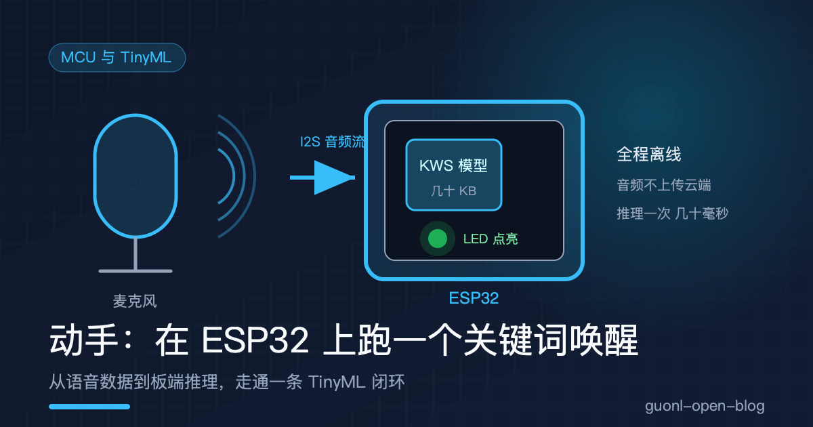
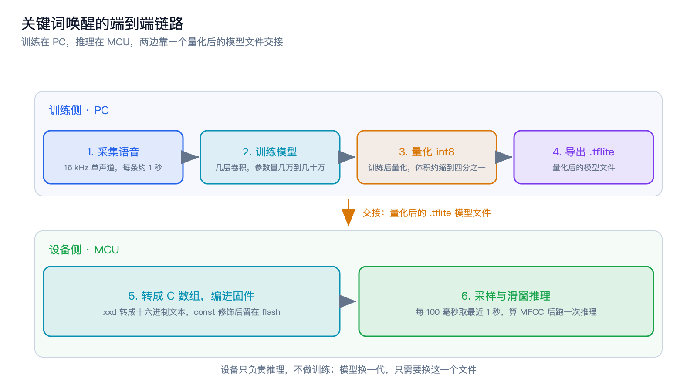
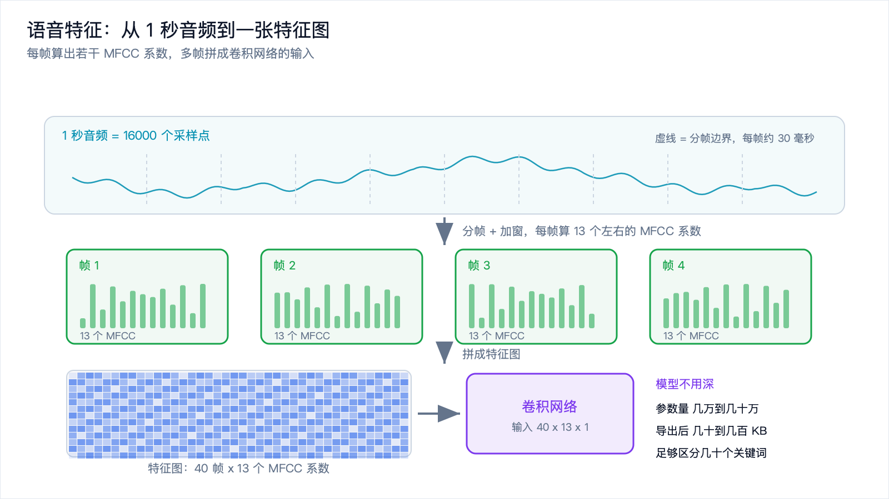
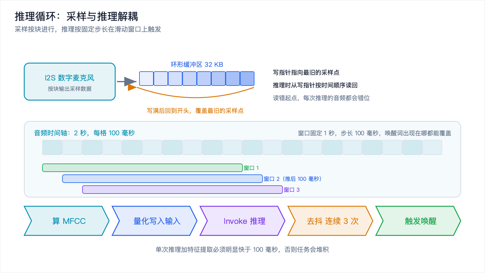
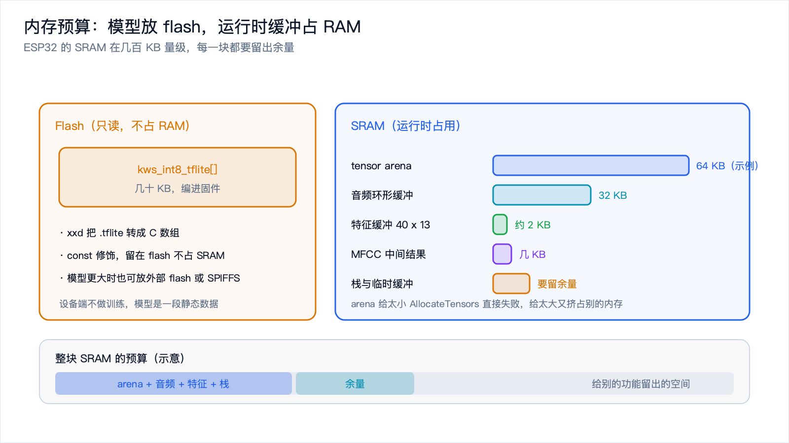

# 动手：在 ESP32 上跑一个关键词唤醒



*2026-10-30 · MCU 与 TinyML*

## 一个几十块钱的板子，也能听懂你说话

智能音箱上那声唤醒词，是端侧 AI 里最适合上手的一个任务：模型小、输入输出干净、对延迟和隐私都敏感，而且在一颗几十块钱的芯片上就能跑起来。

这篇把整条链路走一遍，从准备语音数据开始，到在 ESP32 上跑通麦克风采样和推理的循环。每一步都给可复现的做法和关键代码，和版本相关的部分留给你按手上的环境去定。

先把目标说清楚：做一个能识别一个唤醒词的小程序。设备一直在听，听到唤醒词就点亮 LED，真实产品里这一步是唤起后面的语音助手。整个模型只有几十 KB，推理一次在几十毫秒量级。

## 整条链路长什么样

关键词唤醒（Keyword Spotting，简称 KWS）的落地流程可以拆成六步，前后跨两台机器。

- 训练侧，在 PC 上：采集语音、训练模型、量化、导出。
- 设备侧，在 MCU 上：把模型塞进固件、采样、滑窗推理。

两边靠一个文件交接：量化后的 `.tflite` 模型。PC 上训练好、量化好，转成一个 C 数组编进固件，设备只负责推理，不做训练。



*图 1：从语音数据到设备端推理的六步，训练在 PC，推理在 MCU，中间用 tflite 模型交接。*

## 第一步：准备语音数据

模型的上限由数据决定，这一步最容易被跳过，也最影响成败。

几个约定先说定。

采样率统一 16 kHz、单声道、16 位。16 kHz 足够覆盖人声的主要频段，又能把数据量压下来。关键是训练和推理必须用同一个采样率，后面还会再强调一次。

每条样本截成 1 秒左右。太短盖不住一个词，太长又浪费算力。

类别从少到多。最省事的起点是三类：唤醒词、未知词、静音。等这条链路跑通了再细分。

正样本就是自己念唤醒词，几百条起步，换几个人、换几个位置、换几种语速念。一个人对着同一个麦克风录几百遍，模型只会记住那一个人的嗓音和那个房间的混响，换个人就失灵。

负样本反而要更多，包括三类：环境噪声（空调、键盘、音乐）、别人的正常对话、发音相近的词。唤醒词是"你好小智"，那"你好小明"就得当负样本。负样本不够，模型会把什么都当成唤醒词，这就是最常见的误唤醒来源。

数据不够可以增强。加不同信噪比的噪声、轻微变速、轻微变调、在 1 秒窗口里随机平移，都能把几百条扩到几千条。增强要克制，变速变调幅度太大反而会让样本失真。

最后做归一化。把每条音频的幅度归一化到相近范围，让模型学的是频谱形状而不是录音音量。录音设备不同、增益不同，不做归一化，模型很容易被音量带偏。

## 第二步：训练一个小模型

特征用 MFCC（梅尔频率倒谱系数）。它是语音领域的经典特征，把一帧音频压成十几个系数，比原始波形紧凑得多，小模型处理起来更轻松。常见做法是每 30 毫秒左右取一帧，每帧算 13 个左右的 MFCC 系数，1 秒大概 30 到 40 帧。

模型本身不需要深。一个几层的卷积网络，或者用深度可分离卷积把参数量再压一压，就足够区分几十个关键词。参数量控制在几万到几十万，导出后模型体积就是几十到几百 KB。

下面是训练脚本的关键部分，用 Keras 风格的写法，具体 API 以你手上的版本为准。

```python
import numpy as np
from tensorflow import keras
from tensorflow.keras import layers

# 特征形状：帧数 x MFCC 系数 x 1 个通道
FRAMES, N_MFCC, N_CLASS = 40, 13, 3   # 唤醒词 / 未知 / 静音
X_train = np.load("X_train.npy")      # (N, 40, 13, 1)
y_train = np.load("y_train.npy")      # (N,) 整数标签

def make_model():
    return keras.Sequential([
        layers.Input(shape=(FRAMES, N_MFCC, 1)),
        layers.Conv2D(16, (3, 3), activation="relu", padding="same"),
        layers.DepthwiseConv2D((3, 3), activation="relu", padding="same"),
        layers.MaxPooling2D((2, 2)),
        layers.DepthwiseConv2D((3, 3), activation="relu", padding="same"),
        layers.MaxPooling2D((2, 2)),
        layers.Dropout(0.2),
        layers.Flatten(),
        layers.Dense(32, activation="relu"),
        layers.Dense(N_CLASS),            # 输出 logits，softmax 放到推理时
    ])

model = make_model()
model.compile(optimizer="adam",
              loss=keras.losses.SparseCategoricalCrossentropy(from_logits=True),
              metrics=["accuracy"])
model.fit(X_train, y_train, batch_size=64, epochs=30, validation_split=0.15)
model.save("kws_float.h5")
```

有两个要点。损失函数用的是带 logits 的交叉熵，也就是模型最后一层不加 softmax。这么做是为了后面量化更稳：softmax 放到推理端，输出反量化之后再算，数值更可控。

训练时要用一部分没进训练集的数据做验证，重点看验证集准确率而不是训练集准确率。训练集到 99% 而验证集卡在 80%，说明模型在背样本，这时候该加数据或加噪声，而不是继续加轮数。



*图 2：一帧音频算出若干 MFCC 系数，多帧拼成一张"特征图"，正好是卷积网络的输入。*

## 第三步：量化并转成 TFLite

训练出来的是 float32 模型，直接部署到 MCU 又大又慢。量化把它压成 int8。

最省事的是训练后量化：模型不用重训，准备一批有代表性的输入，让转换器统计每一层的数值范围，把权重和激活都映射到 8 位整数。体积大约缩到四分之一，很多 MCU 上还能走整数指令加速。

```python
import tensorflow as tf

def representative_data():
    # 从训练集里抽几百条真实样本，喂给转换器统计数值范围
    for x in X_train[:300]:
        yield [x[None, ...].astype("float32")]

converter = tf.lite.TFLiteConverter.from_keras_model(model)
converter.optimizations = [tf.lite.Optimize.DEFAULT]
converter.representative_dataset = representative_data
converter.target_spec.supported_ops = [tf.lite.OpsSet.TFLITE_BUILTINS_INT8]
converter.inference_input_type = tf.int8
converter.inference_output_type = tf.int8

tflite_model = converter.convert()
open("kws_int8.tflite", "wb").write(tflite_model)
```

代表性样本很关键。它决定了每一层的量化范围，如果只抽了安静环境下的样本，模型到了嘈杂环境就可能溢出、精度崩掉。所以这批样本要尽量覆盖真实场景，包括噪声和不同说话人。

量化的代价是精度。转完之后要拿一批测试样本分别跑 float 模型和 int8 模型，对比准确率掉了多少。一般掉一两个百分点可以接受，掉太多就得回头补数据，或者改用能感知训练过程的量化方法。

## 第四步：把模型变成 C 数组

`.tflite` 是一个二进制文件，MCU 不认文件系统，得把它变成一个 C 数组编进固件。做法就是用 `xxd` 这类工具把二进制转成十六进制文本。

```
xxd -i kws_int8.tflite > model_data.cc
```

生成的 `model_data.cc` 里会有一个 `unsigned char` 数组，通常带上 `const`，让它留在 flash 里而不是占 RAM。

```cpp
const unsigned char kws_int8_tflite[] = { 0x1c, 0x00, 0x00, 0x00 /* ... */ };
const unsigned int kws_int8_tflite_len = 12345;   // 实际长度以生成结果为准
```

模型不大的话，直接编进固件最省事。模型再大一些，也可以放到外部 flash 或者 SPIFFS 文件系统里，运行时按地址读。ESP32 上跑几十 KB 的关键词模型，直接编进固件就够了。

## 第五步：在 ESP32 上跑推理

设备端用 TensorFlow Lite for Microcontrollers（TFLite Micro）。它的核心是一个解释器：你给它模型数组和一块内存，它自己按算子图把推理算出来。这块内存叫 tensor arena，必须自己分配，大小也得自己调。

```cpp
#include "tensorflow/lite/micro/micro_interpreter.h"
#include "tensorflow/lite/micro/micro_mutable_op_resolver.h"
#include "tensorflow/lite/schema/schema_generated.h"

// 模型数组和长度来自 xxd 生成的 model_data.cc
extern const unsigned char kws_int8_tflite[];
extern const unsigned int kws_int8_tflite_len;

// tensor arena：模型越复杂、中间张量越大，这块就要越大
constexpr int kArenaSize = 64 * 1024;
alignas(16) static uint8_t tensor_arena[kArenaSize];

tflite::MicroInterpreter* interpreter = nullptr;
TfLiteTensor* input = nullptr;
TfLiteTensor* output = nullptr;

bool setup_model() {
  static const tflite::Model* model = tflite::GetModel(kws_int8_tflite);
  if (model->version() != TFLITE_SCHEMA_VERSION) return false;

  static tflite::MicroMutableOpResolver<6> resolver;
  resolver.AddConv2D();
  resolver.AddDepthwiseConv2D();
  resolver.AddMaxPool2D();
  resolver.AddFullyConnected();
  resolver.AddReshape();
  resolver.AddSoftmax();

  static tflite::MicroInterpreter static_interpreter(
      model, resolver, tensor_arena, kArenaSize);
  interpreter = &static_interpreter;
  if (interpreter->AllocateTensors() != kTfLiteOk) return false;

  input = interpreter->input(0);
  output = interpreter->output(0);
  return true;
}
```

有两个地方容易翻车。

算子和模型对不上。resolver 里注册的算子必须覆盖模型用到的全部算子，少注册一个，`AllocateTensors` 就会失败。注册哪些算子，看模型用了什么，上面那六个对应一个典型的深度可分离卷积网络。算子名和注册函数名要按你手上的 TFLite Micro 版本写。

输入输出都是量化过的整数，不是浮点。int8 张量的值域是 -128 到 127，模型里每一层的输入输出都带一个 scale 和 zero_point，换算关系是：

```
real_value = (int8_value - zero_point) * scale
```

喂数据前要把 MFCC 特征按输入张量的 scale 和 zero_point 量化成 int8；拿到输出后，把 logits 反量化回浮点，再自己算 softmax 或者直接比较大小。忘了这一步，模型输出的数字会看起来毫无意义。

## 第六步：麦克风采样与滑动窗口

到这一步模型能跑了，但还没有音频喂给它。麦克风通过 I2S 把采样数据一块块读进来，写进一个环形缓冲区，推理则每隔一小段时间取最近 1 秒做一次。

核心是滑动窗口：窗口长度 1 秒，步长比窗口短得多，比如每 100 毫秒推一次。这样每 100 毫秒就能得到一次判断，唤醒词出现在哪个位置都能被覆盖到。

```cpp
#define SAMPLE_RATE   16000
#define WINDOW_LEN    (SAMPLE_RATE * 1)      // 1 秒 = 16000 个采样点
#define HOP_LEN       (SAMPLE_RATE / 10)     // 每 100 毫秒推一次

static int16_t audio_ring[WINDOW_LEN];       // 环形缓冲区
static int write_pos = 0;
static int hop_count = 0;

void on_audio_block(const int16_t* data, int n) {
  for (int i = 0; i < n; i++) {
    audio_ring[write_pos] = data[i];
    write_pos = (write_pos + 1) % WINDOW_LEN;
    if (++hop_count >= HOP_LEN) {
      hop_count = 0;
      run_inference_on_window();   // 把环形缓冲区按时间顺序拼回一段音频
    }
  }
}

int wake_streak = 0;
const int kWakeStreak = 3;         // 连续 3 次判为唤醒词才真正触发

void run_inference_on_window() {
  float feats[FRAMES * N_MFCC];
  compute_mfcc(audio_ring, write_pos, feats);   // 环形缓冲转成顺序音频再算 MFCC
  quantize_into_input(feats, input);            // 按 scale/zero_point 量化后写入

  if (interpreter->Invoke() != kTfLiteOk) return;

  float wake_score = dequantize(output, /* 唤醒词类下标 */ 0);
  if (wake_score > 0.8f) {
    if (++wake_streak >= kWakeStreak) {
      wake_streak = 0;
      on_wake_detected();                       // 点亮 LED / 唤起后续流程
    }
  } else {
    wake_streak = 0;
  }
}
```

代码里有几个刻意的设计。

环形缓冲区的读取起点是 `write_pos`，也就是最旧的那个采样点。拼特征的时候要按时间顺序从 `write_pos` 绕一圈读回来，别直接从下标 0 读，否则每次推理看到的音频都是错位的。

去抖用连续命中次数。单次推理难免有误判，要求连续几次都超过阈值才触发，能把偶发误唤醒压下去。代价是唤醒多几十毫秒的延迟，这个交换在唤醒场景里很划算。

MFCC 的计算量不能忽视。如果 MCU 算 MFCC 都吃力，可以考虑把特征提取也做成一个算子塞进模型，或者用芯片自带的 DSP 指令、CMSIS-DSP 这类库来加速。特征是整条链路的固定开销，每 100 毫秒就要算一次，不能只盯着模型本身。



*图 3：采样和推理解耦，采样按块进行，推理按固定步长在滑动窗口上触发。*

## 硬件要花多少钱

这套东西的硬件成本很低，适合入门。

| 部件 | 说明 | 参考价格 |
| --- | --- | --- |
| ESP32 开发板 | 带 USB 和足够 RAM，如 ESP32-DevKitC 一类 | 20 到 40 元 |
| I2S 数字麦克风 | 如 INMP441 一类，走 I2S 直接出数字信号 | 10 到 30 元 |
| 杜邦线、面包板 | 接线用 | 10 元以内 |
| LED 和电阻 | 用来看唤醒是否触发 | 忽略不计 |

合计不到一百块。价格是市场量级估算，会随渠道波动。ESP32 的 SRAM 通常在几百 KB 量级，跑几十 KB 的关键词模型和 1 秒的音频缓冲是够的；如果换更小的芯片，就要把窗口和模型再缩一缩。

麦克风建议用 I2S 数字麦克风，而不是模拟麦克风加 ADC。数字麦克风直接输出 I2S 数据流，省掉一路 ADC 和模拟前端，接线和代码都更简单，也不容易被模拟噪声干扰。



*图 4：模型编进 flash 不占 RAM，真正吃 RAM 的是 tensor arena、特征缓冲和音频缓冲。*

## 几个必踩的坑

坑集中在三处：采样率、内存、误唤醒。

采样率必须端到端一致。训练时用 16 kHz，设备上也必须 16 kHz。中间任何一环做了重采样而没对齐，MFCC 的频域刻度就全错了，模型看到的是完全陌生的特征，准确率会断崖式下跌。这条也解释了为什么换麦克风之后要重新验证：不同麦克风的频率响应不同，必要时得用新麦克风补一点数据。

内存要留足余量。tensor arena 是第一个撞墙的地方，给太小 `AllocateTensors` 直接失败，给太大又挤占别的内存。做法是从一个偏大的值开始，跑通之后逐步调小，同时留出余量，因为推理过程中还有栈和临时缓冲。音频环形缓冲区按 1 秒 16 kHz 的 16 位数据算就是 32 KB，特征缓冲、MFCC 的中间结果都要算进去。模型本身编在 flash 里，不占 RAM。

误唤醒要靠负样本和阈值一起治。模型层面，负样本要覆盖真实环境，包括相近发音的词；部署层面，用连续命中次数和阈值把边界收紧。阈值调高，误唤醒少了但漏唤醒多了，这个平衡要拿真实环境的数据来调，不能只在安静的办公室里试。唤醒词本身也要选得抗混淆，音节多、区分度高的词比两个字的常用词更稳。

还有几个小坑。麦克风增益和直流偏置要处理，偏置不除会让 MFCC 的第一维一直很大。I2S 的时钟和采样率要配对，配错了拿到的音频会变速。推理周期要实测，别拍脑袋，每 100 毫秒推一次的前提是单次推理加特征提取明显快于 100 毫秒，否则会堆积。

## 写在最后

这条链路跑通之后，你就有了一个完整的 TinyML 闭环：数据、训练、量化、部署、实时推理，每个环节都亲手做过一遍。

回头看，真正难的地方不在模型有多深，而在两个衔接处。一个是训练和推理的特征必须严格对齐，采样率、帧长、MFCC 参数差一点，模型就废了。另一个是内存预算，模型、tensor arena、音频缓冲、特征缓冲加起来必须塞进芯片的 SRAM，超了就是跑不起来。

下一步可以把唤醒词换成别的词、加第二个词，或者把模型再压小，塞进内存更小的芯片。要把这套做法放到更极端的资源约束下，得先搞清楚神经网络在 KB 级内存里到底是怎么算的，下一篇《TinyML 入门：KB 级内存里怎么跑神经网络》就讲这个。
