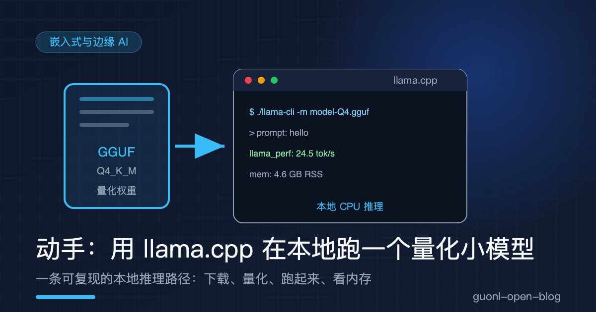
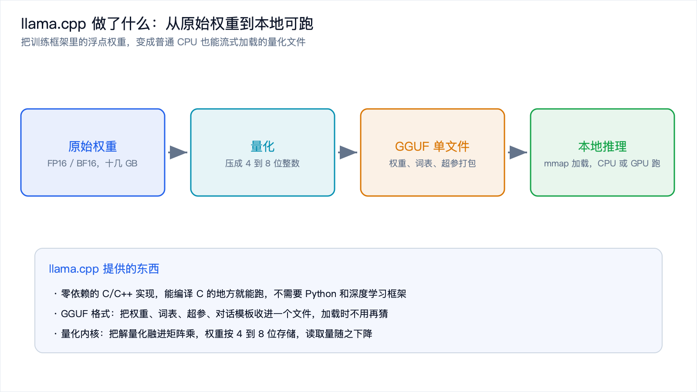
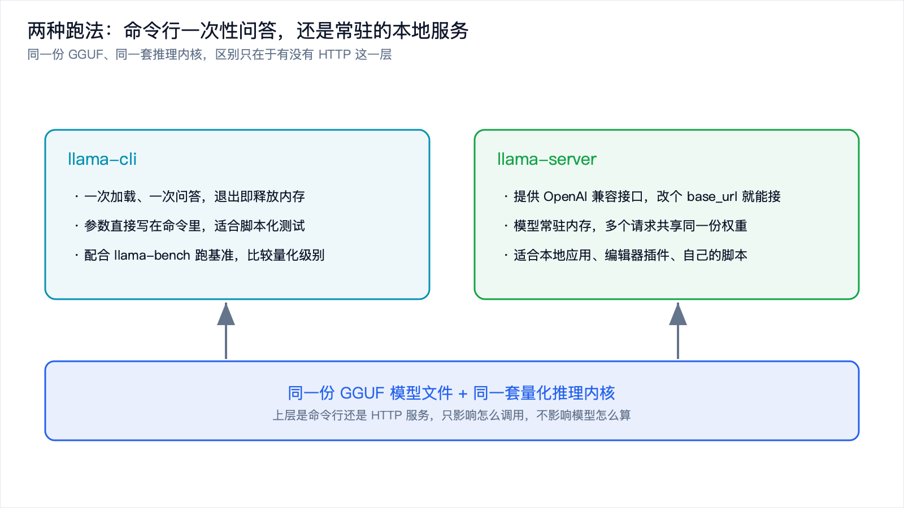
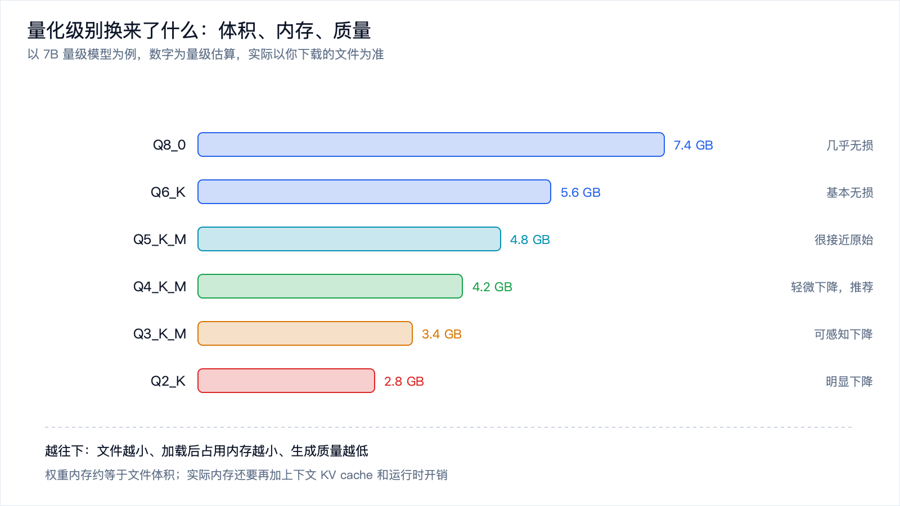
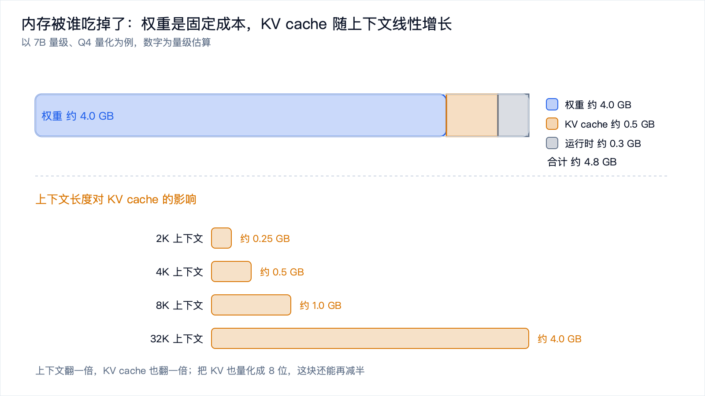

# 动手：用 llama.cpp 在本地跑一个量化小模型



*2026-10-30 · 端侧大模型*

## 目标：在自己的电脑上，跑一个断网也能用的模型

[上一篇](edge-ai-intro.md)把边缘 AI 的概念立住了：把推理放到数据产生地附近，云和端像总店和便利店一样分工，端侧受内存约束，擅长小而专的任务。

这一篇换个方式，直接动手。

目标很具体：在一台普通笔记本上，不联网、不依赖任何云服务，把一个量化过的小模型跑起来，然后亲眼看看它占多少内存、每秒能吐多少个 token、上下文开大会多花多少内存。

这套路径不只适用于笔记本。同一份 GGUF 文件、同一套 llama.cpp，搬到树莓派、迷你主机、甚至手机上，跑法是相通的。差别只在算力和内存大小。

先把话说在前面：llama.cpp 迭代很快，命令名、参数名、编译选项在不同版本之间改过好几轮。下面给的是通用步骤和思路，具体命令以你手上那个版本为准。遇到不认识的参数，`--help` 永远是最可靠的信息源。

## llama.cpp 到底做了什么

很多人第一次听到 llama.cpp，会以为它是一个"小号的大模型"。不是。它跟模型本身没关系，它是一个推理引擎，也就是"把已经训练好的权重跑起来"的那段程序。

它用纯 C/C++ 写成，几乎没有第三方依赖，编译出来就是一个可执行文件。这个特点听起来朴素，却是它能铺得这么开的根本原因：没有 Python 运行时，没有 PyTorch，没有 CUDA 工具链，能编译 C 代码的地方它就能跑。



*图 1：llama.cpp 把训练框架里的浮点权重，变成普通 CPU 也能跑的量化文件。*

这条链路上有三件事值得单独讲。

一个是 GGUF。它是一种文件格式，把权重、词表、超参、对话模板这些东西全部打包进一个文件。为什么要有它？从训练框架里导出来的权重通常是一堆分散的文件加一份配置，部署时很容易缺一个、版本对不上。GGUF 把"跑一个模型需要知道的一切"收进单文件，加载时不用再去猜。

另一个是量化。训练出来的权重是 FP16 或 BF16 的浮点数，一个参数占两个字节。量化把权重压成 4 位、5 位、8 位的整数，体积能降到原来的三分之一到四分之一。它不是简单地砍掉精度，而是给每一小块权重配一个缩放系数，用整数存相对值，反量化时再还原回来。细节后面单独说。

还有内存映射。llama.cpp 默认用 mmap 把模型文件映射进地址空间，而不是一次性读进内存。好处是启动快，不常用的部分由操作系统决定要不要留在物理内存里。这也带来一个观察上的坑：任务管理器里看到的内存占用可能比模型文件还小，因为一部分页还在磁盘缓存里没被算进去。想看到真实数字，得关掉 mmap。

## 第一步：把 llama.cpp 编译出来

准备工作很简单：一个 C/C++ 编译器、CMake、Git。macOS 上装好 Xcode 命令行工具就行，Linux 上装 build-essential 或等价的包。

拿到源码并编译：

```bash
git clone https://github.com/ggml-org/llama.cpp
cd llama.cpp

# 配置并编译。Release 模式很重要，Debug 模式会慢一个数量级
cmake -B build -DCMAKE_BUILD_TYPE=Release
cmake --build build --config Release -j

# 编译完成后，可执行文件在 build/bin/ 下
ls build/bin
```

仓库地址在历史上换过归属，如果你手上的文档给的是旧地址，两者指向的是同一个项目。编译开关同理，有些版本还支持一键脚本，以 clone 下来的 README 为准。

编译完你会看到 `build/bin` 下有一批可执行文件。这篇会用到两个：

- `llama-cli`：命令行交互，一次加载、一次问答，适合验证和跑测试。
- `llama-server`：起一个本地 HTTP 服务，提供 OpenAI 兼容接口。

如果你在旧版本里看到的是 `main` 和 `server` 这两个名字，它们就是上面两个工具的前身，功能对应。

顺便说一句，很多平台有现成的预编译包或包管理器版本（brew、apt、pip 上的绑定等）。想省事可以直接装，自己编译一次的好处是能拿到最新的量化内核，而且遇到问题时你能改代码。

## 第二步：找一个 GGUF 量化模型

模型文件可以从 Hugging Face 这类模型仓库下载。搜索时注意两件事：格式必须是 GGUF；看文件名里的量化标记，带 `Q4_K_M`、`Q5_K_M`、`Q8_0` 这类后缀的才是量化版本。

装好下载工具：

```bash
pip install -U "huggingface_hub[cli]"
```

然后挑一个仓库下载。下面用占位符代替具体仓库名，把它换成你选中的那个即可：

```bash
# 只下载 Q4_K_M 这一个量化版本，避免把整个仓库拖下来
huggingface-cli download <用户名>/<模型名>-GGUF \
  --include "*Q4_K_M*.gguf" \
  --local-dir ./models
```

新版的命令行工具把 `huggingface-cli` 换成了 `hf`，用法基本一致，遇到 `command not found` 就试试 `hf download`。

选模型有几个经验值可以参考。第一次跑，建议挑 1B 到 8B 之间的模型，量化级别选 `Q4_K_M`。这个组合在体积和质量之间比较平衡，普通笔记本的 8GB 到 16GB 内存能从容放下。参数量再往上，内存就开始紧张；量化级别再往下（比如 Q2），生成质量会明显掉。

## 第三步：命令行跑第一次推理

先跑一次最简单的，确认模型能加载、能出字：

```bash
./build/bin/llama-cli \
  -m ./models/<你的模型>-Q4_K_M.gguf \
  -p "用一句话解释什么是边缘 AI" \
  -n 128 \
  -c 2048
```

几个参数的含义：

- `-m` 指定模型文件路径。
- `-p` 是提示词。不加 `-p` 会进入交互模式，可以连续对话。
- `-n` 限制最多生成多少个 token，避免它一直说下去。
- `-c` 是上下文长度，也就是这个模型一次能"看到"多少 token。这个参数是后面观察内存的主角。

跑起来之后，屏幕上会先打印一堆加载信息，包括模型有多少层、多少参数、用了什么量化类型、有多少权重被卸载到了 GPU（如果编译时开了 GPU 后端）。这些信息值得扫一眼。

然后它开始一个一个地吐 token。你会看到类似 `llama_perf` 或 `eval time` 这样的统计行，里面有两个关键数字：

- `prompt eval`：处理你的输入花了多久。这一步计算密集，因为要并行算很多 token。
- `eval` 或 `tg`：生成阶段的速度，单位是 token/s。这一步内存带宽密集，因为每生成一个 token 都要把全部权重读一遍。



*图 2：同一份 GGUF、同一套推理内核，区别只在于有没有 HTTP 这一层。*

## 第四步：起一个本地服务

命令行适合验证，但如果你想让别的程序用上这个模型（编辑器插件、自己的脚本），更顺手的方式是起一个服务：

```bash
./build/bin/llama-server \
  -m ./models/<你的模型>-Q4_K_M.gguf \
  -c 4096 \
  --port 8080
```

它启动后会监听 8080 端口，并提供一个 OpenAI 兼容的接口。所谓兼容，就是请求和响应的字段跟 OpenAI 的接口长得一样，所以你原来调用云端的代码，只要把 `base_url` 改成本地地址，基本就能直接跑：

```bash
curl http://localhost:8080/v1/chat/completions \
  -H "Content-Type: application/json" \
  -d '{
    "model": "local",
    "messages": [{"role": "user", "content": "用一句话解释什么是量化"}],
    "max_tokens": 128
  }'
```

这是整套流程里最实用的一步。模型常驻内存，多次请求共享同一份权重，不用每次重新加载。写代码的时候把它当成一个"跑在自己机器上的 API"就行。

服务模式的模型是一直占着内存的，用完了记得关掉。在内存紧张的机器上，这一点比想象中重要。

## 量化级别换来了什么：体积、内存、质量

现在讲回量化。llama.cpp 支持一长串量化级别，名字里的字母和数字有含义：数字代表位宽，`K` 表示用了 k-quant 那套更细的分块策略，后缀 `_S`/`_M`/`_L` 表示同一级别内的偏小、中等、偏大版本。

下面这张表是量级估算，用来建立直觉。实际体积取决于模型结构和具体的量化实现，下载时看文件大小最准。

| 量化级别 | 每参数约 | 7B 模型文件约 | 7B 权重内存约 | 质量 | 适合场景 |
| --- | --- | --- | --- | --- | --- |
| Q8_0 | 1.05 字节 | 7.4 GB | 约 7.4 GB | 几乎无损 | 内存充足，追求质量 |
| Q6_K | 0.80 字节 | 5.6 GB | 约 5.6 GB | 基本无损 | 质量优先 |
| Q5_K_M | 0.70 字节 | 4.8 GB | 约 4.8 GB | 很接近原始 | 折中偏好 |
| Q4_K_M | 0.60 字节 | 4.2 GB | 约 4.2 GB | 轻微下降 | 默认推荐 |
| Q4_0 | 0.56 字节 | 3.9 GB | 约 3.9 GB | 轻微下降 | 老格式，兼容性好 |
| Q3_K_M | 0.48 字节 | 3.4 GB | 约 3.4 GB | 可感知下降 | 内存很紧 |
| Q2_K | 0.40 字节 | 2.8 GB | 约 2.8 GB | 明显下降 | 只求能跑起来 |



*图 3：量化级别与文件体积的量级对照，数字为估算，实际以文件为准。*

从这张表能读出几件事。

体积基本和每参数字节数成正比。从 Q8 降到 Q4，文件小了将近一半，这也就是为什么量化是端侧大模型的第一道门槛。

质量不是线性下降的。Q8 到 Q4 这一段，日常对话里很难察觉差别；再往下走，到了 Q3 和 Q2，模型开始明显退化，比如答非所问、反复重复、算错简单算术。所以 4 位通常被当作性价比拐点，不是因为它最好，而是因为它是最后一段还能安心用的区间。

还有一点容易忽略：量化省的不只是磁盘，更是内存带宽。生成阶段每产出一个 token，都要把全部权重从内存里读一遍，所以生成速度大致等于"内存带宽除以模型体积"。一个 7B 的 Q4 模型约 4GB，如果机器内存带宽是每秒 50GB 到 80GB 这个量级，理论上限就是每秒十几到二十个 token。实际会更低，但量级是对的。这也解释了为什么端侧大模型的速度瓶颈常常不在算力，而在带宽。

## 看内存：权重是固定成本，上下文是变量

跑起来之后，最该动手量的是内存。

不同平台看内存的方式不一样，思路是一样的：拿一个能打印"最大常驻内存"的工具去包住命令。

```bash
# macOS：/usr/bin/time -l 会打印 maximum resident set size
/usr/bin/time -l ./build/bin/llama-cli \
  -m ./models/<你的模型>-Q4_K_M.gguf \
  -p "你好" -n 16 -c 2048 --no-mmap
```

```bash
# Linux：-v 会打印 Maximum resident set size
/usr/bin/time -v ./build/bin/llama-cli \
  -m ./models/<你的模型>-Q4_K_M.gguf \
  -p "你好" -n 16 -c 2048 --no-mmap
```

注意 `--no-mmap`。不加它，一部分权重会停留在操作系统的文件缓存里，统计出来的常驻内存偏小；加上它，模型被强制读进进程内存，数字更接近"真实需要多少内存"。想知道程序本身的开销，看前者；想知道要买多大内存的机器，看后者。

llama.cpp 还自带一个基准工具，比手工计时靠谱：

```bash
./build/bin/llama-bench \
  -m ./models/<你的模型>-Q4_K_M.gguf \
  -p 512 -n 128 -t 4
```

`-p` 是预填充的 token 数，`-n` 是生成的 token 数，`-t` 是线程数。它会输出一组干净的数字，包括预填充速度和生成速度。想比较不同量化级别、不同线程数的差异，用这个工具比肉眼掐表准确得多。

量出来的内存，主要由三块构成：

- 权重：等于模型文件大小，加载后基本不变。
- KV cache：缓存注意力计算里的键和值，随上下文长度线性增长。
- 计算缓冲和运行时开销：相对固定，通常几百 MB 量级。



*图 4：内存的三个组成部分，以及上下文长度对 KV cache 的影响，数字为估算。*

第二块是唯一能通过参数调整的，也是新手最容易踩坑的地方。它的估算公式大致是：

```text
KV cache 字节数 约等于 2 x 层数 x KV 头数 x 头维度 x 上下文长度 x 每元素字节数
```

前面的 `2` 是因为键和值各存一份。假设一个 7B 量级的模型有 32 层、注意力用了分组查询（KV 头数比查询头数少，比如 8 个 KV 头、每头 128 维），每元素用 FP16 存也就是 2 字节，那么：

```text
每 token 每层：2 x 8 x 128 x 2 字节 = 4096 字节 = 4 KB
全部 32 层：4 KB x 32 = 128 KB / token
```

按这个算，2K 上下文约 0.25 GB，4K 约 0.5 GB，8K 约 1 GB，32K 就要 4 GB 左右。这个数字很惊人：上下文开到 32K，光是 KV cache 就和权重一样大了。

这些都是估算，真实数值取决于模型的层数、注意力配置和是否对 KV 做了量化。但结论是稳的：上下文长度是内存的主要变量，而且它增长得比直觉快。

动手验证一下，把同一个模型用不同上下文长度各跑一次，看内存怎么变：

```bash
for ctx in 512 2048 4096 8192; do
  echo "===== context = $ctx ====="
  /usr/bin/time -l ./build/bin/llama-cli \
    -m ./models/<你的模型>-Q4_K_M.gguf \
    -p "你好" -n 16 -c $ctx --no-mmap 2>&1 \
    | grep -Ei "maximum resident|eval time|tokens per second"
done
```

你会看到常驻内存随 `-c` 单调上升，每翻一倍上下文，就多出几百 MB 到一 GB 不等。这就是"上下文不是免费的"最直观的证明。

## 几个容易踩的坑

把上面这套跑通之后，多数人会在下面几个地方卡一下。

模型下错了。Hugging Face 上同一个模型往往有十几个文件，混着不同的量化级别，还有拆成多个分片的（文件名里带 `-00001-of-0000X` 这种）。如果你只需要一个量化版本，用 `--include` 精确过滤，别把整个仓库拖下来。

上下文开太大。把 `-c` 设成一个很大的值，加载时会直接申请对应的 KV cache，内存不够就崩。先从小值试，确认能跑通再往上加。有些版本支持把上下文窗口设大、同时把实际分配的 KV cache 压小，具体开关名以你所用版本为准。

线程数开太多。`-t` 设成超过物理核心数，通常会变慢，因为线程之间抢内存带宽，反而拉低了有效带宽。从物理核心数开始试，上下各调一档。

GPU 卸载没开。如果编译时带了 GPU 后端（macOS 上是 Metal，NVIDIA 卡上是 CUDA），可以用 `-ngl` 把一部分层放到 GPU 上跑。这个参数控制卸载多少层，设成很大的值表示尽量全放上去。笔记本上这一步往往能让生成速度翻几倍，值得试。

把 mmap 当成了内存不足的证据。前面说过，默认的 mmap 会让内存数字偏小。别用它来判断"这台机器能不能跑"，用 `--no-mmap` 的数字判断。

## 写在最后

这篇从零跑通了一条本地推理路径：编译 llama.cpp，下载一个 GGUF 量化模型，用 `llama-cli` 验证，用 `llama-server` 起服务，再用 `llama-bench` 和时间工具量出内存与速度。

回头看，这套流程里有三个反复出现的概念。GGUF 是打包格式，把跑模型需要的一切收进单文件。量化是压缩手段，用每参数 0.4 到 1 字节的代价，把体积和带宽需求降下来。KV cache 是运行时变量，它把上下文长度直接换算成了内存。

量出来的数字也印证了前一篇的结论：端侧大模型的瓶颈，很多时候是内存容量和内存带宽，而不是浮点算力。所以选模型时，参数量和量化级别比"跑分"更值得先看。

不过 4 GB 内存、每秒十几 token，这已经是"小模型"里的上限了。如果场景再极端一点，芯片只有几百 KB 内存、几十 MHz 主频、靠一颗纽扣电池供电，神经网络还能不能跑？

能，但那完全是另一套做法。下一篇《TinyML 入门：KB 级内存里怎么跑神经网络》，就来讲这条极端路线。
