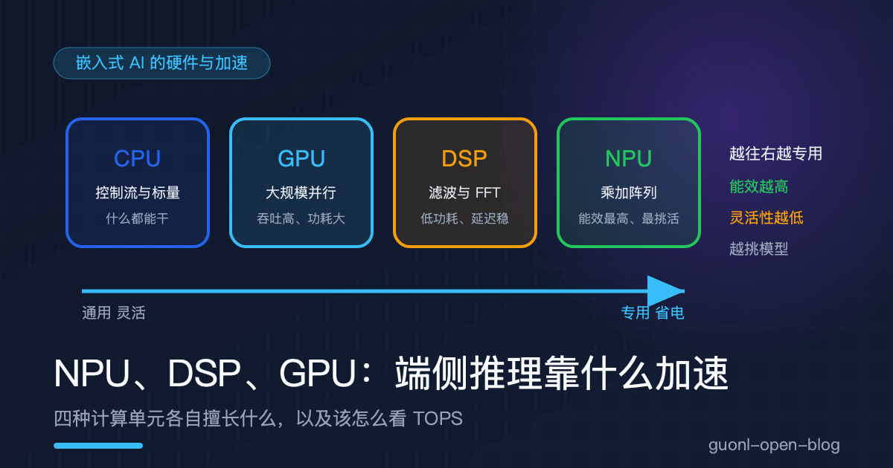
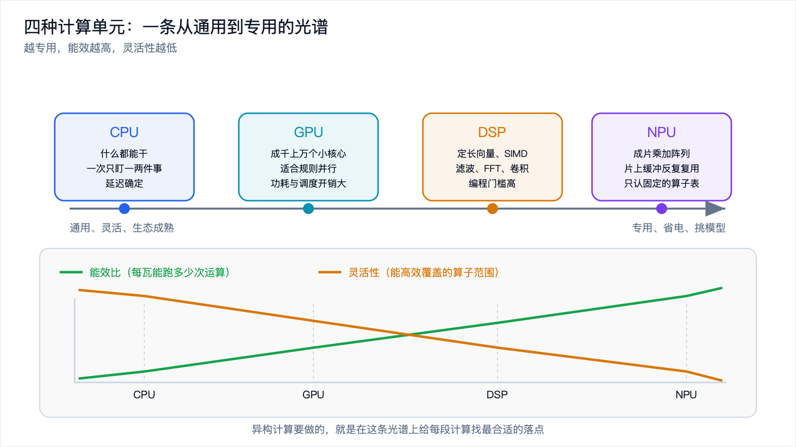
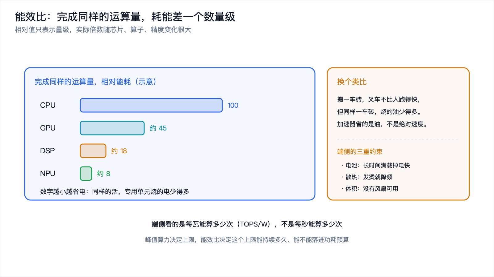
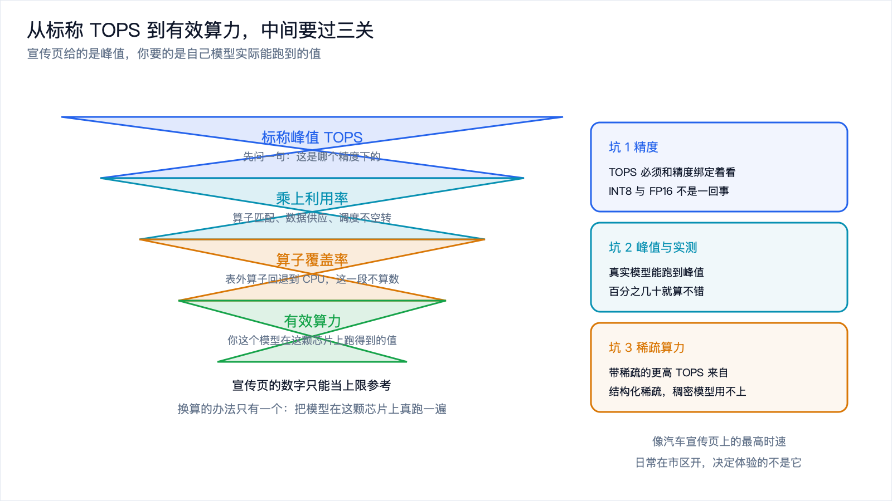
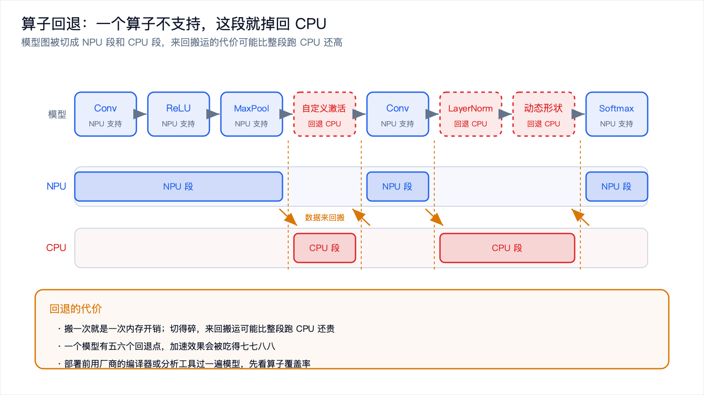

# NPU、DSP、GPU：端侧推理到底靠什么加速

*2026-10-30 · 嵌入式 AI 的硬件与加速*

## 一块芯片里为什么塞了这么多种计算单元

翻开一颗手机 SoC 或者机器人主控的框图，你会看到 CPU、GPU、DSP、NPU 挤在同一块硅片上。既然都是算东西的，为什么要造这么多种？

因为它们擅长的活不一样。CPU 像一个什么都会的帮厨，切菜、调味、看火候都能干，但一次只能盯一两件事；GPU 像一口大锅，能同时炒很多份同样的菜；DSP 像一个专门切丝的师傅，刀工快、稳定、省力，但只会切；NPU 像一台专门的饺子机，包饺子又快又省电，你让它炒菜它不会。

把不同的活派给不同的单元，让它们协作，这套思路叫异构计算。它不是为了堆料，而是因为"一个通用单元干所有事"在能效上太亏。

这篇把四种计算单元讲清楚：各自擅长什么，为什么专用加速器值那个钱，TOPS 这个指标该怎么看，以及两个最容易被忽略的坑：算子支持和内存带宽。

## 四种计算单元各自擅长什么

先看它们的底子。

CPU 是通用处理器。它的强项是控制流：分支、跳转、复杂逻辑、标量运算，什么都能接。但它的核心数少，做矩阵乘法这种大规模规则并行运算，是拿短板去碰别人的长板。CPU 的价值在于什么都能干，以及延迟确定，而不是吞吐。

GPU 天生为并行设计。它有成千上万个小核心，走 SIMT（单指令多线程）的路子，同一条指令同时作用在大量数据上，图形渲染和矩阵运算都是它的主场。吞吐很高，代价是功耗和调度开销都大，而且对不规则、分支多的任务不友好。

DSP 是为信号处理长的。它有定长的向量单元，SIMD 或 VLIW 的指令集，专门加速滤波、FFT、卷积这类数字信号运算。特点是低功耗、延迟确定，很适合实时音频、雷达、通信这些场景。短板是编程门槛高，生态比 CPU 和 GPU 窄很多，写起来费劲。

NPU 是给神经网络定制的。它的核心是成片的乘加阵列，配上片上缓冲，一次能并行算出大量乘加；为了省电，数据尽量在片上复用，不来回访问内存。能效比是四种里最高的。代价是不灵活：它只认一张固定的算子表，模型出了这张表就用不上。

这里有个规律：越专用的单元，能效越高，灵活性越低。CPU 最灵活也最费电，NPU 最省电但最挑模型。异构计算要做的，就是在这个光谱上给每段计算找最合适的落点。

*图 1：四种计算单元在"通用到专用"的光谱上各有位置，能效和灵活性此消彼长。*

## 为什么需要专用加速器：能效比才是关键

很多人以为加速器是为了算得更快。更准确的说法是：为了在同样的功耗下算得更多，或者在同样的运算量下更省电。

端侧和云端的约束完全不同。云端有稳定供电和强力散热，可以靠堆峰值算力硬扛。端侧受电池、散热、体积三重限制，尤其是手机和可穿戴设备，长时间满载会发烫、掉电、降频。这时候每瓦能算多少次，比每秒能算多少次重要得多。

这个差距是数量级的。同一个矩阵乘法，用专用加速器跑，每瓦能完成的运算次数可以是通用 CPU 的十倍到百倍，具体倍数随芯片、算子、精度变化很大，这里只说量级。差距来自两处：一是并行的乘加阵列把运算摊到很多个单元上；二是片上缓冲减少了来回访问内存的功耗，而访存往往比计算本身更费电。

换个类比。搬一车砖，不是叉车比人跑得快，而是同样一车砖，叉车烧的油少得多。加速器的意义在于省油，不在绝对速度。

所以评估一颗端侧芯片，第一眼该看的不是峰值算力，而是能效比，也就是每瓦能跑多少次运算，常见写法是 TOPS/W。峰值算力决定上限，能效比决定这个上限能持续多久、能不能落进功耗预算。

*图 2：完成同样的运算量，越专用的单元耗能越低，这个差距是端侧最关心的指标。*

## TOPS 该怎么看：一个容易被误读的指标

TOPS 是每秒万亿次操作（Tera Operations Per Second）。芯片宣传页上经常写"40 TOPS""8 TOPS"，数字越大听起来越强。但这个数字有几个坑。

第一个坑是精度。TOPS 必须和精度绑定着看。INT8 的算力通常比 FP16 高一截，INT4 又比 INT8 高一截，因为位宽越低，同样的硬件一次能算的更多。所以一颗写着"20 TOPS INT8"的芯片，和一颗写着"20 TOPS FP16"的芯片，不是一回事。看到 TOPS 先问一句：这是哪个精度下的。

第二个坑是峰值和实测的差距。标称 TOPS 是理论峰值，只有在算子完美匹配、数据供应充足、调度没有空转时才能跑到。真实模型能跑出峰值的百分之几十就算不错了。有效算力大致等于峰值乘以利用率，而利用率被算子覆盖、内存带宽、批大小、调度共同决定。宣传页给的是峰值，你要的是有效值。

第三个坑是稀疏算力。有些芯片会标一个"带稀疏"的更高 TOPS，那个数字来自结构化稀疏，比如每四个权重里允许两个为零的 2:4 稀疏。普通稠密模型用不上这个加速，数字好看，对你的模型没意义。

类比一下：TOPS 像汽车宣传页上的最高时速。这个数字是真的，但只在理想赛道上、油门踩到底才跑得到。日常在市区开，决定体验的是加速、油耗和堵不堵车，而不是那个最高时速。

看 TOPS 的正确姿势是：先看精度，再看它是峰值还是实测，最后把它换算成"我这个模型在这颗芯片上实际能跑到多少"。换算的办法只有一个，把模型真跑一遍。

*图 3：从标称 TOPS 到模型实际能用的算力，中间要经过几层折扣。*

## 算子支持与量化友好度：一个算子不支持，就掉回 CPU

NPU 不是通用处理器，它只支持一张固定的算子表。这句话是选型时最重要的一句话。

一个神经网络就是一张算子图：卷积、全连接、激活、归一化、池化、各种逐元素运算。NPU 的硬件只实现了其中一部分，而且往往是最常用的那部分。模型里只要出现一个表外的算子，比如某个不常见的激活函数、某个特殊的归一化、动态形状的操作、或者自定义层，编译器就没法把整张图交给 NPU，只能把这一段切出去交给 CPU，这就是算子回退。

回退的代价不只是这一段慢。数据要在 NPU 和 CPU 之间来回搬，搬一次就是一次内存开销；切得碎的话，来回搬运的代价可能比整段交给 CPU 跑还高。一个模型如果有五六个回退点，加速效果会被吃得七七八八，甚至出现开了 NPU 反而更慢的情况。

量化友好度是同一件事的另一面。NPU 为了省电，通常只做整数量化运算，模型得先转成 int8，甚至更低。问题在于，不是所有结构都对量化友好：有些激活的数值范围很宽，量化之后精度掉得厉害；有些算子根本不支持量化版本。这类结构要么换成量化友好的替代品，要么就只能回退到 CPU 用浮点跑。

所以部署前有一件必做的功课：用芯片厂商给的编译器或者分析工具，把模型过一遍，看算子覆盖率有多少、哪些算子回退了、回退之后性能损失多少。别等上了板子才发现模型跑不起来。

结论很直接：选芯片的时候，算子支持和量化友好度，比峰值算力更能决定成败。一个能跑满你模型所有算子的中等算力芯片，胜过一个峰值很高但总在回退的高端芯片。

*图 4：模型图被切成 NPU 段和 CPU 段，回退点越多，来回搬运的代价越大。*

## 内存带宽：被忽略的第二道墙

算得快不等于跑得快。计算单元算完一个数，得先把数据从内存读进来、把结果写回去。内存的搬运速度，也就是带宽，经常才是真正的瓶颈。

衡量这件事有个指标叫算力带宽比，也叫算术强度：每读进来一个字节的数据，能做多少次运算。算术强度高的算子，比如卷积，同一个权重会被复用好多次，对带宽不敏感，算力说了算；算术强度低的算子，比如全连接、逐元素加法，每读一个数只算一两次，很快就被带宽卡住。

这里还有一层：内存分片上内存和片外内存。片上 SRAM 快、省电，但容量小；片外 DRAM 容量大，但访问慢、耗电。NPU 省电的功劳有一半在片上缓冲：把要用的小块数据搬进片上，反复用，减少访问 DRAM 的次数。可一旦模型和中间激活放不进片上，就得走 DRAM，能效和速度都会掉下来。

所以看芯片不能只看算力，还要看带宽和片上缓存有多大。一颗算力很高但带宽跟不上、片上缓存很小的芯片，跑大模型时会一直饿着，算力根本发挥不出来。

## 一张对比表

把四种单元放在一起看。

| 计算单元 | 擅长 | 不擅长 | 能效比 | 编程难度 | 典型任务 |
| --- | --- | --- | --- | --- | --- |
| CPU | 控制流、分支、标量、通用逻辑 | 大规模规则并行 | 低 | 低，生态最成熟 | 调度、后处理、小算子、回退段 |
| GPU | 大规模并行、规则计算、图形 | 不规则分支、低延迟单任务 | 中 | 中，生态较成熟 | 图形渲染、并行矩阵运算、部分推理 |
| DSP | 定长向量、滤波、FFT、卷积 | 通用逻辑、动态控制 | 高 | 高，生态较窄 | 音频前端、雷达、通信、特征提取 |
| NPU | 神经网络算子、乘加密集运算 | 表外算子、动态形状、通用计算 | 最高 | 中，依赖编译器 | 卷积网络、Transformer 推理 |

这张表读出来的结论有几条。能效和灵活性是反着走的，越往下越省电、越挑活。真实系统很少只用一种单元，常见形态是 NPU 跑主干、DSP 做信号前端、CPU 兜底和调度、GPU 处理图形和部分并行任务。选型时盯住"我这个模型能被哪几个单元高效覆盖"，比盯峰值算力实在。

## 落到选型：几条经验

把上面的东西收成几条能直接用的判断。

先看模型，再看芯片。把模型的算子列出来，对着芯片的算子支持表勾一遍，看覆盖率。覆盖率高，这颗芯片才有讨论的价值。

看有效算力，不看峰值。有机会就在目标芯片上把模型真跑一遍，测实测延迟和功耗。宣传页的数字只能当上限参考。

能效比和带宽一起看。峰值算力只是分子，功耗和带宽才是端侧真正的约束。一颗能长时间稳定跑在功耗预算内的芯片，比一颗峰值高但一跑就降频的芯片好用。

把量化方案提前定下来。训练模型的时候就考虑目标芯片支持哪种量化，别等部署了才发现模型转不过去。

## 写在最后

端侧推理的加速，不是谁算得快的问题，而是谁算得省的问题。CPU、GPU、DSP、NPU 组成一条从通用到专用的光谱，越专用能效越高、越挑活。选加速器先看能效比；看 TOPS 要带上精度、区分峰值和实测；算子支持和量化友好度决定模型能不能真的跑在加速器上，一个算子不支持就得回退 CPU；内存带宽常常才是隐藏的瓶颈。

概念到这里就够用了。真正要落到手上，还得把具体的板子摆出来对比：算力、内存、功耗、价格、工具链成熟度，一个都不能少。下一篇《选板指南：Jetson / RK3588 / ESP32-S3 怎么选》就来做这件事。
