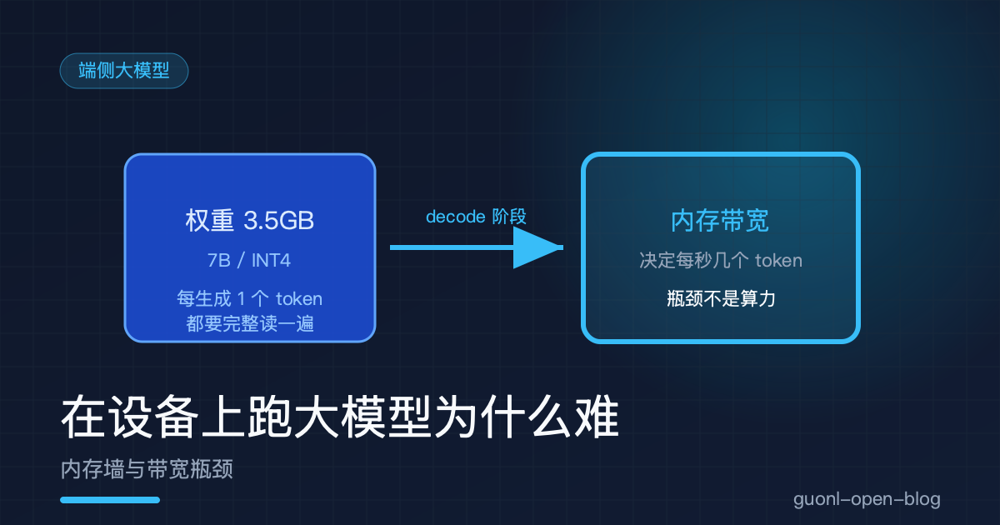
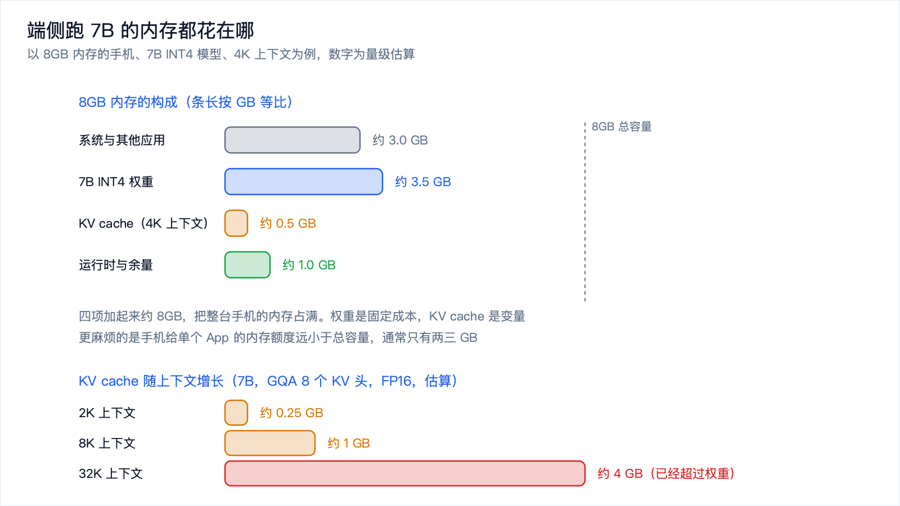
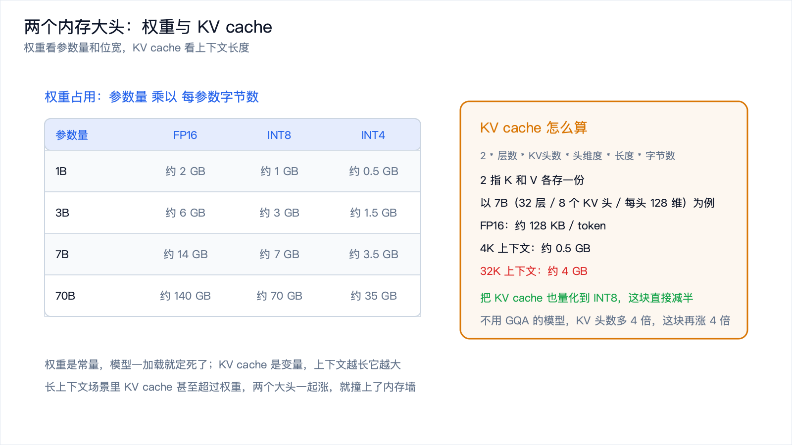
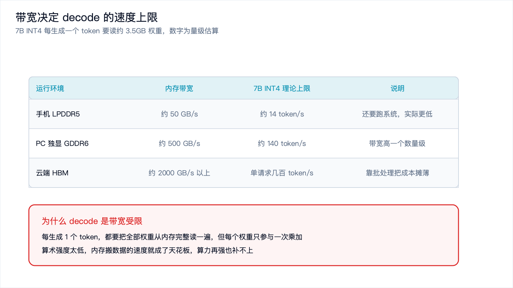

# 在设备上跑大模型为什么难：内存墙与带宽瓶颈



*2026-10-30 · 端侧大模型*

## 一个反直觉的结论

上一篇[《动手：把 PyTorch 模型部署到端侧》](deploy-model-on-edge.md)，我们把一个图像分类模型量化、导出、跑进了端侧。那个模型只有几百万参数，几十兆大小，跑起来毫不费力。

现在把目标换成一个 7B 的大语言模型。多数人的第一反应是算力不够：手机那点算力，怎么可能跑得动几十亿参数。

真拿设备跑一次，会发现一件反直觉的事。跑得慢的时候，芯片并没有满负荷。CPU 占用率不高，GPU 也在空等，整个系统看起来像是被什么东西堵住了。它不是算不过来，是数据喂不上。

这篇要讲的就是这件事。端侧大模型的瓶颈，排在最前面的是内存容量，紧随其后的是内存带宽，算力反而排在很后面。理解了这个顺序，很多奇怪的现象就有了解释：为什么 4 位量化能让速度翻几倍，为什么上下文一开大就崩。

## 内存墙是怎么来的

先解释"内存墙"这个词。

处理器的算力，指的是每秒能做多少次乘加运算；内存带宽，指的是每秒能从内存里搬多少字节过来。这两件事的增长速度，过去几十年差了很远。

算力这边靠制程进步和并行度提升，长期趋势是每两年翻一倍这个量级；带宽这边靠内存颗粒的接口速率，同期只涨到原来的几倍。两条曲线越拉越开，中间的缺口就是内存墙：处理器越来越能吃，内存喂不进去。

放在端侧，这道墙还要更矮一点。手机、带独显的笔记本、云端服务器，内存带宽差着几十倍，具体数字后面图里会列。

而大模型推理，恰恰是最吃带宽的那类负载。



*图 1：权重、KV cache、运行时开销三者挤在一台 8GB 手机里，数字为量级估算。*

## 一笔内存账：权重、KV cache、运行时

跑一个模型要占多少内存，可以拆成三块来算。

第一块是权重，也就是模型参数本身。这一块最直观：参数量乘以每个参数占的字节数。FP16 每参数 2 字节，INT8 每参数 1 字节，INT4 每参数 0.5 字节。

| 参数量 | FP16 | INT8 | INT4 |
| --- | --- | --- | --- |
| 1B | 约 2 GB | 约 1 GB | 约 0.5 GB |
| 3B | 约 6 GB | 约 3 GB | 约 1.5 GB |
| 7B | 约 14 GB | 约 7 GB | 约 3.5 GB |
| 70B | 约 140 GB | 约 70 GB | 约 35 GB |

一张 7B 模型的 FP16 权重就要 14GB，超过了很多笔记本的内存总量；量化到 INT4 之后是 3.5GB，才勉强进入端侧能讨论的范围。

第二块是 KV cache。注意力机制在生成每个 token 时都要回看前面所有 token 的键和值，为了避免重复计算，这些键和值会被缓存下来，这就是 KV cache。它的体积随上下文长度线性增长，估算方式是：

```text
KV cache 字节数 约等于 2 * 层数 * KV 头数 * 头维度 * 上下文长度 * 每元素字节数
```

前面的 2 是因为键和值各存一份。拿一个 7B 量级的模型举例，32 层、注意力用了分组查询（KV 头数比查询头数少，比如 8 个 KV 头、每头 128 维），每个元素用 FP16 存，那么每 token 每层的开销是：

```text
2 * 8 * 128 * 2 字节 = 4096 字节 = 4 KB
32 层合起来：4 KB * 32 = 128 KB / token
```

按这个算，2K 上下文约 0.25GB，8K 约 1GB，32K 约 4GB。最后这个数字比权重还大。也就是说，一个上下文开到 32K 的 7B 模型，光内存占用就接近 7.5GB，还没算运行时开销。

这里有个容易忽略的细节：上面用的是分组查询的配置。如果模型不用分组查询，KV 头数和查询头数一样多，这个数字还要再乘 4，长上下文的代价立刻翻几倍。

第三块是运行时开销，包括激活值、中间张量和推理引擎自己的缓冲，通常几百 MB 量级，不随上下文变化。

三块里，只有 KV cache 是变量，它随上下文长度线性上涨。端侧大模型在"能跑"和"跑不动"之间来回横跳，跳的就是这一块。


*图 2：同一个模型，两个阶段的瓶颈完全不同。*

## 两个阶段：prefill 和 decode

内存容量决定了模型能不能装下，内存带宽决定了装下之后能跑多快。要理解带宽为什么是主角，得先把生成过程拆成两个阶段。

第一个阶段叫 prefill，预填充。你把一段 prompt 丢给模型，它要把这段 prompt 全部读进去，为每个 token 算出键和值填进 KV cache。这一步是并行的：整段 prompt 里的 token 可以同时算，展开成大规模矩阵乘法。矩阵乘的数据复用率高，同一个权重会被用来算很多个 token，算术强度高，所以这一步计算密集，瓶颈在算力。

第二个阶段叫 decode，逐 token 生成。模型根据已有的内容预测下一个 token，把它接上去，再预测下一个，如此循环。这一步没有并行度可言，因为下一个 token 依赖上一个 token 的结果，只能一个一个来。

关键差别就在这里。每生成一个 token，模型都要把全部权重从内存里读一遍，但每个权重只参与一次乘加运算。读完 35 亿个参数，只换来一个 token。数据搬了一大堆，算的活却很少。

## 为什么 decode 一定是带宽受限

把上面这句话翻译成一个可以算的指标：算术强度，也就是每从内存搬来一个字节，能做多少次运算。

decode 阶段每读一个权重做一次乘加，乘加算两次运算，所以算术强度大约是 2。而现代处理器的算力带宽比，通常在一百以上，也就是说它每搬一个字节，有能力做上百次运算。供给和需求差了两个数量级，处理器大部分时间在等数据。

换个角度算一遍会更清楚。还是那个 7B INT4 模型，权重 3.5GB，设备带宽每秒 50GB：

```text
生成一个 token 至少要读 3.5 GB
3.5 GB / 50 GB/s = 0.07 秒
也就是每秒最多 14 个 token
```

再看算力这边够不够。一个 7B 模型生成一个 token，需要的运算量大约是参数量的两倍，也就是 14 GFLOP 左右。假设手机的 NPU 按 INT8 算力有 10 TOPS，那么这部分运算理论上只要 1.4 毫秒。一边是 70 毫秒，一边是 1.4 毫秒，差了两个数量级。

结论很直接：算力闲着，内存在拼命。把 NPU 换成算力强十倍的型号，速度也快不了多少；反过来，只要把权重的字节数减半，这一步的耗时就会接近减半。量化在端侧大模型上效果特别明显，原因就在这里：它省的不只是磁盘空间，更是每一秒都要走一遍的内存带宽。



*图 3：权重看参数量和位宽，KV cache 看上下文长度，两者一起决定内存能不能装下。*

## 量化格式帮了什么忙

既然瓶颈是每 token 要读的字节数，量化就是最对症的手段。

推理速度的上限大致等于内存带宽除以权重体积。权重从 FP16 压到 INT8，体积减半，上限翻倍；压到 INT4，体积变成四分之一，上限就是四倍。这条关系是线性的，也是端侧大模型所有优化里最可靠的一条。

具体到工程上，绕不开 GGUF 这个格式。它是一种单文件打包格式，把权重、词表、超参、对话模板全部收进一个文件，同时定义了一整套量化表示方式。名字里那些 `Q4_K_M`、`Q5_K_M` 的后缀就是量化级别，数字代表位宽，`K` 表示用了更细的分块策略，后面的字母表示同一级别内偏小、中等、偏大的版本。

为什么需要"更细的分块"？因为 4 位只有 16 个格点，如果一个张量里的权重范围差异很大，用一套缩放系数会把大部分权重压到少数几个格点上，精度直接崩掉。分块量化把权重切成小块，每 32 个或 64 个权重共享一套缩放系数，让每一小块的取值范围更贴近它自己的分布。

| 量化级别 | 每参数约 | 7B 模型约 | 生成速度上限 | 质量 |
| --- | --- | --- | --- | --- |
| FP16 | 2 字节 | 约 14 GB | 1 倍 | 基线 |
| Q8_0 | 约 1.05 字节 | 约 7.4 GB | 约 1.9 倍 | 几乎无损 |
| Q5_K_M | 约 0.70 字节 | 约 4.8 GB | 约 2.9 倍 | 很接近原始 |
| Q4_K_M | 约 0.60 字节 | 约 4.2 GB | 约 3.3 倍 | 轻微下降 |
| Q3_K_M | 约 0.48 字节 | 约 3.4 GB | 约 4.1 倍 | 可感知下降 |

表里的数字都是量级估算，实际取决于模型结构、推理引擎和硬件。它说明的是量化的性价比拐点：Q8 到 Q4 这一段速度提升明显而质量损失很难察觉，再往下体积继续变小，生成质量开始肉眼可见地退化。

权重之外，KV cache 也可以量化。把它从 FP16 降到 INT8，长上下文场景下这块内存直接减半，代价是注意力的精度略有损失。在上下文很长的时候，这笔交易往往划算。

还有一条路是缩小模型本身。1B 到 3B 配 INT4 量化，权重只有 0.5GB 到 1.5GB，端侧放得很从容，代价是能力明显弱于 7B。

## 手机上跑 7B 为什么紧张

把上面的账合起来看，就能明白为什么"手机上跑 7B"这件事一直很勉强。

拿一台 8GB 内存的手机做例子，这个数字是整机容量，不是某个 App 能用的量。按量级估算：

- 系统和其他应用：约 3GB
- 7B INT4 权重：约 3.5GB
- KV cache（4K 上下文）：约 0.5GB
- 运行时、激活值和余量：约 1GB

四项加起来正好把 8GB 占满。这里还没考虑更麻烦的一点：手机给单个 App 的内存额度通常远小于整机容量，往往只有两三 GB。权重这一项就已经超过这个额度了。

于是端侧跑 7B 的常见做法是各种妥协：换 1B 到 3B 的小模型，把上下文限制在 2K 到 4K，把 KV cache 也量化掉，再用内存映射让不活跃的权重留在闪存里。每一条都在换，用能力、用上下文长度、用精度换内存。

还有一个绕不开的问题是发热。长时间满负荷推理会让手机升温，触发降频，速度掉下来。这一条在桌面上不明显，在手机上是常态。



*图 4：同样的模型，换个运行环境，理论上限差出几十倍。*

## 和云端比，差在哪

把端侧和云端放在一起，差距的来源会变得很清楚。

差距之一是带宽。云端服务器的 HBM 带宽在每秒 2000GB 以上，是手机 LPDDR5 的四十倍。同样一个 7B INT4 模型，端侧每 token 至少 70 毫秒，云端理论上只要 1.75 毫秒。

比带宽更重要的是批处理。云端服务几百个用户时，可以把请求攒成一批一起算，一批里的所有请求共享同一次权重读取。那份 3.5GB 的权重只读一遍，却服务了几十个请求，带宽被摊薄，算术强度上去，瓶颈重新回到算力，而算力正好是云端最不缺的东西。

端侧没有这个选项。手机上的推理请求通常只有你一个人，批大小是 1，权重读取永远摊不薄。

| 维度 | 端侧 | 云端 |
| --- | --- | --- |
| 内存容量 | 几 GB，还要和系统分 | 几百 GB 到 TB 级 |
| 内存带宽 | 约 50 GB/s | 约 2000 GB/s 以上 |
| 批大小 | 1 | 几十到几百 |
| 瓶颈 | 内存容量与带宽 | 算力，带宽被批处理摊薄 |
| 边际成本 | 零，用用户自己的电 | 按算力计费 |

最后一行是端侧真正的优势所在。端侧推理的边际成本接近零，用的是用户自己的电和自己的芯片，而且数据不出设备。云端每生成一个 token 都要花钱。

这也解释了端侧大模型的合理定位。它不是在和云端比能力，而是拿一部分能力换隐私、离线可用和零边际成本。这些性质值钱的场景，端侧就有位置。

## 端侧大模型该往哪走

理解了瓶颈是内存而不是算力，优化方向也就清楚了。

最有效的还是减少每 token 要读的字节数：更小的模型、更激进的量化、把 KV cache 也压下去。这三件事直接作用在瓶颈上，收益是线性的。另一条路是减少要读的次数，多轮对话里复用前几轮算好的 KV cache，或者用投机解码这类拿算力换串行步骤的技术。

再往下是避开长上下文。它对内存的消耗是线性的，在端侧是最贵的一项，把任务设计成短上下文能完成的形态，比事后优化更划算。反过来，长文档问答、需要反复检索推理的复杂任务、需要大量并行请求的服务，端侧先天不占优势。

## 写在最后

这一篇把端侧大模型的瓶颈拆开算了一遍。内存墙来自算力和带宽增长速度的差异，端侧的带宽只有云端的几十分之一。运行时内存由三块组成：权重看参数量和位宽，KV cache 看上下文长度，运行时开销相对固定。生成分 prefill 和 decode 两个阶段，前者算力受限，后者带宽受限，所以速度上限大致就是带宽除以权重体积，量化正是作用在这一项上。手机上跑 7B 之所以紧张，是因为权重、KV cache 和系统占用加起来正好把 8GB 占满。云端靠高带宽和批处理，把容量和带宽这两个问题都绕开了。

数字算清了，接下来该动手了。下一篇[《动手：用 llama.cpp 在本地跑一个量化小模型》](llama-cpp-hands-on.md)，把这套账落到一个真实的推理引擎上：编译、下载 GGUF、跑起来，再亲手量一遍内存和每秒 token 数。
