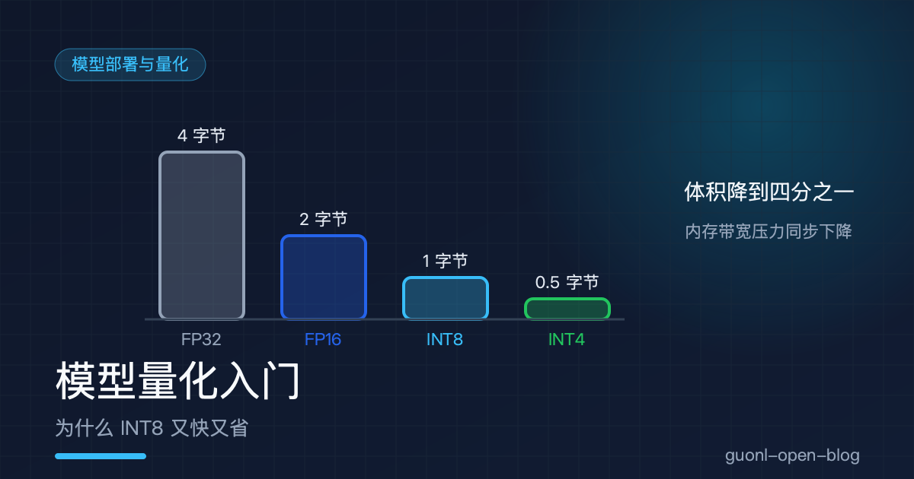
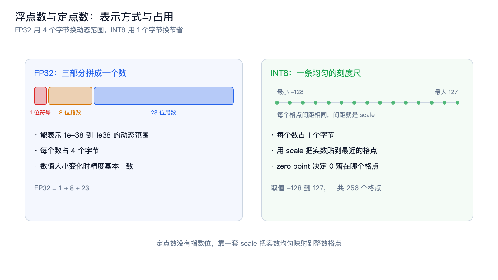
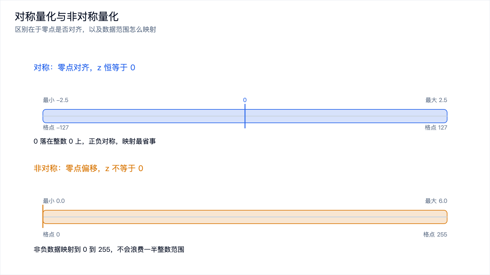
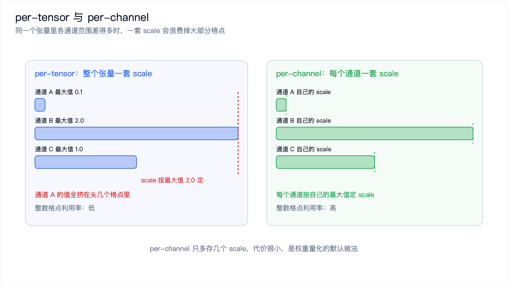
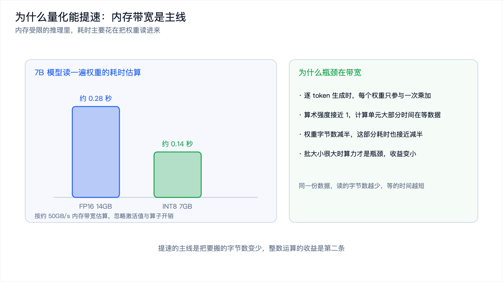

# 模型量化入门：为什么 INT8 又快又省



*2026-10-30 · 模型部署与量化*

## 一个模型文件为什么这么大

你在本地跑过模型就会发现，一个 7B 参数的模型下载下来就是十几个 GB，加载进内存之后还要更多。这些参数里的每一个，默认都存成 32 位浮点数，占 4 个字节。

问题在于，模型里绝大多数参数真的需要 32 位精度吗？一个训练好的权重，比如 0.0173421，和它旁边的 0.0173398，对最终输出的影响微乎其微。用 4 个字节去区分这种差异，是浪费。

量化做的就是这件事：用更少的位数表示这些数。最常见的是把 32 位浮点换成 8 位整数，也就是 INT8。模型体积直接变成四分之一，推理还能更快。

听起来像免费午餐，实际不是，精度会掉。但掉多少、掉在哪、怎么补，是可以控制的。这篇讲清楚量化的原理：定点数怎么表示实数、对称与非对称的区别、为什么它省内存又提速、精度损失从哪来、校准在做什么，以及几个一定会踩到的坑。

## 浮点数和定点数的区别

浮点数 FP32 把一个数拆成三部分：1 位符号、8 位指数、23 位尾数。指数决定它能表示的动态范围，尾数决定它的精度。因为有指数，FP32 既能表示 1e-38 也能表示 1e38，而且数值大小变化时小数位的精度基本保持一致。代价是每个数要 4 个字节，运算单元也复杂。

定点数 INT8 就是普通的 8 位整数，取值 -128 到 127，一共 256 个可能的值。它没有指数，所有数均匀分布在一条轴上，间距固定。要表示实数，就约定一个缩放比例，把它线性映射到整数网格上。

这个约定写成公式是这样：

```
q = round(r / s) + z      # 量化：实数 r 转成整数 q
r_hat = s * (q - z)       # 反量化：整数 q 还原成实数 r_hat
```

s 是 scale，缩放因子；z 是 zero point，零点偏移。反量化得到的 r_hat 和原始的 r 通常不相等，中间那个差就是量化误差。

一个直观的理解：实数轴铺在一把尺子上，刻度只能落在 256 个位置，每个实数都贴到最近的刻度上，误差就来自这一贴。刻度越少，误差越大。



*图 1：FP32 用 4 个字节换动态范围，INT8 用 1 个字节换节省。*

## 对称与非对称，per-tensor 与 per-channel

公式里的 s 和 z 怎么定，是量化里最核心的选择。这里有两个维度的选择。

先看对称和非对称。对称量化强制零点对齐，z 恒等于 0，映射区间取最大绝对值。整数范围用 -127 到 127，0 被精确表示。非对称量化不强制零点对齐，把数据的最小值到最大值映射到 0 到 255，用 z 把 0 放到正确的位置上。

两种方式各有主场。权重分布通常关于 0 对称，有正有负、均值接近 0，对称量化更合适，而且 z 等于 0 让计算更简单。激活值经过 ReLU 之后全是非负数，分布落在 0 到某个正数之间，用对称量化会浪费一半的整数范围，非对称量化更合适。



*图 2：零点是否对齐决定适用范围，权重偏对称，激活偏非对称。*

再看 per-tensor 和 per-channel。per-tensor 是整个张量共用一套 s 和 z，实现最简单。per-channel 是给每个输出通道各自一套，存储开销只是多几个 scale。

为什么 per-channel 常常明显更好？因为同一个张量里不同通道的数值范围可能差很多。假设某层权重，通道 A 的绝对值最大是 0.1，通道 B 是 2.0。用 per-tensor 的 scale 按 2.0 定，通道 A 的值全被压到 0 附近，能用的整数格点只剩几个；per-channel 让通道 A 用自己的 scale，就能把整个整数范围用满。

| 方式 | 含义 | 适用场景 | 代价 |
| --- | --- | --- | --- |
| 对称 | z 恒为 0，区间按最大绝对值定 | 权重，分布关于 0 对称 | 激活非负时浪费一半范围 |
| 非对称 | 最小值到最大值映射到 0 到 255 | 激活，ReLU 后非负 | 计算稍复杂，要处理 z |
| per-tensor | 整个张量共用一套 s 和 z | 实现简单，激活常用 | 通道间范围差异大时误差大 |
| per-channel | 每个通道一套 s 和 z | 卷积层、线性层的权重 | 需要算子支持，多存几个 scale |



*图 3：同一个张量里各通道范围差得多，一套 scale 会浪费掉大部分格点。*

一个手算的例子。假设某层权重的范围是 -2.5 到 2.5，用对称 INT8：

```
s = 2.5 / 127 = 0.0197
```

相邻两个整数格点之间相差 0.0197。任何一个权重被量化后，误差最大是格点间距的一半，约 0.0098。相对 2.5 的范围，这个误差在 0.4% 量级。

换一个情形。如果这个权重的范围仍然是 -2.5 到 2.5，但 99% 的值都落在 -0.2 到 0.2 之间，情况就完全不同：scale 还是按 2.5 定，绝对误差仍然是 0.0098，但对于 0.2 这个量级的值来说，相对误差到了 5% 左右。这就是离群点的危害，后面还会讲到。

## 为什么量化省内存、省带宽，还提速

省内存最直接。每个参数占的字节数变了：

| 数据类型 | 每个参数占用 | 1B 参数模型 | 7B 参数模型 |
| --- | --- | --- | --- |
| FP32 | 4 字节 | 约 4GB | 约 28GB |
| FP16 / BF16 | 2 字节 | 约 2GB | 约 14GB |
| INT8 | 1 字节 | 约 1GB | 约 7GB |
| INT4 | 0.5 字节 | 约 0.5GB | 约 3.5GB |

表里的数字按参数量乘位宽估算，不含运行时开销。实际占用还要加上激活值、KV cache 和框架内存，真实数字会更大。

省带宽和提速是同一件事的两面，也是量化最容易被误解的地方。很多人以为量化提速是因为整数运算比浮点运算快，这只对了一半，而且在不少场景里不是主因。

真正的主线是内存带宽。现代处理器算得很快，但把数据从内存搬到计算单元的速度跟不上，这个差距就是常说的内存墙。推理过程里，每算一个结果都要把权重读进来。如果推理是逐个小批量做的，比如大模型逐 token 生成，那每生成一个 token，整个模型的权重都要从内存里读一遍。这时候瓶颈完全在带宽上，计算单元大部分时间在等数据。

算一笔账。假设一个 7B 模型跑在内存带宽约 50GB/s 的设备上，只看权重读取这一项：

- INT8：7GB 除以 50GB/s，约 0.14 秒
- FP16：14GB 除以 50GB/s，约 0.28 秒

这是理论下界，实际还要加上激活值读取、算子开销等，真实速度会更慢，但比例关系是清楚的：权重字节数减半，这部分耗时也差不多减半。这也是量化对逐 token 生成这类推理提速特别明显的原因。

判断推理是不是受内存带宽限制，看算术强度：每个字节的数据能参与多少次乘加运算。逐 token 生成时，每个权重读进来基本只参与一次乘加，算术强度接近 1，远低于处理器能承受的水平，是典型的内存受限。反过来，如果批大小很大，同一个权重能被复用很多次，瓶颈就转到算力上，量化的提速效果会变小。

整数运算本身也有收益，多数端侧 NPU 和 DSP 的 INT8 吞吐比 FP32 高几倍，占用面积和功耗也更低。这条收益能不能拿到，取决于硬件有没有对应的加速单元，以及工具链有没有把算子真的映射上去。算子回退到 FP32，量化之后反而可能更慢。



*图 4：内存受限的推理里，耗时主要花在把权重读进来。*

## 精度代价从哪来

量化误差有三个来源，理清了才知道怎么补。

舍入误差是最基本的一个。反量化后的值和原值有偏差，最大是格点间距的一半。位数越少，间距越大，误差越大。这个是原理性的，只能靠增加位数或者让数据分布更集中来缓解。

第二个来源是表示范围的浪费。scale 按极值定，如果数据里有个别离群点，scale 就被拉大，剩下 99% 的数据挤在少数几个格点里，精度被严重压缩。这解释了为什么 per-channel 往往比 per-tensor 好：把一个张量切成多组，每组的极值更贴近该组的数据分布。

第三个来源是量化粒度不够细。同一个 scale 覆盖的范围越大、数据分布越不均匀，误差越大。INT8 有 256 个格点，通常够用；INT4 只有 16 个格点，就必须靠更细的分组才能把误差压住，比如每 32 个或 128 个权重共享一个 scale，也就是分组量化。

误差最终体现在任务指标上，可能是分类准确率掉一两个点，也可能是生成质量肉眼可见地变差。掉多少跟模型、任务、数据都有关，只能实测。

## 校准在做什么

量化需要知道数据的范围。权重的范围可以离线算出来，激活值的范围不行：它取决于输入数据，只有跑起来才知道。校准解决的就是这件事。

做法是拿一批有代表性的数据，几百张图片或者几百条文本就够，关键是覆盖真实场景的分布，让模型跑一遍推理，记录每层的激活值分布，据此定出各层的 s 和 z。这个过程只做前向计算，不需要反向传播和标签，所以很快，几分钟到几十分钟的量级。

从记录到的分布到最终的 s 和 z，有几种策略：

- MinMax：直接取最小值和最大值。实现最简单，但一两个离群点就能把范围撑大，导致整体精度下降。
- 百分位截断：取 99% 或 99.9% 分位点作为边界，把极端值裁掉。裁掉的值会饱和到端点，用一个小的截断误差换整体精度。
- KL 散度：在候选的截断位置里挑一个，让量化前后的分布差异最小。计算稍重，效果通常更稳。

校准数据选得不好是常见的失败原因。用训练集里最干净的样本去校准，真实场景的分布不一样，激活范围对不上，精度就崩。校准集要贴近部署时会遇到的真实输入。

## INT8 还是 INT4

INT8 是当前的默认选择，工具链成熟、硬件支持好、精度损失通常可以接受。INT4 的吸引力在于内存再砍一半：7B 模型从 7GB 降到 3.5GB 左右，这一步往往决定了模型能不能塞进手机或者开发板。

代价也很实在：

| 维度 | INT8 | INT4 |
| --- | --- | --- |
| 每个参数 | 1 字节 | 0.5 字节 |
| 7B 模型权重 | 约 7GB | 约 3.5GB |
| 可表示级别 | 256 级 | 16 级 |
| 是否需要分组量化 | 通常不需要 | 基本必须，否则误差过大 |
| 算子支持 | 普遍支持 | 支持参差不齐 |
| 精度损失 | 通常较小 | 明显，需要更谨慎的校准或再训练 |
| 常见搭配 | 权重和激活都 8 位 | 权重 4 位，激活保持 8 位或 16 位 |

最后一行说的是权重和激活的位宽组合。实际部署里很少让所有东西都降到 4 位，因为激活值对量化更敏感，权重才是省内存的大头。

选择原则很简单：先试 INT8，精度不够就用更好的校准、per-channel、敏感层保留 FP16 来补；内存还是放不下再考虑 INT4，并准备好接受精度下降或者再训练的成本。

## 几个一定会踩的坑

| 坑 | 表现 | 处理方式 |
| --- | --- | --- |
| 个别层敏感 | 输入层、输出层量化后掉点明显 | 混合精度，敏感层保留 FP16 |
| 激活值离群 | 少数极大值把 scale 撑大，其余精度被压缩 | per-channel 量化，或按分位数截断 |
| 只看离线指标 | 用单张图、单条样本验收，真实场景崩 | 用贴近部署分布的一批数据实测 |
| 工具链不支持 | 算子回退到 FP32，量化后反而更慢 | 部署前确认目标平台的算子支持 |
| 量化后精度不够 | PTQ 做完发现差得太多，不知道怎么补 | 上 QAT，训练时插入伪量化 |

校准加量化的这套流程叫 PTQ，训练后量化，不改模型权重，做完就能用，成本低。它的上限也在这里：模型没有机会适应量化误差，只能被动接受。精度实在不够时可以上 QAT，量化感知训练：在训练的前向计算里插入伪量化节点，数值被量化再反量化，梯度照常回传，让模型学会把权重放到对量化更友好的位置上。QAT 精度通常明显好于 PTQ，代价是要有训练数据、训练流程和算力。

量化误差还会叠加。单层误差看起来很小，几十层串起来会累积和放大，所以量化之后必须在完整的评估流程上验证，不能只看单层误差。

## 写在最后

量化用更少的位数表示模型参数，代价是引入量化误差。定点数靠一套 scale 和 zero point 把实数映射到整数格点；对称和非对称、per-tensor 和 per-channel 是两组正交的选择，权重常用对称加 per-channel，激活常用非对称。省内存是直接的；提速的主线是内存带宽，内存受限的推理里耗时主要花在把权重读进来，字节数减半，耗时也接近减半。精度损失来自舍入、范围浪费和粒度不足，校准的作用是用一批真实数据把每层的激活范围定下来。INT8 是默认选择，INT4 用来换最后那一半内存，代价是更复杂的量化和更明显的精度损失。

原理讲完，下一步是把它落到代码上：怎么把一个 PyTorch 模型导出、量化、在端侧跑起来，以及部署时那些琐碎的坑。下一篇《动手：把 PyTorch 模型部署到端侧》，就从这里讲起。
