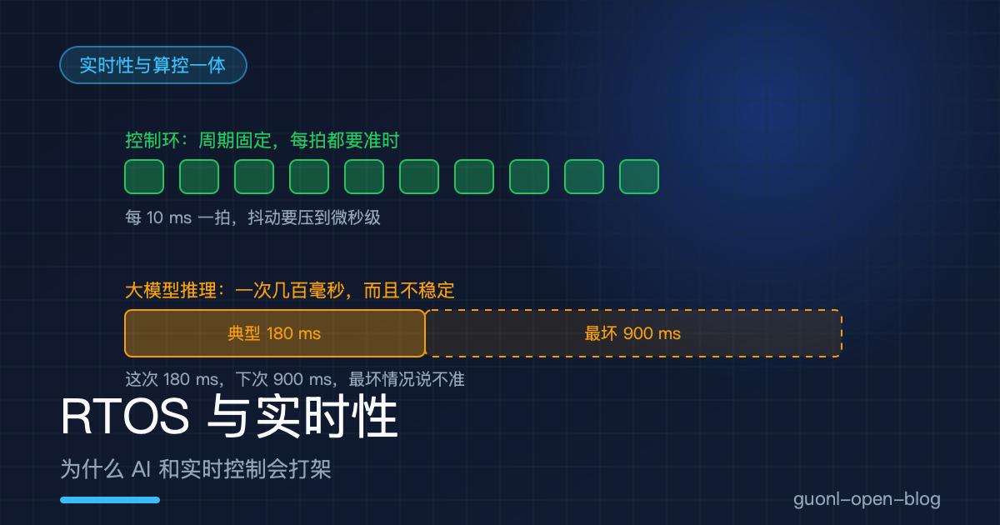
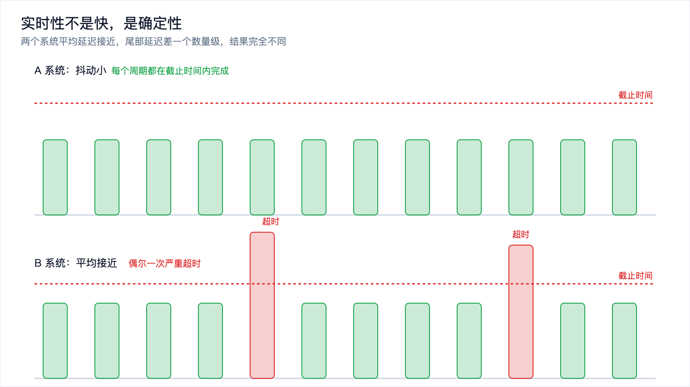
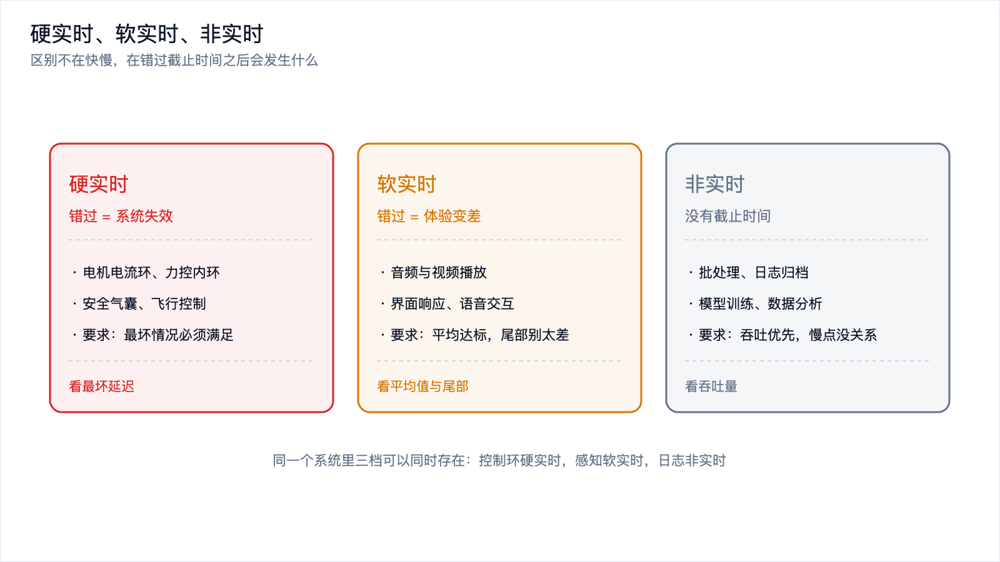
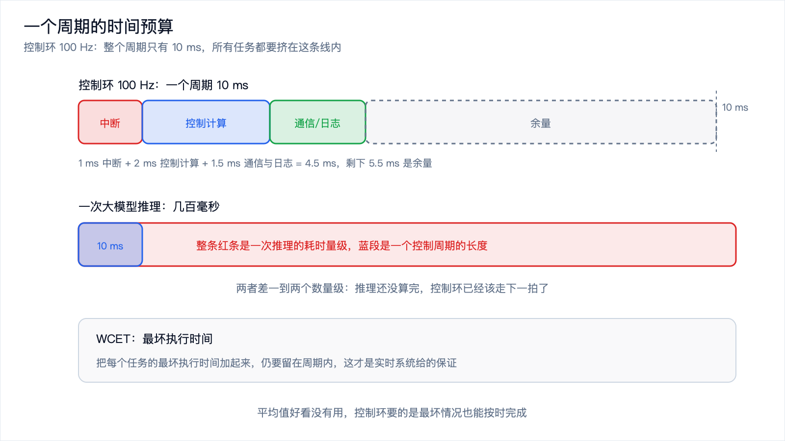
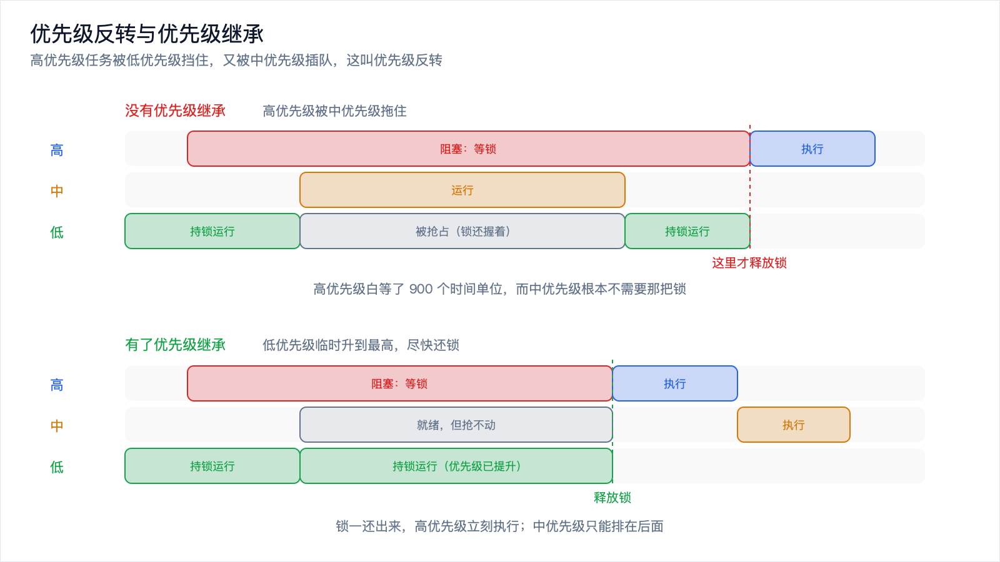

# RTOS 与实时性：为什么 AI 和实时控制会打架

*2026-10-30 · 实时性与算控一体*

## "实时"不是"快"

你可能会觉得，实时就是快。板子跑得快，那它就是实时的。这个理解错得很常见，也错得挺关键。

一个系统每次响应都要 50 毫秒，听起来不快；另一个系统平均 20 毫秒，但有百分之一的概率要 2 秒。哪个更实时？在控制场景里是第一个。第一个每次都在 50 毫秒内完成，你可以围绕这个数字设计整个系统；第二个平均更快，但偶尔的 2 秒会直接让系统失稳。

所以实时性的准确说法是：在规定的截止时间之前，保证完成任务。它的核心不是速度，是确定性。

## 实时性不是快，是确定性

要看三个词。延迟，是从事件发生到响应完成花的时间；抖动，是延迟的波动范围；截止时间，是延迟允许的上限。实时系统要保证的不是平均延迟小于截止时间，而是每一次都小于截止时间。

所以评价一个控制系统，不看平均延迟，看最坏情况延迟和抖动。平均 50 毫秒、偶尔 900 毫秒的系统在控制环里不可用，那偶尔的一次就够让机械臂出事。

[《端侧实时控制：为什么大模型进不了控制环》](../embodied-ai/on-device-realtime-control.md)把这条约束从控制环那一侧讲了一遍。这篇换个方向，从操作系统这一侧讲：RTOS 怎么把"确定"这件事做进系统里。

*图 1：A 系统每拍都在截止时间内，B 系统平均接近但偶尔超时，可用性完全不同。*

## 硬实时与软实时

确定性还有程度之分。

硬实时：错过截止时间等于系统失效。电机电流环晚了几百微秒，电机可能啸叫甚至烧掉；安全气囊晚了几十毫秒，等于没装。设计目标是最坏情况必须满足，代价是性能上限被压得很低，缓存、动态内存、复杂调度这些让平均更快的东西都要限制。

软实时：错过截止时间只是体验变差。视频掉一帧、语音交互慢半拍，用户会不舒服，但系统没错。设计目标是平均达标、尾部别太难看，实现上宽松得多。

中间还有一档叫固实时，偶尔超时能容忍，但频率和幅度都要有界，位置控制通常在这一档。把实时等级分清楚，才知道哪些任务必须放在实时核上，哪些可以随便放。

*图 2：三档的区别不在快慢，在错过截止时间之后会发生什么。*

## RTOS 是什么：把确定性做进调度里

RTOS 是实时操作系统。它和 Linux 这类通用操作系统的区别不在功能多少，在设计目标：通用 OS 追求吞吐和公平，RTOS 追求最坏延迟可预测。

通用 OS 给不出确定性，是一堆小事的叠加。内核里有不可抢占的区域；中断会被短暂关闭；虚拟内存会触发缺页，读一页的时间没法预测；驱动和协议栈里都有长路径；调度器为了公平会主动换人。这些机制让系统平均更快、更好用，代价是最坏延迟既大又不确定。

RTOS 把这些不确定性一个个去掉。调度器改成优先级抢占式，高优先级任务一就绪就立刻拿到 CPU；内核路径做得很短，关中断的时间有明确上界；内存预分配，运行期不做动态分配；很多 RTOS 干脆不带虚拟内存，省掉缺页这个最大的不确定源。FreeRTOS 和 Zephyr 是常被提到的两个：前者小而简单，中断服务例程要写得极短，重活通过队列丢给任务，适合资源紧张的 MCU；后者支持更多架构，有设备树和完整的驱动模型，调度策略也更丰富。

确定性来自同一批手段，挑三件最关键的讲。

### 中断：随时可能打断你

硬件事件（定时器到期、串口收到数据、编码器计数变化）会打断当前任务，跳到中断服务例程。中断服务例程必须短，因为它在跑的时候，同优先级和更低优先级的中断与任务都进不来。做法是中断里只做最少的事，读寄存器、清标志、把数据放进队列，耗时的处理交给任务；中断优先级也要排清楚，让最紧急的事件先被处理。

### 优先级：谁先拿到 CPU

优先级抢占式调度的规则很直白：永远运行当前就绪的最高优先级任务。只要你把任务的优先级设得足够高，它的响应时间就有了保证，不用去和别的任务抢。

代价是优先级必须由人来定。一个常见错误是把所有任务设成同一个优先级，等于退化成轮转调度，实时性就没了；另一个错误是给非关键任务设了高优先级，把关键任务挤在后面。

### WCET：最坏情况要算得清

WCET 是最坏执行时间。做可调度性分析时，用的不是平均执行时间，是每个任务在最坏输入、最坏路径下的执行时间。用平均值去算余量，等于在赌平均值以上的情况不会发生，而它们一定会发生。

把 WCET 加起来，就得到一个周期的预算。一个 100 Hz 的控制环，周期 10 毫秒，中断读传感器 1 毫秒，控制计算 2 毫秒，通信和日志 1.5 毫秒，加起来 4.5 毫秒，剩下 5.5 毫秒是余量。余量不是用来舒服的，是用来吸收缓存未命中、总线竞争、别的中断插进来这些最坏情况的。

WCET 很难算准。现代芯片有流水线、分支预测、多级缓存，同一条指令序列的执行时间取决于之前跑了什么，静态分析工具给出的上界往往保守得离谱，工程上更常见的是实测加余量，用测试覆盖最坏路径再留安全系数。

*图 3：把每个任务的 WCET 加起来，仍要留在周期内，这才是实时系统给出的保证。*

## 优先级反转：实时系统里的经典陷阱

优先级抢占式调度有个著名的坑。

一个低优先级任务拿到互斥锁，进了临界区。这时一个高优先级任务就绪，它也要这把锁，于是被阻塞，等低优先级任务释放。这本身还算合理。问题在于中间又有一个中优先级任务就绪了，它不需要那把锁，但优先级比低优先级任务高，于是抢占了低优先级任务。低优先级任务被压着跑不完，锁迟迟不释放，高优先级任务就一直等。

结果是高优先级任务的等待时间，被一个和它毫无关系的中优先级任务拉长了。系统里任务越多、锁用得越多，这种等待就越难估计，最坏延迟可能远超设计预期。航天器上出过因为这个问题反复重启的事故，它是实时系统里被反复讲的案例。

工程上有几种做法。优先级继承：高优先级任务因为等锁被阻塞时，持锁的低优先级任务临时提升到那个高优先级任务的级别，中优先级就抢不动它了，锁能尽快释放，之后优先级恢复。优先级天花板：每把锁有一个天花板优先级，等于所有可能用它的任务里的最高优先级，任务拿到锁就提到天花板，用完降回去，比继承更保守但更容易分析。还有一种做法更粗暴：把临界区做到极短，短到能用关中断保护，根本不用锁。

*图 4：没有继承时高优先级被中优先级拖住；有了继承，低优先级临时升到最高，尽快还锁。*

## 为什么大模型和实时控制会打架

冲突有两个层次。

时间量级。控制环的频率从 10 Hz 到几千赫兹，周期是 100 毫秒到零点几毫秒。一次大模型推理，就算放在端侧、去掉网络往返，一个几 B 参数的模型生成几十个 token，也是几十到几百毫秒的量级。两者差一到两个数量级，不是调优能补上的。

性质不同。控制环要的是确定性，它需要一个能被证明的最坏执行时间；大模型推理给的是概率，延迟取决于输入长度、批处理策略、内存带宽竞争、芯片温度，最坏情况说不准。把一件最坏情况说不准的事，放进一个必须保证最坏情况的循环里，逻辑上就不成立。

还有第三层：资源冲突。大模型推理会吃满 CPU、GPU 和内存带宽，还会污染缓存。推理正在跑的时候，控制任务的缓存被挤掉、内存访问变慢，本来算得准的 WCET 就不再成立。就算推理任务优先级更低，这种共享资源被占的影响也没法靠优先级调度消除。

| 维度 | 控制环 | 大模型推理 |
| --- | --- | --- |
| 时间尺度 | 十毫秒到亚毫秒 | 百毫秒级 |
| 延迟性质 | 必须确定，看最坏情况 | 概率分布，看平均值 |
| 超时代价 | 系统失稳、设备损坏 | 结果晚一点 |
| 资源占用 | 小而稳定 | 大而波动 |
| 行为可预测性 | 高，可分析 | 低，难保证 |

这张表解释了为什么换一个更快的大模型解决不了问题。平均延迟可以压下去，尾部压不住；模型可以压小，压不到毫秒级。冲突的根不在速度，在确定性。

## 冲突的几种解法

解法都围绕把不确定的部分隔离出去。

分层是最基础的一层：系统分成慢回路和快回路，慢回路 1 到 10 Hz，负责理解任务、做规划，可以放心用大模型，几百毫秒能接受；快回路 100 Hz 到 kHz，负责把意图变成具体指令，只用计算量可控、延迟可预测的小控制器。两层之间用清晰的接口解耦，快回路的时序不因为慢回路变了而改变。

物理隔离是把两层放到不同芯片上。控制跑在 MCU 或实时核上，AI 推理跑在 SoC 上，中间用串口、CAN 或以太网通信。这是最稳的做法，实时核上跑 RTOS，它的 WCET 分析不受 AI 侧影响。代价是成本和板级复杂度，[选板那篇](choose-edge-board.md)里"要实时控制也要跑 AI 就用两块芯片"说的就是这条路。

算控一体是同一颗芯片上的时间隔离。一个实时核跑 RTOS，一个 AI 核跑 Linux 或专用推理，实时核的调度优先级有硬保障，AI 核的推理被限制在它自己的时间片和内存预算里。它省掉了两块芯片的成本和体积，难点在隔离要做扎实，不只是调度，还有内存带宽和缓存。

共同底线一样：控制环的时间确定性高于任何 AI 任务的吞吐。宁可让模型慢一点，也不能让控制环超时。

## 这是通往具身智能的接口

机器人要动，就一定有控制环；要聪明，就一定会用到模型。这两件事的约束正好相反，一个要求最坏情况可证明，一个天生是概率性的。谁能把它们在同一台设备上安排好，谁就解决了具身智能最基础的一层工程问题。

这也解释了边缘 AI 的很多设计选择为什么长这样。模型量化不只是为了省内存，也是为了让推理时间可预测，好放进实时预算里；静态内存规划不只是为了快，也是为了让延迟没有尖峰。在[《边缘 AI 是什么》](edge-ai-intro.md)讲的四个驱动力里，延迟确定性这一条在机器人这里被推到了极限。

如果你在做 AI 加实时控制的系统，先把两件事的时间预算分开算清楚，再决定用几颗芯片、怎么隔离，最后才去选板子。顺序反过来，多半会在调试时发现控制环被推理拖慢，改架构的成本就高了。

## 写在最后

实时不是快，是在截止时间之前一定完成；评价实时系统看最坏延迟和抖动，不看平均值。硬实时和软实时的区别在超时的后果，同一个系统里几档可以并存。RTOS 用优先级抢占、短内核路径、预分配内存和极短的中断换取确定性；WCET 是可调度性分析的基础，余量用来吸收最坏情况。优先级反转是这套机制里的经典陷阱，优先级继承和天花板是标准解法。

大模型和实时控制打架，根因不是慢，是不确定：时间量级差一到两个数量级，延迟性质一个是概率一个是保证，再加上共享资源的争抢。解法是分层、物理隔离或算控一体，共同底线是控制环的确定性优先。这条边界就是具身智能的接口层。

下一篇《算控一体：在同一颗芯片上同时跑 AI 和控制》，就把最后这条路展开讲。
