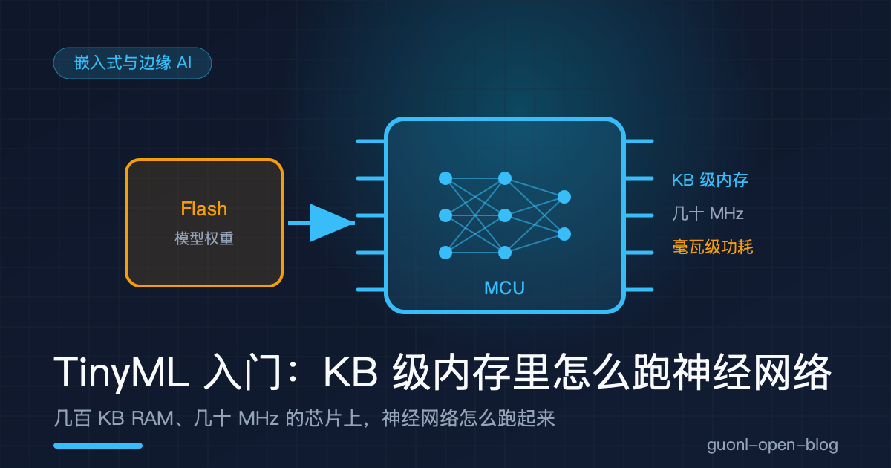
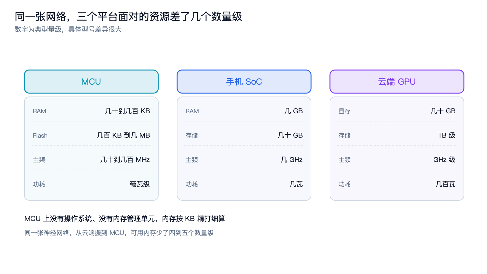
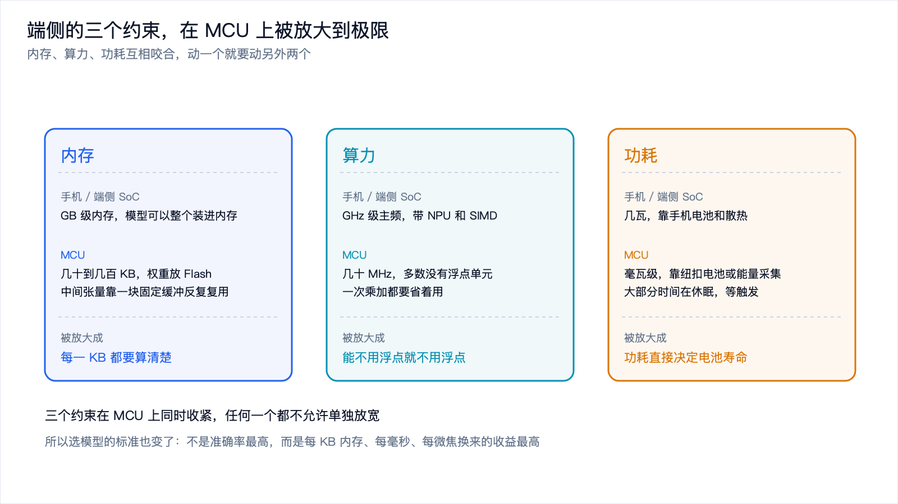
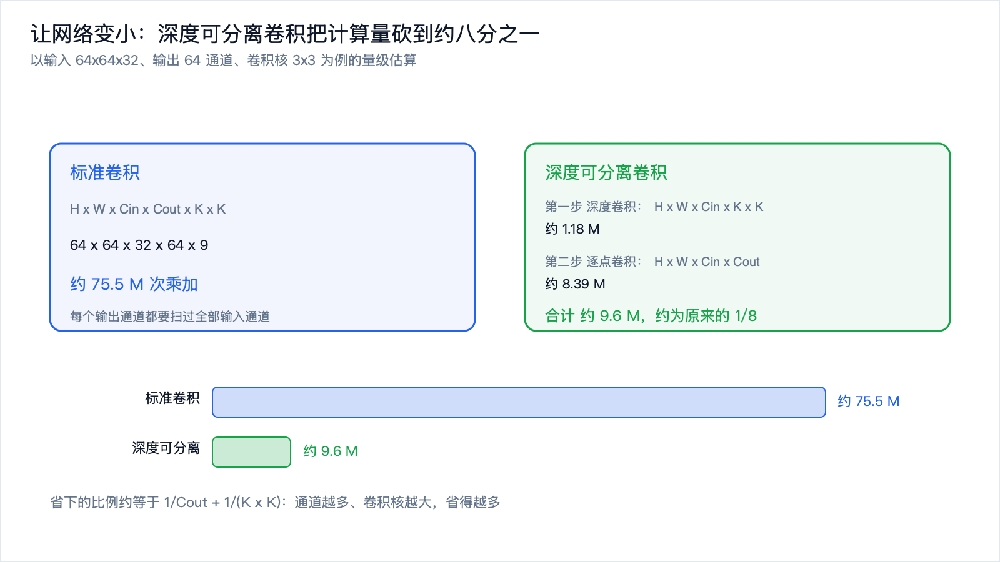
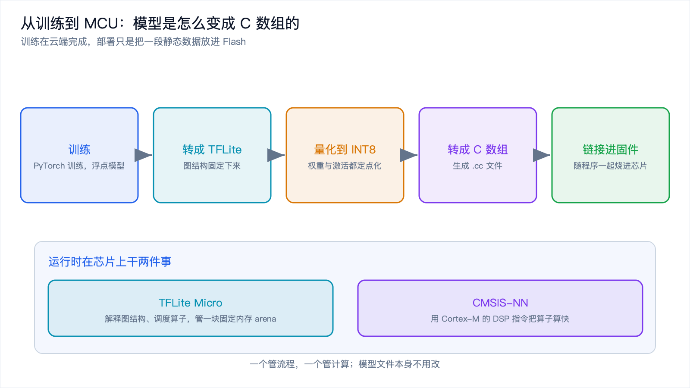

# TinyML 入门：KB 级内存里怎么跑神经网络



*2026-10-30 · MCU 与 TinyML*

## 从一颗几块钱的芯片说起

你戴的手环能分辨你在跑步还是睡觉。你的蓝牙耳机听到"你好"就醒来。工厂里贴在电机上的小盒子，在振动异常的时候报警。这些东西有个共同点：背后都有神经网络在跑，但跑它的东西既不是手机，也不是云，而是一颗几块钱的微控制器（MCU）。

MCU 和手机里的芯片是两种东西。手机 SoC 有 GB 级内存、GHz 级主频、内置 NPU，跑起来要几瓦。MCU 只有几十到几百 KB 的 RAM、几百 KB 到几 MB 的 Flash、几十到几百 MHz 的主频，整颗芯片的功耗是毫瓦级。它的设计目标从来不是"算得快"，而是"便宜、省电、能一直开着"。

TinyML 讲的就是在这类芯片上跑机器学习。它不是"把大模型缩小一点"，而是一套从头设计的方法：模型结构要重新挑，算子要重新写，数据要重新表示，连"什么叫一个模型"都跟云端不太一样。



*图 1：三个平台的资源量级对比，MCU 比手机又小了三到四个数量级。*

## 三个约束，在 MCU 上被放大

[边缘 AI 入门那篇](edge-ai-intro.md)里讲过，端侧受内存、算力、功耗三个约束。MCU 是这三个约束的极端版本，而且它们互相咬合，动一个就得动另外两个。

| 约束 | 手机 / 端侧 SoC | MCU | 被放大成什么 |
| --- | --- | --- | --- |
| 内存 | GB 级，模型整个装进内存 | 几十到几百 KB RAM | 权重放 Flash，RAM 靠一块缓冲反复复用 |
| 算力 | GHz 级主频，带 NPU 和 SIMD | 几十 MHz，常常没有浮点单元 | 浮点几乎不能用，全部换成 8 位定点 |
| 功耗 | 几瓦，靠手机电池和散热 | 毫瓦级，靠纽扣电池 | 常开部分压到微瓦，大部分时间在休眠 |



*图 2：三个约束在 MCU 上同时收紧，任何一个都不允许单独放宽。*

内存最直观。手机上 GB 级内存，模型整个装进内存跑就行。MCU 上只有几十到几百 KB 的 RAM，一个几十万参数的模型按 4 字节浮点存要 1MB 以上，RAM 根本放不下。所以权重必须放在 Flash 里，运行时按需分块搬进 RAM。RAM 里真正常驻的，是一块反复复用的中间张量缓冲区，不同层共用同一块内存，用完就覆盖。这也是为什么 TinyML 里"内存规划"是单独一门学问：问题不是"需要多少内存"，而是"能不能复用同一块内存"。

算力是第二道。MCU 主频只有几十到几百 MHz，大多数型号没有硬件浮点单元（FPU）。一次浮点乘法在软件模拟下要几十个时钟周期，整数乘法只要一两个。这不是优化问题，是能不能跑的问题。所以 TinyML 里的模型几乎全部用定点整数运算，8 位为主，个别地方用 16 位。

功耗是第三道，也是 MCU 场景里最独特的。手机没电了可以充，MCU 往往靠纽扣电池或能量采集供电，要撑几个月甚至几年。这意味着两件事：平均功耗压到微瓦到毫瓦级；大部分时间芯片在休眠，只在传感器触发时才醒来算一下。所以 TinyML 的典型形态是"常开的极简前端加偶尔唤醒的推理"，而不是"一直跑着一个模型"。

三个约束一叠加，就出现了一个反直觉的结果：在 MCU 上，模型准确率不是第一位的，"每毫秒、每 KB、每微焦能换来什么"才是。一个准确率低 2 个点但内存减半的模型，在这里往往是更好的选择。

## 为什么要定点运算

讲清楚了约束，就能理解 TinyML 里最重要的一个技术选择：量化到定点整数。

浮点在 MCU 上有多贵？没有 FPU 的芯片上，一次单精度乘法要用软件模拟，几十个周期起步；带 FPU 的 Cortex-M4F 好一些，但浮点单元面积大、耗电高，很多低端型号干脆没有。整数运算就不一样，8 位乘加在 Cortex-M 上通常一两个周期就完成，有 DSP 扩展指令时还能一条指令算好几个。

量化的做法是把一段范围内的浮点数，线性映射到 8 位整数上：

```text
真实值 约等于 缩放系数 x (量化值 - 零点)
```

缩放系数决定这段范围有多宽，零点决定 0 对应哪个整数。比如把 [-1.0, 1.0] 映射到 [-128, 127]，缩放系数就是 1/128 左右。推理时全部用整数算，只在需要的时候做一次乘法把结果拉回真实范围。

这里有个关键点：不是只有权重需要量化，输入和输出也要。整张网络都用整数算，中间结果会不断累积缩放系数；如果每层的缩放系数不一样，就没法直接相加，得先对齐。所以训练时会用一批样本跑一遍，统计每层激活值的实际分布，给每层定一个缩放系数。这套流程叫训练后量化，也可以在训练时就把量化误差考虑进去，代价是多花训练成本。

8 位够不够？对大多数 TinyML 任务够用。关键词唤醒、手势识别这类任务的输入本来信噪比就不高，量化带来的几个点精度损失，往往被真实环境里的噪声掩盖了。真有精度不够的情况，可以对部分层用 16 位，代价是内存和计算量翻倍。

## 网络结构要重新挑

定点化解决了"怎么算"，还有一个问题是"算什么"。云端那套网络结构，直接搬到 MCU 上跑不动，得换一种搭法。

最典型的一个改动是深度可分离卷积。标准卷积在算每个输出通道时，都要遍历全部输入通道，计算量是 `H x W x Cin x Cout x K x K`。深度可分离卷积把它拆成两步：先对每个输入通道各自做一次卷积（深度卷积），再用 1x1 卷积把通道混起来（逐点卷积）。



*图 3：同一组尺寸下，深度可分离卷积把乘加次数压到约八分之一。*

省下来的比例可以算出来，大约是 `1/Cout + 1/(K x K)`。以 64 个输出通道、3x3 卷积核为例，就是 1/64 加 1/9，约等于 0.13，也就是省掉将近九成。通道数越多、卷积核越大，省得越多。这是 MobileNet 系列能在手机上跑起来的原因，也是 TinyML 视觉模型的基础结构。

除了换卷积，还有几条通用原则。

网络要浅。MCU 上不适合堆几十层的深层网络，几层到十几层是常见规模。宁可把每层做宽一点，也不要堆很深。

输入要小。语音模型常见输入是 16kHz 采样、几十毫秒一帧的梅尔频谱，图像模型常见输入是 32x32 到 96x96 的灰度图。输入尺寸直接决定第一层的计算量，是压缩时最先动的地方。

少用"重"算子。全连接层参数量大，能不用就不用；循环网络虽然省内存，但串行计算、延迟高，MCU 上更常见的是用一维卷积替代。

别用动态形状和动态内存。云端模型经常有变长输入、动态分配张量，MCU 上都要避免。输入尺寸在编译期固定，内存一次性分配好，运行期只读写、不 malloc。这不只为省内存，也是为了确定性：TinyML 系统经常要保证最坏情况下的执行时间，动态分配会让这个保证失效。

## 模型怎么变成 C 数组

约束和结构讲完了，还有一个很具体的问题：训练好的模型怎么进到芯片里？

训练不可能在 MCU 上做，流程是在电脑或云端训练、量化，再转换。转换的目标格式是 TFLite，一个为嵌入式设计的模型格式，它把图结构固定下来，去掉训练相关的算子，只留推理需要的部分。

转换完得到的是一个 `.tflite` 文件，本质是一段二进制。它要变成 C 代码里的一个数组，才能编译进固件：

```bash
# 把二进制文件转成 C 源文件，得到一个 unsigned char 数组
xxd -i model.tflite > model_data.cc
```

生成出来的东西长这样（内容被截断了）：

```c
unsigned char model_tflite[] = {
  0x1c, 0x00, 0x00, 0x00, 0x54, 0x46, 0x4c, 0x33, 0x00, 0x00, 0x12, 0x00,
  0x1c, 0x00, 0x14, 0x00, 0x13, 0x00, 0x0c, 0x00, 0x08, 0x00, 0x04, 0x00,
  /* ... 几万个到几十万个数 ... */
};
unsigned int model_tflite_len = 123456;
```

这个数组会被编译器放进 Flash，不占 RAM。这是 TinyML 部署里一个重要的心理转变：在云端，模型是运行时要加载的对象；在 MCU 上，模型就是固件里的一段只读数据，和一张字模表没有本质区别。



*图 4：训练在云端完成，部署只是把一段静态数据放进 Flash。*

## 运行时干两件事

数组放进 Flash 之后，还需要一段程序去读它、执行它。这段程序叫推理运行时，在 MCU 上通常是两个东西配合。

一个是 TFLite Micro。它是 TFLite 的微控制器版本，本质是一个解释器：读模型里的图结构，按顺序调用对应的算子实现，管理张量内存。它没有动态内存分配，也不依赖操作系统，内存来自一块预先分配好的区域（通常叫 arena）。你要在代码里声明一块缓冲区，运行时在这里切分张量，用完就复用。这块缓冲区要多大，先在 PC 上跑一次模拟推理算出来，照着配就行。

另一个是 CMSIS-NN。它是 ARM 给 Cortex-M 系列写的神经网络算子库，用上芯片里的 DSP 和 SIMD 指令，把卷积、池化、全连接的整数实现做到接近硬件极限。它和 TFLite Micro 是配合关系：一个负责读图、调度，一个负责把单个算子算快。TFLite Micro 编译时可以选不同的算子后端，选 CMSIS-NN 就能拿到这份加速。

两者的分工可以这样理解：一个管流程，一个管计算。换掉前者就是换框架，换掉后者就是换加速库，模型文件不用动。

推理的代码骨架大致是这样，重点看内存是怎么给的：

```c
// 1. 从 Flash 里的数组加载模型
const tflite::Model* model = tflite::GetModel(model_tflite);

// 2. 准备一块固定内存 arena，运行时所有张量都从这里切
constexpr int kArenaSize = 64 * 1024;      // 大小先在 PC 端算出来
static uint8_t tensor_arena[kArenaSize];

// 3. 建解释器，只注册用得到的算子
static tflite::MicroInterpreter interpreter(
    model, op_resolver, tensor_arena, kArenaSize);

// 4. 一次性分配张量内存，之后不再变
interpreter.AllocateTensors();

// 5. 写入传感器数据，推理一次，读输出
int8_t* input = interpreter.input(0)->data.int8;
memcpy(input, sensor_frame, sizeof(sensor_frame));
interpreter.Invoke();
int8_t score = interpreter.output(0)->data.int8[0];
```

这段代码有三处容易被忽略：arena 是一块静态数组，不是 malloc 出来的；算子要显式注册，注册多了会占 Flash；`Invoke()` 一次只处理一帧，没有批处理。整个过程执行时间可预估，这对实时系统很重要。

## 典型任务长什么样

TinyML 能做的事，比很多人想的窄，也比很多人想的实用。常见的就三类。

关键词唤醒是最经典的一个。麦克风持续采集音频，前端把音频切成帧、算梅尔频谱，得到几十维、几十帧的特征图，送进一个小卷积网络，输出"是不是唤醒词"的概率。模型可以做到几十 KB，推理几毫秒，平时芯片在休眠，检测到疑似语音才唤醒主处理器。它的价值不在识别得多准，而在把功耗压到微瓦级，让"一直听着"在电池上成立。

异常检测是工业场景里最常见的一类。电机、泵、轴承上贴一个振动传感器，模型学的是"正常应该是什么样"，偏离正常就报警。这类任务的正样本（异常）极少，所以多用自编码器或极简的统计学习，而不是分类网络。它的价值在于把"什么时候该修"从定期检修变成按需检修。

手势识别是 IMU 场景的代表。手表或手环里的加速度计和陀螺仪，采样频率几十到几百赫兹，把一小段六轴数据送进网络，判断用户在做什么动作。数据维度低、时序短，非常适合 MCU，模型往往只有几 KB 到几十 KB。

三类任务的共同点很明显：输入是传感器的一小段原始信号，输出是一个很小的判断，延迟要求高，功耗要求苛刻。它们不需要模型"理解"什么，只需要把一种模式识别出来。这正是 TinyML 的能力边界。

## 什么时候不该用 TinyML

讲了这么多能做的事，也要说清楚它的边界。

需要通用能力的时候不该用。MCU 上放不下任何接近"通用"的模型，它只能做一件很具体的事。如果你需要的是理解自然语言、做多步推理，那是手机或云端的活。

数据本身很复杂的时候要慎重。高分辨率图像、长音频、大词表，这些在 MCU 上要么放不下，要么延迟高到没有意义。

开发成本可能超过收益的时候。TinyML 的开发流程比云端训练麻烦得多：要自己做数据采集，要处理定点化的精度问题，要反复调内存，还要在真实硬件上验证功耗。如果场景本身对功耗和离线没有硬要求，用一颗带 NPU 的 SoC 会轻松很多。

判断标准其实很简单：如果你的场景必须同时满足极低功耗、长期在线、完全离线，TinyML 就是对的；如果只是"想省点云成本"，那有更省事的办法。

## 写在最后

TinyML 是在资源被压到极限的地方做机器学习。三个约束在 MCU 上同时收紧：RAM 只有几十到几百 KB，主频只有几十 MHz 且常常没有浮点单元，功耗预算是毫瓦级。应对办法也是三条：把浮点换成 8 位定点，把标准卷积换成深度可分离卷积，把模型从运行时要加载的对象变成固件里的一段 C 数组。运行时里，TFLite Micro 管流程和内存 arena，CMSIS-NN 管算子加速。能做的事集中在关键词唤醒、异常检测、手势识别这类"输入小、输出小、要求快、要求省"的任务上。

把它和上一篇[《动手：用 llama.cpp 在本地跑一个量化小模型》](llama-cpp-hands-on.md)放在一起看，端侧 AI 是一条连续的谱：一端是几百 KB 内存的 MCU，另一端是能跑几 GB 量化模型的手机和笔记本。两端资源差了四五个数量级，遇到的问题却一样，都是内存、算力、功耗之间的取舍，只是尺度不同。

下一篇《动手：在 ESP32 上跑一个关键词唤醒》，就把这套流程落到具体硬件上，从采数据、训模型，到转成 C 数组、烧进板子，完整走一遍。
