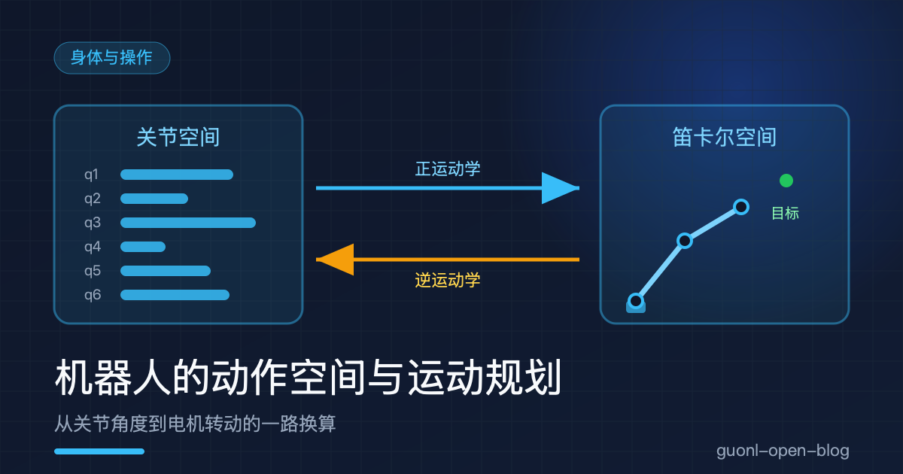
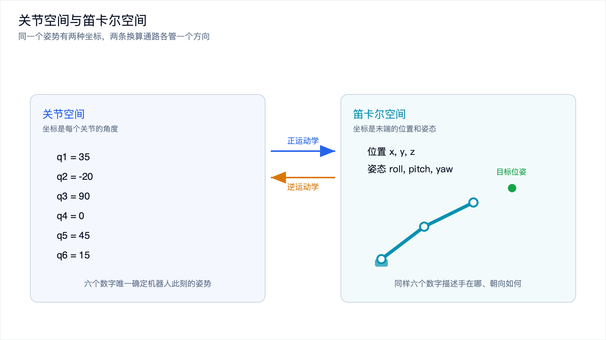
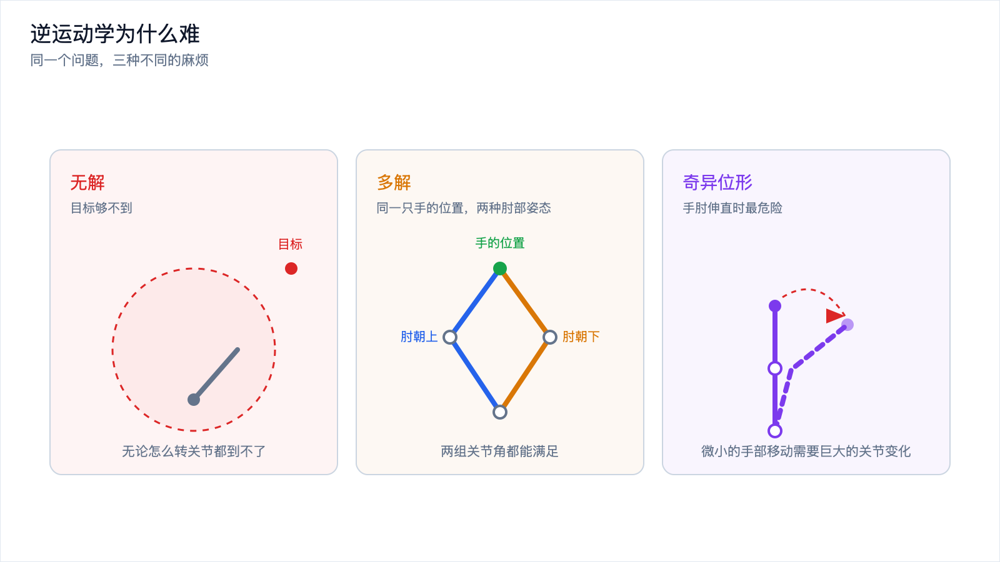
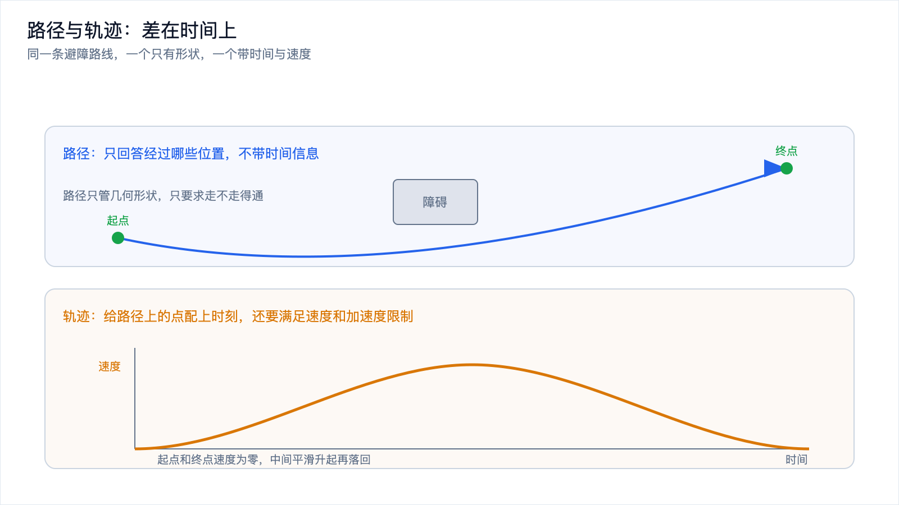
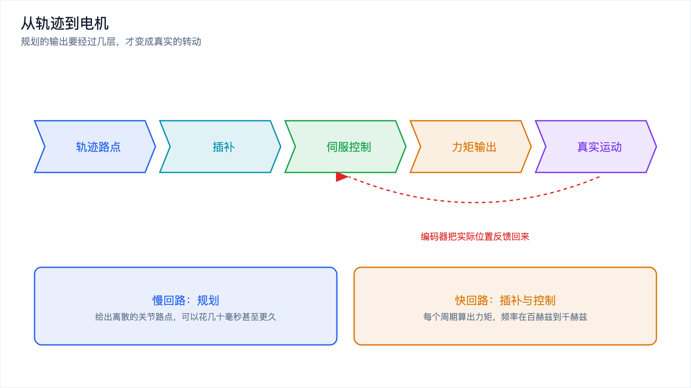

# 机器人的动作空间与运动规划

*2026-10-30 · 身体与操作*

## 从"把杯子拿到嘴边"说起

一个人说"把杯子拿到嘴边"，你听完就做了。这句话里没有数字，没有坐标，也没说明用哪只手。但对一台机械臂来说，同一句话必须被翻译成一串具体的数：六个关节各自转到什么角度、以多快的速度转、中间经过哪些位置。

差别就在这里。人对动作的描述是目标式的，"拿到嘴边"是一个期望的最终状态。机器执行动作靠的是参量式的，每一刻都要知道每个电机在哪。中间那道翻译环节，就是动作空间要处理的事。

动作空间可以理解成：做动作时你手里能调的旋钮是哪几个，每个旋钮的取值范围是多少。旋钮选得不同，同一件事的难度可能差出好几倍。

## 关节空间：每个关节转多少度

一台典型的机械臂有几个能转动的关节，每个关节里有一个电机加一个减速器。控制电机，本质上就是告诉它转到某个角度。把所有关节的角度排成列表，就唯一确定了机器人此刻的姿势。

这个由关节角度构成的坐标系叫关节空间，一个六轴机械臂的姿态就是六维空间里的一个点。取值不能随便取，每个关节都有物理限位和结构限制。

好处是它和硬件一一对应：指令最终一定落到关节角度上，不会有歧义，也不会出现同一个姿势两种表示这种麻烦。

坏处也很直接：在关节空间里，你很难说出"手往前伸一点"是什么意思。手往前伸，可能需要肩、肘、腕好几个关节同时改变，比例还不固定。任务目标描述的往往是手的位置，关节空间不擅长表达。

## 笛卡尔空间：手在房间里的位置

换个视角，从手（也叫末端执行器）的角度来描述动作。

末端执行器的状态可以用六个数字说清楚：三个描述位置，三个描述姿态，合起来叫位姿。这套以任务目标为参照的坐标系叫笛卡尔空间，也叫任务空间。

笛卡尔空间是人最容易理解的表达。杯子在桌上、嘴边在某个高度，这些说法天生就是笛卡尔空间的。

它的代价在于，笛卡尔空间不直接对应任何硬件。你说"手往上抬五厘米"，机器人并不知道该让哪几个关节转多少度，中间必须再做一次换算。

一个生活化的类比：关节空间像"每个关节弯多少度"，是身体内部的账本；笛卡尔空间像"手在房间里的位置和朝向"，是身体之外的账本。你伸手去拿水杯时，脑子里想的是后者，身体执行的却是前者，中间那层换算由神经系统自动完成。

*图 1：同一个机器人姿势的两种表示，左边是关节空间，右边是笛卡尔空间，两个方向各有一套换算。*

## 两个方向：正运动学与逆运动学

把两个空间连起来的两条换算通路，分别叫正运动学和逆运动学。

正运动学是"从关节到末端"。给定所有关节的角度，算出手最终在哪、朝向如何。它有确定答案，算法也不复杂：从底座开始把每层旋转依次作用上去，就得到末端位姿。输入一组关节角，输出唯一一个位姿。

逆运动学是反过来的：给定手要到达的位姿，反推每个关节该转多少度。这一步是运动规划里最常被抱怨的环节，性质比正运动学麻烦得多。麻烦大致分三类。

一类是没有解。手要去的那个点机器人根本够不到，可能是超出臂展，可能是姿态转不过来，也可能被自己的连杆挡住。这时候逆运动学不是算得慢，而是答案不存在。

另一类是解不唯一。同一个末端位姿往往对应好几组关节角。最典型的例子是手肘：手停在同一个点上不动，肘部可以朝上也可以朝下，两种姿势都能满足要求。肩膀翻转、手腕自转还会带来额外的解。多解给了选择余地，但也意味着"算出答案"和"选出该用的答案"是两件事。

还有一类是奇异位形附近的数值问题。机器人处于某些特殊姿势时，末端在某些方向上会丧失运动能力。这时候想把手往某个方向挪一点点，需要的关节角变化会趋向无穷大，或者方向根本确定不了。手肘完全伸直就是一种常见的奇异姿势。走到这附近关节角会剧烈跳变，控制器只能报警或者绕开，规划算法要专门处理。

*图 2：逆运动学的三种麻烦：够不到所以无解、手肘姿态二选一所以多解、奇异位形附近关节角剧变。*

## 自由度：6 个刚好，多了是冗余

要在三维空间里任意指定一个位姿，需要六个自由度：三个管位置，三个管姿态。一台恰好有六个独立关节的机械臂，理论上能到达工作空间里任意一个可达位姿，而且解通常是有限个。

关节数多于六个，就叫冗余。冗余机械臂有无数种关节配置能实现同一个末端位姿，这听起来像浪费，实际是资源。多出来的自由度可以用来绕开障碍物、远离奇异位形、避开关节限位、让手臂尽量收拢。同一件事有很多做法，就给了优化的空间。人手臂的自由度就超过六个，所以你能一边把手伸到某个位置，一边让手肘绕开桌角。

关节数少于六个，能力就受限。一些只有四五个自由度的机械臂，位置范围没问题，但姿态转不全，它们适合固定工位上的取放这类不需要任意姿态的场景。

后面的规划问题，本质都是在这若干个自由度的空间里找一条路。

## 运动规划要解决什么问题

机器人的当前位姿已知，目标位姿已知，中间通常还有一堆障碍物。要做的，是找出一条从起点到终点的可行运动。所谓可行，包含好几条约束：

- 不能撞到东西，包括环境障碍、机器人自己的连杆、以及抓着的物体。
- 每个关节都不能超出限位，速度、加速度和力矩都有上限。
- 路径尽量平滑，不要出现拐点式的突变，机械结构受不了，控制环也跟不上。
- 如果是在人附近工作，还要保持安全距离。

这几条里最硬的通常是避障。高维避障不是把二维地图放大一点那么简单，关节空间里障碍物的形状会变得非常古怪：末端在笛卡尔空间里一块简单的障碍，映射到关节空间可能是一片扭曲的、不连通的区域。

## 路径和轨迹：差在时间上

路径是几何上的一条线，只回答经过哪些位置，不带时间信息，没有速度，也没有先后快慢的概念。

轨迹是在路径之上加了时间维度，回答什么时候在哪。给路径上每个点配上时刻，再对时间求导得到速度和加速度，才是轨迹。它要满足速度和加速度限制，还要在起点和终点让速度平滑地起停，不能瞬间从静止跳到高速。

这个区别在工程上很实在。路径只关心走不走得通，轨迹才关心走起来是否平稳、电机跟不跟得上、会不会因为加速度过大触发保护。同一个几何路径配上不同的时间安排，就是截然不同的运动：慢慢走一遍是安全的，赶时间走一遍可能就把杯子甩出去了。

*图 3：同一条避障路径，只描述几何形状时是路径，加上时间与速度才成为可执行的轨迹。*

## 采样类方法：随机撒点找通路

采样类方法的思路很朴素：不去精确描述障碍物的形状，而是随机采样试探哪些配置可行，再用这些点连成一张图或者一棵树，在图上找一条通路。RRT 是这一类的代表，它从起点出发，每次随机取一个点，朝那个方向长出一小段新的树枝，慢慢地树就铺满了整个可行空间。

它的优点是维度不敏感。机械臂七个自由度、双臂十四个自由度，这些空间没法画图也没法精确表示障碍，但采样不需要这些。只要能判断某个配置是否与障碍相撞，它就能跑，这个判断通常靠碰撞检测库完成。

代价是解往往不好看。随机长出来的路径歪歪扭扭，离最优很远，每次结果都不一样。工程上会在它后面接一步平滑处理，把多余的绕路剪掉，或者用渐进最优的变体多跑一会儿让路径慢慢收敛。

## 基于优化的方法：把约束写成目标函数

另一条路是把规划写成一个优化问题。把整条轨迹的参数（比如若干个路点）当成待求变量，把离障碍越远越好、路径越短越好、越平滑越好写成代价项，把关节限位、速度上限、不能碰撞写成约束，交给数值求解器迭代，解出一条代价足够低的轨迹。这类方法的代表思路是连续优化式的轨迹优化。

它的优点是轨迹质量高。平滑、短、可微，直接就是控制环喜欢的样子，不需要再做后处理。

代价是它对初值敏感，容易陷在局部最优里。如果起点和目标之间隔着一堵墙，随便给一个初值，优化很可能直接撞进墙里出不来，因为它只会在附近微调，不会主动翻墙。常见的做法是先跑一次采样法拿到一条粗糙但可行的路径，当作初值再交给优化打磨。两条路配合，比单独用哪一条都稳。

## 从轨迹到电机：还差几层

规划出来的是关节角度序列，还不是电机听得懂的语言，中间还要走几层。

规划器输出的是离散的路点，点位之间是空的，需要插补补上。关节空间插补就是在相邻两个路点之间按时间填充中间角度，笛卡尔空间插补则是在末端位姿之间插值再换算回关节。

插补之后得到每个控制周期的目标位置。伺服控制环把它和编码器读回的实际位置比较，算出误差，通过 PID 之类的控制器算出该给多大的力矩或电流。力矩送到电机驱动器，电机转动，编码器把新位置反馈回来，进入下一个周期，以百赫兹到千赫兹的频率不停重复。

这一层的实时性要求很高，因为它是闭环的最后一环。控制环跑不动或者延迟不稳定，前面规划得再漂亮也白搭。这个分层和[《端侧实时推理与控制：大模型为什么进不了控制环》](on-device-realtime-control.md)讲的是同一件事：规划是慢回路，可以花几十毫秒甚至更久；控制是快回路，每个周期都必须按时交卷。

*图 4：规划给出路点，插补补出中间位置，伺服控制算出力矩，电机执行并反馈，构成闭环。*

## 学习类方法站在哪里

现在很多具身模型直接输出动作，不再显式地跑逆运动学和运动规划。视觉语言动作模型给出的是关节指令或者末端位移，扩散策略一次生成一小段动作序列。它们把"看到什么"和"该怎么做"放在一个网络里一起学，跳过了中间那些模块化的环节。

好处是端到端，能处理那些用规则写不出来的动作，比如揉面团、折衣服。缺点也很清楚：它不保证安全，不知道自己给的动作会不会撞到人，输出的动作序列可能根本不满足关节限位。训练数据里没见过的场景，它给什么答案都有可能。

所以实际系统里，学习类方法很少单独干活。它负责给出意图和粗动作，后面仍然接一层运动学和规划做校验与兜底：把网络输出的动作投影到可行的关节空间里，检查是否会碰撞，必要时换成一条规划出来的安全路径。这套上层用模型、下层用规划与控制的分层，和前面提到的实时控制分层是同一个骨架，只是上层的智力换了个来源。

## 写在最后

一句话里藏着一整套换算。关节空间描述机器人自己，笛卡尔空间描述任务目标，正运动学从关节算出末端在哪，逆运动学反过来算，并且会因为够不到、多解、奇异位形而变得麻烦。六个自由度是任意摆位姿的门槛，多了是冗余也是余地，少了受限制。

规划要在这若干个自由度的空间里找一条不撞东西的路。路径只管几何形状，轨迹还要管时间和速度。采样类方法靠随机试探，维度高也能用，解不够漂亮；优化类方法轨迹质量高，但依赖好的初值。规划之后还有插补、伺服、力矩几层，才能真正变成电机的转动。

手能伸到位置了，接下来才是真正难的部分：碰到东西以后怎么办。下一篇[《抓取与灵巧操作：手怎么把东西拿稳》](grasping-dexterous-manipulation.md)，从抓取说起。
