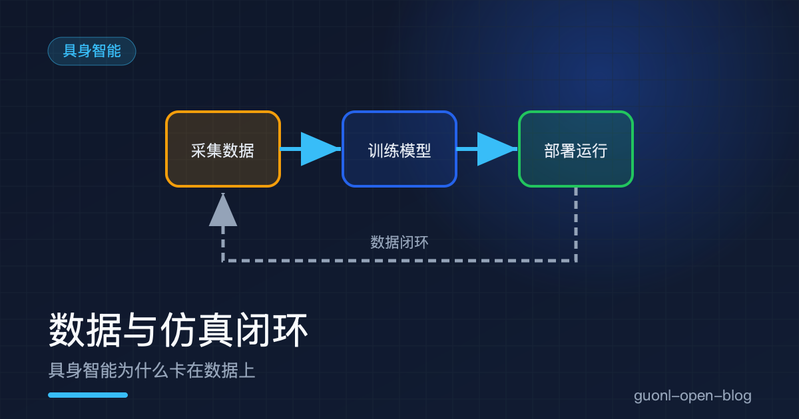
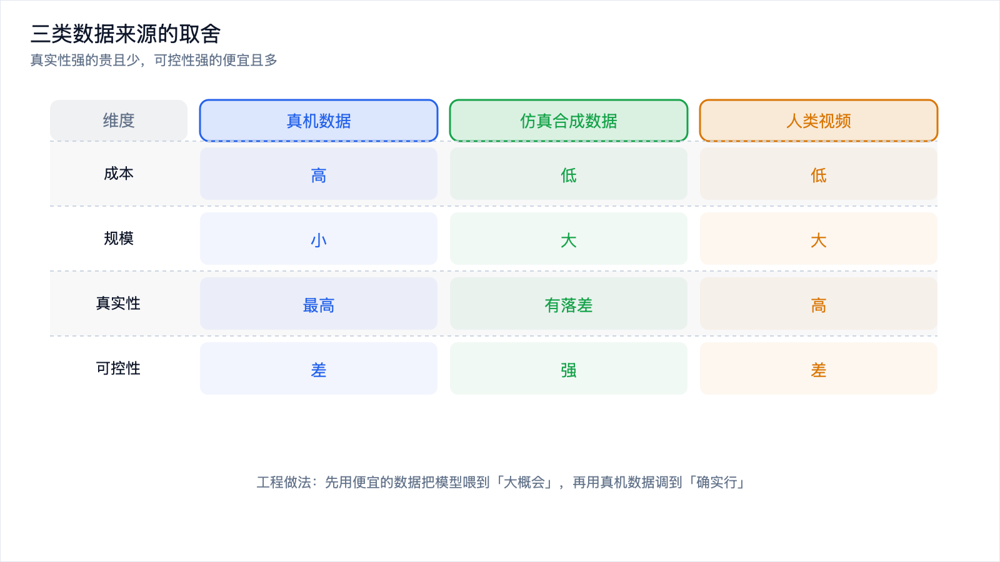
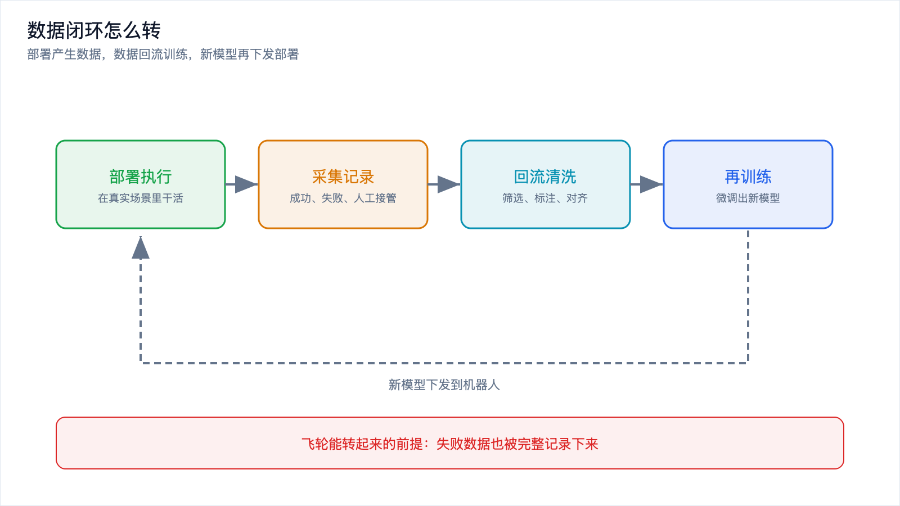
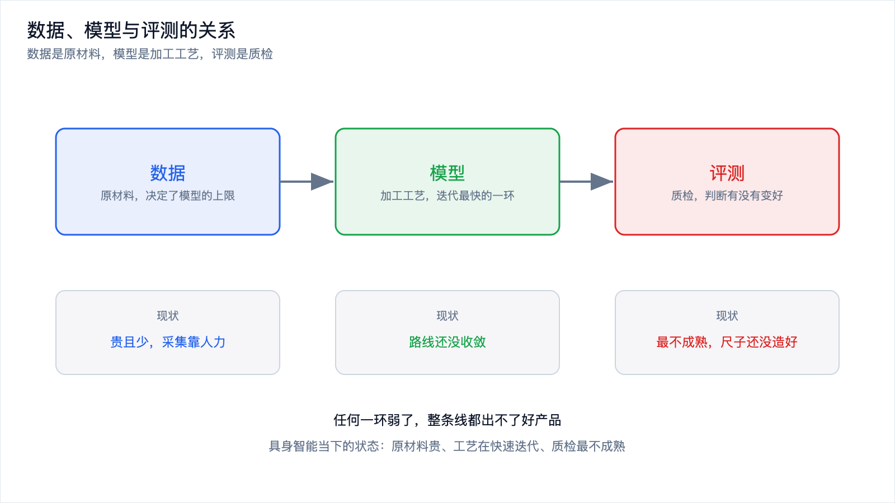

# 数据与仿真闭环：具身智能为什么卡在数据上

*2026-10-30 · 数据与仿真闭环*

## 先看一个刺眼的对比

大模型这几年进步很快，常见的解释是架构好、算力足。还有一个更朴素的原因容易被忽略：训练数据几乎是白捡的。

整个互联网上的文本、代码、图片，是人类在几十年里顺手留下的副产品。想训练一个语言模型，把网页爬下来、把书扫一遍、把开源代码仓库拉下来，几百亿到几万亿 token 就到手了。数据不用你生产，你只负责清洗和筛选。

把镜头转到机器人这边，情况整个反过来。机器人要学会"把杯子放进洗碗机"，得有真人反复操作机械臂：抓起杯子、移到洗碗机、放进去。一次成功的演示可能只有十几秒，想让模型学得稳，这个动作要重复成百上千次，还得换不同的杯子、不同的光照、不同的摆放位置。

机器人数据不是捡来的，是用人力和机器时间"喂"出来的。

这就是这篇要讲的问题：具身智能的能力瓶颈，很多时候不在模型架构，而在数据。围绕这个瓶颈，业界摸索出三条主要的路：仿真合成数据、真机数据、人类视频数据。三条路最后都指向同一个词，数据闭环。

## 机器人操作数据为什么这么少

先把"少"说清楚，它不只是数量问题，更是获取成本问题。

语言数据之所以多，是因为记录语言几乎零成本。你写一条微博、发一条评论、提交一次代码，数据就自动产生了，而且天然带标注。这是"副产品型"数据。机器人数据是"生产型"数据，要得到一条操作轨迹，你必须有一台机器人、一个操作员、一个真实场景，再加上时间。机器人的数量远少于手机和键盘，能长时间开机采数据的机器人更少。

还有几层叠加的困难。标注难，语言样本的标注可能就是一句话，操作轨迹却要记下每个时刻的关节角、末端位姿、夹爪开合，还得对齐。分布窄，实验室里光照规整、桌面干净，一到真实家庭或工厂，光线会变、物体会挪，模型见过的东西一下就失效。长尾重，抓方块和抓软塑料袋动作差别巨大，每一类都得单独采数据。

结果就是很不对称的局面：语言模型的训练数据以万亿 token 计，机器人操作数据的主流数据集往往在几十万到几百万条轨迹的量级。这是估算，看数量级差距就够。

## 三类数据的取舍

把三条路摆到一张表里。它们的关系不是替代，而是互补。

| 维度 | 真机数据 | 仿真合成数据 | 人类视频 |
| --- | --- | --- | --- |
| 来源 | 机器人在真实环境执行 | 物理引擎里虚拟执行 | 互联网上的第一人称视频 |
| 规模 | 小，受机器数量限制 | 大，可批量生成 | 大，已经存在 |
| 成本 | 高，机器加人力加时间 | 低，主要是算力和建模 | 低，主要是清洗 |
| 真实性 | 最高 | 有落差 | 高，但是观察视角 |
| 可控性 | 差，场景难复现 | 强，参数随便改 | 差 |
| 动作标签 | 有 | 有 | 通常没有，要反推 |
| 主要用途 | 精调、评测、兜底 | 预训练、扩增、长尾 | 预训练、通用先验 |

看完表会发现一个规律：真实性强的数据贵且少，可控性强的数据便宜且多。所以工程上的做法从来不是二选一，而是先用便宜的数据把模型喂到"大概会"，再用贵的数据把它调到"确实行"。

*图 1：真机、仿真、人类视频三类数据，没有一种能同时占满四个维度。*

## 仿真合成数据：可以随便改参数的练习场

仿真的核心吸引力是一句话：你能改。在物理引擎里，重力可以调，摩擦力可以调，光照可以调，桌面上的物体可以随机撒，相机的位姿可以随机晃。同一段任务，你可以生成几万条略有差异的演示，这在真实世界里做不到。

仿真还解决了两件真机很难做的事。一是并行，真机只有一台，采数据时只能干一件事；仿真是纯计算，一台服务器上可以开几百个环境同时跑。二是破坏性试验，机器人撞翻杯子、抓坏东西、把自己摔了，在真实世界是事故，在仿真里只是一个可以重开的进程，那些"故意让机器人犯错"的数据只能在仿真里采。

代价也很清楚：仿真和真实世界之间有一道落差，常说的 sim-to-real gap。物理引擎是近似的，接触、摩擦、软体、液体这些东西误差最大，而这恰恰是操作任务里最关键的部分；视觉上也不一样，渲染出的图像没有真实相机的噪声、反光和运动模糊。

处理落差的思路不是把它消灭，而是让模型不去依赖那些不真实的部分。常见做法是在仿真里加大随机化：光照随机、纹理随机、相机位置随机、物理参数随机，逼着模型学一个对这些因素不敏感的策略。与其让仿真更真，不如让模型更钝，用随机化把仿真里"过拟合"的痕迹抹掉，落差就从致命问题变成可容忍的噪声。

## 真机数据：贵，但它是最后的裁判

仿真的所有问题，都源于它终究不是真的。所以真机数据的地位不会被取代：它是模型最终要面对的世界。

它的价值集中在两个环节。一是精调，用仿真和大规模视频把模型预训练到"知道大概怎么做"，再用相对小规模的真机数据微调，让它适配具体的机器人身体、场景和任务，量可以不大，但必须精。二是评测，仿真里成功率 90% 的模型，到真机上可能只有一半，要判断一个模型到底行不行，只能把它放到真机上跑。它的痛点不是采不到，是采不快、采不便宜，而且今天采的和下周采的分布对不齐，模型训练时容易两头不讨好。

## 遥操作：目前最主流的采集方式

真机数据从哪来？目前最主流的办法是遥操作，也就是人通过某种设备"带着"机器人做动作。

常见的形式有这么几种：

- 主从臂。操作员推一台小机械臂，从臂跟着动，动作一比一映射，手感直接，适合精细操作。
- 手持示教器或手柄。用摇杆、按键控制末端位姿，学习成本低，但动作不够自然。
- 体感与穿戴设备。用 VR 手柄或动捕手套驱动机器人，适合大范围移动的任务。

遥操作的优点很实在：采到的就是真机数据，动作标签天然精确（关节角、末端位姿都是直接记录），而且操作员能即时纠错，不容易采到完全没用的失败轨迹。代价同样实在：一个人一次只能带一台机器人，采集效率被操作员的手速和体力卡住，是很像数据标注工厂的活。为了省力，业界也想了不少办法，比如让操作员只在关键节点介入，中间动作由已有策略补全；或者先用少量演示训一个初级策略，再让操作员在策略基础上做修正，把修正过的轨迹收回来接着训。

## 人类视频：不用买机器人，但要跨过身体差异

互联网上有海量的人类操作视频。做饭、修车、叠衣服、拆快递，第一人称视角的视频这几年尤其多。这些数据是现成的，不用机器人、不用操作员，规模比任何机器人数据集都大。

用人类视频训练机器人，动机很直接：让模型先学会"世界上有哪些操作、操作是怎么发生的"，也就是通用的动作先验，至于怎么把这个先验落到具体的机械臂上，是后面微调的事。

难点在于身体差异。人手有五个手指、手腕灵活、能感知触觉；机械臂可能只有两指夹爪，关节自由度完全不同。视频里人做的动作，机械臂不一定做得了；机械臂能做的动作，视频里也未必有对应。应对方式主要有两类：一类是在动作空间上做映射，把人的手部姿态抽象成"抓取点、接近方向、开合程度"这样的中间表示，让不同身体都能对应到同一套表示上；另一类是只从视频里学视觉表征和任务语义，不学具体动作，把动作部分交给真机数据去补。人类视频的另一个麻烦是它没有动作标签，视频里只有画面，没有关节角，也没有力，要反推动作得靠额外的估计模型，或者干脆只当成"看过了很多场景"的视觉预训练。
## 数据闭环：从部署现场再回到训练

三条路讲完，可以拼出整个图景了。真正让具身智能往前走的方式，不是一次性攒一个巨大的数据集，而是让数据持续流动起来，形成一个环。

一个典型的数据闭环长这样：

1. 机器人部署到真实场景，执行任务。
2. 执行过程中记录数据，成功的、失败的、被人接管的，都记下来。
3. 数据回流到训练侧，做清洗、筛选、标注。
4. 用回流的数据再训练或微调模型。
5. 新模型下发到机器人，回到第 1 步。

这个环的意义在于，它把"数据获取"从一次性的项目变成了持续的运营。部署得越多，回来的数据越多，模型越好；模型越好，能落地的场景越多，部署得越多。这是一个正向飞轮。

闭环里最关键的一环，是失败数据的采集。成功的轨迹告诉你该怎么做，失败的轨迹告诉你哪里会崩。而且失败数据只有真实部署才采得到，仿真里造不出真实世界的意外。所以很多团队在机器人上专门埋了记录机制：一旦出现异常、人工接管、或者模型置信度低，就把前后一段时间的多模态数据完整存下来，打包回传。回传的数据量很大，带宽和存储都是成本，回流的数据还要筛选，每次重新训练都要重新评测，所以闭环不是免费的正循环，是要持续投入的运营动作。

*图 2：数据闭环的五个环节，飞轮转起来的前提是失败数据也被记下来。*

## 评测基准和数据是一回事

讲数据绕不开评测，两者是同一个问题的两面：没有数据就没有考题，没有考题就不知道新模型是不是真的变好了。

具身领域的基准大致分操作类、导航类、认知类和数据集本身这几类。操作类最多，用标准化的任务（抓取、堆叠、开门、倒水）和标准化的物体与场景比较成功率，好处是所有人跑同一套环境、结果可比，代价是它测的多半是仿真里的表现，真机基准更接近真实却很难跨实验室可比。数据集本身的基准则把数据切成训练集和测试集，看泛化得怎么样，便宜、可复现，但也容易被过拟合。

数据是原材料，模型是加工工艺，评测是质检。三者里任何一环弱了，整条线都出不了好产品。具身智能当下的状态是，原材料贵、工艺在快速迭代、质检最不成熟。

*图 3：数据是原材料，模型是工艺，评测是质检，缺一环整条线都出不了结果。*

## 写在最后

具身智能卡在数据上，原因不神秘：语言数据是副产品，机器人数据是生产品，前者的边际成本接近零，后者要拿机器、人和时间换。围绕这个瓶颈，业界走了三条路。仿真合成数据可编辑、可放大、可并行，代价是和真实世界有落差；真机数据真实可信，代价是贵且慢；人类视频量大且免费，代价是要跨过身体差异和缺少动作标签。实际的做法是把三者叠起来用：用便宜的数据把通用能力垫起来，用高质量真机数据做精调，上线后靠数据闭环持续回补，真实部署暴露出来的失败是最值钱的燃料。
数据解决之后，下一个问题会变得很尖锐：模型变强了，它能进控制环吗？控制环每秒要出几百到上千次决策，每次只有几毫秒的预算，而大模型推理动辄几百毫秒。下一篇[《端侧实时控制：为什么大模型进不了控制环》](./on-device-realtime-control.md)，就从这个时间账讲起。
