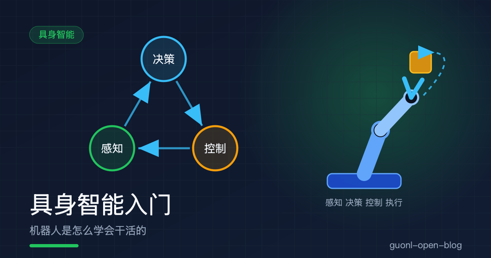
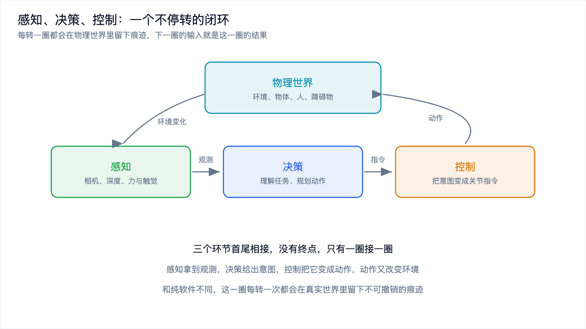
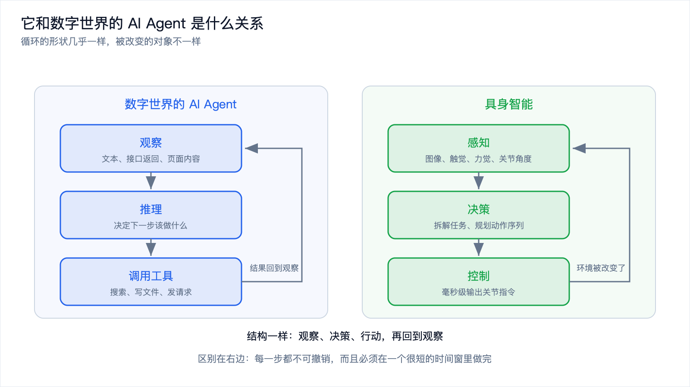
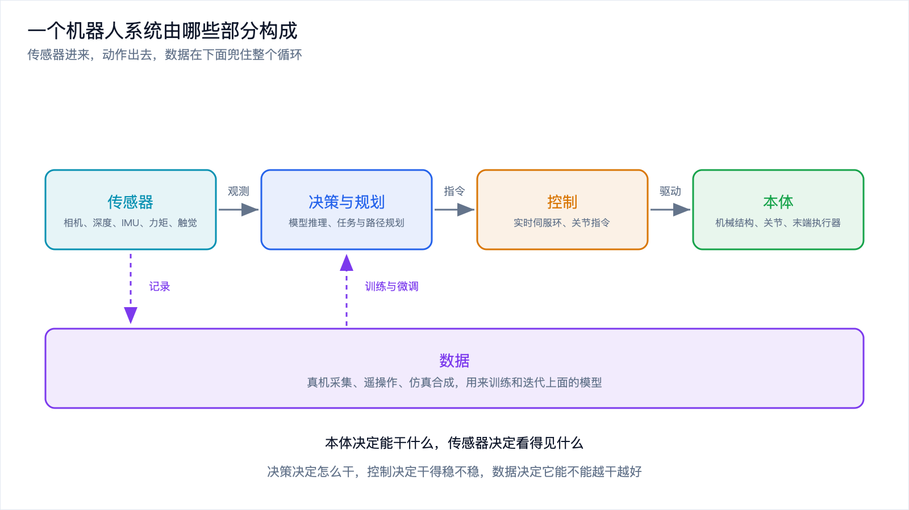

# 具身智能入门：机器人是怎么学会干活的

*2026-10-30 · 具身智能入门*

## 从递一杯水说起

你坐在工位上，同事说"帮我递杯水"。你回头看了一眼杯子的位置，伸手，握住，递过去。整个过程你几乎没想过自己在干什么。

把这个任务交给机器人，事情立刻变得棘手。它得先知道杯子在哪，这件事靠相机和深度传感器；它得知道"递水"这个动作的起点和终点在哪；它得算出一条不撞翻键盘、不碰到同事手的路径；它还得在握住杯子的那一刻控制力度，玻璃杯捏碎了不行，太松掉了也不行。

每一步单独拆出来，计算机视觉、自然语言理解、运动规划、力控制，都是几十年的研究领域。而人做这件事的时候，一秒都没停顿。

这篇作为"具身智能"专题的第一篇，先把最基础的问题讲清楚：具身智能是什么，它和数字世界的 AI Agent 差在哪，一个机器人系统由哪些部分组成，以及它为什么比看起来难那么多。

## 具身智能：能感知物理世界，也能对物理世界动手

先给定义。具身智能指的是能感知物理世界、并对其采取行动的智能体。两件事缺一不可：感知，行动。

这个定义朴素，但能把不少误解挡在外面。一个能识别图片里杯子的模型，它感知了，但不能行动，不算。一台按预设轨迹循环运动的机械臂，它动了，但不会根据环境变化调整，也不算。只有"看一眼、动一下、再看一眼、再调整"这套循环转起来，才算。

这里的关键在"循环"两个字。你伸手去拿杯子，手伸到一半发现杯子被人挪了，你会立刻修正轨迹，这个修正不是重新规划一次完整任务，而是在原有动作上叠加一点调整。这种边做边改的能力，只有在闭环里才可能出现。

## 感知、决策、控制：一个不停转的闭环

把上面那套循环拆开，会看到三个环节在轮流上场。

感知负责把物理世界的状态变成模型能读的数字。相机给出图像和深度，IMU 给出姿态和角速度，关节编码器给出每个关节转到哪了，力矩传感器和触觉传感器给出"手上现在有多大的力、接触面是什么形状"。

决策负责在观测的基础上想清楚"接下来该干什么"。它可能是理解一句自然语言指令，可能是把"把杯子递给我"拆成"移动到杯子上方、下降、闭合夹爪、抬起、转向、松开"，也可能是规划一条从当前位置到目标位置的路径。

控制负责把决策给出的意图变成电机的指令。它拿到的是"末端要移动到某个位姿"，输出的是"每个关节这一毫秒该出多少电流"。

*图 1：三个环节首尾相接，动作改变环境，环境又成为下一圈的输入。*

三个环节跑在完全不同的时间尺度上，这一点比流程本身更重要。控制环通常跑在百赫兹到千赫兹，周期是毫秒甚至微秒；决策可能每秒跑几次，每次几十到几百毫秒；感知介于两者之间，取决于传感器的帧率。把它们串成一条流水线，就会被迫按最慢的那一环对齐，整套系统慢得没法用。真实系统的做法是分层：慢的这层负责理解与规划，快的这层负责把意图稳稳落地，两层之间用一层薄接口隔开。

这里还藏着具身智能和数字世界最根本的一条差异。数字世界里的动作可以撤销，写错一个文件、调错一个接口，重来一次就行。物理世界的动作不可撤销，机械臂撞上桌面，桌面上的杯子就碎了。这一圈的每一次转动都会留下痕迹，而痕迹会改变下一圈的起点。

## 它和数字世界的 AI Agent 是什么关系

如果你读过这个博客里讲 AI Agent 的[那一组文章](../ai-agent/from-chat-to-action.md)，会发现上面这套描述有点眼熟：观察、决策、行动、再观察，这不就是 Agent 循环吗。

确实如此，而且这个类比很有用。数字世界的 Agent 是在一个由接口和文本构成的环境里循环：它观察网页内容或接口返回，推理下一步该做什么，调用一个工具，拿到结果，再进入下一轮。具身智能做的事情，是把同一个循环接到物理世界上去。观察的对象从文本变成图像、触觉和关节角度，行动的手段从调用接口变成驱动电机。

*图 2：循环的形状几乎一样，区别在于右边每一步都不可撤销，而且时间窗很短。*

形状一样，性质差很远。把它们放在一起看，差异集中在这几处。

| 维度 | 数字世界的 AI Agent | 具身智能 |
| --- | --- | --- |
| 观察什么 | 文本、接口返回、页面内容 | 图像、触觉、力觉、关节状态 |
| 怎么行动 | 调用工具、写文件、发请求 | 驱动电机，改变物理世界 |
| 反馈多快 | 工具返回值，通常几十到几百毫秒 | 取决于物理过程，且带噪声和延迟 |
| 出错代价 | 重试一次就行 | 撞坏了不能回滚 |
| 时间预算 | 秒级通常可以接受 | 控制环要毫秒级，超时即失效 |
| 数据从哪来 | 互联网文本，几乎是副产品 | 真机采集，用人力和机器时间换 |

最后两行是具身智能真正难的地方，后面还会展开。中间几行则是它可以向数字世界借东西的地方：技能库和工具库的思路相通，状态管理与记忆的设计相通，任务分解与规划的框架相通。搞过 Agent 工程的人转过来做机器人，很多经验可以直接复用。

## 一个机器人系统由哪些部分构成

概念讲完，落到具体。一台能干活的机器人，不管外形是人形、轮式还是机械臂，通常都由五块拼起来。

*图 3：传感器进来，动作出去，数据在下面兜住整个循环。*

本体是机械结构，包括底座、关节、连杆、末端执行器。它决定了这台机器人的自由度、工作空间和负载能力。本体不聪明，但它是所有能力的物理边界：一个只有六个自由度的机械臂，你没法让它做需要七个自由度的动作。这几年人形机器人受关注，原因之一就是它的本体形态和人类环境天然兼容，门把手、楼梯、货架都是按人的身体尺寸设计的。

传感器是机器人的眼睛和皮肤。相机提供丰富的语义信息，但采样率和精度都有限；深度相机和激光雷达提供几何信息；IMU 提供姿态和加速度；关节编码器提供本体状态；力矩传感器和触觉传感器提供接触信息。这里有个容易被忽略的点：不同的传感器有不同的频率、延迟和噪声特性，把它们对齐到同一个时间戳上，本身就是一项工程。

决策与规划是策略所在的地方，也是最近几年变化最大的地方。传统做法里，这一层是人写的状态机加上运动规划算法；现在越来越多地把模型放进来，让它从数据里学"看到这个场景该做什么"。这个位置放什么模型，正是具身智能当前最活跃的分歧点。

控制是把意图变成动作的一层。它要处理的是"关节该怎么动才既快又稳"，包括逆运动学、动力学补偿、力控与阻抗控制。这一层几十年来的主体是经典控制器，最近也开始出现专门为动作空间优化过的小神经网络。

数据是这五块里唯一不在机器人身上的一块，但它决定了机器人能不能越干越好。真机采集、遥操作、仿真合成，三种来源各有取舍。这块内容后面会用一整篇来写。

## 为什么难：三条互相牵制的约束

把上面五块拼起来，一个机器人系统就搭好了。难点在于，它要在三条约束同时成立的情况下工作。

*图 4：三条约束互相牵制，单独解决任何一条都不算解决。*

第一条，物理世界不可逆。软件可以随便试错，重跑一次单元测试的成本接近于零。机器人不行。让机械臂去尝试一万种抓取方式，一万次里只要有一次把东西摔了，这个方案在真实场景里就不可接受。试错必须被搬到别的地方去，比如仿真里，或者模型内部的想象里。这也是仿真和世界模型这类技术存在的根本理由。

第二条，数据稀缺。语言模型的训练数据是人类几十年顺手留下的副产品，爬下来就有。机器人数据是生产出来的：要一台机器人、一个操作员、一个真实场景，再加时间。一次成功的抓取演示可能只有十几秒，而要让模型学稳，同一个动作要在不同物体、不同光照、不同摆放位置下重复成百上千次。数据的获取成本和标注成本都高，规模却比文本小好几个数量级。

第三条，实时性。控制环跑在百赫兹以上，留给每次决策的时间是毫秒级。这条约束直接把大部分大模型挡在控制环外面，只能让它们待在慢的那一层。控制环还怕抖动，一次超时可能让机械臂停在半路，收到的指令已经过期。

三条约束绕成一个圈：要做到毫秒级响应，模型必须小；模型小，泛化能力就弱，需要更多数据来补；而更多真机数据既慢又贵，还伴随着不可逆的试错风险。任何一条单独解决都不算解决。

## 三个常见的误解

概念清楚了，顺手澄清三个最常见的误解。

误解一，具身智能就是人形机器人。人形只是本体形态的一种选择，它的优势是兼容人类环境，代价是结构和控制都复杂、成本高、稳定性差。工厂里大量在用的机械臂、仓库里跑的轮式机器人、扫地机、无人机，都是具身智能的载体。判断一个系统是不是具身智能，看它有没有感知与行动的闭环，不看它长什么样。

误解二，具身智能就是把大模型塞进机器人。大模型擅长的是理解语义和常识推理，它在具身系统里最合适的位置是慢的那一层，负责把模糊的指令翻译成清晰的任务。控制环那一层要的是确定性和速度，那里仍然是经典控制器和小网络的天下。把一个大模型直接接到电机上，得到的是一个反应迟钝又不稳定的系统。

误解三，机器人难在硬件。硬件确实难，但真正的瓶颈更多在软件和数据上：怎么在数据稀缺的条件下学到泛化，怎么把不可逆的试错搬到安全的地方，怎么在毫秒级预算里做出足够聪明的决策。这几年机器人领域的进展，主要来自模型和数据方法的变化，而不是关节电机的迭代。

## 写在最后

具身智能是能感知物理世界并对其采取行动的智能体，核心是感知、决策、控制三个环节构成的闭环。它和数字世界的 AI Agent 是同一个循环形状，只是被改变的对象从文本和接口换成了真实的物体，并且每一步都不可撤销、时间窗都很短。一台机器人由本体、传感器、决策与规划、控制、数据五块组成，前四块在机器人身上，最后一块决定了它能走多远。三条约束互相牵制：物理世界不可逆、数据稀缺、实时性要求高，其中实时性会把大模型挤到慢的那一层去。

概念立住了，接下来的问题是那个最活跃的分歧点：从感知到动作这一步，到底该怎么跨过去。目前有三条主流路线在同时推进，一条用视觉和语言模型直接输出动作，一条先在模型里推演未来再动手，一条靠触觉和力觉做毫秒级的本能反射。它们的原理、代价，以及为什么正在走向融合，下一篇[《VLA 与三大技术路线：视觉-语言-动作模型、世界模型、本能驱动》](./vla-world-model.md)接着讲。
