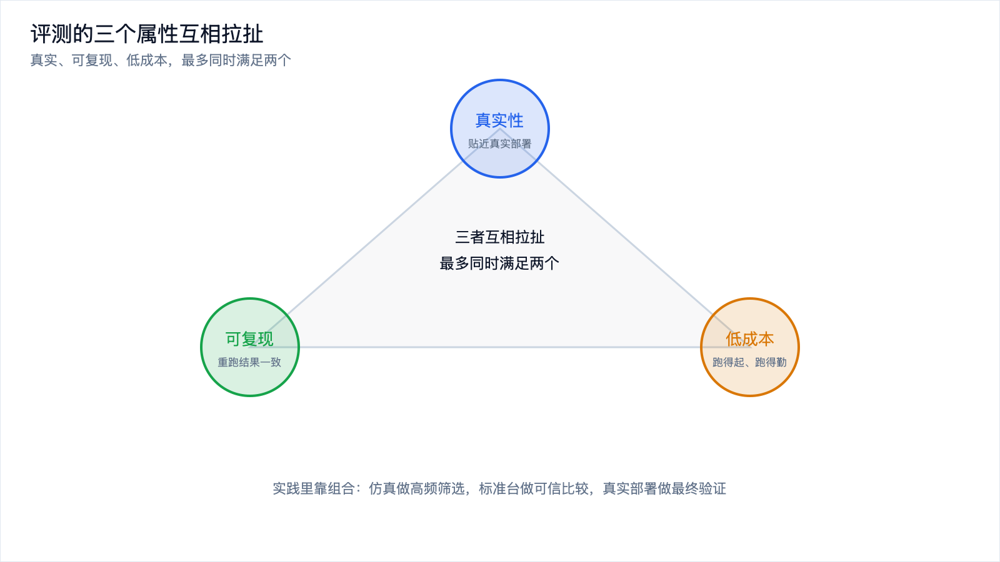
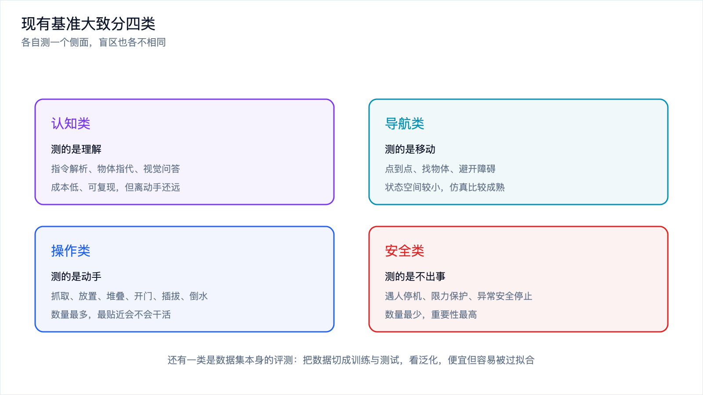
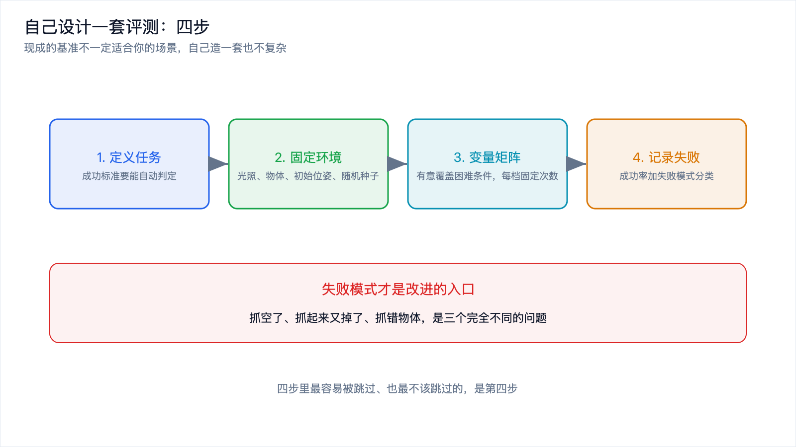

# 具身评测：怎么衡量一个机器人模型的好坏

*2026-10-30 · 具身评测*

## 一个让人难受的事实

做软件的都知道怎么验收：写测试，跑一遍，绿了就行。改一版再跑一遍，比上一版快了多少、错了几处，数字清清楚楚。

做机器人模型，这套东西整个失效。

你把模型改了一版，它抓东西看起来更稳了，但你去问"到底好了多少"，没人能给你一个可信的数字。因为要得到这个数字，你得把两版模型都放到真实的机器人上、真实的场景里、跑足够多次，还得保证两次跑的初始条件完全一样。这几件事，一件比一件难。

这就是具身评测的处境。它不是锦上添花的环节，而是决定这个领域能不能像软件那样快速迭代的基础设施。这篇讲三件事：评测为什么难，现有基准长什么样，以及如果今天就要给自己的机器人做评测，应该怎么做。

## 三个难以兼得的东西

评测有三个理想属性：真实、可复现、低成本。

真实，指评测环境要贴近真实部署，而不是实验室里摆好的干净桌面。可复现，指同一次评测重跑一遍结果应该基本一致，不同人、不同时间、不同实验室跑，结论也应该对得上。低成本，指跑一次的时间和钱要能承受，否则没法频繁迭代。

问题在于，这三者互相拉扯，最多同时满足两个。

真机评测最真实，也最贵：要占着机器、占着场地、占着人，跑一次几十上百次试验，一天就过去了。而且它通常不可复现，因为真实世界的初始条件控制不住，今天的光照和昨天不一样，物体摆放也有偏差。

仿真评测可复现、成本低，但它不真实，sim-to-real 的落差在这里会直接变成数字上的偏差。

在实验室搭一个标准化的测试台，能兼顾可复现和一定程度的真实，但成本不低，而且它测的是一个被简化过的世界，未必代表部署现场。

现实里的做法是组合：用仿真做高频的粗略筛选，用标准化真机台做中频的可信比较，用真实部署做低频的最终验证。三种手段成本和可信度不同，各自回答不同的问题。

*图 1：评测的三个理想属性互相拉扯，最多同时满足两个，实践里靠组合来补。*

## 变量太多，穷举不完

传统软件测试可以穷举，因为输入空间是离散的、有边界的。一个函数接收两个整数，你至少可以枚举边界值。机器人不行。

考虑一个最简单的任务："抓起桌上的杯子"。影响成败的变量至少有这么几类。

物体。杯子的形状、大小、重量、材质、表面摩擦力、里面有没有水、盖子有没有拧紧。

位置与姿态。杯子放在哪里，朝向如何，周围有没有别的物体挡着。

环境。光照强弱与方向，桌面颜色与反光，背景有没有干扰物。

机器人自身。关节的初始状态、电池电量（影响力矩输出）、末端执行器的磨损。

指令。同一件事有无数种说法，"把杯子拿起来""帮我拿下那个杯子""我渴了"。

每个变量单独看都还好，组合起来就是天文数字。你不可能穷举，只能抽样。而抽样意味着评测结果的置信度有限，你测的 100 次试验，可能恰好绕过了所有困难情况。

应对方式有两个方向。一个是设计变量矩阵，不是随机撒，而是有意覆盖极端情况：最滑的物体、最暗的光照、最刁钻的位置、最模糊的指令。另一个是把失败模式记录下来，因为失败样例比成功率更有信息量。

## 仿真和真机之间的落差

仿真评测最大的诱惑是便宜，最大的陷阱是它测的可能不是你关心的东西。

落差主要来自物理和视觉两块。物理上，接触、摩擦、软体形变、颗粒状物体、液体，这些是物理引擎里误差最大的部分，而它们恰恰是操作任务的核心。一个在仿真里能完美堆叠方块的模型，遇到一袋软趴趴的米可能完全没法抓。视觉上，仿真渲染出来的图像太干净，真实相机有噪声、有运动模糊、有反光和镜头畸变，模型如果学会了依赖仿真的"干净特征"，到真机就会失效。

落差还有一个更隐蔽的来源：评测协议的差异。同一个任务，仿真里定义"成功"是"杯子被举离桌面 5 厘米"，真机上你可能认为"杯子被稳稳拿到手里"才算成功。标准一变，数字就不可比。

实践中处理落差的常见做法，是在仿真里做域随机化，尽量让仿真环境的分布覆盖真机的分布；以及用仿真做排序、用真机验证绝对值，也就是用仿真快速比较"哪个模型更好"，但不信它给出的"成功率 92%"这种绝对数字。

## 产业关心的指标和学术基准错位

还有一个容易被忽略的问题：评测测的东西，可能不是产业真正需要的东西。

学术基准通常关心任务成功率。给定一个任务，模型做成了几次算几次。这个指标清晰、好比较，但它是单次任务的、理想条件下的。

产业现场关心的是另一套东西。

连续作业能力。不是做一次成功，而是连着做几百次不出错，中间不会越做越偏。很多模型单次成功率不错，跑一小时就开始积累误差，然后崩掉。

任务节拍。每个动作花多长时间。一个成功率 95% 但每个动作要 8 秒的模型，在产线上可能还不如成功率 90% 但 2 秒完成的。

运行成本。耗电、耗气、占用的算力、需要几个人盯着。机器人真正落地时，这些是硬账。

异常处理能力。遇到没见过的情况会不会停、会不会叫人、会不会把东西摔了。这一项在学术基准里几乎不测，在产线上却直接决定能不能用。

指标错位的后果是，一个在基准榜上排名靠前的模型，到了现场可能表现平庸；而一个基准成绩一般、但节拍快、稳定性好的模型，反而更适合落地。评测的目的如果只是刷榜，就会和真实需求越走越远。

## 现有基准的几类

尽管问题很多，具身领域还是积累了相当多可用的基准，按测的东西大致分四类。

认知类。测的是"理解"，比如给定一个模糊指令，模型能不能正确解析出任务；给定一个场景，能不能回答"杯子在哪"。这类基准很多是从视觉问答和语言理解那边迁移过来的，成本低、可复现，但离"动手"还有距离。

导航类。测的是"在空间里移动"，比如从 A 点走到 B 点、在房间里找某个物体、避开障碍。这类任务的状态空间比操作小，仿真比较成熟，评测协议也相对统一。

操作类。数量最多，也是和具身智能最直接相关的。抓取、放置、堆叠、开门、插拔、倒水。仿真侧有一批标准化的任务集和场景集，真机侧有标准化的桌面任务台。这是最能反映"会不会干活"的一类。

安全类。测的是"不出事"，比如遇到人会不会停、超出力时会不会保护、异常状态下能不能安全停下。这类基准数量最少，但重要性最高，因为一次事故就可能让整个项目停掉。

除这四类，还有一类是数据集本身的评测：把数据集切分成训练和测试，看模型在没见过的场景上泛化得怎么样。它便宜、可复现，缺点也明显，模型可能只是记住了这个数据集的分布。

*图 2：四类基准各测一个侧面，操作类最贴近"会不会干活"，安全类数量最少但最要紧。*

## 自己设计一套评测：四步

现成的基准不一定适合你的场景，很多时候得自己造一套。方法不复杂，关键是每步都别偷懒。

第一步，定义任务，并且定义清楚什么叫成功。这一步最容易含糊。不要写"完成抓取"，要写"物体被抓起并离开桌面 10 厘米以上，且在抓取后 2 秒内没有掉落"。成功标准必须能由程序自动判定，否则评测没法自动跑，也就没法频繁跑。同时定义好"部分成功"，比如抓住了但没放进目标位置，这种中间状态往往比失败更有信息量。

第二步，固定环境。把光照、桌面、物体清单、相机位置、机器人初始位姿全部固定下来，写成一份配置。每次评测都从同一份配置开始，初始随机种子也固定。这一步是可复现的全部来源，做不好，后面的数字都没意义。固定环境还要包括物理条件：电池电量、气压、室温，这些在长时间评测里会漂移，需要监控。

第三步，设计变量矩阵，做有意的覆盖而不是随机撒。同一个任务，准备几档难度：标准摆放、位置偏移、光照变化、加入干扰物、更换物体材质、换成模糊指令。每一档跑固定次数，比如每档 20 次。这样得到的不是一个笼统的成功率，而是"在哪种条件下会崩"的画像。

第四步，记录成功率和失败模式，并且一定要看失败。失败模式才是改进的入口。同是失败，"抓空了""抓起来又掉了""抓错物体"是完全不同的问题，对应完全不同的修法。给失败分类，统计各类占比，比一个总成功率有用得多。分类的粒度不用一开始就很细，先记下视频和状态日志，事后回看归类。

*图 3：自建评测的四步，重点是把"成功"定义成可自动判定，并坚持看失败样例。*

## 几个容易踩的坑

跑评测的过程里，有几类错误特别常见。

只看成功率，不看试验次数。跑了 10 次，成功 9 次，看起来 90%。但 10 次的样本量太小，换个种子可能就是 7 次。起步阶段的试验次数要足够多，关键结论最好做多次独立重复，看波动范围。

只测标准场景。标准场景的通过率高，容易让人误判。真正区分模型好坏的是偏移、遮挡、光照变化这些非标准条件，评测里至少要有几档困难模式。

忽略节拍和成本。只记成功率不记耗时，会漏掉一个关键维度。评测脚本里顺手把每个动作的耗时、每次试验的能耗记下来，成本很低，信息量很大。

不记录失败原因。只存一个"失败"的标记，事后完全不知道为什么失败。至少存下当时的相机画面和关节状态。

用同一批数据调优又评测。这是最隐蔽的问题。如果你反复针对评测任务改模型，模型最后只是记住了这批任务，分数虚高。要留一份从没在调优中用过的测试集，只在最终判断时用。

## 写在最后

具身评测难，难在真实性、可复现性和低成本三者不可兼得，难在测试变量多到无法穷举，难在仿真和真机之间存在落差，也难在学术基准关心的指标和产业现场关心的连续作业能力、任务节拍、运行成本并不一致。现有的基准按认知、导航、操作、安全分了四类，各有各的用处，也各有各的盲区。

如果要在自己的项目里做评测，四步就够：把任务和成功标准定义到可自动判定，把环境彻底固定下来，用变量矩阵有意覆盖困难条件，然后认真记录成功率和失败模式。最容易被跳过、也最不该跳过的，是记录失败这一步，失败样例才是让模型变好的入口。

到这里，具身智能这个专题的三块拼图凑齐了。数据决定了模型能学成什么样，分层架构决定了模型能不能真的跑起来，评测决定了你能不能判断它到底有没有变好。三件事互相咬合，缺一个都转不动。回到最开始那个问题，机器人怎么学会干活，答案不在某一个模型里，而在这条从数据到控制再到评测的完整链路里。这条链路的前两篇是[《数据与仿真闭环：具身智能为什么卡在数据上》](./data-simulation-loop.md)和[《端侧实时控制：为什么大模型进不了控制环》](./on-device-realtime-control.md)，三篇连起来读会更完整。
