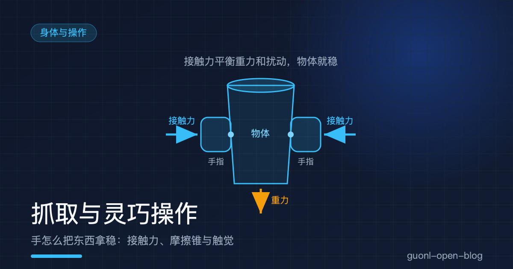
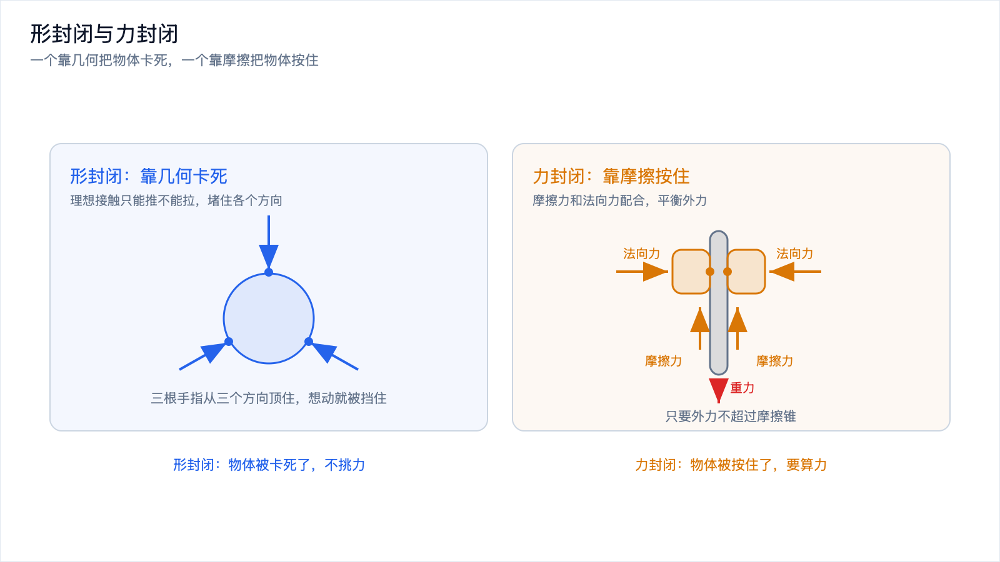
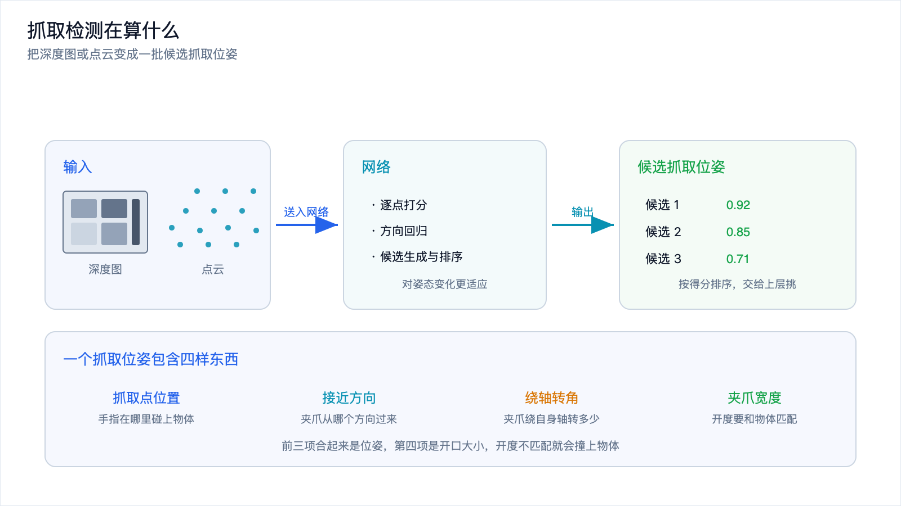
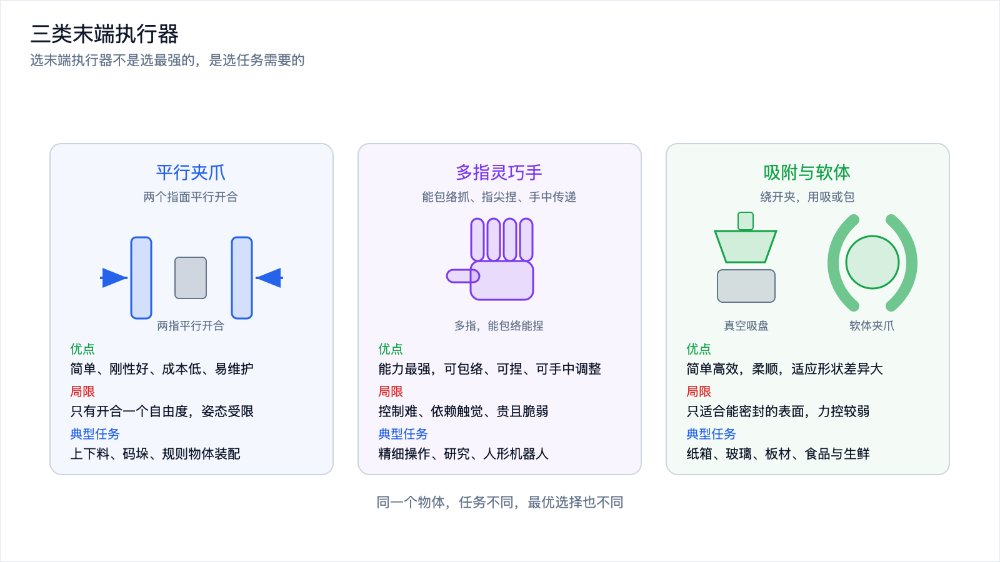
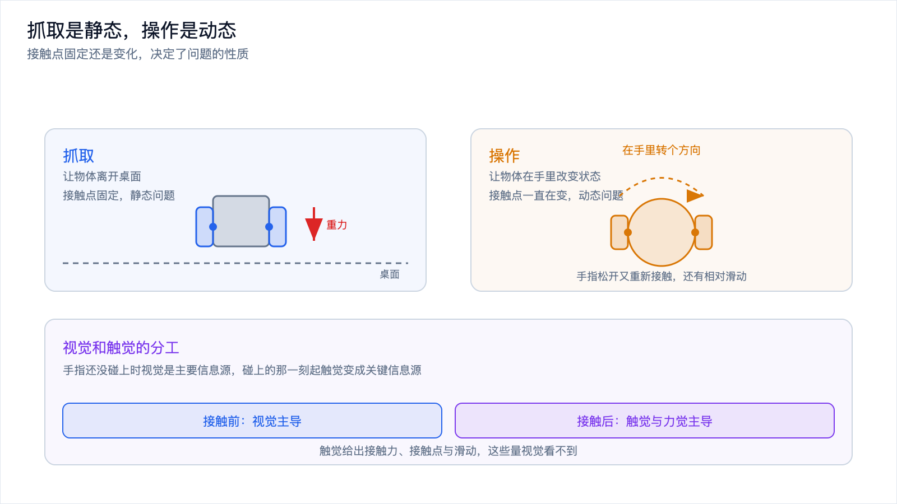

# 抓取与灵巧操作：手怎么把东西拿稳

*2026-10-30 · 身体与操作*

## 手已经伸到杯子旁边了

上一篇讲完了怎么让手到位：从关节角度算出末端位置，在障碍物之间找一条不撞东西的路，再把路径变成带时间和速度的轨迹。做完这些，机械手停在杯子旁边，姿态正对杯身，速度降到零。

然后呢。

人要拿杯子，"握住"这一步几乎不占注意力，手指自己就合上了。换成机器人，这一步最容易被低估。手停在正确的位置，只说明它有资格去碰杯子，不代表它能拿起来。

拿不起来的情况太多。两指捏在杯壁，力大了纸杯瘪掉，力小了滑下去。位置偏一点，手指从杯沿蹭过去。桌沿挡住指根，手指根本合不拢。手到位之后的事，比让手到位更难。

## 抓取的本质：用接触力把物体约束住

抓取的核心可以一句话概括：用若干个接触点把物体约束住，让它不滑、不翻、不变形。手对物体的作用只有接触力，物体还受重力和可能的惯性力，抓取成立的条件是接触点能把它们平衡掉。怎么判断约束够不够，机械手里有两个经典概念，形封闭和力封闭。

形封闭讲几何。即使接触点只提供纯法向推力，也就是既不能拉也不能摩擦的理想接触，物体也被卡死，想往任何方向运动都会被某个接触点挡住。两根手指夹一根笔，笔横在两指之间不能上下平移，却能沿手指方向滑出去，这不算形封闭。真正的形封闭要让接触堵住各个方向，比如三根手指从三个方向顶住一个球。它不依赖摩擦，只要几何位置对就成立，代价是接触点得铺在物体周围足够多的方向上。

力封闭放松了要求，允许接触之间有摩擦，只要摩擦力和法向力配合起来能平衡外力就成立。还是两指夹笔，靠指尖摩擦力捏住，能端起来，能转向，只要外力不超过摩擦锥。

差别可以这样看：形封闭是物体被卡死了，力封闭是物体被按住了。卡死靠几何，不挑力；按住靠摩擦，要算力。整只手握住杯子是典型的形封闭，手不用力杯子也很难掉出去；两指夹笔是典型的力封闭，捏松一点就滑了。

接触点给的是法向力加摩擦，摩擦有上限，超过上限就开始滑。抓取维持的是一个力的平衡，平衡被打破，物体就掉。

*图 1：形封闭靠几何把物体卡住，力封闭靠摩擦把物体按住，两者对接触点的要求不同。*

## 抓取点怎么选：抓取检测在算什么

目标明确之后，问题变得具体：抓哪里，用几根手指，接触方向怎么定。

人靠直觉，看到杯子就知道从侧面捏。机器人要从感知数据里把这件事解出来。主流做法叫抓取检测，输入一张深度图或者一帧点云，输出一个或若干候选抓取位姿。

一个抓取位姿包含四样东西：抓取点位置、夹爪接近物体的方向、夹爪绕自身轴线的转角、夹爪需要张开的宽度。前三个合起来是位姿，第四个是开口大小，宽度必须和物体匹配，夹爪开度小了伸过去就是撞。

抓取检测的做法有不同代际。早期把深度图切成很多小窗口逐个分类回归，在已知物体上很快；现在更多把点云喂给网络，输出每个点的得分和方向，或者生成一批候选再排序，对姿态变化更适应。

*图 2：抓取检测把深度图或点云变成候选抓取位姿，每个位姿包含位置、姿态、转角和夹爪宽度。*

## 一个抓取姿态好不好，从三个层面看

给候选抓取打分，通常从三个层面往下看，越往下越贴近任务。

几何层面管能不能夹上。夹爪张开到指定宽度，两指之间要有物体，不能夹空；接近物体的路径上不能先撞到别的东西，桌面、其他物体、物体自己的凸起都算；接触点最好落在平行面或者曲率合适的位置，夹在斜面上容易滑开。这一层只要几何模型，算得快，可以做粗筛。

力层面管夹住之后稳不稳。把重力和扰动力代进去，检查接触力能不能平衡：抗重力，夹起来不下滑；抗扰动，比如移动中加减速产生的惯性力，或者被旁边的东西轻碰一下。摩擦锥的边界就是红线，实际系统一般留一个安全系数，不贴着摩擦极限抓，因为真机上的摩擦系数和模型里估的经常不一样。

任务层面管抓完好不好用。抓住杯子只是端走，从侧面捏住杯身就行；要拧开瓶盖，抓法就受限，得让手指能施加绕瓶盖轴的力矩；要把东西插进孔里，抓的时候就得考虑插入方向。同一个物体，任务不同，最优抓法不同，所以抓取检测的输出往往是一批候选，让上层按任务挑。

## 抓起来和用起来是两回事

抓取是让物体离开桌面，操作是让物体在手里、或者手里加环境的作用下改变状态。抓住杯子只是第一步，后面还有：在手里把杯子转个方向，把杯口对准饮水机，把笔尖对准笔帽插进去，把插头对准插座推到底。

区别在接触状态会变。抓取阶段接触点固定，手指夹住就不动了。操作阶段接触点在变：有的手指松开，有的重新接触，物体在指间滚动或者滑动，接触力连续调整。机器人不只要保持平衡，还要主动打破平衡让物体动起来，动到新位置再重新稳住。

抓取是静态问题，找到一个可行的接触配置就结束了；操作是动态问题，要在一段时间里控制接触状态的变化。手里转动物体，物体和手指之间必然有相对滑动，摩擦力从静摩擦变成动摩擦，模型得跟着变。

打个比方：从桌上拿起一颗鸡蛋是抓取，把鸡蛋在手里转一圈找到大头朝下是操作。前者几乎不用想，后者要一点注意力，手滑一下鸡蛋就掉了。

## 灵巧手为什么难

要做出上面这些动作，硬件上最直接的想法是造一只像人手的手：一条手臂接一只多指手，每根手指有几个关节，能独立弯曲，有的还有手掌转动和手指外展内收。难点集中在几处。

自由度多。一只灵巧手可能有十几个到二十几个自由度，比整条六轴机械臂还多。手指之间的运动还耦合：想让指尖到某个位置，几个关节要协调，跟逆运动学在手臂上的麻烦一样，只是挪到了更小的尺寸上。

接触状态复杂。手指什么时候碰到物体、碰到哪里、有没有滑动，这些量一直在变，而且大部分看不见。摄像头看不到指腹和物体之间那层接触，只能靠触觉传感器。接触状态估错了，力的分配就错了，物体不是滑掉就是被捏坏。

控制频率要求高。手臂规划可以花几十毫秒甚至更久，手指调抓握力不行。物体从开始滑动到彻底脱手往往只有几十毫秒的窗口，控制环必须在这段时间内检测到并加大夹持力。这和[《端侧实时推理与控制：大模型为什么进不了控制环》](on-device-realtime-control.md)讲的分层是同一个道理。

硬件贵且脆弱。关节多，每个都要电机、减速器、传动和传感器，还得塞进手指那么小的空间里。手指是细长结构，撞一下容易坏，这直接限制了它大规模部署的可能。

## 三条路线：平行夹爪、多指灵巧手、吸附与软体

工业现场最常见的末端执行器，反而是最简单的那个。

平行夹爪是两个手指的简化版，只有一个自由度，两个指面平行开合。结构简单、刚性好、力大、控制只有开合一个量、成本低，正好对上工业需求。缺点是只能做两个方向的夹持，抓形状复杂的物体、或者要在手里转动物体就做不了。

多指灵巧手能力上限最高，能包络抓、指尖捏、在手指之间传递物体。代价是控制难、传感要求高、硬件贵。

吸附和软体绕开了夹。真空吸盘靠负压吸住物体，纸箱、玻璃、面板这类平面物体几乎都用它，缺点是只能吸能形成密封的表面。软体夹爪用柔性材料做手指，靠气压或拉线弯曲包住物体，抓易碎、形状差异大的东西不用精确建模，缺点是可重复性和力控较弱。

| 路线 | 优点 | 局限 | 典型任务 |
| --- | --- | --- | --- |
| 平行夹爪 | 简单、刚性好、成本低、易维护 | 只有开合一个自由度，姿态受限 | 上下料、码垛、规则物体装配 |
| 多指灵巧手 | 能力最强，可包络、可捏、可在手中调整 | 控制难、依赖触觉、贵且脆弱 | 精细操作、研究、人形机器人 |
| 真空吸盘 | 对平面物体简单高效 | 只适合能形成密封的表面 | 纸箱、玻璃、板材搬运 |
| 软体夹爪 | 柔顺，适应形状差异大、易碎的物体 | 可重复性与力控较弱 | 食品、生鲜、不规则软物 |

选末端执行器不是选最强的，是选任务需要的。码垛工位用灵巧手是浪费，要在手里拧螺丝的工位用平行夹爪则根本做不到。

*图 3：平行夹爪、多指灵巧手、吸附与软体三条路线，各自对应不同的任务与代价。*

## 触觉和力觉：绕不过去的一环

前面反复提到摩擦、滑动、接触状态，这些量有一个共同点：视觉看不到。

视觉能告诉你物体在哪、形状如何、从哪里下手，但给不出接触之后的信息。手指碰到没有、用多大劲、有没有开始滑，摄像头都看不见，因为接触发生在指腹和物体之间，被手自己挡住了。手指还没碰上时视觉是主要信息源，碰上的那一刻起触觉变成关键信息源。

触觉传感器要提供的是：接触有没有发生，接触力多大、方向如何，接触点在哪，有没有相对滑动。其中滑觉最要紧，也最让视觉无能为力，物体在指间慢慢滑动时从外面几乎看不出来，只有指腹能感觉到微小的振动和切向力变化。

有了滑觉，抓握力才能闭环。策略可以很朴素：先轻轻合上手指，力慢慢加大，一旦检测到滑动就把力提上去，滑停了就保持。没有触觉，只能事先算好一个力按固定值去夹，物体轻了夹不住，重了捏坏，换个物体就得重新标定。

多指灵巧手几乎离不开触觉，手指越多，接触状态越复杂，没触觉就只剩盲抓。平行夹爪对触觉的依赖低一些，但加上一个简单的力反馈或者滑觉检测，成功率也会明显提升。

## 学习类方法在这里的位置

前面讲的抓取检测、摩擦锥分析、力的平衡，都是基于几何和力学的传统做法。它们可解释、能给出保证，但依赖物体的几何模型和准确的摩擦参数，遇到没见过的物体或者柔软变形的物体就不好使。

学习类方法换了一条路：不显式建模摩擦和接触，直接从数据里学什么样的位姿能抓住。数据可以来自示教，人拿手柄演示几百次抓取，让机器人记录位姿和成功与否；也可以来自仿真里的大规模试错，用深度图或点云作输入输出抓取位姿，成功的样本得到正奖励。练出来的策略能处理没见过的物体，也能处理柔软物体这类几何建模很难的东西。

两条路不是对立的，实际系统里经常配合：学习给出候选和粗略优先级，传统几何校验把明显不可行的候选筛掉，力学分析在几个候选之间做安全判断。这跟运动规划里学习给意图、规划做兜底是同一个结构，区别只是这里兜底的是接触和力。

短板也清楚：需要大量数据，仿真里学到的抓取搬到真机会遇到差距，触觉这类信号在仿真里很难准确建模，而这恰恰是灵巧操作最依赖的。

*图 4：抓取是让物体离开桌面，操作是让物体在手里改变状态，触觉与力觉在每个阶段都要参与。*

## 写在最后

手伸到杯子旁边只是开始。抓取的本质是用接触力把物体约束住，让它不滑、不翻、不变形。形封闭靠几何把物体卡死，力封闭靠摩擦把物体按住，多数真实抓取走后一条路，摩擦极限就是那条红线。

抓取点要从深度图或点云里解出来，一个位姿包含位置、姿态、转角和夹爪宽度。判断好坏要看几何上夹不夹得住、力上抗不抗扰动、任务上抓完好不好用。抓住和用好是两件事，操作阶段接触状态一直在变。

灵巧手能力最强，也最难控、最贵、最依赖触觉；平行夹爪简单可靠，撑起工业现场的大部分工作；吸附和软体在特定场景里更好用。触觉和力觉绕不过去，因为摩擦和滑动是视觉看不见的量。学习类方法擅长没见过的物体，和传统的几何力学分析互补。

抓取和操作都做对了，还有一个问题在后面等着：这些策略通常先在仿真里练，再搬到真机上，搬过去之后表现经常大幅下降。下一篇[《Sim2Real：仿真里练好的技能，为什么到了真机就废》](sim2real.md)，讲这中间的差距从哪来。
