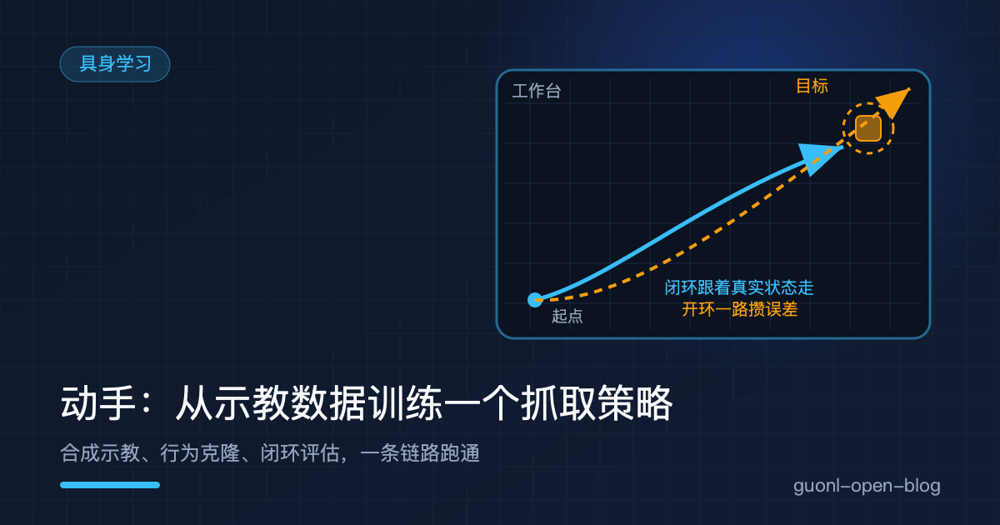
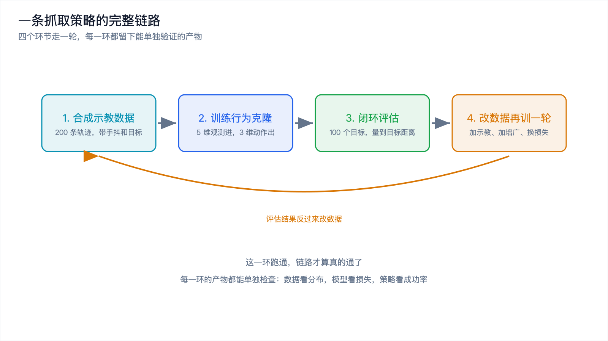
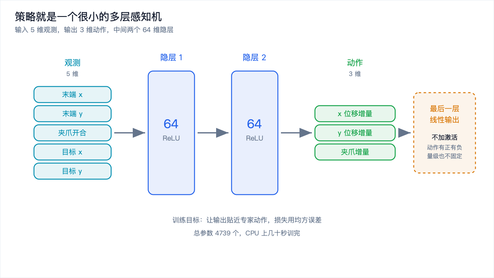
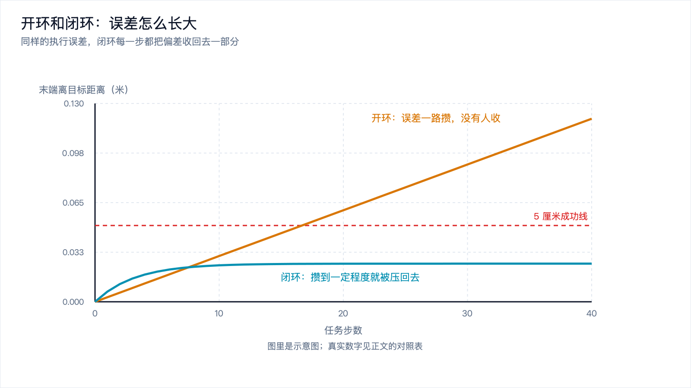
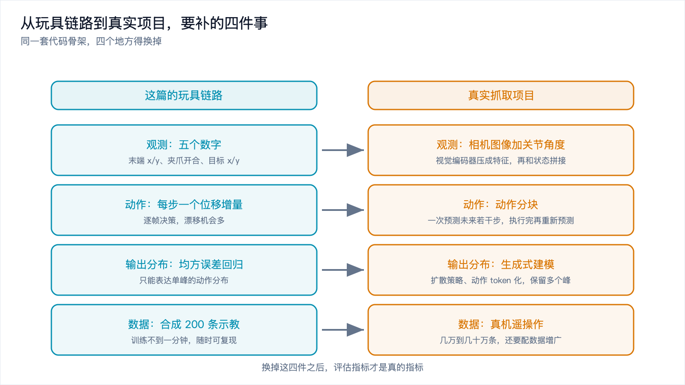

# 动手：从示教数据训练一个抓取策略



*2026-10-30 · 具身学习*

## 从原理到能跑起来

上一篇[《模仿学习：机器人怎么从示教里学会动作》](imitation-learning.md)把道理讲完了：行为克隆就是把示教拆成一条条「观测、动作」样本，当成监督学习去拟合。分布偏移、多模态、数据成本，三道坎也交代清楚了。

道理听懂了，手还是痒。这篇把链路从头搭一遍，再把开环和闭环、噪声和偏差、双示教者的差别量出来。



*图 1：合成示教、训练策略、闭环评估、根据结果回去改数据，四步一轮。*

数据、环境、机器人全是自己造的。抓取任务压到一个二维平面上：末端在工作台上移动，夹爪能开能合，目标是走到指定位置再把夹爪合上。真实项目里这份示教数据来自遥操作，人带着机械臂走一遍录一遍；这里没有机械臂，用一段代码合成出来，形状和真实示教一样。

需要一个 Python 环境加两个包：

```bash
python3 -m venv .venv
source .venv/bin/activate
pip install numpy torch
```

CPU 版 torch 就够，模型只有四千多个参数。下面的输出是我在一台 Apple Silicon 笔记本上跑的，Python 3.11、numpy 2.4、torch 2.15。换个版本数字会动一点，结论不会。

## 第一步：造一份示教数据

一条示教就是一条轨迹。末端从起点出发往目标走，靠近之后合上夹爪。

```python
import numpy as np

T = 40                            # 一条示教多少步
N_TRAJ = 200                      # 示教条数
START = np.array([0.10, 0.10])    # 末端起点，工作台按 1m x 1m 算，单位米

def demo(rng, target=None, jitter=0.0015, gain=0.20, vmax=0.05):
    """合成一条抓取示教：末端往目标走，远了全速、近了减速，到位后合上夹爪。"""
    if target is None:
        target = rng.uniform(0.55, 0.90, size=2)
    pos = START + rng.normal(0.0, 0.01, 2)        # 每次示教的起点都略有不同
    grip = 1.0
    P, G = [pos.copy()], [grip]
    for _ in range(T):
        err = target - pos
        d = np.linalg.norm(err)
        v = gain * err
        n = np.linalg.norm(v)
        if n > vmax:
            v = v / n * vmax                      # 速度上限
        pos = pos + v + rng.normal(0.0, jitter, 2)     # 人手抖动
        if d < 0.05:
            grip = max(0.0, grip - 0.25)          # 到位了，四步合上夹爪
        P.append(pos.copy())
        G.append(grip)
    return np.array(P), np.array(G), target
```

几处细节都是照着真实示教写的。比例控制 `v = gain * err` 对应人手的手法，离得远走得快，快到了就慢下来，遥操作录出来的速度曲线就是这个形状。`vmax` 是速度上限，机械臂有关节速度限制。`jitter` 是手抖，1.5 毫米人几乎察觉不到，可它决定了这条轨迹里有多少噪声标签。起点还加了 1 厘米的随机偏移，因为人每次把手臂放回起始位置都不会精确到同一毫米。

把轨迹切成样本。每一帧一条，输入是这一帧的观测，标签是专家在这一帧做的动作，也就是下一帧相对这一帧的增量：

```python
def build_dataset(rng, n_traj=N_TRAJ):
    obs, act = [], []
    for _ in range(n_traj):
        pos, grip, target = demo(rng)
        for t in range(T):
            obs.append([pos[t, 0], pos[t, 1], grip[t], target[0], target[1]])
            act.append([pos[t + 1, 0] - pos[t, 0],
                        pos[t + 1, 1] - pos[t, 1],
                        grip[t + 1] - grip[t]])
    return np.array(obs, np.float32), np.array(act, np.float32)

RNG = np.random.default_rng(0)
obs, act = build_dataset(RNG)
print("样本数 %d  观测维度 %d  动作维度 %d" % (obs.shape[0], obs.shape[1], act.shape[1]))
```

观测五个量：末端 x、末端 y、夹爪开合，加上目标的 x 和 y。动作三个量：x 增量、y 增量、夹爪增量。目标位置必须进观测，不然策略没法判断往哪走。真实系统里目标来自视觉，相机看到杯子，算出杯子在机器人坐标系里的位置，再拼进观测；这里直接给一个坐标，等于把视觉那一段短路掉了。

跑出来：

```
样本数 8000  观测维度 5  动作维度 3
观测均值 [0.567 0.574 0.579 0.725 0.735]
观测标准差 [0.212 0.214 0.478 0.1   0.098]
动作均值 [ 0.0156  0.0158 -0.025 ]
动作标准差 [0.0155 0.0158 0.075 ]
末端单步位移量级 0.0160 m
```

8000 条样本，200 条示教各 40 步。注意动作那一列：末端单步位移的波动在 1.5 厘米量级，夹爪那一维是 0.075。夹爪只有两种状态，要么不动，要么在最后四步快速合上，方差自然比位置大。

## 第二步：训一个策略网络

策略就是一个多层感知机。



*图 2：两个隐层各 64 维，输入是末端位置、夹爪状态和目标位置，输出是位移增量和夹爪增量。*

```python
import torch
import torch.nn as nn

class Policy(nn.Module):
    def __init__(self, obs_dim=5, act_dim=3, hidden=64):
        super().__init__()
        self.net = nn.Sequential(
            nn.Linear(obs_dim, hidden), nn.ReLU(),
            nn.Linear(hidden, hidden), nn.ReLU(),
            nn.Linear(hidden, act_dim),
        )

    def forward(self, x):
        return self.net(x)
```

两个隐层各 64 个单元，ReLU 激活，最后一层线性输出，总参数 4739 个。规模不是拍的：输入 5 维输出 3 维，问题本身很小，网络再大只会更快过拟合到那 1.5 毫米的手抖上。最后一层不加激活函数，因为动作是连续数值，可以是负的，加了 ReLU 或者 tanh 就把输出范围限死了。

训练循环和图像分类完全一样：

```python
def train_policy(obs, act, epochs=60, batch=128, lr=1e-3, seed=0, verbose=False):
    torch.manual_seed(seed)
    X = torch.from_numpy(np.ascontiguousarray(obs))
    Y = torch.from_numpy(np.ascontiguousarray(act))
    policy = Policy(obs.shape[1], act.shape[1])
    opt = torch.optim.Adam(policy.parameters(), lr=lr)
    lossf = nn.MSELoss()
    for epoch in range(1, epochs + 1):
        perm = torch.randperm(len(X))
        total = 0.0
        for i in range(0, len(X), batch):
            idx = perm[i:i + batch]
            opt.zero_grad()
            loss = lossf(policy(X[idx]), Y[idx])
            loss.backward()
            opt.step()
            total += loss.item() * len(idx)
        if verbose and (epoch == 1 or epoch % 10 == 0):
            with torch.no_grad():
                full = lossf(policy(X), Y).item()
            print("epoch %3d  批平均 MSE %.6f  全量 MSE %.6f" % (epoch, total / len(X), full))
    return policy
```

损失用均方误差，因为动作是连续量。Adam，学习率千分之一，批大小 128，跑 60 轮。`opt.zero_grad()` 放在批循环里而不是轮循环里，这是最容易写错的地方：梯度不清零会一轮一轮累加，训练直接发散。

训练输出：

```
策略网络参数量 4739
epoch   1  批平均 MSE 0.001812  全量 MSE 0.001401
epoch  10  批平均 MSE 0.000373  全量 MSE 0.000379
epoch  20  批平均 MSE 0.000324  全量 MSE 0.000310
epoch  30  批平均 MSE 0.000285  全量 MSE 0.000354
epoch  40  批平均 MSE 0.000241  全量 MSE 0.000212
epoch  50  批平均 MSE 0.000212  全量 MSE 0.000176
epoch  60  批平均 MSE 0.000180  全量 MSE 0.000176
```

损失从 1.8e-3 掉到 1.8e-4，一个数量级，十轮之内就基本到位。剩下的那点降不下去了，不是模型能力不够，是标签本身带噪：动作由两帧位置相减得到，两帧各自有 1.5 毫米的手抖，相减之后噪声变成大约 2 毫米，而真实动作信号的标准差是 1.5 厘米。噪声占了信号的一成多，模型再大也学不到不存在的东西。训练损失平了别急着加层加宽，先量一量示教的抖动。

## 第三步：让策略自己跑

训练只说明它会模仿单帧，不说明它能把一整条任务走完。得让它进环境自己跑。

```python
def rollout(policy, start, target, max_steps=60, exec_noise=0.0, obs_noise=0.0,
            obs_bias=0.0, feedback=True, rng=None):
    """让策略在环境里自己跑。feedback=False 就是开环：策略看不到真实状态。"""
    rng = rng if rng is not None else np.random.default_rng(1)
    real = np.array([start[0], start[1], 1.0])        # 末端 x、y、夹爪开合
    plan = real.copy()                                # 策略自己以为的状态
    traj = [real.copy()]
    with torch.no_grad():
        for _ in range(max_steps):
            seen = real if feedback else plan
            o = np.array([seen[0] + obs_bias + rng.normal(0.0, obs_noise),
                          seen[1] + obs_bias + rng.normal(0.0, obs_noise),
                          seen[2], target[0], target[1]], dtype=np.float32)
            a = policy(torch.from_numpy(o).unsqueeze(0)).numpy()[0]
            a = np.clip(a, -0.05, 0.05)               # 速度限幅，真机上的安全上限
            plan = plan + a
            plan[2] = np.clip(plan[2], 0.0, 1.0)
            real = real + a + rng.normal(0.0, exec_noise, 3)
            real[2] = np.clip(real[2], 0.0, 1.0)
            traj.append(real.copy())
            if real[2] < 0.5:                         # 夹爪合上，这一抓结束
                break
    return np.array(traj)
```

环境只做三件事：执行动作、加上执行误差、把结果回给策略。

`np.clip(a, -0.05, 0.05)` 是速度限幅，对应真机上的关节速度上限。没有这一层，一旦策略输出异常动作，仿真里的机械臂会瞬间飞出工作台，数字就没法看了。

`real[2] = np.clip(real[2], 0.0, 1.0)` 是夹爪的物理限位，只能从 1 合到 0，合不进去。这一行不能省。第一版我忘了写，策略一直输出再合一点，夹爪开合量跑到负三，观测离开训练分布，位置输出跟着发散。

`if real[2] < 0.5: break` 是终止条件。夹爪合上，这一抓结束，这一刻也是评估时刻。评估就是随机抽 100 个目标，看抓取结束时末端离目标多远：

```python
def eval_suite(policy, n=100, **kw):
    rng = np.random.default_rng(7)
    dist = []
    for i in range(n):
        target = rng.uniform(0.55, 0.90, size=2)
        traj = rollout(policy, START, target, rng=np.random.default_rng(1000 + i), **kw)
        dist.append(float(np.linalg.norm(traj[-1][:2] - target)))
    return np.array(dist)
```

成功线画在 5 厘米：夹爪合上时末端离目标不到 5 厘米，算这一抓成了。理想情况下不加噪声：

```
理想执行，闭环                  中位 0.0125  P90 0.0211  最差 0.0311  成功率 100%
```

100 个目标全部成功，中位误差 1.25 厘米。200 条示教、4739 个参数、训练不到一分钟，做到这个程度不算差。

## 第四步：开环和闭环差在哪

现在把执行误差打开。真实机械臂不可能精确执行指令，每个控制周期都会偏一点，用 `exec_noise` 模拟。闭环是每一步都拿真实状态重新问一次策略；开环是策略在脑子里把整条轨迹推演一遍，把这一串动作原样交给机器人执行，中途不再看结果。两种模式的执行误差完全一样。



*图 3：开环只算一次，执行误差一路攒到最后；闭环每一步都看一眼真实状态，偏差当场被收回去。*

| 执行噪声 | 模式 | 距离中位 | P90 | 最差 | 成功率 |
| --- | --- | --- | --- | --- | --- |
| 0.002 | 闭环 | 0.0142 | 0.0267 | 0.0450 | 100% |
| 0.002 | 开环 | 0.0177 | 0.0318 | 0.0522 | 99% |
| 0.005 | 闭环 | 0.0222 | 0.0377 | 0.0742 | 95% |
| 0.005 | 开环 | 0.0302 | 0.0553 | 0.0921 | 84% |
| 0.010 | 闭环 | 0.0317 | 0.0644 | 0.1337 | 77% |
| 0.010 | 开环 | 0.0615 | 0.0987 | 0.1706 | 37% |
| 0.020 | 闭环 | 0.0614 | 0.1291 | 0.2488 | 41% |
| 0.020 | 开环 | 0.1211 | 0.2039 | 0.3345 | 13% |

噪声 0.002 米的时候两种模式差不多，闭环 100%，开环 99%。偏差攒起来是一次随机游走，二十来步的累积量还在 5 厘米线以内，看不出差别。噪声 0.01 米，闭环 77%，开环掉到 37%；噪声 0.02 米，闭环 41%，开环 13%。

原因在误差怎么长大。开环的误差是随机游走，步数越多攒得越多，没有人去收。闭环的误差是自回归的，每一步的偏差被下一步的动作按比例压回去一部分，攒和收达到平衡，稳定在一个有限的量级上。这也是示教数据的质量比想象中更要紧的原因：策略的回收能力是从示教里学的，示教本身抖得厉害，学出来的策略就收不回偏差。

## 第五步：噪声不可怕，偏差才可怕

开环闭环的差别来自执行侧。观测侧也有两种误差，危害完全不一样。

零均值噪声来自相机噪声和标定的随机误差，每一帧的观测都在真实值附近抖。

```
闭环下给观测加零均值噪声
  观测噪声 0.000             中位 0.0125  P90 0.0211  最差 0.0311  成功率 100%
  观测噪声 0.005             中位 0.0135  P90 0.0211  最差 0.0308  成功率 100%
  观测噪声 0.010             中位 0.0141  P90 0.0217  最差 0.0327  成功率 100%
  观测噪声 0.020             中位 0.0149  P90 0.0258  最差 0.0325  成功率 100%
  观测噪声 0.050             中位 0.0207  P90 0.0348  最差 0.0527  成功率 99%
```

观测抖了 5 厘米，误差只从 1.25 厘米涨到 2.07 厘米，成功率还有 99%。闭环每一步都重新看一眼，正负抖动互相抵消，反馈回路对零均值扰动天然有抑制。

固定偏差不一样。相机标定偏了 2 厘米，或者机器人坐标系的零点偏了，观测里就永远带着一个方向的错。

```
闭环下给观测加固定偏差（相机标定偏了）
  观测偏差 0.000             中位 0.0125  P90 0.0211  最差 0.0311  成功率 100%
  观测偏差 0.010             中位 0.0241  P90 0.0295  最差 0.0360  成功率 100%
  观测偏差 0.020             中位 0.0372  P90 0.0411  最差 0.0440  成功率 100%
  观测偏差 0.050             中位 0.0782  P90 0.0809  最差 0.0834  成功率 0%
```

偏差 1 厘米，误差涨到 2.41 厘米；偏差 2 厘米，涨到 3.72 厘米；偏差 5 厘米，误差 7.82 厘米，成功率归零。误差基本跟着偏差一起往上走。

道理很直白。策略把观测里的误差压到零就收手了。观测偏了两厘米，压到零就意味着真实位置偏了两厘米。偏差不会被反馈消掉，因为对策略来说那不是偏差，那就是它看到的世界。

顺带量一下策略的局部增益：

```
同一个观测加 sigma=0.01 的零均值噪声，跑 200 次
  动作 x 标准差 0.00027  y 标准差 0.00015  夹爪标准差 0.00015
  训练集里动作 x 标准差 0.01555
```

观测抖 1 厘米，动作只抖 0.027 厘米，放大倍数大约 0.03。这是策略在当前位置附近的等效比例增益，也是上面那张偏差表能对上账的原因：增益低，观测里的一点点错会被原样照搬到动作上。

工程上的结论很直接：观测噪声可以忍，标定偏差不能忍。上线前该花时间的是把手眼标定核准，而不是把滤波器的参数调得更花。

## 第六步：两个示教者，一条模棱两可的路

前面几步都在单示教者的数据上做。把两个风格不同的示教者混在一起，会看到另一个问题。

任务改简单一点，去掉夹爪，只看末端往哪走。起点和终点固定，中点摆一个障碍物。示教者 A 习惯从一侧绕，示教者 B 习惯从另一侧绕。观测是末端位置加目标位置，里面没有任何关于障碍的信息。

```python
T2 = 25
TARGET = np.array([0.80, 0.80])
OBSTACLE = np.array([0.45, 0.45])          # 挡在起点和目标连线的中点上
DIR = (TARGET - START) / np.linalg.norm(TARGET - START)
PERP = np.array([-DIR[1], DIR[0]])         # 垂直于直线，用来量侧向

def demo_side(rng, side, n_traj=150, lat=0.020):
    """side=+1 从一侧绕过去，side=-1 从另一侧绕。观测里没有任何障碍信息。"""
    obs, act = [], []
    for _ in range(n_traj):
        pos = START + rng.normal(0.0, 0.01, 2)
        P = [pos.copy()]
        for _ in range(T2):
            err = TARGET - pos
            d = np.linalg.norm(err)
            v = 0.20 * err
            n = np.linalg.norm(v)
            if n > 0.05:
                v = v / n * 0.05
            v = v + side * PERP * lat * min(1.0, d / 0.35)   # 侧向让开
            pos = pos + v + rng.normal(0.0, 0.0015, 2)
            P.append(pos.copy())
        P = np.array(P)
        for t in range(T2):
            obs.append([P[t, 0], P[t, 1], TARGET[0], TARGET[1]])
            act.append([P[t + 1, 0] - P[t, 0], P[t + 1, 1] - P[t, 1]])
    return np.array(obs, np.float32), np.array(act, np.float32)
```

`PERP` 是垂直于起点到目标连线方向的单位向量，`side` 决定往哪一侧让。分别训三个策略：只用 A 的示教、只用 B 的示教、两份混在一起，然后在同一个观测上问它们该做什么：

```
同一个观测：末端在起点，目标 (0.80, 0.80)，障碍在 (0.45, 0.45)
  只学 A 的示教  动作 [0.0212 0.0496]  侧向分量 +0.02010
  只学 B 的示教  动作 [0.0488 0.0206]  侧向分量 -0.01991
  两份混在一起  动作 [0.0339 0.0379]  侧向分量 +0.00281
```

侧向分量是动作在 `PERP` 上的投影。A 给 +0.0201，B 给 -0.0199，一正一负，各走各的。混在一起之后输出 +0.0028，差不多是两者的一半，几乎正对着直线往前。均方误差的最优解就是条件均值，两份示教一样多，均值就落在中间那个值上。模型没有学错，它的目标函数就长这样。

让三个策略各自跑一遍，固定 25 步，量轨迹离障碍最近多少米：

```
  只学 A  离障碍最近 0.1417 m  终点 [0.748 0.812]  离目标 0.0536 m
  只学 B  离障碍最近 0.1459 m  终点 [0.815 0.743]  离目标 0.0584 m
  混合策略  离障碍最近 0.0272 m  终点 [0.777 0.79 ]  离目标 0.0254 m
```

障碍物半径按 8 厘米算。单学一侧的策略最近离障碍 14 厘米，从旁边过去了；混合策略最近只有 2.7 厘米，正正撞在障碍上。它到目标的路走得挺顺，终点离目标 2.5 厘米，比两个单侧策略还准，可半路上把东西撞了。

这就是多模态。同一个观测，两个都对的答案，用回归去拟合，拿到的是两个答案的平均，而平均出来的那条路往往哪里都去不了。

处理办法是换建模方式，不是调参。把预测一个点换成生成一个样本：扩散策略学怎么从噪声里一步步去噪出动作，动作 token 化把连续动作切成格子当分类做，两者都保留了多个峰。代价是推理变慢，对几十赫兹的控制频率是实打实的开销，工程上常和动作分块一起用，一次算一大段把账摊薄。

## 跑通之后，这条链路要换什么

上面这条链路跑通了，能训练、能评估、能复现，但它离一个能上真机的策略还有几段距离。



*图 4：从二维玩具链路到真实抓取项目，要补的四件事。*

观测要换。这里的观测是五个数字，真实项目是相机图像加关节角度。图像要经过一个视觉编码器压成特征，再和状态拼起来送进策略。数据量跟着上一个量级：几千条样本够训一个五维输入的 MLP，训一个图像输入的策略通常要几万到几十万条，还得配数据增广。

动作要换。这里是每步一个位移增量，真实项目更常见的是动作分块，一次预测未来若干步的动作，执行完这一段再重新预测。每帧一次决策变成每段一次决策，漂移的机会少一个数量级，推理次数也降下来。代价是块执行到一半时环境变了，策略改不了。

输出分布要换。单峰分布用均方误差就够了，一旦示教里出现往左往右都对的情况，就得换成生成式建模。

数据来源要换。合成数据只能把链路跑通、把代码调对、把评估指标定下来，真实的手感、光照、物体材质，它都没有。下一步是用同一套代码在几十条真机遥操作数据上再训一遍，看指标掉多少。掉得不多说明链路是对的；掉得厉害，问题多半在观测和数据的分布上。

## 写在最后

这篇从零搭了一条链路：合成 200 条示教轨迹，训一个 4739 参数的行为克隆策略，让它在环境里自己跑，量出中位 1.25 厘米、100 个目标全中的结果，然后做了三组对照。

开环和闭环的差别，是误差攒不攒的问题，执行噪声一上去，开环的成功率就从 99% 掉到 13%。观测噪声和观测偏差的差别，是能不能被反馈消掉的问题，零均值噪声抖 5 厘米也没事，固定偏差 5 厘米直接让成功率归零。双示教者和单示教者的差别，是动作分布有没有多个峰的问题，混在一起训出来的策略对着障碍直直撞过去。

这三个结论都不新鲜，模仿学习那篇里都写过。亲手跑一遍的价值在于，它们从一句话变成了几个能复现、能拿来当基线用的数字。

这条链路到抓取为止：末端怎么移动，夹爪什么时候合。可移动这两个字本身还没交代。机械臂有六个或者七个关节，末端的位移要怎么分到每个关节上，撞到桌子怎么办，路径怎么绕开障碍。下一篇[《机器人的动作空间与运动规划》](action-space-motion-planning.md)就从这个问题接着往下讲。
