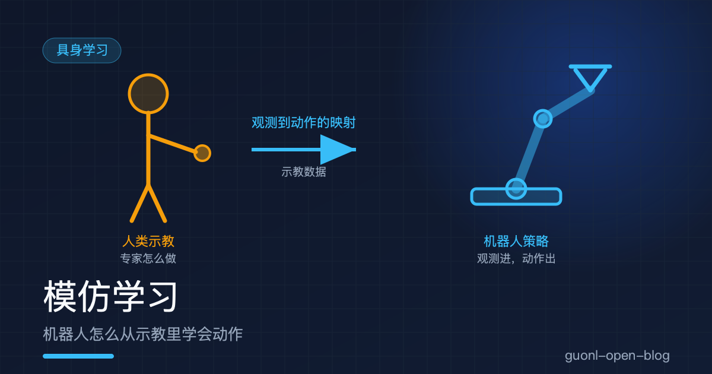
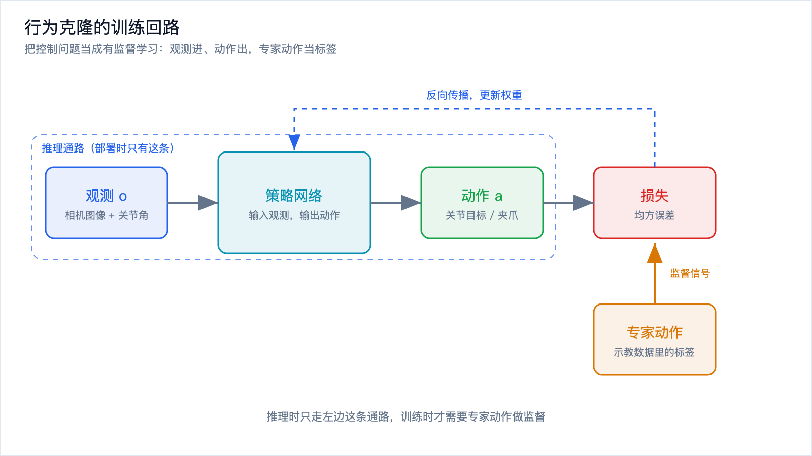
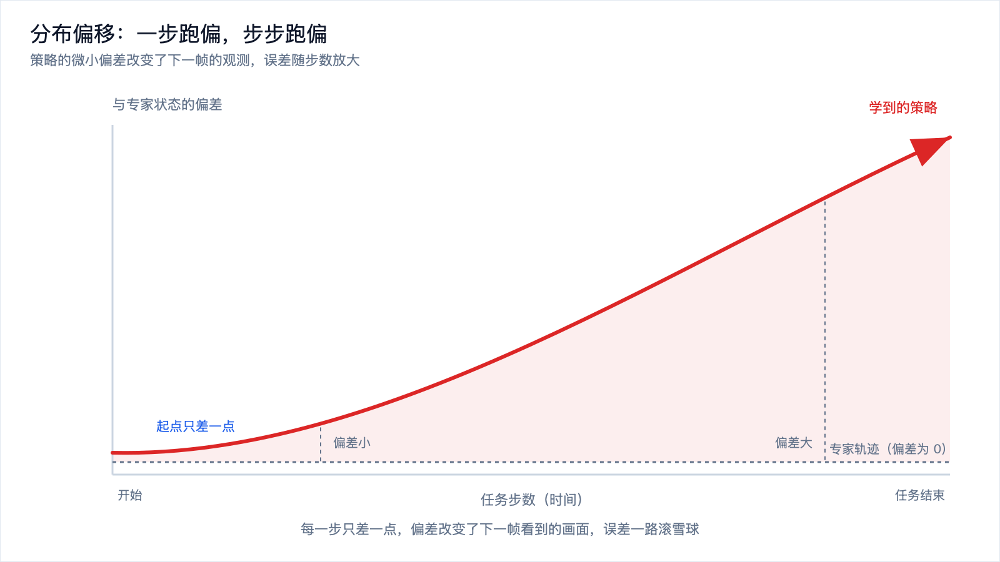
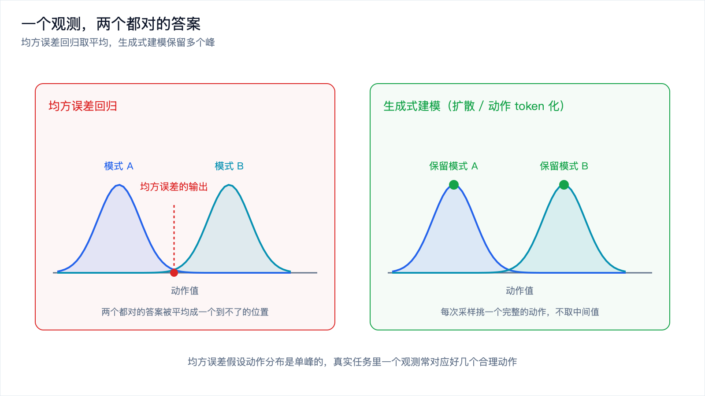
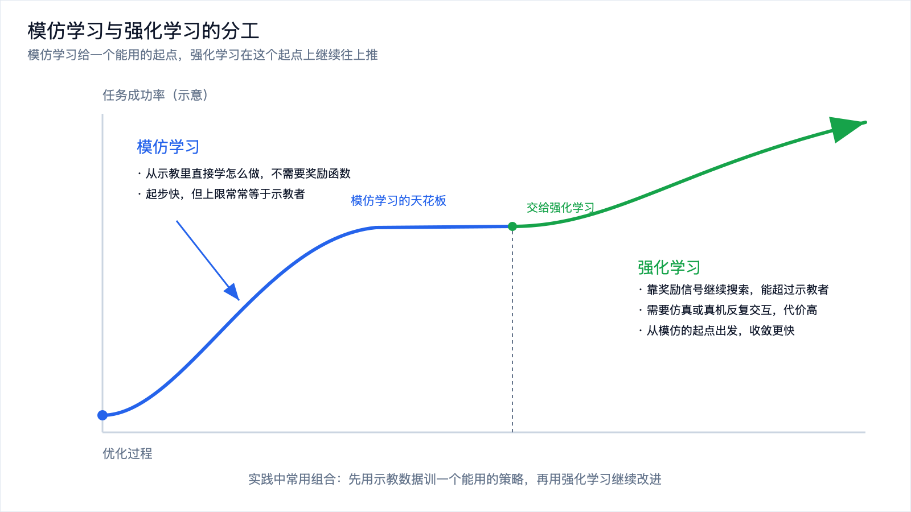

# 模仿学习：机器人怎么从示教里学会动作



*2026-10-30 · 具身学习*

## 一个最朴素的想法

要让机器人学会干活，最直接的办法是什么？

不是写规则，不是调参数，而是站到它旁边，做给它看。你带着机械臂把桌上的杯子拿起来，放进洗碗机，重复几十遍。它把这些过程记下来，然后自己试。

这就是模仿学习。它背后的假设朴素得有点不像 AI：人做这个动作的时候，眼睛看到的东西和手上的动作之间有一种对应关系。把这种对应关系学出来，机器人就能在类似的场景里复现。

一句话概括，模仿学习是让机器人从示教数据里学一个从观测到动作的映射。

这个映射有个正式名字，叫策略，写成 π(a|o)：给定当前观测 o，输出此刻该做什么动作 a。观测通常是相机图像，加上机器人的关节角度和末端位姿；动作通常是关节目标位置、末端位姿增量、夹爪开合。策略就是一个神经网络，输入观测，输出动作。

模仿学习里最常见的一类做法叫行为克隆（behavior cloning）。名字里的"克隆"很直白，就是把专家那套输入输出关系原样搬过来。

## 行为克隆：把它当成一个监督学习问题

行为克隆讨人喜欢的地方在于，它把一个控制问题变成了一个普通的有监督学习问题。

数据长这样：每一帧记一条样本，输入是机器人当时看到的和感觉到的，标签是人当时做的动作。一整套示教轨迹拆开，就是成千上万条这样的样本。

```python
# 一条训练样本的伪代码
sample = {
    "obs": {
        "image": camera_frame,          # 相机画面
        "joint_pos": arm.joint_angles,  # 各关节角度
        "gripper": gripper.width,       # 夹爪开合
    },
    "action": expert_action,  # 专家在这一帧做了什么
}

# 训练目标：让策略输出尽量贴近专家动作
pred = policy(sample["obs"])
loss = mse(pred, sample["action"])
loss.backward()
```

训练循环和图像分类没有本质区别：前向、算损失、反向传播、更新权重。只是数据集从一堆猫狗照片换成了操作轨迹，损失函数从交叉熵换成了均方误差，因为动作是连续数值。

整个流程可以画成一条线。



*图 1：行为克隆的训练回路。推理时只有左边这条通路，训练时右侧的专家动作提供监督信号。*

看到这里你可能会想，这么简单，那机器人岂不是早就学会了？恰恰相反。行为克隆的原理十分钟能讲完，难点全在后面。这篇剩下的篇幅，都在讲它为什么会失败。

## 为什么大家都从模仿学习起步

在动手之前，先回答一个现实问题：学机器人操作为什么几乎都从模仿学习开始？

因为它绕开了最难的一件事，定义目标。

强化学习的思路是让机器人自己试，做对了给奖励，做错了扣分，靠奖励信号把策略慢慢调好。听起来更通用，不用人示范。可它有个前置条件，你得先把"做对"写成一个奖励函数。抓杯子这个任务，奖励怎么写？杯子离目标近一点加多少分，夹爪碰到杯子加多少分，杯子洒了扣多少分？写得太粗，机器人会学会把杯子推过去而不是拿起来；写得太细，等于你自己已经把任务拆解完了，还要它学什么。

模仿学习把这一步直接跳过。人做一遍，动作序列本身就是答案，不需要任何额外的评价标准。数据就是示教，示教就是答案。

工程上的差别也很大。强化学习要靠机器人反复与环境交互，一条策略往往要几千上万次尝试才能学到一点东西，真机上这么试的代价是时间和磨损。模仿学习是离线训练，数据采好之后，训练过程在 GPU 上跑，不占用机器人。对刚起步的团队来说，这常常是唯一一条能在几周内跑通的路。

代价也很明确：模仿学习的天花板常常就是示教者的水平。专家做得不够好，学出来的也只好到这个程度。它教的是"怎么做"，不教"怎么做得更好"。这一点后面还会回来讲。

## 难题一：一步跑偏，步步跑偏

行为克隆最漂亮的假设是，训练数据覆盖了机器人会遇到的所有情况。

现实不是这样。

训练时，机器人看到的每一帧都来自专家的操作。专家手很稳，杯子一直在画面中央，关节角一直待在舒服的范围里。模型学到的，是在这些好状态下该做什么。

部署时，只要机器人的动作和专家有一点差别，它就会走进一个训练时从没见过的状态。比如它比专家多伸出去一厘米，杯子在画面里的位置就变了，这个画面模型没见过。它会输出一个不太准的动作，偏差再大一点，下一帧的状态更陌生。误差不是零散地出现，而是一路滚雪球。

开车跑偏是最好的类比。你握方向盘时手轻轻偏了一下，车开始往右飘。如果你不去修，车会越飘越远，最后压到线上。整个过程里，每一刻的偏差都不大，但偏差会改变你看到的路面，让你更难判断该往哪打方向。

这种行为有个正式名字，叫分布偏移，它带来的误差累积叫复合误差。



*图 2：专家轨迹与策略轨迹的差距随步数放大。起点只差一点，终点可能差很远。*

有个粗略的说法可以记住这件事：模仿学习模型的误差，会随着任务步数快速放大。单步差一点没关系，可当任务要走一百步，这一点点就会被放大成灾难。这也是为什么抓一个方块看起来还行，而"打开冰箱、拿出牛奶、倒进杯子"这种长任务，行为克隆会崩得很难看。

## 怎么对付分布偏移

既然问题的根源是"没见过的状态"，对策也就围绕一件事：让模型见过更多状态，或者在跑偏的时候把它拉回来。

DAgger 是思路最直接的一种。它不再只用专家的数据训练，而是让当前策略自己去跑，跑出来的轨迹请专家逐帧标注"这时候应该做什么"，把这些新样本加进数据集再训一轮。策略跑到哪里，专家就补哪里的答案，训练分布会慢慢往策略实际会遇到的状态上靠。它的代价是贵，要请人盯着策略跑，一帧一帧标，采数据的成本比一次性示教高不少。

数据增广是另一条路，成本低得多。把示教数据里的图像做各种扰动，光照变一变，相机位置抖一抖，物体的初始摆放挪一挪，让模型明白哪些变化不重要。这相当于人为地把训练分布摊开，让策略对视觉上的小偏差不那么敏感。很多机器人项目里，增广带来的稳定性提升比换一个更大的网络还明显。

多示教、多场景也有效。同一个任务，让不同的人做，用不同的速度做，在不同的光照和桌面上做。示教的多样性直接决定了模型能容忍多少偏差。只有一份示教的模型，本质上是在背一条轨迹；几十份示教的模型，才有机会学到任务本身的规律。

还有一类做法思路不太一样，叫动作分块（action chunking）。与其每一帧都算一个动作，不如一次预测一小段动作，比如未来若干步的关节轨迹，照着执行完这一段再重新预测。ACT 是这类做法里比较有代表性的一个。

动作分块为什么能缓解漂移？因为它把每帧做一次决策，变成了每段做一次决策。决策次数少了，小误差累积的机会也少了。它还顺带解决了一个实际问题：操作任务里很多动作是连贯的，比如把夹爪伸过去这个过程，中间每一步都在犹豫反而更糟。一次给出一段，动作更自然，也省推理时间。

代价同样存在。动作块执行到一半时环境变了，模型不能立刻改，反应会慢一拍。相邻两个动作块接起来的地方可能不连续，需要额外做平滑。块的长度是个要调的量，太长反应迟钝，太短又退回到逐帧决策。

## 难题二：一个观测，两个都对的答案

分布偏移之外，还有一道更根本的坎。

考虑这样一个场景：桌上有个障碍物，机器人可以从左边绕过去，也可以从右边绕过去。两条路都通。专家示教的时候，有一次往左，有一次往右。

把这两条示教放进数据集训练，用均方误差当损失，会发生什么？

假设往左的动作是 -1，往右的动作是 +1。均方误差的最优解是把它们平均，输出 0。也就是让机器人笔直往前冲，正好撞上障碍物。

这不是模型没学好，而是它的目标函数就长这样。均方误差假设动作分布是单峰的，只有一个正确答案。可真实任务里，一个观测往往对应好几个都合理的动作，这种分布叫多模态。用一个单峰的模型去拟合一个多峰的分布，学出来的是几个峰中间的那个平均动作，而这个平均动作往往既不是左也不是右，而是一个哪里都到不了的位置。



*图 3：左边是均方误差回归的结果，落在两个模式中间；右边是生成式建模，多个模式都被保留下来。*

解决办法是换掉建模方式，别再用"预测一个点"，改成"生成一个分布"。

扩散策略是这几年被广泛使用的一类做法。它把动作生成看成一个从噪声逐步去噪的过程，网络学的是怎么把一团随机噪声慢慢收敛成一条合理的动作序列。因为整个过程保留了随机性，它可以在两个模式之间挑一个，而不是取中间值。同一份示教数据，它可能这次往左，下次往右，但每次给出的都是完整的、可执行的一条路。

另一类做法是动作 token 化。把连续的动作切成一格一格，每一格当一个类别，然后像语言模型预测下一个词那样预测下一格动作。分类问题天然能表达多个峰，所以它同样不会去取平均。代价是精度受格子大小限制，格子太粗动作会抖，格子太细类数爆炸。

这些做法的共同代价是推理变慢。均方误差回归一次前向就出结果，扩散要迭代好几轮去噪，动作 token 化要一个一个 token 往外吐。对需要几十赫兹控制的机器人，这个延迟是实打实的工程问题，也是动作分块这类方法流行的另一个原因：一次算一大段，把推理的账摊薄。

## 难题三：数据从哪来，贵在哪

前面所有讨论都建立在一个前提上，得有足够的示教数据。而这个前提本身就不便宜。

数据从哪来，专题上一篇[《数据与仿真闭环》](data-simulation-loop.md)已经展开讲过：遥操作是目前最主流的采集方式，仿真合成数据能批量生成但和真实世界有落差，人类视频量大却缺动作标签。这里只补几句和模仿学习直接相关的话。

示教数据的贵，不只是采的时候贵，还贵在它对质量的要求比一般数据集高。语言模型的标注可以粗糙，一句话标错，影响有限。操作轨迹不行，动作序列是一整条链，中间有一帧不对，整条轨迹的因果关系就断了。示教者的手法也直接决定模型的上限，一个动作忽快忽慢、时左时右的示教者，教出来的模型大概率也是飘的。

数据的分布还难对齐。同一个任务，换个人做，动作风格变了；换台机器人，关节数和动力学变了；换个场景，光照和背景全变了。把来源不同的数据混在一起训，模型要先花力气弥合这些差异，能用在任务本身上的容量就被占掉了。

一个有点反直觉的结论是，模仿学习里数据的质量往往比数量更要紧。几百条干净的、覆盖了关键变化的示教，常常比几千条杂乱的示教训出来的策略更稳。这也是为什么很多团队宁可多花时间设计采集流程，也不愿意随手把数据堆上去。

## 模仿学习和强化学习的分工

讲到这里，可以回到开头那个没说完的话题。

模仿学习和强化学习不是竞争关系，它们擅长的事分得很清楚。模仿学习解决"怎么做"，它从人的示教里直接学到一套能用的动作。强化学习解决"怎么做得更好"，它靠奖励信号去搜索，理论上能超过任何人类示教者。

分工可以这样理解：模仿学习给你一个起点，一个不会把杯子摔了的起点；强化学习在这个起点上继续往上推，把成功率从七成推到九成，或者找到一个比人更省力的动作方式。反过来，如果直接让强化学习从零开始学抓杯子，它得先撞上几千次桌子，才可能偶然做对一次。

现实里的做法大多是组合。先用示教数据训一个能用的策略，再用强化学习在仿真里微调，或者用少量真机交互做在线改进。模仿负责入门，强化负责精通。



*图 4：模仿学习从示教里学怎么做，强化学习靠奖励把策略继续往上推，实践中常组合使用。*

## 写在最后

模仿学习做的事情可以用一句话说清：让机器人看人做，学一个从观测到动作的映射。它受欢迎，是因为不需要写奖励函数，数据就是示教，工程上最容易起步。

它的难点也很集中。分布偏移让模型一旦跑偏就回不来，误差随步数累积；多模态的动作分布让均方误差回归学到几个答案的平均值，结果哪里都去不了；示教数据采集又贵又难对齐，还卡住了模型的上限。围绕这些难点，业界攒出了一套工具箱：DAgger 补状态、增广摊分布、多示教增覆盖、动作分块压漂移、生成式建模保多峰。

这套工具箱里没有一件是免费的，每一样都在别处付代价，要么是采集成本，要么是推理延迟，要么是精度。选哪几样，取决于你的任务有多长、控制频率要多高、手上有多少示教数据。

模仿学习能给你一个能用的起点，但要让它变得更好，还得靠另一套机制。下一篇[《强化学习在机器人上为什么这么难》](rl-for-robots.md)，讲的就是这套机制在真实机器人上到底卡在哪里。
