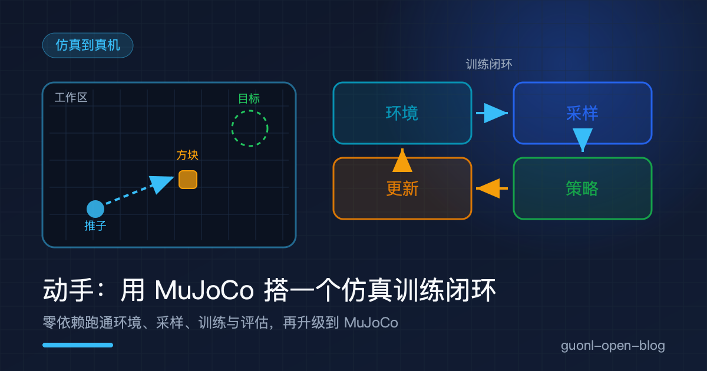
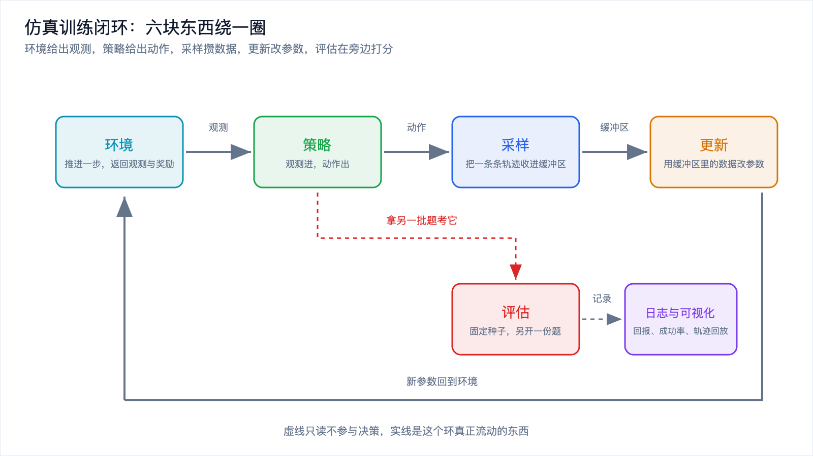
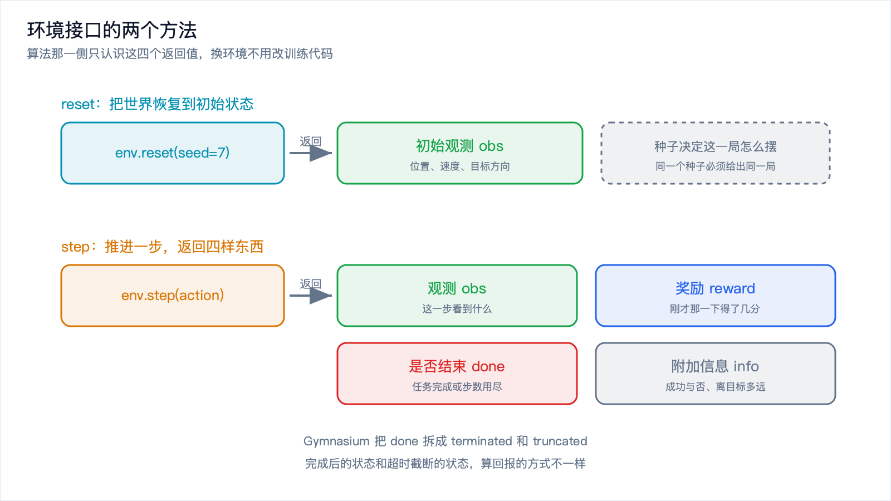
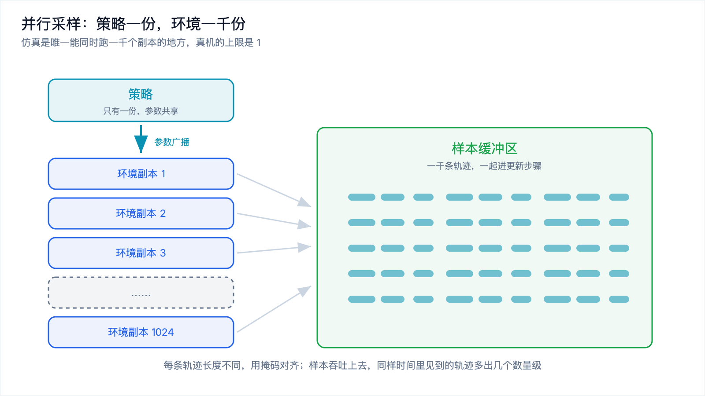
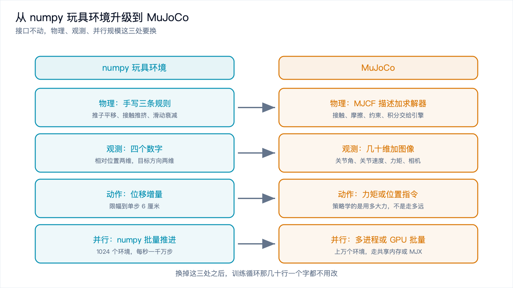

# 动手：用 MuJoCo 搭一个仿真训练闭环



*2026-10-30 · 仿真到真机*

## 这篇为什么分两层写

前几篇把道理讲完了。[《数据与仿真闭环》](data-simulation-loop.md)说仿真是唯一能大规模生产的练习场，[《强化学习在机器人上为什么这么难》](rl-for-robots.md)算清了真机试错的账，[《Sim2Real》](sim2real.md)讲了仿真里练好的技能搬到真机上会掉多少。

落地时会卡在一个很实际的地方：想动手，先得有个环境。很多人第一反应是装 MuJoCo，而 `pip install mujoco` 可能报错，可能装上了不知道从哪下手，也可能内网的机器根本装不了。

所以这篇分两层。第一层用 numpy 手写一个极简环境，二维平面上把方块推到目标点，配上训练和评估代码，复制过去就能跑。第二层讲 MuJoCo：模型用什么文件描述，并行怎么提吞吐，接口为什么要对齐 Gymnasium。两层之间那句话是：接口不变，物理变真。

## 一个闭环由哪几块组成

把"在仿真里训练"这件事拆开，六块东西。

环境是那个被操作的世界，接受动作，返回新的观测和奖励。策略把观测映射成动作。采样让策略和环境来回跑，把数据攒起来。更新用攒到的数据改策略参数。评估拿一份没见过的题目考它，给一个能横向比较的分数。日志和可视化把每一轮的数字和画面留下来。

数据流是单向绕圈的：环境给出观测，策略输出动作，动作回到环境，环境推进物理并给出奖励，采样器把轨迹收进缓冲区，更新消费缓冲区，改完的策略再去交互，评估用另一批固定题目在旁边打分。



*图 1：环境、策略、采样、更新、评估、记录各司其职，环上任何一环出问题，训练都会安静地变差。*

这个环看着朴素，出问题的姿势却很多。环境有 bug 的时候训练不报错，它会认真地学一个错误的物理规律；奖励写错的时候也不报错，它会认真地学一个投机行为。
## 环境接口：reset 和 step

几乎所有仿真环境都收敛到同一套接口，就两个方法：

```
obs                     = env.reset(seed=...)      # 回到初始状态，返回初始观测
obs, reward, done, info = env.step(action)         # 推进一步，返回四样东西
```

`reset()` 带种子是为了让"回到初始状态"可复现。`step()` 的四个返回值回答四个问题：现在看到什么，得了几分，这一局结束没有，还有没有别的信息。

这套接口成了事实标准，原因是它把世界和算法切开。算法那侧只认识这四样东西，不关心底下是二维平面还是四十个自由度的机械臂。换一个环境，训练循环那几十行不用改一个字。

Gymnasium 在这套接口上加了一点细节：`reset()` 返回 `(obs, info)`，`step()` 返回 `(obs, reward, terminated, truncated, info)`，把"任务完成"和"时间到了被截断"拆成两个布尔量。两者算回报的方式不一样，前者是真结束，后者是被打断。早期 Gym 用一个 `done` 混着表达，很多算法就悄悄学错了。



*图 2：接口很小，但它决定了算法和环境能不能互换。*

## 用 numpy 写一个能跑的环境

任务：一个圆形推子，一个方块，一个目标点，都在两米见方的平面里。推子每步往任意方向最多移动 6 厘米，碰到方块就把它顶开。方块进入目标点 8 厘米以内算成功，一局最多 120 步。

观测四维：方块相对推子的位置两维，从方块指向目标的单位向量两维。动作两维，就是推子这一步的位移。

```python
import time
import numpy as np

WS = 1.0                 # 工作区半径
R_AGENT, R_BLOCK = 0.06, 0.05
R_CONTACT = R_AGENT + R_BLOCK
R_SUCCESS = 0.08         # 方块离目标多近算成功
VMAX = 0.06              # 推子单步最大位移
T_MAX = 120              # 一条轨迹最多 120 步
PUSH_GAIN = 1.0          # 接触时传给方块的速度系数
VB_CAP = 0.03            # 方块单步位移上限，防止方块滑飞

TRAIN_SEEDS = range(0, 500)          # 训练种子池
EVAL_SEEDS = range(10000, 10200)     # 评估种子池，与训练完全不重叠


class PushEnv:
    """二维推方块。动作是推子这一步的位移，观测是相对位置加目标方向。"""

    def __init__(self, randomize=False, obs_noise=0.0, delay_max=0,
                 mass_range=(0.6, 1.6), fric_range=(0.75, 0.92)):
        self.randomize = randomize
        self.obs_noise = obs_noise
        self.delay_max = delay_max
        self.mass_range = mass_range
        self.fric_range = fric_range
        self.rng = np.random.default_rng(0)
        self.p = np.zeros(2)      # 推子位置
        self.b = np.zeros(2)      # 方块位置
        self.g = np.zeros(2)      # 目标点
        self.vb = np.zeros(2)     # 方块自己的滑动速度
        self.mass, self.fric, self.noise, self.delay = 1.0, 0.85, 0.0, 0
        self.buf = []
        self.t = 0

    def reset(self, seed=None):
        r = np.random.default_rng(seed)
        self.rng = r
        self.p = r.uniform(-0.9, -0.3, size=2)
        self.b = r.uniform(-0.25, 0.25, size=2)
        while True:                                 # 目标离方块远一点，不然白送
            self.g = r.uniform(0.40, 0.90, size=2)
            if np.linalg.norm(self.g - self.b) > 0.5:
                break
        self.mass, self.fric, self.noise, self.delay = 1.0, 0.85, 0.0, 0
        if self.randomize:                          # 域随机化就落在这里
            self.mass = r.uniform(*self.mass_range)
            self.fric = r.uniform(*self.fric_range)
            self.noise = self.obs_noise
            self.delay = int(r.integers(0, self.delay_max + 1))
            self.p = self.p + r.normal(0.0, 0.03, 2)
            self.b = self.b + r.normal(0.0, 0.03, 2)
        self.vb = np.zeros(2)
        self.buf = [np.zeros(2) for _ in range(self.delay)]
        self.t = 0
        return self._obs()

    def _obs(self):
        d = self.g - self.b
        n = float(np.linalg.norm(d))
        u = d / n if n > 1e-6 else np.zeros(2)
        rel = self.b - self.p
        if self.noise > 0.0:
            rel = rel + self.rng.normal(0.0, self.noise, 2)
        return np.concatenate([rel, u])

    def step(self, action):
        a = np.clip(np.asarray(action, dtype=float), -VMAX, VMAX)
        if self.delay:                              # 动作延迟：走的是若干步之前那条
            self.buf.append(a)
            a = self.buf.pop(0)
        self.p = np.clip(self.p + a, -WS, WS)

        d = self.p - self.b
        dist = float(np.linalg.norm(d))
        if dist < R_CONTACT and dist > 1e-9:
            n = d / dist
            self.b = self.p - n * R_CONTACT         # 把方块顶到接触面
            self.vb = self.vb * self.fric + (PUSH_GAIN / self.mass) * float(a @ n) * n
        else:
            self.vb = self.vb * self.fric
        self.vb = np.clip(self.vb, -VB_CAP, VB_CAP)
        self.b = np.clip(self.b + self.vb, -WS, WS)  # 方块靠自己的速度再滑一段

        self.t += 1
        gap = float(np.linalg.norm(self.b - self.g))
        to_block = float(np.linalg.norm(self.b - self.p))
        reward = -gap - 0.5 * to_block              # 一段拉向方块，一段拉向目标
        done = gap < R_SUCCESS
        if done:
            reward += 10.0
        done = done or self.t >= T_MAX
        return self._obs(), reward, done, {"gap": gap, "steps": self.t}
```

物理只有三条：推子按动作平移；接触时把方块顶到接触面，并按法向分量给方块一点速度；方块带着速度滑一段然后衰减。没有转动和摩擦锥。

奖励那一行要单独讲。它由三部分组成：方块离目标越远扣分越多，推子离方块越远扣分越多，成功那一刻加 10 分。第二项看着多余，其实决定了搜索能不能找到东西。

同一个配置我跑过两组对照，唯一区别是奖励里有没有 `- 0.5 * to_block`。没有它的时候，推子碰不到方块的那些参数组得分几乎一样，都是"方块一动不动待到超时"，分数挤成一团，搜索没有方向：三个种子只有一个收敛到 99.5%，另外两个卡在 14.5% 和 24.0%。加上这一项，四个种子都在 89% 以上。多写一项不是让分数更漂亮，是让"往哪边改"从无到有。

先看环境本身有没有问题，随机策略跑 200 条轨迹：

```
平均回报  -181.58   成功率   0.0%   平均步数 120.0   终局距离中位 0.9157
```

零成功率是对的。随机乱动的推子不该完成任务，这里出现成功率说明环境在送分，比如成功判定写错了。

## 策略、采样和更新

策略选最省事的一种：线性映射加限幅，十个参数。

```python
N_OBS, N_ACT = 4, 2
N_PARAM = N_OBS * N_ACT + N_ACT        # 线性策略 10 个参数


def act(theta, obs):
    W = theta[:N_OBS * N_ACT].reshape(N_ACT, N_OBS)
    return np.clip(W @ obs + theta[N_OBS * N_ACT:], -VMAX, VMAX)


def rollout(env, theta, seed, max_steps=T_MAX):
    """让策略在这个环境里跑一条轨迹，返回总回报、步数、终局距离。"""
    obs = env.reset(seed=seed)
    total, steps, gap = 0.0, 0, 0.0
    for _ in range(max_steps):
        obs, r, done, info = env.step(act(theta, obs))
        total += r
        steps, gap = info["steps"], info["gap"]
        if done:
            break
    return total, steps, gap
```

观测为什么用单位向量，而不是直接给目标减方块？因为线性策略不会做归一化。我第一版给的是 `g - b`，训出来的策略停在离方块 0.41 米的地方不动了，那个位置正好是 `W @ obs = 0` 的解，策略表达不出"绕到方块后面去推"这一手。

训练用交叉熵方法，不需要梯度：

```python
def cem_train(env, iters=40, pop=64, elite=8, episodes=5, sigma0=0.3,
              mu0=None, seed=0, log_every=5):
    """交叉熵方法：每轮采一批参数，用同一批种子给它们打分，留最好的几个更新分布。"""
    rng = np.random.default_rng(seed)
    mu = np.zeros(N_PARAM) if mu0 is None else np.array(mu0, dtype=float)
    sigma = np.full(N_PARAM, sigma0)
    t0 = time.time()
    for it in range(1, iters + 1):
        cand = rng.normal(mu, sigma, size=(pop, N_PARAM))
        seeds = rng.choice(TRAIN_SEEDS, episodes)       # 同一轮里所有候选跑同一批种子
        scores = np.array([np.mean([rollout(env, c, int(s))[0] for s in seeds])
                           for c in cand])
        top = cand[np.argsort(-scores)[:elite]]
        mu, sigma = top.mean(axis=0), top.std(axis=0) + 0.02
        if it == 1 or it % log_every == 0:
            succ = np.mean([1.0 if rollout(env, top[i], seed=int(s))[2] < R_SUCCESS else 0.0
                            for i in range(elite) for s in range(it, it + 5)])
            print("迭代 %2d   种群平均回报 %8.2f   本轮最好 %8.2f   精英成功率 %5.1f%%"
                  % (it, scores.mean(), scores.max(), succ * 100))
    print("训练耗时 %.1f 秒，累计采样 %d 条轨迹"
          % (time.time() - t0, iters * pop * episodes))
    return mu
```

每轮从当前的高斯分布里采 64 组参数，每组跑几条轨迹算平均回报，把最好的 8 组留下，用它们的均值和标准差替换原来的分布。

`seeds = rng.choice(TRAIN_SEEDS, episodes)` 那一行是这套代码能不能收敛的分界线。它让同一轮里的 64 个候选跑完全相同的几条轨迹。如果各跑各的随机轨迹，候选之间的分数差会被种子噪声淹没，选出来的"最好的 8 个"基本等于随机挑。我试过两种写法，配置一样：各跑各的种子，四十轮下来评估成功率 0.5%；跑同一批种子，96.0%。

跑起来是这样：

```
迭代  1   种群平均回报  -204.40   本轮最好  -161.65   精英成功率   0.0%
迭代  5   种群平均回报  -149.09   本轮最好   -69.06   精英成功率   5.0%
迭代 10   种群平均回报  -113.71   本轮最好   -24.72   精英成功率  32.5%
迭代 15   种群平均回报   -81.82   本轮最好   -13.79   精英成功率  52.5%
迭代 20   种群平均回报   -73.40   本轮最好    -7.13   精英成功率  72.5%
迭代 25   种群平均回报   -46.85   本轮最好    -8.76   精英成功率  92.5%
迭代 30   种群平均回报   -57.08   本轮最好    -8.07   精英成功率 100.0%
迭代 35   种群平均回报   -58.87   本轮最好    -9.72   精英成功率  95.0%
迭代 40   种群平均回报   -56.89   本轮最好    -7.59   精英成功率  82.5%
训练耗时 18.6 秒，累计采样 12800 条轨迹
```

十八秒，一万两千多条轨迹。前五轮几乎没进展，第十轮开始往上走：搜索先花时间把推子推到方块旁边，然后才学怎么推。

## 评估：固定种子，另开一份题

评估的代码短，规矩比训练还多：

```python
def evaluate(env, theta, seeds, verbose=False):
    """跑一批固定种子的轨迹，回报、成功率、平均步数。"""
    rets, succ, steps, gaps = [], [], [], []
    for s in seeds:
        total, n, gap = rollout(env, theta, seed=s)
        rets.append(total)
        gaps.append(gap)
        succ.append(1.0 if gap < R_SUCCESS else 0.0)
        steps.append(n)
    out = (float(np.mean(rets)), float(np.mean(succ)), float(np.mean(steps)),
           float(np.median(gaps)))
    if verbose:
        print("平均回报 %8.2f   成功率 %5.1f%%   平均步数 %5.1f   终局距离中位 %.4f"
              % (out[0], out[1] * 100, out[2], out[3]))
    return out
```

种子必须固定，理由和实验里固定所有条件一样。同一个策略、同一个环境，换一批种子跑出来的成功率会差几个百分点，用浮动的题去比较两个策略，比出来的可能是运气。这段代码里训练用 0 到 499 号种子，评估用 10000 到 10199 号。

为什么一定要不重叠？因为评估的数字会被用来做决定。看到评估成功率掉了，你去调奖励、调观测，再重新评估，这一串动作下来，评估集已经参与了训练，不再是一份没见过的题。真正没被碰过的数据要留到最后，这也是[具身评测](embodied-eval.md)那一篇强调的纪律。

200 条轨迹够不够？按二项分布估，成功率在 90% 附近时，200 条样本的标准误大约是 `sqrt(0.9 * 0.1 / 200)`，2.1 个百分点。想分辨"92% 和 90% 有没有区别"，200 条不够。成功率还有个毛病：到 99% 附近就顶到天花板。所以指标要一起看：

```
训练种子池（500 条）： 平均回报   -14.06   成功率  97.4%   平均步数  25.2   终局距离中位 0.0488
评估种子池（200 条）： 平均回报   -17.43   成功率  96.0%   平均步数  26.7   终局距离中位 0.0471
```

评估集上的成功率比训练集低 1.4 个百分点，这个差距正常，训练集里有被搜索过程反复看过的痕迹。真正有信息量的是后两列：终局距离中位数 0.047 说明成功的那部分里有一些是擦着 0.08 的线过的，平均 26.7 步说明完成一次任务要花多久。

## 并行采样：真机做不到的那件事

到这里闭环是通的，但吞吐很低：串行跑一个环境每秒七万步左右。真机还要再降几个数量级，因为真机只有一个，每一步都要等物理世界发生。

仿真唯一能给而真机给不了的，是同时跑一千个副本。做法是把状态从标量换成数组，一次 `step()` 推进 N 个环境：

```python
class VecPushEnv:
    """同一套物理，状态是 shape=(N,2) 的数组，一次 step 推进 N 个环境。"""

    def obs(self):
        d = self.g - self.b
        nrm = np.linalg.norm(d, axis=1, keepdims=True)
        u = np.where(nrm > 1e-6, d / np.where(nrm < 1e-9, 1.0, nrm), 0.0)
        return np.concatenate([self.b - self.p, u], axis=1)

    def step(self, actions):
        a = np.clip(np.asarray(actions, dtype=float), -VMAX, VMAX)
        self.p = np.clip(self.p + a, -WS, WS)

        d = self.p - self.b
        dist = np.linalg.norm(d, axis=1)
        contact = dist < R_CONTACT
        n = d / np.where(dist < 1e-9, 1.0, dist)[:, None]
        self.b = np.where(contact[:, None], self.p - n * R_CONTACT, self.b)
        vn = (a * n).sum(axis=1)
        self.vb = self.vb * 0.85 + np.where(contact, PUSH_GAIN, 0.0)[:, None] * vn[:, None] * n
        self.vb = np.clip(self.vb, -VB_CAP, VB_CAP)
        self.b = np.clip(self.b + self.vb, -WS, WS)

        self.t += 1
        gap = np.linalg.norm(self.b - self.g, axis=1)
        to_block = np.linalg.norm(self.b - self.p, axis=1)
        reward = -gap - 0.5 * to_block + np.where(gap < R_SUCCESS, 10.0, 0.0)
        done = (gap < R_SUCCESS) | (self.t >= T_MAX)
        return self.obs(), reward, done, gap
```

公式一行行对着抄，标量换成数组，`if` 换成 `np.where`；`reset()` 那一侧按种子给每个环境单独摆初值。



*图 3：策略只有一份，环境副本有一千个，采样器把一千条轨迹收进同一个缓冲区。*

两个版本必须是同一个环境，这不是口号，是要检查的。用同一组动作序列跑一遍串行版和批量版，逐元素比对：

```
两条轨迹长度 120 / 120，逐元素最大偏差 0.00e+00
```

零偏差，说明批量改写没有引入语义差异。向量化改写最怕某一处 `if` 换成 `np.where` 时把条件写反，结果训练照跑，只是学的东西和你以为的不一样。吞吐量测出来是这样：
```
环境数    串行(步/秒)    批量(步/秒)      提速
     1          61470          34408       0.6x
    16          70965         504325       7.1x
    64          70645        1908309      27.0x
   256          70045        5022179      71.7x
  1024          69450        9745785     140.3x
```

1024 个环境并行，每秒接近一千万步，比串行快 140 倍。两个细节要看清。环境数为 1 的时候批量版反而更慢，数组运算的固定开销摊不掉，要到 16 个环境以上才开始赚。倍数也不可能等于环境数，加速的部分是物理计算被合并成几次数组运算。

用 MuJoCo 的时候这套批量思路更划算，因为物理计算从 Python 里的几十行 numpy 变成了 C 里的几千行。工程上常见两条路：一个进程里开一批环境走批量接口，或者开多个进程各负责几个环境，样本汇总到一个共享缓冲区。

## 域随机化落在代码里

域随机化落到代码上就是 `reset()` 里的几行：方块质量在 0.6 到 1.6 倍之间随机，摩擦衰减在 0.75 到 0.92 之间随机，观测加一点噪声，动作有零到一步的延迟。

```python
if self.randomize:                          # 域随机化就落在这里
    self.mass = r.uniform(*self.mass_range)
    self.fric = r.uniform(*self.fric_range)
    self.noise = self.obs_noise
    self.delay = int(r.integers(0, self.delay_max + 1))
    self.p = self.p + r.normal(0.0, 0.03, 2)
    self.b = self.b + r.normal(0.0, 0.03, 2)
```

关键是这些随机量每一局重新抽一次，不是全局抽一次。策略见到的每一局都是略有不同的世界，被迫学一个对这些参数不敏感的做法。代价可以量出来：固定参数下训出来的策略评估成功率 96.0%，原封不动放进随机参数的环境里：

```
固定参数训练出来的策略，直接放进随机环境： 平均回报   -61.37   成功率  66.0%   平均步数  57.1
```

从 96.0% 掉到 66.0%。这是仿真内部的一次小型 Sim2Real：环境参数一动，策略就露馅，它学到的"手感"里有一部分是在拟合固定的质量和平滑的物理，而这些恰恰是真实世界最不确定的东西。

补救办法是把训练继续放在随机环境里，用刚才那个策略当起点再跑 40 轮：

```
随机环境 200 条（评估种子池）
  固定参数策略： 平均回报   -61.37   成功率  66.0%   平均步数  57.1
  随机参数策略： 平均回报   -21.84   成功率  88.0%   平均步数  43.1
固定环境 200 条（评估种子池）
  固定参数策略： 平均回报   -17.43   成功率  96.0%   平均步数  26.7
  随机参数策略： 平均回报   -10.58   成功率  97.5%   平均步数  27.1
```

随机环境里从 66.0% 提到 88.0%，固定环境里没退步。原因在随机化的范围上：我把质量和摩擦的区间开得比较窄。区间开得越大，策略越保守，固定环境里的成绩掉得越多，这就是域随机化的取舍，用一点平均表现换对参数变化的鲁棒性。

范围开多大取决于真实世界的偏差有多大。仿真里的摩擦系数和真机差几倍是常事，那就该开到几倍，这个数要从真机数据里量。

## 从玩具环境升级到 MuJoCo



*图 4：接口不动，物理、观测、并行规模这三处要换。*

第一处是物理。numpy 版本里那三条规则要换成真正的物理引擎：MJCF 或 URDF 这样的 XML 描述模型，引擎负责接触、摩擦、约束求解、积分。MJCF 是 MuJoCo 自己的格式：

```xml
<mujoco model="pusher">
  <option timestep="0.002"/>
  <worldbody>
    <geom name="floor" type="plane" size="2 2 0.1"/>
    <body name="pusher" pos="-0.5 -0.5 0.05">
      <joint name="slide_x" type="slide" axis="1 0 0"/>
      <joint name="slide_y" type="slide" axis="0 1 0"/>
      <geom type="sphere" size="0.06"/>
    </body>
    <body name="block" pos="0.1 0.1 0.05">
      <joint type="free"/>
      <geom type="box" size="0.05 0.05 0.05"/>
    </body>
  </worldbody>
  <actuator>
    <motor joint="slide_x"/>
    <motor joint="slide_y"/>
  </actuator>
</mujoco>
```

地面、推子、方块都在世界体里，推子用两个滑动关节约束在平面上，方块是自由刚体。模型文件是可以被版本管理、被 diff 的资产，这是它比一堆代码常量更好用的原因。

用 MuJoCo 写环境，接口不变：

```python
try:
    import mujoco                       # 需要 pip install mujoco 才能跑
except ImportError:
    mujoco = None

DT = 0.1                                # 控制周期，和玩具环境里一样

class MujocoPushEnv:
    """接口和 PushEnv 一样，只把里面的物理换成 MuJoCo。"""

    def __init__(self, xml_path="pusher.xml"):
        self.model = mujoco.MjModel.from_xml_path(xml_path)
        self.data = mujoco.MjData(self.model)
        # 一个控制步里跑多少个仿真步，由两者的步长比决定
        self.sim_steps = int(round(DT / self.model.opt.timestep))
        self.rng = np.random.default_rng(0)

    def reset(self, seed=None):
        self.rng = np.random.default_rng(seed)
        mujoco.mj_resetData(self.model, self.data)
        self.data.qpos[:] = self._sample_start()      # 摆初值
        self.data.qvel[:] = 0.0
        self._apply_domain_randomization()            # 域随机化改的是 model
        mujoco.mj_forward(self.model, self.data)      # 算一遍派生量
        return self._obs()

    def step(self, action):
        self.data.ctrl[:] = action                    # 这里给的是力矩，不是位移
        for _ in range(self.sim_steps):
            mujoco.mj_step(self.model, self.data)
        return self._obs(), self._reward(), self._done(), self._info()

    def _obs(self):
        # qpos / qvel 是关节位置和速度，sensordata 是传感器读数
        return np.concatenate([self.data.qpos[:2], self.data.qvel[:2]])
```

字段名以你装的版本为准，三处和玩具环境不一样。

动作的含义变了。玩具环境里动作就是位移，MuJoCo 里 `ctrl` 给的是力矩，推子走多远是引擎算出来的。策略要学的东西从"往哪走"变成"用多大力"。

一个控制步里要跑很多个仿真步。物理引擎为了数值稳定，步长通常在毫秒量级，而策略的决策频率是几十到几百毫秒一次。`sim_steps` 就是这两者的比值，仿真步长 0.002 秒、控制周期 0.1 秒时，一次决策要推进 50 个仿真步，这个比例对应真机上控制器的运行周期。

观测变多了。玩具环境只有四个数，真实项目里通常是几十维的关节角和关节速度，再加末端位姿、夹爪开合、力矩读数，视觉任务还要塞进相机图像。维度一上去，线性策略就不够用了，要换成多层网络和 PPO、SAC 这类算法。

域随机化在 MuJoCo 里的落点是模型上的数组：

```python
def _apply_domain_randomization(self):
    m = self.model
    for i in range(m.nbody):                       # 每个刚体的质量
        m.body_mass[i] *= self.rng.uniform(*self.mass_range)
    for i in range(m.ngeom):                       # 每个几何体的滑动摩擦
        m.geom_friction[i, 0] *= self.rng.uniform(*self.fric_range)
    m.opt.timestep = self.rng.uniform(*self.dt_range)   # 积分步长
```

字段名同样以版本为准，思路是固定的：随机化改的是模型参数，改完要让引擎重新算一遍派生量，效果要在批量评估里量，因为引擎自己还有一层随机，求解器迭代次数和接触点顺序都会影响结果。

并行规模也换一档。玩具环境里我用 numpy 把 N 个环境压进数组，MuJoCo 里能走得更远：多进程，每个进程一份模型和一批环境，用共享内存汇总样本；或者把物理放到 GPU 上批量算，MuJoCo 官方有一个基于 JAX 的后端，一份 MJCF 能在显卡上同时推进成千上万个副本。几十个环境用多进程就够，要几万个环境才值得上 GPU。

还有一件事值得提前做对：让环境接口对齐 Gymnasium。包一层薄适配器，把 `reset()` 改成返回二元组，把 `step()` 的结束拆成 `terminated` 和 `truncated`。收益不在训练本身，在生态：向量化环境、观测归一化、录像、评测脚本这些现成的 wrapper 都能直接用。环境这一侧最大的工程量往往不是物理，是接口和工具链的对齐。

## 写在最后

这篇搭的闭环不复杂，六块东西，两百行代码，一台笔记本一分钟跑完。但它是真的：环境有真实的状态转移和奖励，策略有真实的参数更新，评估有真实的成功率和统计噪声，并行有真实的吞吐数字。换成 MuJoCo、换成机械臂、换成几十万条轨迹，形状不变。

四个可以带走的判断。环境写完先跑一遍随机策略，零成功率是健康信号。奖励里那些看着多余的项，往往决定搜索能不能找到方向。训练和评估的种子必须分开，评估数字一旦参与调参就不再是评估。域随机化不是把仿真变真，是让策略对参数不敏感，范围要从真机数据里量。

想动手的人常常卡在"环境从哪来"，答案是可以先用一个二十行的环境把闭环跑通，把训练、评估、并行、随机化都调到能跑，再换引擎。物理引擎解决"世界像不像真的"，闭环解决"能不能从这个世界里学到东西"。

下一篇换一个角度。策略训好了要装到机器人上跑起来，它面对的不再是 `env.step()`，而是一堆话题、节点、中间件和实时性约束。[《机器人的软件栈：ROS 2、实时中间件与数据流》](robot-software-stack.md)，就从这个接口边界讲起。
