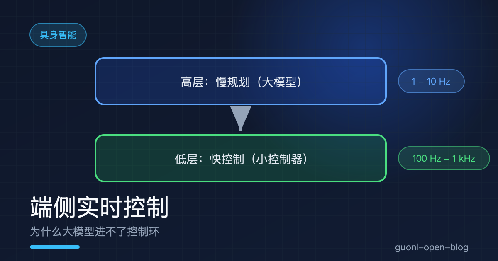
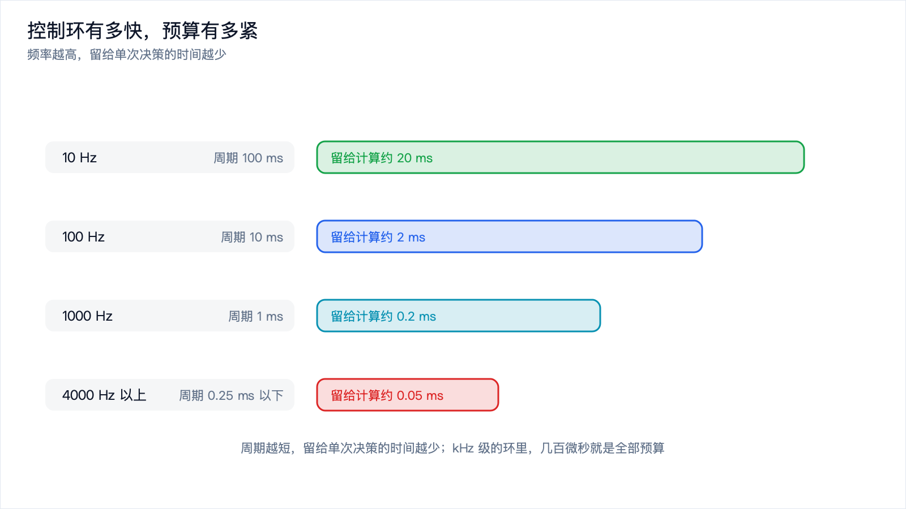
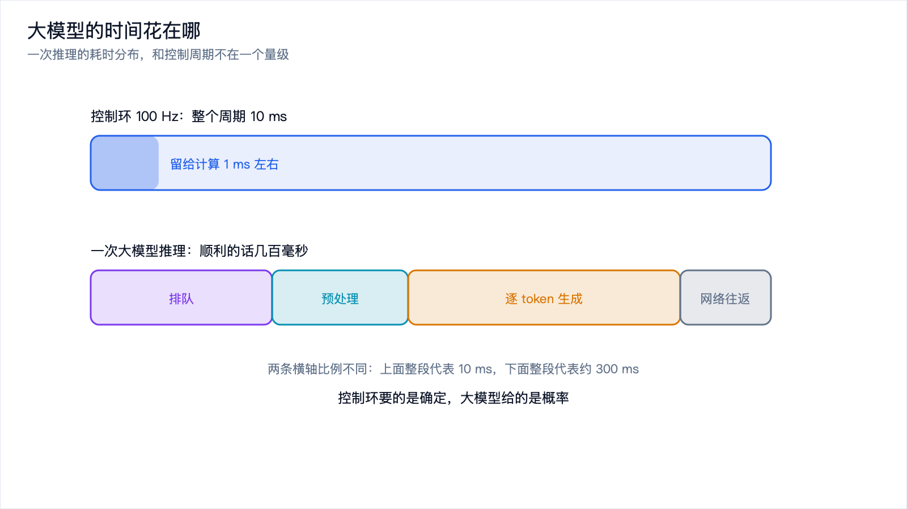
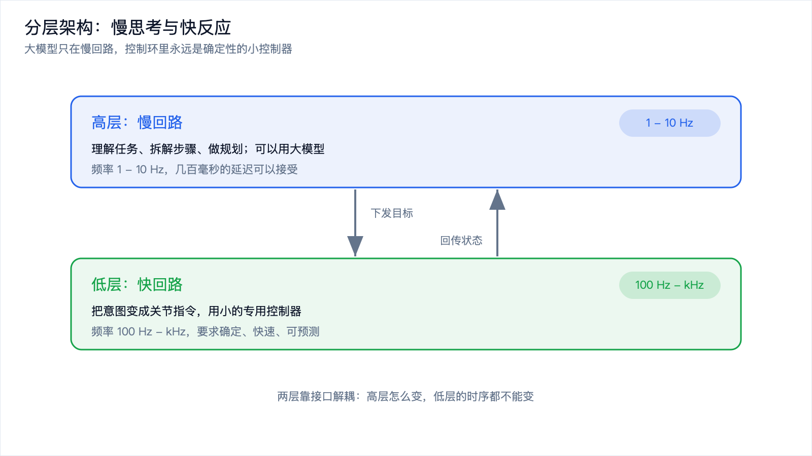
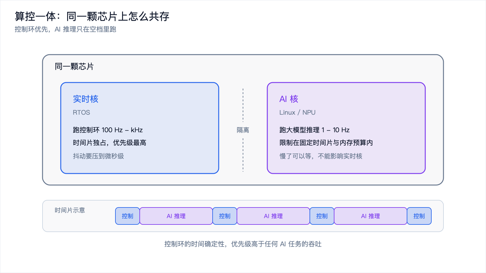

# 端侧实时控制：为什么大模型进不了控制环

*2026-10-30 · 端侧实时控制*

## 从一次"看起来没问题"的延迟说起

你做了个机器人，用大模型当大脑。你让它"把桌上的苹果拿给我"，它想了 200 毫秒，输出一串动作指令，机械臂动了，苹果拿到了。

演示很成功。然后你把它放到真实场景，让它去接一个正在被人递过来的苹果。

结果是机械臂动作一顿一顿的，抓取时机总慢半拍，苹果掉在地上。

问题不在模型的"智力"，在时间。你让一个需要 200 毫秒才能想清楚的东西，去应付一个每几毫秒就变一次的世界。

这篇讲的就是这条硬约束：控制环的时间预算有多紧，大模型为什么放不进去，放不进去之后工程上怎么绕。

## 控制环到底有多快

先建立量感。机器人的控制不是"想好了动一次"，而是不停地在循环：读传感器（关节角、电流、力矩、相机、IMU），算出这一时刻该输出什么，把指令发给电机，过几毫秒回到第一步。

这个循环叫控制环。它的频率决定了两件事：系统能多快对外界变化做出反应，以及每次计算只有多少时间。

| 控制环频率 | 每次周期 | 典型场景 |
| --- | --- | --- |
| 10 Hz | 100 ms | 移动底盘的速度指令 |
| 100 Hz | 10 ms | 一般位置控制、抓取 |
| 1000 Hz | 1 ms | 力矩控制、柔顺控制、平衡 |
| 4000 Hz 以上 | 0.25 ms 以下 | 电机电流环、力控内环 |

看表底那一行。电流环跑在几千赫兹，意味着从读到算到发，整条链路必须在零点几毫秒内完成。这不是"希望快一点"，是物理上必须：电流环不稳，电机就会啸叫、发热，严重时烧掉。

再算预算。1 kHz 的环，周期 1 毫秒，扣掉传感器采样、通信、下发的时间，留给计算的可能只有几百微秒。几百微秒能干什么？一次简单的矩阵运算，或者一个几十个参数的小控制器，差不多就到顶了。

*图 1：控制环频率越高，留给单次决策的时间越少，kHz 级只剩几百微秒。*

## 大模型的时间花在哪了

现在把大模型放进这个预算里，看它超支在哪。

一次典型的大模型推理，时间大致花在几块。排队，请求到了服务端不一定立刻被处理，前面可能还有别的请求，这一块波动最大。预处理与首 token，模型要把输入编码一遍再开始生成，输入越长、模型越大越慢。逐 token 生成，每生成一个 token 都要把整个模型跑一遍，输出几十个 token 就是几十次前向。还有网络往返，模型不在机器人身上时，去程和回程都要算。

加起来，一次云端调用顺利的话几百毫秒，网络一抖就是一两秒。就算把模型放到端侧、去掉网络，一个几 B 参数的模型生成几十个 token，也还是几十到几百毫秒的量级。

拿这个数字去对控制环的预算：100 Hz 要求 10 毫秒内出结果，大模型要几百毫秒，差了两个数量级。

*图 2：大模型的耗时分布在排队、预处理、逐 token 生成和网络往返上，总量远超控制周期。*

## 比"慢"更麻烦的是"不确定"

如果大模型只是稳定地慢 200 毫秒，事情反而好办：提前 200 毫秒做决定就行。真正的麻烦是它的延迟不稳定。

同一个请求、同一台服务器，这次 180 毫秒，下次 900 毫秒。原因很多：服务端排队、批处理策略、输入长度变化、芯片降频、网络抖动。你没法保证它多久回来。

控制系统最怕的就是这种不确定性。一个控制环的设计前提是"每个周期都能按时算完并输出"。如果某个周期算不完，机械臂会停在半路，电机收到的指令已经过期，下一条指令也不对应当前状态。轻则抖动，重则失稳。

工程上把这种超时叫错过截止时间。实时系统的评价标准不是平均延迟，而是最坏情况延迟能不能满足截止时间。平均 50 毫秒、偶尔 1 秒的系统，在控制环里不可用，因为那"偶尔"的一次就足以让机器人出事。

这也是"换一个更快的大模型"解决不了问题的原因。你可以把平均值压下来，压不住尾部。控制环要的是确定性，大模型给的是概率。

## 分层架构：慢思考与快反应

既然大模型进不了控制环，那就不让它进。工程上的解法是把系统分成两层。

高层是慢回路，频率低（1 到 10 Hz 甚至更低），负责理解任务、拆解步骤、做规划。这一层可以用大模型，因为它的输出是"接下来该干什么"，而不是"这一刻电机该出多少力"，几百毫秒的延迟完全可以接受。

低层是快回路，频率高（100 Hz 到 kHz），负责把高层的意图变成具体的关节指令，用小的专用控制器，要求确定、快速、可预测。

这个分层不是具身智能发明的，它在机器人里已经存在几十年。传统做法里，高层是任务规划器，低层是运动规划加控制器。现在变化的是高层的"智力"：以前的高层是人写死的状态机，现在换成了能理解自然语言、能处理模糊指令的大模型。

用日常的类比：你开车时，"去公司"这个决定不需要每秒重做一次，可以一路上想别的事；但"保持车道""跟车距离"每时每刻都在调整，而且不能有延迟。前者是慢思考，后者是快反应。人脑本来就这么分工，机器人的架构借用了同一个思路。

*图 3：高层慢回路负责理解与规划，低层快回路负责确定性控制，两层靠接口解耦。*

## 低层用什么：小控制器的几种形态

低层到底跑什么？从简单到复杂有这么几类。

最经典的是 PID。比例、积分、微分三项，参数不多，计算量极小，跑在 kHz 上毫无压力。几十年来绝大多数电机的内环都是 PID。

往上一层是运动学与动力学控制器。逆运动学把"末端要到这里"换算成"各个关节该转到哪"；动力学补偿算出力矩，抵消重力和惯量；力控和阻抗控制让机械臂在接触时表现出柔顺，不至于把东西捏碎。

再往上是模型预测控制（MPC）。它在每个周期里做一次短程优化，算未来几十到几百毫秒内怎么走最优。MPC 比 PID 重得多，通常跑在几十到几百赫兹，需要实时优化求解器配合。

最近几年还多了一类：用神经网络做低层策略。比如扩散策略这类方法，一次推理生成一小段动作，频率在几十到上百赫兹。它的定位已经不是"大模型"，而是针对动作空间专门优化过的小网络，参数量小、推理快、输出结构固定。它能进控制环，恰恰是因为它足够小、足够专。

这些控制器的共同特征是：计算量可控、延迟可预测、行为可解释。这三条正是大模型欠缺的。

## 端侧实时推理与算控一体

如果高层的大模型也想放在机器人身上，就撞上了另一个问题：算力和实时的资源冲突。

机器人身上通常只有一颗主控芯片。低层控制环要独占 CPU 的时间片，不能被别的任务抢走；高层大模型推理是重负载，一跑起来就占满 CPU、GPU、内存带宽。两者放在同一颗芯片上，很容易互相干扰：大模型一推理，控制环就错过截止时间。

解决办法有两条路。一条是物理隔离，控制跑在独立的 MCU 或实时核上，大模型跑在另一颗 SoC 上，中间用高速总线通信，最稳，代价是成本和板级复杂度。另一条是同一颗芯片上的时间隔离，也就是常说的算控一体：芯片上有一个实时核跑 RTOS，一个 AI 核跑 Linux 或专用推理，实时核有优先级保障，AI 核的推理被限制在它自己的时间片和内存预算里，不能影响实时核。一颗芯片同时干两件事，成本和体积更友好，难点在调度和资源隔离要做到位。

不管走哪条路，底线是一样的：控制环的时间确定性，优先级高于任何 AI 任务的吞吐。宁可让大模型慢一点、规划少跑几次，也不能让控制环超时。

*图 4：算控一体靠时间隔离让 AI 推理与控制环共存，控制环的确定性优先。*

## 这条线怎么把边缘 AI 和具身智能连起来

把这篇和边缘 AI 那个[板块](../edge-ai/edge-ai-intro.md)对上，会发现它们说的是同一件事。

边缘 AI 讲的是为什么要把推理放到设备端，理由里有延迟确定性、数据不出设备、离线可用。具身智能这边，这三条一个不差地全部命中，而且强度更高：机器人本来就在物理世界里，数据天然在本地；它可能在没有网络的工厂和野外工作；控制环对确定性的要求比任何消费级应用都严。

所以具身智能不是边缘 AI 之外的一个新话题，而是边缘 AI 最硬的那个场景。手机上的语音识别延迟从 200 毫秒降到 100 毫秒，用户感觉更好；机器人的控制环从 10 毫秒抖到 20 毫秒，机械臂可能就废了。同一个技术方向，在机器人这里被推到了极限。

反过来，边缘 AI 的技术积累在具身智能这里直接复用：模型量化让小模型能塞进实时预算，算子融合和推理引擎的确定性调度让延迟可预测，实时操作系统提供时间保障。想清楚具身智能的实时约束，回头看边缘 AI 的很多设计选择，会明白它们为什么长这样。

## 写在最后

大模型进不了控制环，原因不复杂：控制环的频率是百赫兹到千赫兹，每次决策的预算是毫秒甚至微秒；大模型推理动辄几百毫秒，而且延迟不确定。控制环怕的不是慢，是不确定，一次超时就能让系统失稳。

工程上的答案是分层：高层用大模型做慢规划，频率低、可以容忍几百毫秒；低层用小的专用控制器做快控制，频率高、要求确定。低层可以是 PID、运动学动力学控制器、MPC，也可以是专门优化过的动作策略网络，共同点是计算量可控、延迟可预测。想在同一颗芯片上同时跑 AI 和控制，就得做算控一体，靠实时核与 AI 核的时间隔离把两类负载分开，底线是控制环的确定性优先。

分层和实时都解决了，还有一个问题会浮出来：你怎么知道这个模型真的变好了？机器人不像软件，不能重跑一万次单元测试。下一篇[《具身评测：怎么衡量一个机器人模型的好坏》](./embodied-eval.md)，讲的就是这把尺子怎么造。
