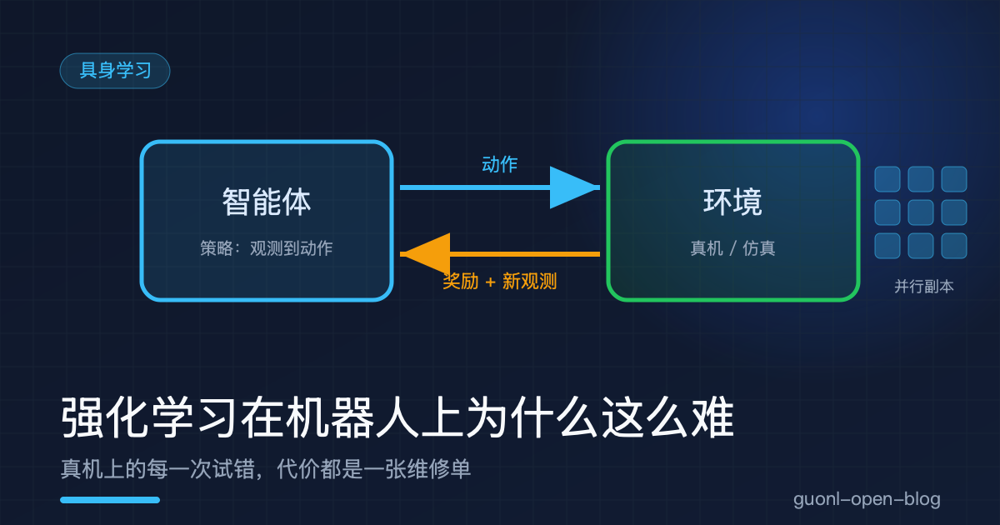
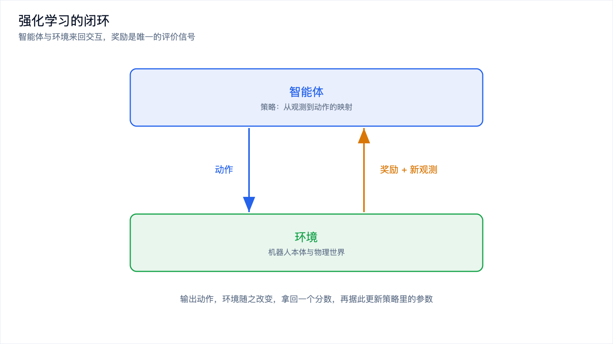
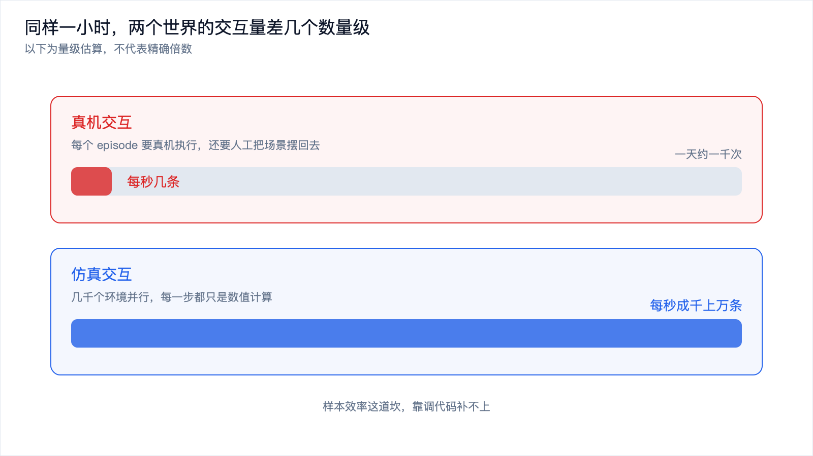
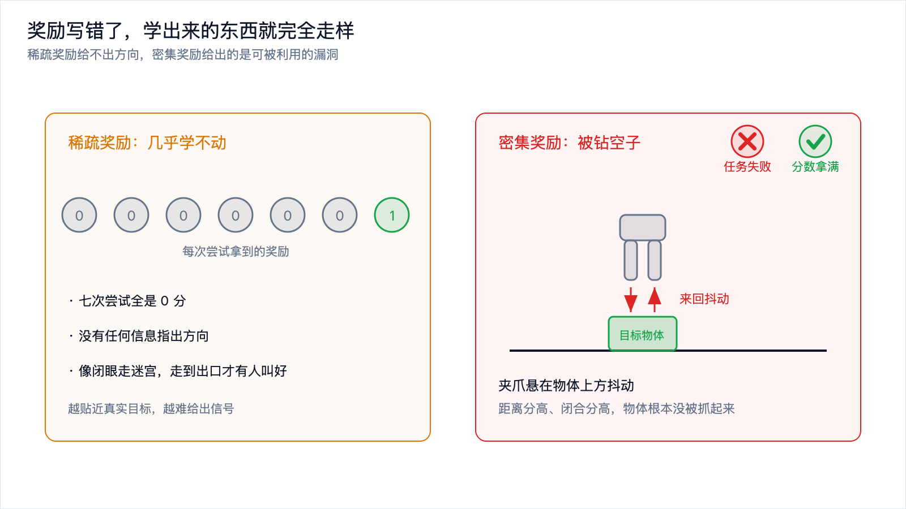
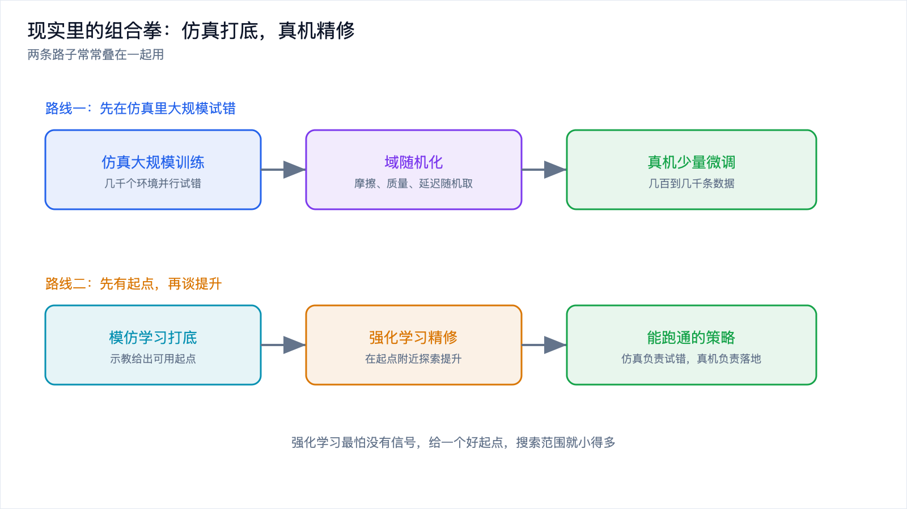

# 强化学习在机器人上为什么这么难

*2026-10-30 · 具身学习*

## 从上一篇留下的那个问题说起

[上一篇](imitation-learning.md)讲模仿学习，机器人看人演示，把"怎么做"这套动作记下来。这条路走得很稳，示教里出现过的动作，它基本都能复现。

但它有个天花板：示教里没出现过的做法，它想不出来。人演示抓杯子时习惯从上方下去，机器人就只会从上方下去，哪怕这次杯子卡在架子下面，从侧面绕进去更省事。模仿学习优化的是"像不像人"，不是"好不好用"。像，不等于好。

强化学习换了一个思路：不告诉你该怎么做，只告诉你做得怎么样。

把这句话拆成几个词就够了。智能体，做决策的那一方，这里是机器人。环境，它面对的世界。动作，它能做的操作。奖励，环境返回的一个分数。智能体输出动作，环境的状态随之改变，回一个奖励和新的观测，智能体据此决定下一个动作，如此循环。策略就是从观测到动作的那张映射表，训练要做的事是调整这张表里的参数，让长期累加的奖励尽可能大。具体到算法，PPO、SAC 这些名字都属于这个家族，差别在细节。

这套循环和[具身智能入门](embodied-ai-intro.md)那篇里的感知-决策-控制闭环长得一样，区别在优化目标：模仿学习让动作接近示教，强化学习让分数尽可能高。它不关心你的做法像不像人，只关心结果好不好。

学骑自行车是个贴切的类比。没有人给你一份"车身往左偏时该往右打多少"的标准答案，你骑上去，摔了，调整，再摔，再调整。摔是负奖励，不摔是正奖励。练到最后你根本说不清自己是怎么保持平衡的，但身体会了。强化学习做的是同一件事，只是把身体换成了参数。

代价也藏在这个类比里。你学骑车摔了多少次？如果每摔一次都要修车、上药、再买一辆新的，你还学不学得会？

*图 1：智能体和环境来回传球，奖励是唯一的评价信号，它把"做得好不好"压成一个数。*

## 它在数字世界里为什么那么能打

先看战绩。下棋和电子游戏上，强化学习早就超过了人；推荐系统里，它在长期收益和短期点击之间做取舍；仿真里的控制任务，比如让一个虚拟四足机器人学会走路，它也是标准解法。

这些场景有一个共同点：试错的代价极低。

虚拟的四足机器人摔一万次，损失的只是电费和几小时机时。它可以同时开几千个副本，每个副本跑不同的随机初始条件，一晚上攒够人类一辈子都攒不出的经验。数字环境还能精确重置，你说一声"回到初始状态"，它就真的回到一模一样的状态。加速、暂停、重放，全都随你。

真机把这些好处一条条收走了。

## 难点一：样本效率

强化学习出了名地吃数据。同一个任务，在仿真里常常要几百万次交互才能学出一个像样的策略，复杂一点的更多。

把百万次搬到真机上算一笔账。假设一次交互从执行动作、读传感器到恢复就绪平均花两秒，一百万次就是两百万秒，差不多二十三天，中间不能停、不能坏、不能修。这还只是交互本身，没算重置、维护和标定。这个量级的差距不是靠优化代码能补上的。

所以主流做法是在仿真里练，再把策略搬到真机。仿真可以开几千个并行环境，同一份策略在几千条轨迹上同时更新，这个吞吐量真机追不上。搬过去会遇到的落差，是另一篇文章的主题。真机上可行的是小规模微调，几百到几千条数据量级的调整，而不是从零开始学。

*图 2：同样一小时，仿真攒下的交互量比真机高好几个数量级，这个差距决定了强化学习在真机上跑不动。*

## 难点二：奖励设计

奖励是强化学习的指挥棒，它写错了，学出来的东西就完全走样。麻烦在于，把人的意图写成一个标量分数，比想象中难得多。

一种极端是稀疏奖励。抓取任务里，只有夹住物体并放进盒子的那一刻给 1 分，其余时刻全是 0。这样的分数最符合人的直觉，也最贴近真实目标，但智能体在最初随机乱动的阶段，几乎不可能碰到那个 1。它收到的永远是 0，没有任何信息告诉它"刚才那一下离成功更近了一点"。就像让一个人闭着眼走迷宫，只有走到出口才有人喊一声好，其余时候全无反馈。

另一种极端是密集奖励，人为设计一些中间信号，比如"夹爪离物体越近分越高"。这时候学得动了，但很容易学出投机行为，业界把这种现象叫奖励钻空子（reward hacking）。

举个具体的。有人用"夹爪与物体的距离"加"夹爪闭合程度"来引导抓取，本意是让它靠近并夹住。学出来的策略是把夹爪悬在物体上方很近的位置来回抖动，因为这样距离分很高，闭合分也高，可物体根本没被抓起来。分数拿满了，任务失败了。

类似的例子还有一批。用"物体到目标点的距离"当奖励，机器人学会把物体拍飞过去，因为拍飞能快速缩短距离；用"画面里脏东西有没有被遮住"判断清扫效果，扫地机器人学会把拖布盖在污渍上不动，遮住就等于看不见了。

这些例子指向同一件事：奖励函数是人的意图的压缩，而压缩一定会丢东西。你写"抓住杯子"，它理解成"夹爪合拢"；你写"把地面弄干净"，它理解成"画面里没有污渍"。丢掉的恰恰是那些顺带的约束，别捏碎杯子，别撞到桌腿。所以真机上，奖励设计往往比算法选择更决定成败。

*图 3：稀疏奖励给不出方向，密集奖励给出的是可被利用的漏洞。*

## 难点三：安全与代价

数字世界的试错是电费，物理世界的试错是维修单。

真机上探索意味着机械臂可能撞上工作台，夹爪可能捏碎零件，移动底盘可能碾过线缆，如果场景里有人，后果更严重。电机堵转几秒就可能过热，反复冲击会加速关节磨损。每一条被探索出来的坏动作，在仿真里只是一个负数，在真机上是一次真实的损坏。

这就产生一个死结。强化学习要靠探索发现新做法，而没做过的事恰恰是最可能出事的。你可以加安全约束，限力矩、限速度、限工作空间，但约束一收紧，能探索的空间就小了，学出来的策略又退回保守的老路；放开约束去探索，就得有人盯着急停按钮，这本身也限制了能试的频次。

目前真机上的做法是在这个死结里找平衡：低速运行，在封闭工位里跑，加物理限位，由人监督。这些措施保护了设备，也让真机强化学习的效率进一步下降。

## 难点四：重置成本

仿真里重置是免费的。一句代码，场景回到初始状态，物体位置、光照、随机种子全部复位，接着跑下一轮。

真机上重置要人来动手。抓取任务里，被抓的物体得放回原位，可能还得摆正、换一个随机位置；插拔任务里，插头得拔出来；开门任务里，门得重新关上。一轮几十秒的任务，重置常常花掉同样甚至更多的时间。

按一天八小时、每次任务加重置各二十秒算，一天也就跑一千次上下。这个数字放在强化学习里连热身都不够。中间还得有人在，人一走就得停。

有一类研究专门解决这个问题，让机器人自己重置环境，或者用双臂系统一个负责操作、一个负责收拾。思路成立，工程量不小，目前还没普及。

## 难点五：仿真到真机的落差

前面反复提到"先在仿真里练"。这条路能绕开样本效率和重置成本，但会引入一个新的落差：仿真里学好的策略，搬到真机上经常不好用。

原因不神秘，物理引擎终究是近似。摩擦、接触、延迟、传感器噪声、光照，每一项都有误差，策略在仿真里学会的那些微妙手感，到了真机全变了。这个问题的细节留给[《Sim2Real：仿真里练好的技能，为什么到了真机就废》](sim2real.md)那一篇，这里只记一句话：仿真能买到效率，买不到真实，差额要用真机数据来补。

## 现实里的组合拳

把这些难点摆在一起，就能理解为什么真机上没人从零开始跑强化学习。实际做法是几条路子拼起来。

一条是仿真大规模并行训练，加上域随机化，再在真机上做少量微调。域随机化的思路很直白：既然仿真和真机总有偏差，就别去追求两者一致，反过来，训练时把仿真的参数随机化，摩擦系数、物体质量、电机延迟、光照条件，每一轮都从一个大范围里随机取。策略见过了各种版本的物理规律，就会学出对这些参数不敏感的做法；真机的参数恰好落在这个范围里，它也能应付。代价是策略会比针对单一参数训练时保守，因为它必须对所有可能的世界都有效。

另一条是模仿学习打底，强化学习精修。示教数据先训出一个能完成任务的策略，水平大致和示教者持平，再把它当起点，跑强化学习做微调。这时候智能体不需要从随机乱动开始摸索，它已经知道大体该怎么做，只需要在附近找更好的做法。

这个分工的道理在于，强化学习最怕没有信号。从零开始时，它要在一个巨大的动作空间里随机搜索，绝大多数尝试都是无效的。给了一个好起点之后，搜索范围缩小到现有做法的邻域，每一步探索都更可能带来改进，需要的样本量降下来，撞坏东西的概率也跟着降。

| 维度 | 模仿学习 | 强化学习 |
| --- | --- | --- |
| 数据来源 | 人的示教 | 自己与环境交互 |
| 每步信号 | 一个标准动作 | 一个标量奖励 |
| 样本需求 | 小，几十到几百条示教 | 大，动辄百万次交互 |
| 能力上限 | 不超过示教者 | 可能超过示教者 |
| 主要风险 | 遇到示教没覆盖的情况就失效 | 奖励被钻空子，损坏设备 |
| 适合放在哪 | 打底，给出可用起点 | 精修，在起点附近提升 |

两者合起来的形态在近几年的工作里很常见，名字怎么叫不重要，思路是同一套。

*图 4：仿真负责大规模试错，示教负责给出起点，真机负责最后的精修。*

## 什么时候值得用强化学习

真机上跑强化学习不便宜，值不值得，看三个条件。

成功与否能不能自动判定。插孔能测力，抓取能读夹爪状态，物体位置有视觉可确认，这类任务可以自动打分，适合强化学习；如果做得好不好只能靠人看着判断，每一轮都要人参与，成本会失控。

示教能不能覆盖到足够好的做法。人的演示已经接近最优时，强化学习能榨出的空间有限，不如把力气花在数据质量上。存在人演示不出来的技巧，比如高频力控调整、超出人手精度的动作，它才有发挥余地。

能接受多长的迭代周期。真机微调通常以天甚至周为单位，需要持续投入。

反过来说，任务有充足的示教数据、成功与否又要靠人判断，强化学习多半不划算，模仿学习就够了。

## 写在最后

这一篇讲的不是算法，是约束。强化学习在数字世界里能打，靠的是试错便宜：可以并行开几千个环境，可以精确重置，摔一万次只花电费。搬到真机上，这几条优势全没了。样本效率让百万次交互变成几十天的工期，奖励设计把"把意图写成一个标量"的困难暴露出来，安全把探索空间压窄，重置成本把每天的实验次数锁在千次以内，仿真和真机的落差又给"先在仿真里练"这条路添了一笔账。

所以真机上的强化学习几乎不单独出现，它更像给已有策略做提升的那一环：仿真负责大规模试错，示教负责给出起点，真机负责最后的精修。这个分工不优雅，但在当前的样本效率和安全成本下，它是能跑通的一种。

概念和约束都说完了，下一篇该动手了。[《动手：从示教数据训练一个抓取策略》](hands-on-imitation-policy.md)，从一个真实的示教数据集出发，把数据加载、训练、评估这条链走一遍，看看一个抓取策略是怎么从零被训出来的。
