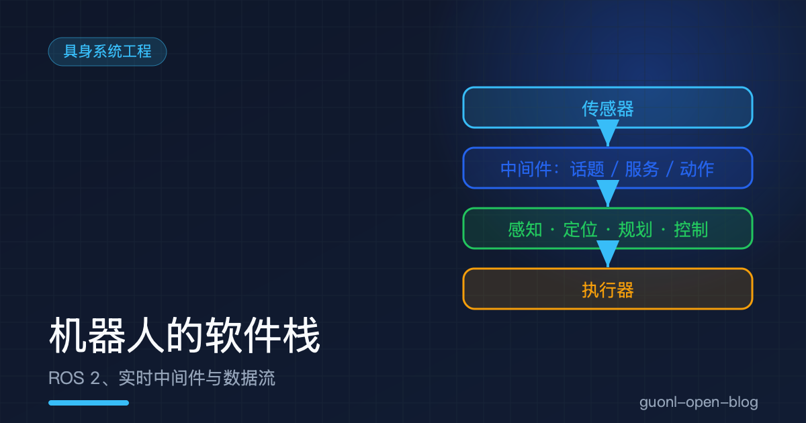
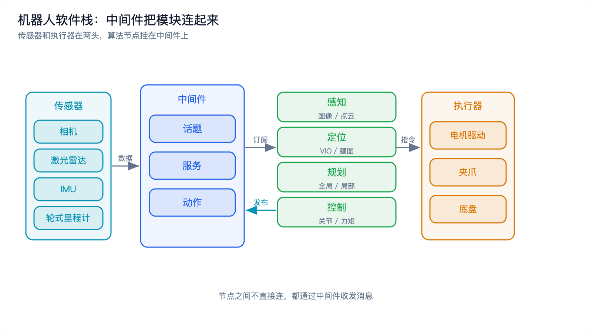
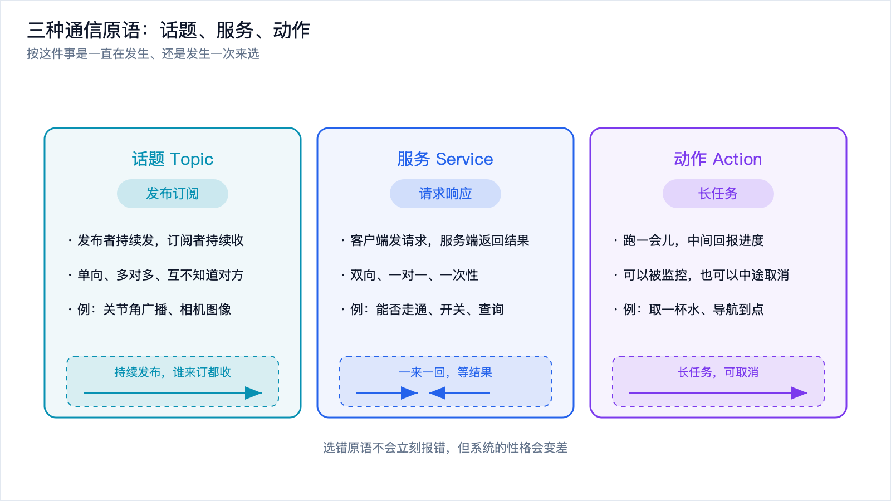
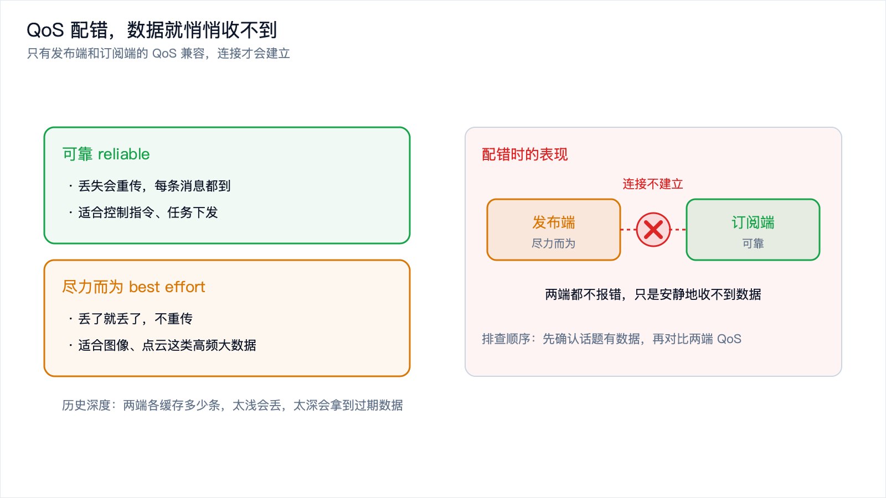
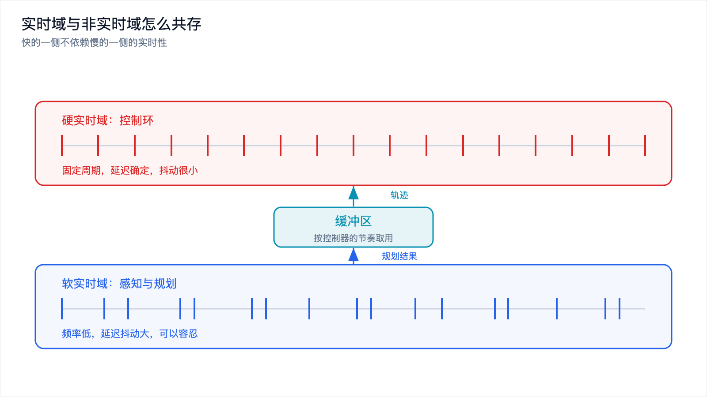

# 机器人的软件栈：ROS 2、实时中间件与数据流

*2026-10-30 · 具身系统工程*

## 从一台机器人身上的十几个程序说起

一台移动操作机器人，开机后同时跑着十几个程序：相机和激光雷达驱动、IMU 和轮式里程计、视觉惯性里程计、建图、规划器、逆运动学求解器、关节轨迹控制器、力矩控制环、夹爪驱动，再加一个上层任务调度。

它们用不同语言写。驱动和控制器多半是 C++，因为要快；任务规划和算法原型常是 Python，因为要快改。它们跑在不同进程里，有的还在不同板子上，中间隔着网线或 CAN 总线。

这些程序之间怎么传数据？问题看着简单，却是机器人工程里最容易失控的地方。

## 手写 socket 拼起来会怎样

最原始的做法是自己开 socket。相机进程往一个端口写图像，定位进程连上去读；算完了再往另一个端口写位姿，规划器去读。跑通一个小 demo 不难，麻烦从第二个模块开始。

接口要手写。每加一个模块就约定一套私有协议，消息怎么编码、字段什么顺序、大小端怎么处理。模块从五个变成二十个，两两之间的连线是平方级增长，改一个字段就要牵动好几处。

跨语言也痛，C++ 和 Python 之间通信，序列化和解析都得自己写两份。调试只能靠打日志，那些瞬时的中间数据过去就没了。时序更靠自觉：图像和 IMU 各带各的时间戳，谁先谁后没有统一约定。

一句话：手写通信能跑通 demo，撑不起一台真机器人。

## 中间件管的是"怎么连"，不是"算什么"

中间件的定位要说清楚：它不负责算法，算法是你自己写的；它负责把一堆互不相识的程序连成一张网，并规定数据怎么流动。

它要提供统一的消息定义、屏蔽语言差异的序列化、不用硬编码端口的寻址与传输、新模块自动被找到的发现机制、时间同步的约定，以及记录与回放的能力。

机器人领域里，用得最广的是 ROS 2。

*图 1：中间件横在中间，把传感器、算法节点和执行器连成一张可插拔的网。*

## ROS 2 的四件套：节点、话题、服务、动作

节点是一个能独立运行的程序单元。相机驱动、规划器、控制器，各是一个节点。节点是分布式的，在同一台机器或不同机器上，ROS 2 不区分。

节点之间说话，最常用三种方式。话题是发布订阅：发布者不断发，订阅者不断收，双方互不知道对方是谁，单向、多对多、持续。服务是请求响应：客户端发请求，服务端返回结果，双向、一对一、一次性，调用方会阻塞等结果。动作是长任务：适合要跑一会儿、中间要报进度、可能还要中途取消的任务，底层是话题加服务的组合，用起来像一个能被监控和打断的长调用。

## 一杯水，三种原语怎么选

用例子讲最快。假设机器人要取一杯水。

机械臂每个关节一直往外广播角度，一千赫兹，从不间断，是典型的周期数据流，用话题，谁想看谁订阅。

调度器判断该去取水了，问规划器："从当前位置到水杯旁边，能不能走通？"有明确答案、很快返回的查询，用服务。

调度器接着说："开始执行取水。"这个任务要好几秒，中间可能绕障、重试抓取，用户随时可能喊停。这是动作的场景：能收到进度反馈，也能在出事时发取消。

| 原语 | 模式 | 方向 | 时长 | 典型用途 |
| --- | --- | --- | --- | --- |
| 话题 | 发布订阅 | 单向、多对多 | 持续 | 传感器流、状态广播、关节角 |
| 服务 | 请求响应 | 双向、一对一 | 瞬时 | 查询、开关、一次性计算 |
| 动作 | 长任务 | 双向 | 数秒到数分钟 | 取水、导航到点、抓取 |

判断标准只有一条：这件事是"一直在发生"还是"发生一次"。一直在发生用话题，发生一次而且很快用服务，要很久就用动作。

*图 2：话题管持续流，服务管一次性查询，动作管带反馈和取消的长任务。*

## DDS：ROS 2 底下的那层

ROS 2 本身不实现网络传输，它把这件事交给底下的中间件，用得最多的是 DDS（数据分发服务）。DDS 是工业界的发布订阅标准，原本用在飞机、军舰、工业控制上，特点是去中心化、可以保证服务质量。

DDS 带来一个关键概念：QoS，服务质量，它允许你为每条数据流单独指定要什么样的保证。最常用的几个策略：

可靠性。可靠模式会重传丢失的数据，尽力而为模式丢了就丢了。听名字像是可靠一定更好，其实不然：图像流每秒几十帧，丢一帧无所谓，但重传会占带宽、增延迟。图像用尽力而为，控制指令用可靠。

历史深度。它决定两端各缓存多少条消息。太小，接收端处理慢一点就丢；太大，内存占用高，延迟也变大，因为可能拿到过期数据。

持久性。新加入的订阅者能不能收到它加入之前的消息。默认收不到，改成持久模式能收到最后一条，适合配置这种不常变的数据。

截止时间和存活期。前者声明我保证多久发一次，后者声明我多久没动静就算挂了。发布者超时，订阅者能收到通知。

## 明明发了，为什么收不到

QoS 是 ROS 2 新手最常踩的坑，因为它有一个反直觉的行为：只有发布端和订阅端的 QoS 兼容，通信才建立。不兼容时，连接根本不会建立，双方各自安静地跑，谁也不报错。

典型场景：你写了一个节点订阅相机图像，跑起来回调一次都不触发，列出话题能看到它，手动 echo 也能打出数据，唯独你的节点收不到。原因往往是相机发布的是尽力而为，而你的订阅端默认请求可靠。可靠订阅者要等一个能保证可靠传输的发布者，等不到，就不连。

反过来也一样：控制器订阅关节角用了尽力而为，发布端是可靠模式，通信同样建立不起来，控制环拿不到数据，机械臂不动，你却在控制器的代码里找了一下午 bug。

排查顺序很固定：先确认话题存在、有数据，再检查两端 QoS 是否兼容。命令行工具能打出话题上各端实际用的 QoS，对不上一眼就能看出来。

*图 3：QoS 不匹配时连接不会建立，两端都不报错，只会安静地收不到数据。*

## 两种数据流，两种性格

系统里跑的数据分成两种性格。周期流是传感器数据、关节状态广播、里程计，按固定频率不断往外发，节奏稳定，允许丢帧，适合发布订阅和尽力而为的 QoS，因为价值在于最新的一帧。

事件流是任务下发、状态查询、参数修改，在某个时刻被触发一次，不规律，但每一条都不能丢。它适合服务或动作，要用可靠的 QoS，丢一条"开始取水"的指令，机器人就卡在原地。

缓冲策略也跟着不同。周期流的接收端关心拿到的是不是最新的，缓冲区做得很浅，甚至只留最新一条；事件流的接收端关心有没有漏掉任何一条，缓冲区要做深。把两类数据混在一起用同一种 QoS，是最常见的错误来源。

## 时间：谁的时钟才算数

机器人上很多传感器，每一个都带自己的时间戳。相机说这张图是 12.345 秒拍的，IMU 说这组数据是 12.347 秒测的，激光雷达说这一帧是 12.350 秒扫的。要把它们融合，前提是这些时间戳得在同一个时间轴上。

问题在于每台设备有自己的晶振，走得快慢不一样。跑一天下来，两块板子的时钟可能差出几十毫秒，这个误差对控制环来说已经很大。

解决办法是时间同步：让所有设备跟同一个时钟源对齐，误差能压到毫秒甚至微秒量级，数据才能按时间戳正确对齐和插值。时间戳的来源也要看：有些传感器在硬件层面给数据打戳，这个时间最准；有些是数据到了驱动里才打，中间隔着传输和缓冲，已经晚了几毫秒。

仿真里还有一件事：用仿真时间还是真实时间。物理引擎推进的速度和墙上时钟往往不一致，节点若用真实时间，仿真跑快了它以为该出结果，跑慢了又觉得超时。ROS 2 让节点声明自己的时间以仿真时钟为准，逻辑就自洽了。

## 实时域和非实时域怎么共存

前面[《端侧实时控制》](on-device-realtime-control.md)讲过控制环的时间预算有多紧。放到软件栈这一层，问题变成：一个系统里既有毫秒级的控制环，又有几百毫秒级的感知和规划，它们怎么共处。

答案还是分层。控制环属于硬实时域，要求每个周期都按时算完，延迟必须确定，抖动要压到很小。这一路的通信要用可靠的 QoS、浅的缓冲区、高的线程优先级，甚至跑在独立的实时核上，数据量很小。

感知和规划属于软实时域，相机图像、点云、地图，数据量大，计算重，延迟允许有较大波动。这一路可以用尽力而为，缓冲区深一些，跑在普通优先级上。

两个域之间的边界要有缓冲。规划器输出一条轨迹给控制器，控制器不是每周期都去问规划器要新轨迹，而是拿一份已经在手的轨迹，按自己的节奏插值执行。规划器算得慢一点，控制器照跑不误，用的是稍微旧一点的轨迹，可以接受。

关键是解耦：让快的一侧不依赖慢的一侧的实时性。控制环永远不等规划器，规划器永远不阻塞控制环。

*图 4：控制环不等上层，规划结果经缓冲区按控制器的节奏消费，快的一侧不依赖慢的一侧的实时性。*

## 录包与回放

如果说这个领域有一件工程手段的投入产出比特别高，那就是录包。

做法很直接：把系统里所有话题上的数据原样记下来，每条消息带上时间戳，存成一个文件。ROS 2 里的工具叫 rosbag。

为什么重要？机器人现场很难复现。你让机器人抓一个杯子，这次失败了，现场再摆一次，光照、物体位置、人的动作都变了，问题可能不复现。而录了包，那次失败的所有输入都被完整保留：相机看到的那一帧、定位当时算出的位姿、规划器收到的目标、控制器发出的指令，全按时间顺序存着。

有了包就能离线反复回放。让定位节点去读录好的传感器数据，看它输出的位姿对不对；让规划器读录好的位姿，看它为什么选了那条路。回放可以暂停、慢放、跳到出问题的那一秒反复看。改了一版算法，用同一批包跑一遍再对比，就知道改动带来了什么。

代价是存储。图像和点云数据量大，录一个小时可能就几十 GB，实际项目里通常只录关键话题，或者降采样。

## 工程上容易踩的坑

QoS 不匹配排第一。它不报错，只是安静地收不到，排查方向又不在代码里。

消息序列化开销。话题上的东西都要序列化再反序列化，小消息无所谓，但把一张大图像或一帧大点云塞进话题，每个订阅者都要反序列化一遍，CPU 会被吃掉一大块。图像从驱动到感知、从感知到可视化，中间还可能被复制好几次，每次复制都是一次内存带宽的消耗，数据大时就成了瓶颈，通常得用共享内存来避免。

时钟不同步。融合的前提是统一时间轴，时钟没对齐，融合结果就是错的，而且很难看出来，因为数据本身都对。

节点崩溃没人管。一个进程挂掉了，如果没人发现，系统可能继续用着过期数据做决定。ROS 2 的生命周期管理就是为这个设计的：节点有明确状态，监控节点能在关键节点异常时让系统进入安全状态。

## 写在最后

这一篇讲的是把感知、规划、控制这些模块真正连起来的那套骨架。

中间件存在的理由，是手写通信在模块变多、语言变杂、需要插拔和调试时会失控。ROS 2 用节点、话题、服务、动作把这张网描述清楚，底下的 DDS 负责传输和 QoS 保证。QoS 决定了一条数据流的性格，配错了不会报错，只会安静地失效。时间要统一到同一个轴上，否则融合是错的。硬实时的控制环和软实时的感知规划靠缓冲解耦。录包回放把不可复现的现场变成可以反复重放的数据。

栈搭好了，模块连起来了，机器人能动了。接下来是一个更沉重的问题：它动起来之后，怎么保证不伤人。下一篇[《安全与人机协作：机器人怎么保证不伤人》](safety-human-robot.md)。
