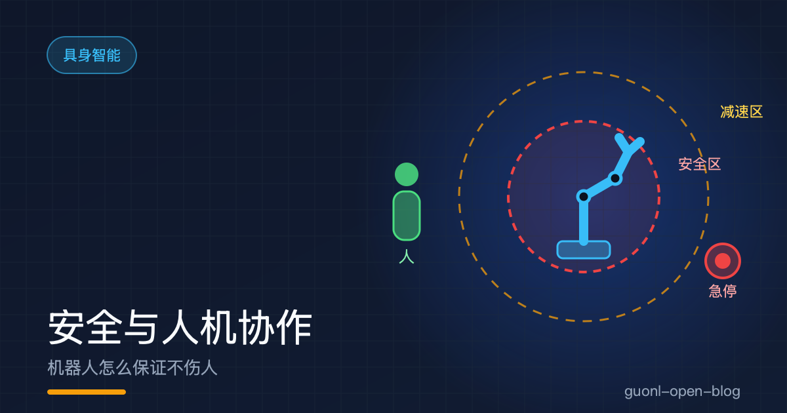
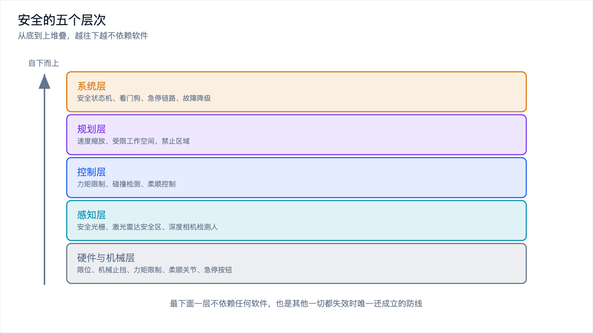
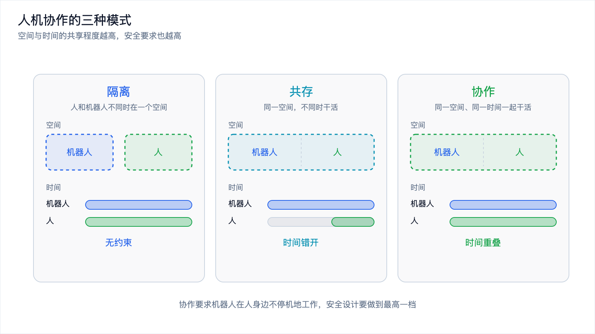
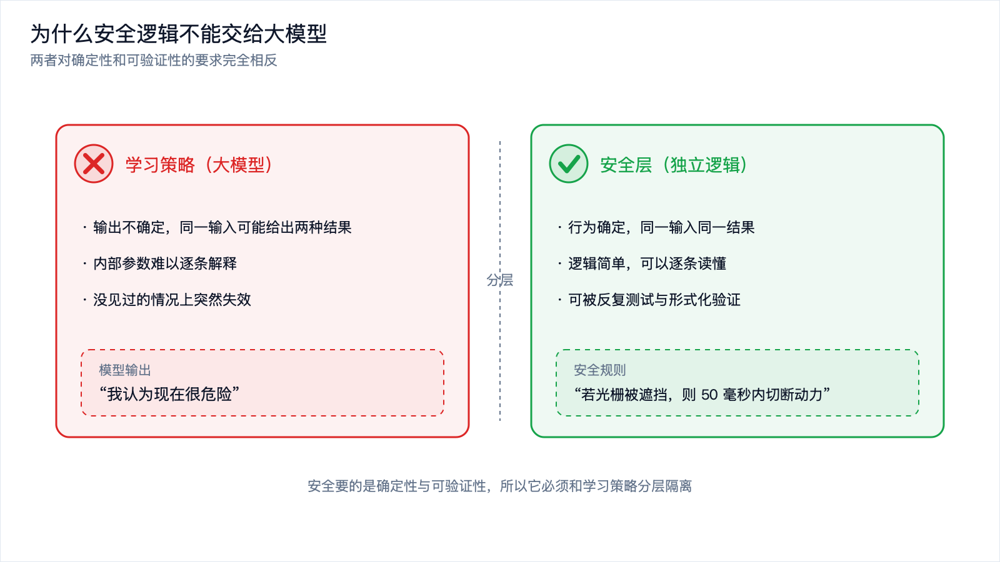

# 安全与人机协作：机器人怎么保证不伤人

*2026-10-30 · 具身系统工程*

## 从一个人站在机械臂旁边说起

设想一个工位：一台六轴机械臂在装配零件，末端带着夹具来回移动。旁边站着一个人，负责把原料放上传送带、把成品取走。

人一伸手，就可能进入机械臂的工作空间。机械臂以每秒一米的速度挥过去，撞到手腕，骨折是最轻的后果。

怎么保证它不撞到人？答案不是"让它小心一点"。机器人没有"小心"这种状态，它只有设计好的行为和没设计到的行为。安全是一层一层叠出来的，每层拦住一类失误，最底下那层不依赖任何软件，最上面那层才轮到算法出场。

这篇按从底到上把这五层讲清楚，再回答一个问题：既然大模型这么聪明，为什么不让它来管安全。

## 第一层：机械和硬件本身

这层跟软件无关。哪怕程序乱了、CPU 死机了、通信断了，它照样起作用。

限位和机械止挡是最古老的做法，关节转到某个角度就物理上顶住，不需要被"计算"出来。

力矩限制做在驱动器里。电机能输出的最大力矩有个硬上限，这不是软件参数，而是驱动电路和电机本身的能力边界。把上限设小一点，机械臂全速朝人撞过去，撞上的力也在安全范围内。

柔顺关节是另一种思路。关节里串一个弹性元件，碰撞时先变形、先卸力，而不是把冲击原样传到人身上。代价是精度和刚度下降。

急停按钮是那个人人都认识的红色蘑菇头。它只做一件事：用最短的路径切断电机动力，同时让抱闸抱死。这条链路必须独立于主控计算机，直接走硬件，它的前提就是"软件已经不可信了"。

这一层是整套设计的地基，也是唯一一层在其他一切都失效时还成立的。

## 第二层：把"人"感知出来

硬件能限制力量，但不知道人在哪。要共处，机器人得先知道有人靠近了。

安全光栅是最常见的一种。一排红外发射管和一排接收管对射，形成一道看不见的光幕。人一伸手穿过，光被挡住，信号立刻断开，机器人停止。缺点是只能守住一条线，人从别的方向进来它不知道。

激光雷达安全扫描仪往前一步。它水平扫一圈，在平面里划出两个圈：外圈是预警区，人进来就减速并发出提示；内圈是保护区，人一进来立即停止。这就是安全区和减速区的分层。

深度相机提供三维信息，能判断人在哪、往哪个方向走，比光栅灵活，但怕遮挡、怕光照、怕反光，识别算法有误判率。

*图 1：安全自下而上分五层，越往下越不依赖软件，也越可靠。*

## 第三层：控制层的力和柔顺

感知层能发现人，但从发现到停下来之间有时间，刹车距离再短也是一段真实位移。控制层处理的就是这一段。

碰撞检测靠的是电机的反馈。正常运动时电流和关节力矩是平稳的，一旦撞上东西，阻力突然增大，电流出现突变，力矩读数跳出正常范围。控制器捕捉这个跳变，在几毫秒内判断撞上了，然后立刻停或者往回退。碰撞发生在几毫秒之内，一个 10 Hz 的环根本来不及反应，检测必须做在 kHz 级的力矩环里。

柔顺控制解决的是撞上之后怎么办。硬碰硬会让机械臂顶住障碍物，力矩不断累积，直到把东西顶坏或者自己堵转烧掉。阻抗控制让机械臂表现得像一个弹簧，遇到阻力顺着退让，力越大退得越多。

力控对协作机器人是根本性的。协作的前提是接触人时不造成伤害，而接触时退让只能靠力控实现。

## 第四层：规划层的速度和空间

控制层管毫秒级的反应，规划层管整个动作怎么安排。

速度缩放是最直观的一条：人离得远，机器人正常跑；人走近，自动降速；人贴到跟前，停住。速度上限随距离连续变化。即使感知和控制都没触发停止，慢下来的机器人造成的伤害也小得多。

受限工作空间把机械臂能去的区域框起来，范围之外不许去。禁止区域更进一步，在空间里挖掉几块，比如人的工位、传送带上方、设备之间的缝隙，轨迹规划必须绕开。

这几条都是事前的约束，代价低，只牺牲一点节拍，和感知、控制层叠在一起构成多层冗余：感知层没看到人，速度限制仍然生效；规划没绕开，碰撞检测仍然兜底。

## 第五层：系统层怎么兜住

前面四层各自管一块，系统层管的是它们之间的协调和出问题时的退路。

安全状态机把机器人的状态显式地列出来：待机、运行、降速、暂停、急停、故障。迁移条件写死，不依赖任何学习出来的东西，任何一个安全信号触发都有一条明确的路径通向停机。

看门狗负责发现系统卡住了。一个独立的定时器周期性检查主控有没有按时上报心跳，一旦超时就直接切断动力，这条路径同样绕开主控。

急停链路把现场所有的急停按钮、安全门开关、光栅信号串成一条回路，任何一个节点断开，整条回路失电，所有电机断电抱闸。这种设计叫失电跳闸，它把安全定义为"没电"，而不是"软件决定停"。

故障降级要区分"可以继续但功能受限"和"必须停"。传感器坏了一个也许还能降速运行，通信断了一路可能必须停机，哪些降级、哪些停机，是设计时就要写清楚的表。

*图 2：隔离是空间和时间都分开，共存是空间共享但时间错开，协作两者都共享。*

## 人机协作的三种模式

上面五层不是每台机器人都要全套上。要上多少，取决于它和人是什么关系。

隔离是最简单的：人和机器人不同时待在一个空间。机器人关在围栏后面，门一开就停机，很多安全设计省掉了。

共存是同一个空间，但不同时干活。机器人工作时人退到一边，人进入时机器人停下，共用场地，时间上错开。安全光栅和激光雷达就是为这种模式准备的。

协作是最难的：同一个空间、同一时间，人和机器人一起干活。机器人必须能在人身边持续工作而不停机，前面讲的所有层次都得做足，还要保证接触也不造成伤害。

多数真实场景落在共存这一档，真正意义上的协作目前集中在低速、轻载的任务上。

## 为什么别让大模型来管安全

有人会问，既然模型能理解场景、能判断危险，为什么不把安全交给它？

问题出在性质上。大模型的输出是不确定的，同一个画面问两次可能给出两个答案；内部是一堆无法逐条解释的参数，出了问题很难说清为什么；它还会在没见过的情况上失效，而且往往突然。安全要的恰好相反：确定性、可解释、可验证。

一段安全逻辑写成"如果光栅被遮挡，则在 50 毫秒内切断动力"，可以被逐条检查、反复测试、形式化验证。一个模型输出"我认为现在很危险"，你能检查什么？没有一条能给出必然安全的结论。

所以安全逻辑必须独立、简单、可验证，和学习的策略分开放在两层。这和[《端侧实时控制：为什么大模型进不了控制环》](on-device-realtime-control.md)里那条结论是同一条：控制环要的是确定，大模型给的是概率。安全比控制更极端，它连偶尔出错都接受不了，因为那一次就够伤人。

大模型仍然有用武之地，可以做任务理解和高层规划，但输出只能作为建议，拍板停机的必须是那条独立、简单、可验证的链路。

*图 3：安全逻辑和学习策略要分层，因为两者对确定性的要求完全相反。*

## 安全不只是不撞人

把安全理解成不撞人，会漏掉一大堆真实风险。

夹点是其中最容易忽略的一类。它指身体或手指被夹在两个面之间的地方：夹爪的两片钳口之间，机械臂和桌面边缘之间，机械臂和货架之间，两个臂之间。机械臂撞过来，人会本能地躲；手指伸进夹爪，人常常来不及反应，因为夹爪闭合又快又静。夹点造成的伤往往比撞击更重。凡是存在两个相对运动的表面，中间就要考虑夹点。

被物体砸到是另一类。机器人抓着的工件掉下来，或者搬运中碰到货架把东西碰落，这要求的不只是别碰人，还有抓稳和别撞到周围的东西。

机器人自己失控甩出去也发生过。控制器发疯、编码器故障、通信中断，都可能让关节突然高速转动，这类故障靠速度限制、力矩上限和急停兜住。

还有长时间运行的疲劳。机器人一天要跑几千次，一年要跑几百万次，螺栓会松、抱闸会磨损、线缆会疲劳，安全功能随时间退化，所以安全装置需要定期校验。

## 怎么验证一套安全设计

"我们跑了很多测试，没出过事"，这不是安全验证。没出事可能只是因为运气好，或者危险的情况还没出现过。

硬件安全功能要独立验证。急停按钮、光栅、看门狗这些装置得单独测响应时间和可靠性，而且要用外部仪器测，不能信软件自己报的日志。

软件要做故障注入测试。人为地让传感器报错、让通信丢包、让某个节点挂掉、让时间戳跳变，看系统是不是按设计的方式进入安全状态。故障注入把平时不会出现的坏情况主动造出来，而不是等它自己发生。

异常场景要成体系地覆盖。传感器坏掉一种、坏掉两种会怎样；通信断掉一路、断掉全部会怎样；突然断电、突然上电会怎样；人从正面走过来、从背后冒出来会怎样。这些场景要列成清单逐个过，而不是随机试。

这套做法不去证明系统能正常工作，而去证明系统在坏掉时仍然安全，后者才是安全这两个字的含义。

*图 4：验证的重点不是跑通正常流程，而是覆盖各种坏掉的方式。*

## 安全投入要跟风险等级匹配

安全做到什么程度，不取决于"安全很重要"这种情绪，取决于风险有多大。

低速、轻载、隔离运行的机器人，风险本来就低。一台几百克负载的小机械臂，跑得慢，又关在围栏后面，它需要的就是限位、急停和门开关。给它上全套三维感知和冗余安全控制器，是浪费，也拖慢节奏。

高速、重载、和人贴身协作的机器人，风险高得多。它需要力矩限制的驱动器、碰撞检测、柔顺控制、多层感知、独立的安全状态机，以及定期的校验。相关安全标准对协作机器人有专门规定，把共享空间时的风险怎么评估、哪些安全功能必须有都写了进去，具体条款以你选用的标准和认证机构的要求为准。

这两档之间还有大量中间地带，判断依据是最大速度、最大负载、人能靠多近、接触的频率有多高、出事之后的后果有多重。

## 写在最后

这一篇是具身智能这一批文章的收尾，正好把整条线串一串。

从[《具身智能入门：机器人是怎么学会干活的》](embodied-ai-intro.md)开始，先立住概念：感知、决策、控制的闭环，物理世界不可逆，数据稀缺，实时性要求高。接着是三条技术路线，VLA、世界模型、本能驱动，它们在不同时间尺度上分工。再往下是数据，真机、仿真、人类视频各自的取舍。实时控制那一篇解释了为什么大模型进不了控制环，评测那一篇讲的是怎么给模型造一把尺子。

工程和安全是这条线的落点。路线也好、数据也好、模型也好，最终都要装进一个能在真实环境里跑起来、不出事的系统里。软件栈决定这些部分怎么组织，安全决定这个系统在出错时会往哪边倒。

安全这一层也把前面几篇的结论又验证了一遍。模型越强，越容易让人产生把一切都交给它的冲动；但物理世界的代价不可逆，有些位置就是不能交给一个概率性的东西。确定的那一层要独立、要简单、要能被验证。

一个能干的机器人，和一个敢放在人身边的机器人，中间隔着的就是这些不起眼的层次。
