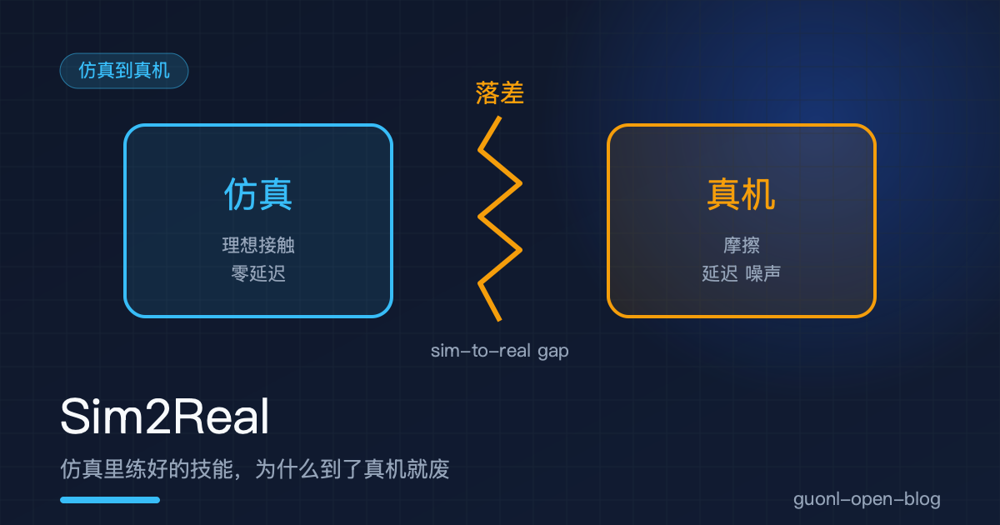
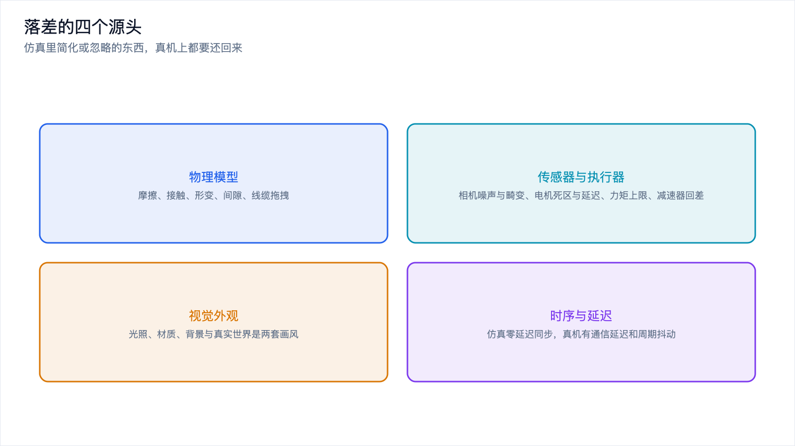
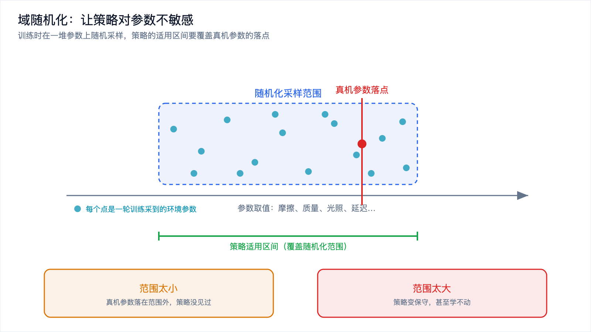
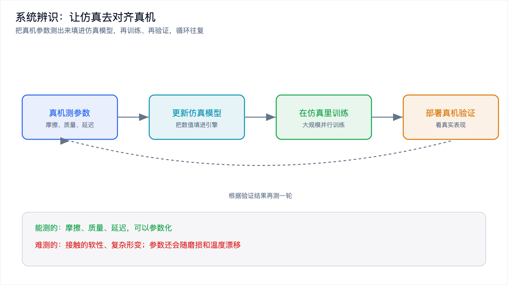
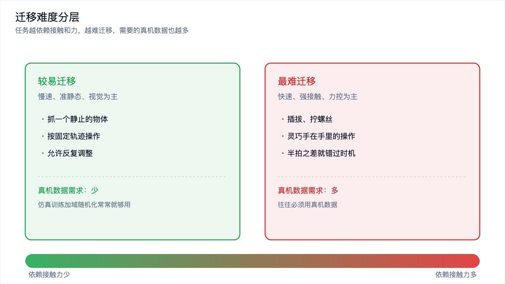

# Sim2Real：仿真里练好的技能，为什么到了真机就废

*2026-10-30 · 仿真到真机*

## 95% 的策略，第一个动作就砸了

一个反复上演的场景。仿真里训练一个抓取策略，跑过上千万步，评测成功率稳定在 95%。团队把模型导出来装到真机上，按下开始。机械臂朝杯子伸过去，夹爪合拢的时机偏了半拍，杯子被推倒，滚下桌面。

模型没坏，是它面对的世界变了。

那 95% 是在一个近似的世界里算出来的。摩擦、接触、延迟、光线，每一项都和真机对不齐。策略学到的是"在这个仿真世界里怎么做对"，换一个世界，它的很多经验就作废了。

这道落差叫 sim-to-real gap，简称 sim2real。它不是某个模块的 bug，而是从仿真走到真机的必经环节。[数据与仿真闭环](data-simulation-loop.md)讲数据从哪来，[强化学习](rl-for-robots.md)讲强化学习为什么难，这一篇对准落差本身。

## 落差从哪来：四类源头

把落差拆开，有四个源头。

物理模型。仿真器里重力和刚体动力学是准的，摩擦、接触、形变、间隙、线缆拖拽这些几乎都做了简化。

传感器和执行器。仿真的相机没有噪声、不会过曝、镜头不会畸变；仿真的电机没有死区、没有延迟，力矩想给多大给多大。

视觉外观。仿真渲染的光照、材质、背景，跟真实世界是两套画风。

时序与延迟。仿真里一切同步、零延迟，真机上有通信延迟和控制周期抖动。

*图 1：落差的四个源头，物理模型、传感器与执行器、视觉外观、时序延迟。*

## 物理模型：接触和摩擦是重灾区

仿真器算重力、算刚体运动，做得很准。但机器人操作里决定成败的，是物体之间那一下接触。

摩擦最麻烦。真实的摩擦不是一个固定的数，静摩擦和动摩擦会切换，摩擦系数还跟速度、压力、表面湿度有关。仿真器常用的库仑摩擦模型把这些压成一个常数。夹爪夹住杯子靠的就是摩擦，仿真里摩擦偏大，策略学会"轻轻一夹就够"，真机上摩擦小一点，杯子直接滑掉。

接触也难。仿真里的接触靠约束求解或者惩罚力来算，接触刚度是拍出来的。真实的接触是软的，贴上去会有微小形变，接触面是一整片，力分布不均匀。硬碰硬容易算对，软接触、滚动、滑动最难，也恰恰是操作最常用的。

还有几样仿真干脆不管。关节和齿轮的间隙常设成零，真机上有一段空行程；线缆拖拽、软物体形变、液体晃动，要么不算，要么算得很粗。

## 传感器和执行器：相机和电机都不是理想的

仿真里的相机是理想相机，按下快门就得到一张干净图。真机上的相机有传感器噪声，暗光下尤其明显；有自动曝光和白平衡，亮度和颜色会漂移；镜头有畸变，边缘直线会弯；物体动快了还有运动模糊。

仿真里的电机是理想电机，给一个力矩就精确执行。真机上的电机有死区，指令小到一定程度不动；有延迟，指令下去到力矩出来隔一段时间；有力矩上限；减速器还有回差，正转反转之间有一段空行程。策略假设力立刻到位，真机上等来的是一段延迟加一个误差。

## 视觉外观：看着就不一样

如果策略靠视觉做决策，还要跨过一道视觉落差。仿真渲染和真实照片是两套画风。光照不同，真实世界有全局光照、反射和软硬不一的阴影，仿真的光照往往是简化过的。材质不同，仿真的贴图是画出来的，真实物体有细节、反光、磨损。背景也不同，仿真里常是干净的纯色，真实桌面杂乱。

视觉策略会失灵，原因很简单：它学到的是捷径。仿真里杯子总是蓝色的，它就学会了"找蓝色的东西"，而不是"找杯子的形状"，真机上一换杯子就不认了。这类问题叫视觉域差距。

## 时序与延迟：仿真里没有"晚一点"

仿真里，观测、决策、动作同步发生，读状态、算动作、执行、时间推进一个固定步长，中间没有等待，也没有抖动。

真机上这三步都有代价。相机曝光要时间，图像传输要时间，计算要时间，指令传到电机驱动器也要时间。加起来就是一段观测延迟。

延迟对闭环策略是致命的。反馈策略在做"看到偏差就纠正"，如果它看到的永远是半拍之前的状态，它就会按过时的信息纠正，纠过头，再反向纠，动作开始振荡，甚至发散。

## 偏差为什么会被放大

到这里，落差还只是一个个孤立的偏差。麻烦在于，闭环会把它们放大。

模仿学习里有个概念叫复合误差，一步走偏，下一步的状态就偏离了训练时见过的分布，策略在这个陌生状态上更容易再偏一步，误差越滚越大。这个机制在 sim2real 里原样复现：仿真和真机差一点，策略动作偏一点，真机状态就比仿真走得更远，几十步之后就面目全非。

更隐蔽的一种情况，是策略学会了钻仿真器的空子。仿真器总有漏洞，摩擦模型让物体有点"粘"，接触求解器允许物体嵌进去一点点也不掉。策略会把漏洞用满，学出一个擦着边、贴着面滑过去的做法，在仿真里得分很高，因为它利用的是一个现实中不存在的物理规律。这类策略在仿真里越漂亮，真机上往往摔得越狠。

## 对策一：域随机化

业界对付落差的主流思路，不是把仿真做得更真，而是反过来，让策略变得更钝。

域随机化的做法很直白。训练时把仿真器里那些不确定的参数全部随机化：摩擦系数、物体质量、光照方向、纹理贴图、电机延迟、控制周期。每一轮训练都从一个大范围里重新采样。策略见过成千上万种不同的世界，慢慢就学会了不去依赖任何一个具体参数，真机的参数只要落在随机化的范围里，它就能应付。

代价有三个。训练更难，每一轮动力学都不一样，等于同时学一堆任务，样本效率下降。策略更保守，为了对所有可能的世界都有效，它得放弃那些只对特定参数成立的激进做法，抓得更慢、夹得更紧。范围最难拍，太小覆盖不到真机，太大又学出一个对什么都平庸的解。

*图 2：训练时在参数范围里随机采样，策略的适用区间要覆盖真机参数的落点。*

## 对策二：系统辨识，让仿真去对齐真机

系统辨识走另一条路：把真机的参数测准，让仿真去对齐真机。

做法是拿真机做实验拟合参数。让机械臂做一组标准动作，记录实际响应，反推出摩擦、质量、延迟这些数值，再填进仿真模型。回路是：真机测参数，更新仿真，在仿真里训练，部署验证，再测一轮。

好处很直接。仿真离真机更近，策略可以学得更精细，不必为适应一大片参数而变得保守。它和域随机化不冲突：系统辨识把仿真的中心对齐到真机，域随机化在周围加一圈范围，兜住那些测不准和会漂移的部分。

代价也清楚。它要求你测、要求你标定，工程量不小。它只能对齐可建模的部分，摩擦和质量能测，接触的软性和复杂形变很难参数化成几个数。参数还会漂移，用久了会磨损，温度一变摩擦力就变，得定期重做标定。

*图 3：系统辨识把仿真的中心拉到真机上，域随机化再在周围留出余量。*

## 对策三：视觉域适配

如果策略吃视觉，还要专门对付视觉差距。风格迁移用真实图片的风格重新渲染仿真图，让它看起来像真照片。随机纹理和材质，等于域随机化的视觉版，逼策略不去记某一种贴图。真实背景贴图，把仿真物体放进真实背景里。用真实数据训练特征提取器，让网络学到形状、结构这类跨域不变的特征，而不是仿真特有的颜色和纹理。这些做法指向同一个目标：让策略别盯着仿真特有的外观，而是盯着那些换个世界也成立的东西。

## 对策四：在仿真里加噪声

除了随机化动力学参数，还可以往仿真里注入噪声和延迟。给观测加噪声模拟相机噪声，给动作加噪声模拟电机误差，在两者之间加随机延迟模拟通信和计算的滞后。这些注入不改变物理模型，只是把真机上的脏因素提前塞给策略。它训练时就习惯了不精确的观测和延迟的执行，真机上的噪声就不再是新鲜事。量级要试：太小没效果，太大策略学不动。

## 对策五：真机微调

前面四招都在仿真里做，但收尾还是要用一点真机数据。

做法是仿真预训练加真机微调。仿真里练出的大方向是对的，真机数据用来把细节拉回来。微调数据量不用大，几百到几千条就够，因为策略不需要从头学，只需要从仿真的世界挪到真机的世界。

难处在两头。真机数据贵，采一批要机器、要人、要时间。分寸也要拿捏，微调得太少，策略改不过来；太多，它会把仿真里学到的一般性先验忘掉，过拟合到那几百条真机场景上。真机微调是收尾，不是替代，它补的是前面几步留下的最后一截差距。

## 不是所有技能都同样难迁移

有个务实的结论：迁移的难度，取决于任务有多依赖仿真最不准的那部分。

慢速、准静态、视觉为主的任务，相对好迁移。抓一个静止的物体，动作慢，接触轻，允许反复调整，视觉提供主要信息。仿真里的摩擦误差影响很小，因为力用得轻、动得慢，物理不准的地方没被触发。这类任务里，仿真训练加域随机化常常就够用。

快速、强接触、力控为主的任务，最难迁移。插拔、拧螺丝、灵巧手在手里的操作都属这一类。它们的成败取决于接触力和摩擦的细微变化，而这恰恰是仿真最不准的地方；动作又快，延迟的影响被放大，半拍之差就错过时机。这类任务往往必须用真机数据，仿真只能提供一个大致的先验。

中间是一大片过渡地带，抓已知物体、按固定轨迹操作，难度居中。判断落在哪里，问一句就够：它有多少成分依赖接触力。依赖越多，迁移越难。

*图 4：任务越依赖接触和力，迁移越难，需要的真机数据也越多。*

## 怎么判断这次迁移会不会成

落到最实际的问题：这个策略迁到真机上到底行不行？

别在完整任务上直接试。先在真机上做小范围、可回退的验证：限制速度、力矩、工作空间，在封闭工位里跑，随时能按急停。即使策略崩了，损失也可控。

看失败模式，不要只看成功率。一个 60% 的成功率，可能是"偶尔滑一下"，也可能是"每次都撞桌腿"，两者的修法完全不同。用少量真机数据跑一跑，记录它在哪里失败、怎么失败，比盯着一个数字有用得多。失败模式能反过来告诉你落差的类型：视觉没认出来，问题在视觉域差距；抓住了又滑掉，问题在摩擦；动作发抖、越纠越偏，问题在延迟；靠近了就卡住，问题在接触模型。定位到哪一类，就知道该补哪一招。如果失败五花八门、每次都不一样，那多半是策略没抓住任务本质，可能一直在钻仿真器的空子，这时候要回头加随机化，或者多采真机数据。

## 写在最后

仿真里练好的技能到了真机就废，不是模型不行，是两个世界不一样。落差有四个源头：物理模型简化了接触和摩擦，传感器和执行器不理想，视觉外观是两套画风，时序和延迟在仿真里根本不存在。闭环还会把这些偏差放大，尤其是靠钻仿真器空子学出来的行为。

对付它的工具箱已经比较成熟。域随机化把策略练钝，系统辨识把仿真对齐真机，视觉域适配缩小画风差距，注入噪声逼策略学鲁棒，真机微调收最后一截。它们不是单选，多数时候是叠着用。任务越依赖接触和力，越难迁移，也越需要真机数据。判断能不能成，靠的是小范围试跑和看失败模式，而不是成功率数字。

概念讲到这里，下一篇该动手了。[《动手：用 MuJoCo 搭一个仿真训练闭环》](mujoco-training-loop.md)，从搭环境、定义任务到训练和评测，把仿真这条链路真正跑起来，看看上面这些落差是怎么在一个具体任务里冒出来的。
