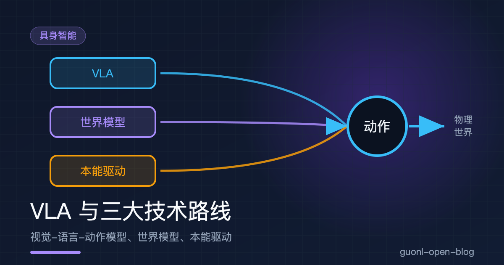
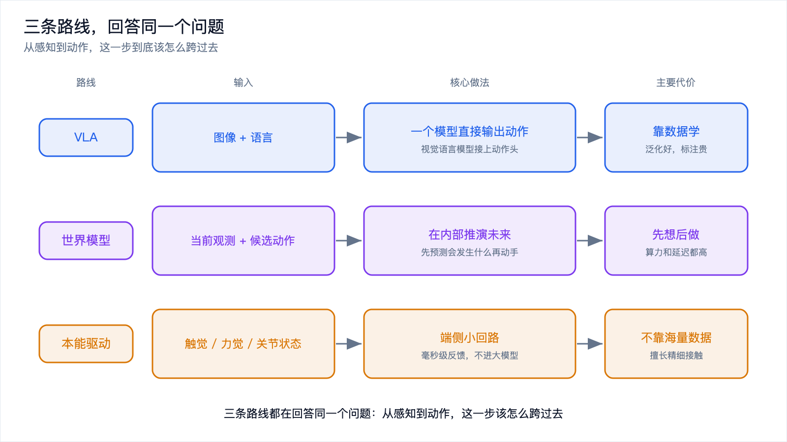
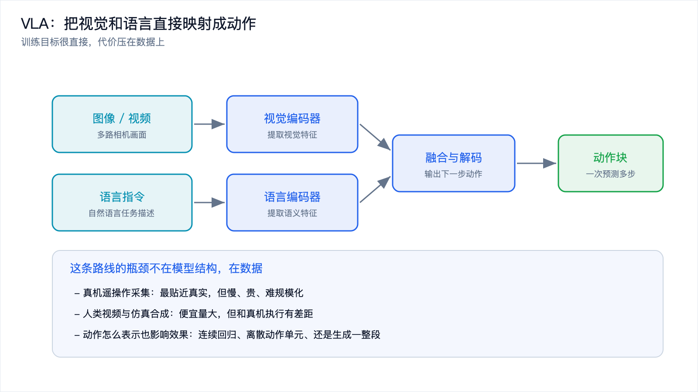
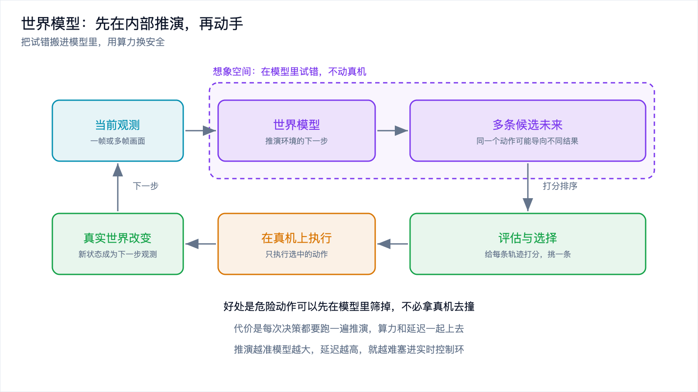
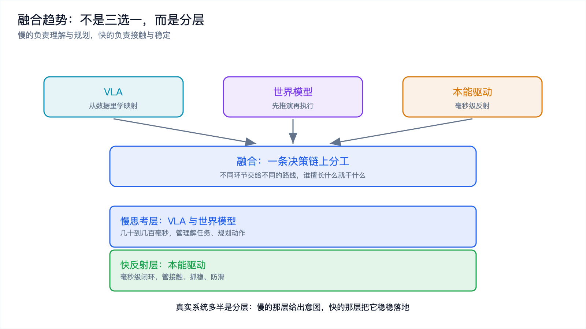

# VLA 与三大技术路线：视觉-语言-动作模型、世界模型、本能驱动

*2026-10-30 · VLA 与三大技术路线*

## 从上一篇留下的那个问题说起

上一篇把具身智能拆成了感知、决策、控制三个环节。感知那一环的技术栈相对清楚，相机、深度、IMU、力矩传感器各司其职；控制那一环也清楚，PID、逆运动学、力控，几十年的积累。真正分歧最大的是中间那一格：从"看到的东西加上想做的事"，到"这一时刻该输出什么动作"，这一步到底该怎么跨过去。

目前有三条主流路线在同时推进，各自给出了不同的答案。一条让模型直接看图、读指令、输出动作；一条让模型先在内部推演一遍未来再动手；一条干脆不依赖大模型，靠触觉和力觉做一个毫秒级的局部闭环。

它们不是三款竞争的产品，而是三种设计哲学，差别在于把智能放在哪里，以及愿意为什么付出代价。

## 三条路线在争什么

三条路线的起点一样，都是"当前观测 + 目标"；终点也一样，都是"一组要执行的动作"。分歧全在中间那一段怎么算出来。

*图 1：三条路线都在回答同一个问题，差别在把智能放在哪里、把成本压在哪里。*

下面一条一条看。

## 路线一：VLA，把视觉和语言直接映射成动作

VLA 是 vision-language-action 的缩写，视觉-语言-动作模型。它的做法可以一句话概括：拿一个已经会看图、会读文字的视觉语言模型，再教它输出动作。

视觉语言模型在互联网的图文数据上预训练过，知道杯子长什么样、抽屉是什么、把东西放进盒子是什么意思。这些知识是免费的副产品，来自几十年积累的公开图文。VLA 的做法是把机器人采集的"图像 + 语言指令 + 动作"三元组拿来微调，让模型学会"看到这个画面、听到这句指令，就输出这一串动作"。

*图 2：VLA 把视觉和语言编码后融合，直接解码成动作，训练目标简单，瓶颈在数据。*

这条路线早期的代表性工作来自 Google 的 RT 系列，它证明了视觉语言模型里从互联网学到的语义知识可以迁移到机器人控制上。之后出现的 OpenVLA 等开源实现，把这条路线的门槛降了下来，让更多人能在自己的机器人上试。这些都是公开的研究工作，具体效果随数据和本体变化很大。

**动作怎么表示，是这条路线上最关键的工程细节**，它直接决定了模型好不好训、能不能实时跑。

一种做法是连续回归，让模型直接输出关节角或末端位姿的数值。简单直接，但和语言模型那种"一个词一个词往外吐"的结构不兼容，需要额外的输出头。

另一种做法是离散化。把每个动作维度切成若干档，动作就变成了 token，模型可以像生成句子一样自回归地生成动作。好处是整套结构和语言模型完全一致，训练方法可以直接复用；代价是精度受分档粒度限制。

还有一种做法是生成式，用扩散模型或者流匹配一次性生成一整段动作，也就是常说的动作块。一次推理出未来几十步，中间不用反复调用模型，推理频率的压力一下就小了，生成的动作也更平滑。代价是这一段动作一旦生成，中途要改就麻烦，只能等它执行完或者叠加一层修正。

这三种做法共同的代价压在数据上。模型的能力上限由数据覆盖度决定：想让它抓没见过的物体、在没见过的厨房里工作，就得有对应的数据。真机数据慢且贵，人类视频便宜但没有动作标签，仿真数据量大但和真实世界有落差。这个矛盾是 VLA 路线上最硬的约束，后面会单独写一篇。

还有两条工程上的代价。一是频率，一个几 B 参数的模型一次前向要几十到几百毫秒，进不了千赫兹的控制环，只能输出动作块或者待在慢的那一层。二是闭环误差，自回归生成动作，前面一步偏了会带着后面一起偏。

## 路线二：世界模型，先在内部推演再执行

世界模型的思路来自一个很自然的观察：人做复杂动作之前会在脑子里过一遍。"这个杯子这么放会不会倒"，你想都不用想就能判断，因为你的脑子里有一个能预测物理后果的模型。

工程上的对应是学一个模型：输入当前状态和候选动作，输出下一个状态会变成什么样。有了它，机器人可以在"脑子里"试错，不用拿真机去撞。

这个思路的公开代表作是 2018 年那篇把"世界模型"这个词带进主流的论文，它用一个小网络在压缩过的潜空间里预测未来；后来的 Dreamer 系列把它做成了强化学习的训练循环，让策略完全在想象出来的轨迹上学习。这条路线的用法可以分成两类。

一类用在训练期，把世界模型当成可以无限重放的模拟器。强化学习最费样本，真机上跑一次试验要几秒，仿真里可以并行跑几千个环境，而学出来的世界模型比物理引擎更贴近真实数据分布，还省掉了建模的功夫。

另一类用在推理期，把世界模型当成规划器。拿到当前观测，生成若干候选动作，用模型推演每个候选会导向什么结果，给这些结果打分，挑最好的那个真的执行。这本质上就是把模型预测控制的框架搬过来，只把里面人写的物理方程换成了学出来的网络。

*图 3：世界模型把试错搬进想象空间，用算力换安全，代价是延迟和误差累积。*

代价有两层。第一层是算力和延迟：每次决策要推演多个候选、每个候选要推演多个步长，开销随候选数和步长一起增长。推演得越远、候选给得越多，决策就越慢，这在实时控制里是硬伤。第二层是精度：预测模型本身有误差，推演得越远误差越大，几步之后轨迹就漂到没有参考价值的地方去了。想让推演更准，模型就得更大，延迟又上去了，两个目标互相拉扯。

所以世界模型目前更常见的落点，是训练期的模拟器，或者在慢思考层当安全过滤器。

## 路线三：本能驱动，触觉和力觉的毫秒级闭环

第三条路线完全换了个角度。它不问"怎么让模型更聪明"，而问"哪些动作根本不需要聪明"。

手碰到烫的东西会立刻缩回来，这个动作不经过大脑的深思熟虑，走的是脊髓里的反射弧。工程上的对应是把"接触"这件事交给一个跑在端侧、频率很高的局部闭环：读触觉和力觉，立刻调整关节力矩，几百微秒到几毫秒内完成一圈，中间不经过任何大模型。

这条路线的底气来自物理规律本身。接触的力学是确定的，不需要"见过一万次"才知道硬物不能硬压、滑了要加力。物理约束提供了极强的先验，这类控制器可以是手写规则加少量参数的组合，比如阻抗控制、力控和各种反射式调整逻辑；也可以用强化学习训一个小网络，但训练在仿真里并行跑几百万次，不需要真机数据。

它的强项是精细接触。插拔接插件、拧螺丝、抓软物体、把杯子放到桌面上不砸出声音，这些任务的难点全在"手感"上，而手感必须在毫秒级反馈里才成立。VLA 那类模型就算看得很准，也很难在这种尺度上做出反应，因为它的推理周期比接触过程本身还长。

它的局限同样清楚：它只管"接触"这一段，不知道任务是什么，不理解语义，换个物体往往要重新调参数。它是一块肌肉，不是一个大脑。

## 三条路线的取舍对比

把三条路线摆在一起，取舍会看得更清楚。

| 维度 | VLA | 世界模型 | 本能驱动 |
| --- | --- | --- | --- |
| 输入 | 图像 + 语言指令 | 当前观测 + 候选动作 | 触觉、力觉、关节状态 |
| 核心机制 | 一个模型直接输出动作 | 先预测未来，再挑动作 | 高频局部反馈闭环 |
| 数据需求 | 高，覆盖度决定泛化 | 中高，需要能推演的数据 | 低，物理规律提供先验 |
| 算力与延迟 | 一次前向几十到几百毫秒 | 更高，随候选数和步长增长 | 毫秒级，端侧小回路 |
| 泛化能力 | 强，能理解没见过的指令 | 中，受预测精度限制 | 弱，通常限定在特定接触任务 |
| 擅长 | 理解任务、跨物体泛化 | 安全筛选、长程规划 | 精细接触、稳定性 |
| 不擅长 | 高频控制、精细力控 | 实时性、长程精度 | 语义理解、任务泛化 |
| 典型位置 | 慢思考层 | 训练期，或慢思考层 | 快反射层 |

表里最关键的是"典型位置"这一行：三条路线天然待在不同的时间尺度上，而尺度差两三个数量级，意味着它们很难互相替代。这也是融合趋势的起点。

## 融合趋势：路线之争最后会变成分工

真实的系统正在往分层上走，原因不是谁妥协了，而是时间尺度的差异本来就没法用一个模型抹平。

*图 4：融合的方式是分层，慢的负责理解与规划，快的负责接触与稳定。*

VLA 内部在做拆分。让语言模型那部分负责理解指令、维持上下文，把动作输出交给一个专门为动作空间设计的小网络，让它在同样的特征上更快地出动作。这个"一慢一快"的结构，是在同一个模型内部把两个时间尺度分开，公开讨论里常叫双系统或者动作专家。

世界模型找到两个更现实的落点。一个是当训练期的模拟器，用学出来的环境代替物理引擎，省掉建模成本，也更接近真实数据的分布。另一个是在慢思考层当安全过滤器，把候选动作先在模型里跑一遍，筛掉明显会出事的那几个再往下传。这两种用法都不要求它在毫秒级给出答案，延迟压力小很多。

本能驱动补上了另外两条路线共同的短板。VLA 学会了"大致该往哪动"，但接触瞬间的细微调整它管不了；把触觉和力觉反馈接进策略，让局部有一个高频的兜底回路，抓取成功率会明显不同。这也是触觉传感这两年重新被重视的原因。

顺着这个分工往下看，一个典型的系统会长成这样：最上层理解自然语言、拆解任务，中间层做规划和安全筛选，下面一层把意图变成动作序列，最底层用毫秒级的反馈把接触处理好。每一层用最适合自己时间尺度的技术，层与层之间用清晰的接口隔开。

这也是为什么问"哪条路线会赢"可能问错了问题。它们回答的不是同一个问题，自然也就没有唯一的答案。

## 写在最后

从感知到动作这一步，三条路线给了三种答案。VLA 把视觉和语言直接映射成动作，靠互联网预训练的常识加机器人数据微调，泛化最强，代价压在数据覆盖度和推理频率上。世界模型先推演再执行，把试错搬进模型内部，适合当训练期的模拟器或者慢思考层的安全过滤器，代价是算力、延迟和长程误差累积。本能驱动以触觉和力觉为核心，做一个端侧的毫秒级闭环，不依赖海量数据，擅长精细接触，但泛化范围窄。

三条路线的时间尺度差两三个数量级，谁也替代不了谁，融合的方式只能是分层分工。

聊到 VLA 的时候留了一个坑：它的能力上限由数据覆盖度决定，而真机数据慢且贵、人类视频没有动作标签、仿真数据和真实世界有落差。这三类数据怎么配合，怎么形成一个能自我加速的闭环，下一篇[《数据与仿真闭环：具身智能为什么卡在数据上》](./data-simulation-loop.md)接着讲。
