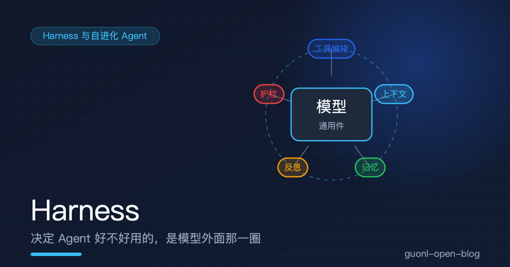
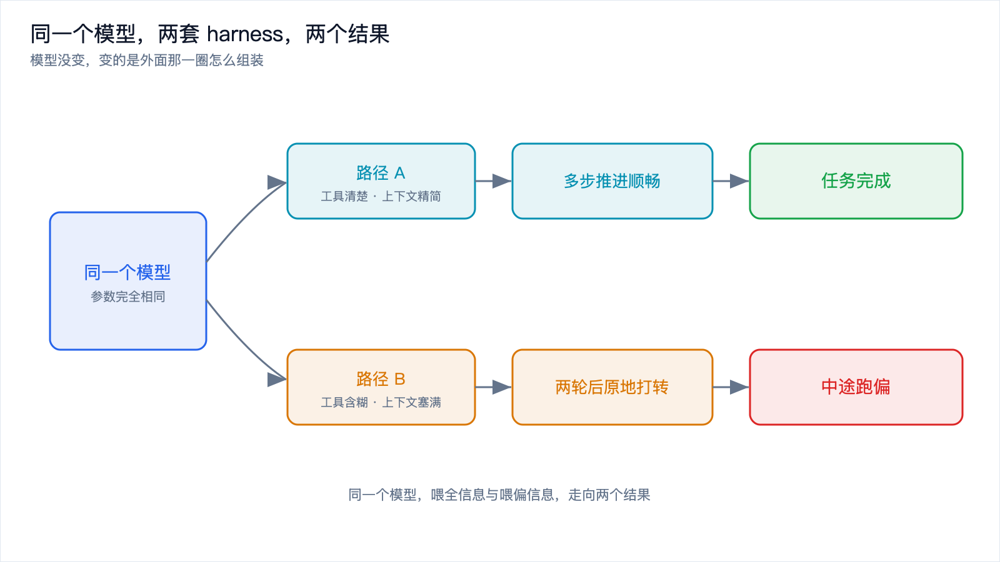
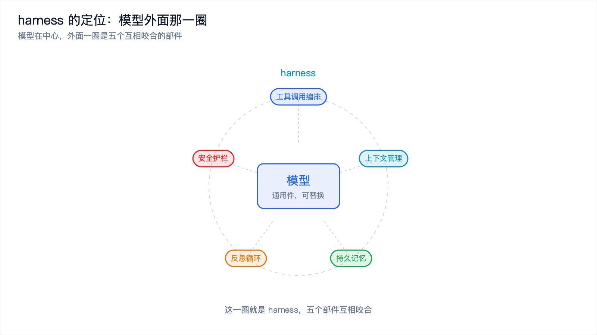
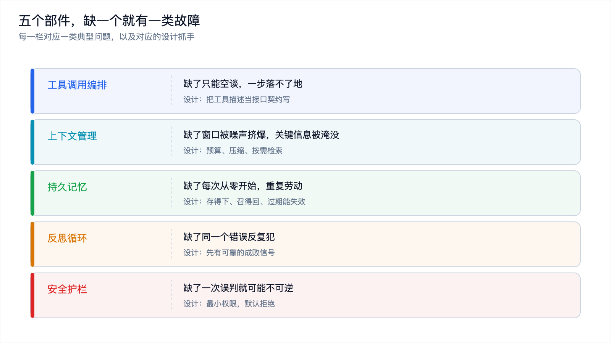
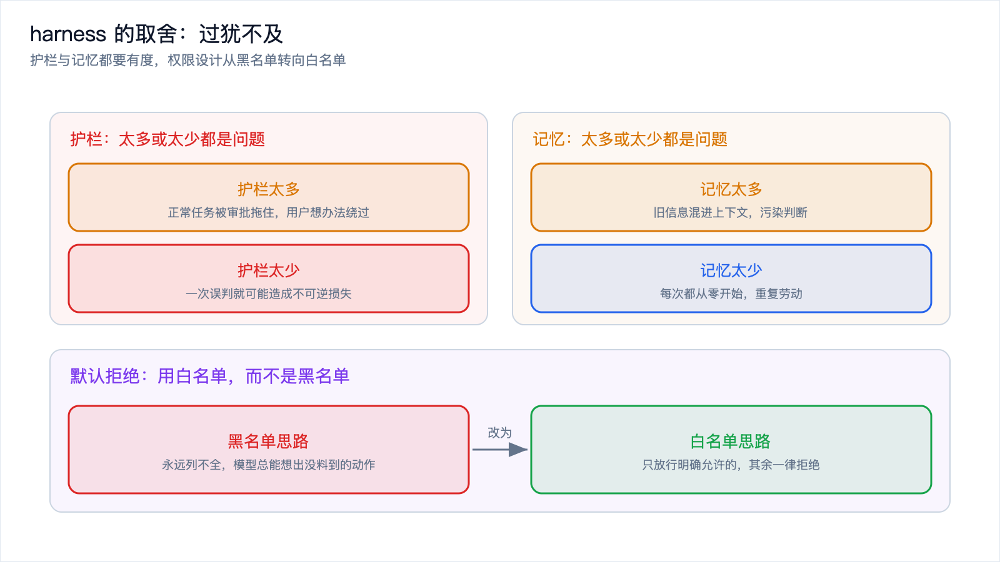

# Harness：决定 Agent 好不好用的，是模型外面那一圈

*2026-11-10 · Harness 与自进化 Agent*

## 同一个模型，换个外壳就像换了一个人

如果你同时用过两个 Agent 框架，大概都撞见过这种反差。

同一个模型，同一句指令，同一个任务，在一个框架里它先列计划、读文件、跑测试、定位问题、改完再验一遍，一路顺畅；换到另一个框架里，它第一步就卡住了，因为它拿不到目录结构，工具说明含糊得只能靠猜，上下文又被一长串无关的历史对话塞满，试了两轮就开始原地打转，最后丢下一句"我无法完成"。

模型没变，任务没变，变的是模型外面那一圈。

这一圈通常不被人注意，因为它不像模型那样有版本号、有跑分、有发布会。它藏在一堆胶水代码、配置文件和运行时逻辑里：工具怎么描述、上下文怎么组装、失败之后谁来收拾、危险动作谁来拦。这些事听起来琐碎，但它们才是模型能不能把活干成的分水岭。

模型提供的是"想"的能力，而"能拿到什么信息、能做什么动作、做错了怎么收场"，全由外面那一圈说了算。

*图 1：模型相同，喂全信息的路径跑通了任务，喂偏信息的路径在中途跑偏。*

## 给"这一圈"起个名字：harness

先说个比方，再说定义。

一台发动机再强，装到赛车上和装到拖拉机上，跑出来的东西完全是两回事。发动机决定上限，底盘、转向、刹车决定这台机器到底能不能把那个上限用出来。发动机可以换，底盘得自己调。

或者换成骑马。马跑得快不快是天赋，但缰绳、马鞍、蹄铁决定了你能不能让马往对的方向跑、什么时候该拉、什么时候该放。这套东西的名字就叫 harness，本意是马具、挽具，也引申为"驾驭、利用"。用在 Agent 身上，这个双关贴切得不用多解释。

比方到此为止，接下来是工程定义。

harness 是包裹在模型外面的整套运行时环境、控制系统和基础设施。它管的事可以归成四类：模型能看到什么信息、能调用什么工具、做完之后怎么判断成败、以及哪些动作绝对不许做。一个 Agent 框架，剥开名字看，装的都是这几件事。

有人会问，那不就是"框架"吗。差别在重心。框架这个词偏抽象的库和接口，harness 更强调运行时、控制和约束这一整套活着的东西。你写一个 while 循环把工具串起来，那就是一个最朴素的 harness 雏形；你加上上下文裁剪、记忆读写、失败回滚和权限校验，它才长成一副能上生产的骨架。

*图 2：模型是中心，harness 是包在外面的一圈，由五个部件咬合而成。*

## 拆开这一圈：五个部件

把 harness 拆开，大致是五个部件。它们不是并列的清单，而是互相咬合的齿轮，缺一个，整台机器都会以某种方式露怯。

### 工具调用编排

模型自己不能上网、不能读文件、不能发请求，它唯一会做的是生成文本。所以它能调用哪些工具、工具怎么描述给它、一次任务的多个调用怎么串起来，全靠 harness 安排。

工具描述是模型唯一的说明书，写含糊了它就乱调、漏调、重复调。多步调用之间还有依赖关系，得先查 A 才能拿 A 的结果去查 B，这个顺序 harness 要能表达。模型一次可能并行请求好几个工具，结果回传时得靠标识一一对上号，对错了就会张冠李戴。

这个部件缺了，模型就只能空谈。它能把方案说得头头是道，却一步都落不了地。怎么把工具描述写准、参数怎么校验、错误怎么回传，[《动手写一个最小 Agent》](../ai-agent/build-minimal-agent.md) 那篇已经用代码讲透了，这里不重复。

### 上下文管理

上下文窗口是模型每次生成时能同时看到的全部文本，它有上限，而且是稀缺资源。

什么信息该进上下文、以什么顺序进、各占多少预算、聊了很长的历史怎么压缩，这些由 harness 决定。管得不好，窗口会被无关的历史和过期的工具输出挤爆，真正关键的那条信息反而被淹没在中间，模型就顺着噪声跑偏了。

这一层的关键动作是四个：按需把相关信息捞进来、把长内容压缩瘦身、把重要的放到模型记得住的位置、让过期信息及时退场。细节在 [《提示词工程不够用了：Context Engineering 入门》](../context-engineering/context-engineering-intro.md) 里展开过。

### 持久记忆

上下文管理管的是"这一次任务里模型看到什么"，持久记忆管的是"跨会话记住什么"。

用户偏好用哪种语言、这个项目的构建命令是什么、上次部署失败是因为端口被占用，这些事实不该每次从零问起。harness 要把它们存下来，在合适的时候召回，并且在信息过期时让它失效。

没有这一层，Agent 每次都是失忆的天才，重复劳动，前后矛盾。怎么存、怎么取、怎么忘，[《Agent 的记忆系统》](../context-engineering/agent-memory.md) 那篇讲得更细。

### 反思与反馈循环

任务做完之后，harness 要做一件很多框架早期都漏掉的事：复盘。

这次任务成功了吗，靠什么判断；失败的话卡在哪一步，下次能不能绕开。把这些判断沉淀成可以复用的东西，Agent 才会随着使用变强，而不是永远停在原地。

这个部件缺了，Agent 会把同一个错误犯上一百遍，因为它压根没记住上次是怎么栽的。复盘要成立，前提是有可靠的成败信号，比如测试跑没跑过、结果能不能自动验证。信号不可靠时，反思出来的结论很可能本身就是错的，这一点下一篇会专门讲它的代价。

### 安全护栏

还有一道，也是最容易被赶工跳过的一道：权限、危险操作审批、沙箱隔离。

模型是概率生成的，它下一秒想调用什么动作，你没法穷举。所以护栏的默认姿态应该是拒绝，而不是放行。

这个原则要多说两句。很多人设计权限时习惯列一张黑名单：删库、转账、发邮件不许做，其余放行。问题在于黑名单永远列不全，模型总能想出一个你没预料到的动作。反过来做白名单，只放行明确允许的几类操作，剩下的全部拒绝，你才把未知风险挡在了门外。**默认拒绝**的代价是多一层配置，收益是即使模型犯了错，也撞不到不该碰的东西上。

对不可逆的动作，还要再加一道人工闸门。自动化可以激进，但删数据、转钱、动生产环境这些回不了头的事，得有人点头。

*图 3：五个部件缺了会怎样，每一栏对应一类典型故障。*

## 为什么模型越趋同，harness 越是胜负手

这两年一个明显的变化是，各家旗舰模型的能力差距在缩小。跑分咬得很紧，你追我赶的领先往往只维持几个月。据公开报道，开源模型和闭源旗舰之间的差距也在缩短。当模型本身拉不开档次，竞争的重心自然就挪到了模型外面。

有三个角度可以说明为什么 harness 成了关键。

模型是通用件，可以随时替换。今天你接的是 A 模型，明天 B 模型降价了、或者某个开源模型在中文场景上更顺手，你把接口一换就行。真正沉淀在你手里的，是 harness 那一圈：你的工具、你的提示词组织方式、你攒下来的记忆和技能。模型是租来的，harness 是自己的。

harness 决定模型能拿到什么信息、能做什么动作。这是最直接的一层。同一个模型，喂全信息和喂偏信息，是两个结果；工具描述清楚和含糊，是两个结果；出错之后有回滚和没回滚，还是两个结果。模型的上限摆在那里，harness 决定这个上限能被用出几成。

harness 是工程能力，抄不走。模型权重谁都下得到，用起来没什么门槛。但你对自家业务的理解、你踩过坑之后长出来的工具集、你积累的项目记忆，这些东西长在你的系统和流程里，别人看得到界面，看不到内里。护城河往往不在最亮的那一层，而在最不显眼的那一圈。

## harness 不是越复杂越好

把五个部件讲完，容易产生一种错觉：那就全都堆满，越厚越安全。方向正好反了。

护栏堆太多，正常任务也被一层层审批挡住，用起来又慢又烦。用户被烦到一定程度，会想方设法绕过你的护栏，最后实际安全性反而更低。记忆堆太多，什么都往长期库里塞，召回时一堆旧信息混进来污染判断，模型被过期的偏好带偏。工具堆太多，光是工具描述就占掉一大块上下文预算，模型面对几十个相似的工具反而挑不准。

所以真正要练的判断力，是分清什么该放进 harness、什么不该。

一条实用的准则：凡是每次都要做、而且做错了代价大的事，值得固化进 harness，比如权限校验、危险动作审批、上下文预算控制。凡是偶尔才用到、或者错了也能补救的，先别急着加，等它真的反复出问题再说。

harness 的目标不是把模型管死，而是让它在需要的地方有自由，在危险的地方有约束。这个平衡点每个系统都不一样，得自己调。

*图 4：护栏和记忆都是过犹不及，默认拒绝把未知风险挡在门外。*

## 两种取向：连接优先，还是成长优先

harness 的设计空间很大，两款被广泛讨论的开源框架，正好代表了两种不同的取向。

一款是据公开报道在 2025 年底开源的 OpenClaw（国内开发者戏称"养虾"）。它把 harness 的重心放在连接与触达上，支持大量消息渠道，本质是一个网关型的连接中枢，让模型能在各种平台上被调用、能连上各种服务。工具和渠道是它的长板。

另一款是据公开报道在 2026 年初开源的 Hermes Agent（戏称"养马"）。它把重心放在记忆与成长上，核心机制是长期记忆和一套会自我完善的技能系统，让 Agent 越用越贴合使用者的习惯。它的长板是积累。

这两种取向没有绝对的高下，取决于你要解决什么问题。但它们共同说明了一件事：模型那一层越来越像标准件，真正拉开差距的设计，都发生在外面那一圈。

## 写在最后

把这一篇的话收一下。同一个模型换个外壳效果差很多，这不是玄学，而是因为模型外面那一圈决定了很多东西：它能看到什么信息、能调用什么工具、做完怎么判断成败、以及哪些动作不许碰。这一圈就是 harness，模型提供"想"的能力，harness 决定这份能力能不能被用出来。

它大致由五个部件咬合而成，工具编排、上下文管理、持久记忆、反思循环、安全护栏，缺一个就有一类故障找上门。但厚度不等于强度，护栏和记忆都要有度，判断标准是"是不是每次都要做、做错了代价大不大"。默认拒绝这个姿态，是护栏设计里最容易被低估的一条。

这五个部件里，反思与反馈循环最特别。它是唯一一个能让 Agent 越用越强的部件，把一次任务的成败变成可以复用的资产。下一篇 [《Agent 怎么从经验里长出技能：自进化的原理与代价》](self-evolving-skills.md)，就来拆解这套机制怎么运转，以及它为什么会带来经验污染。
