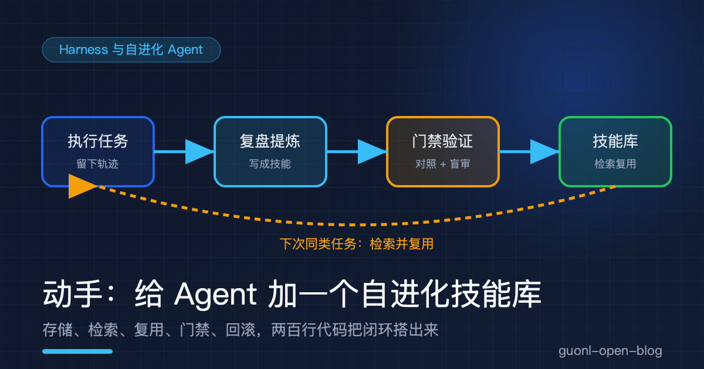
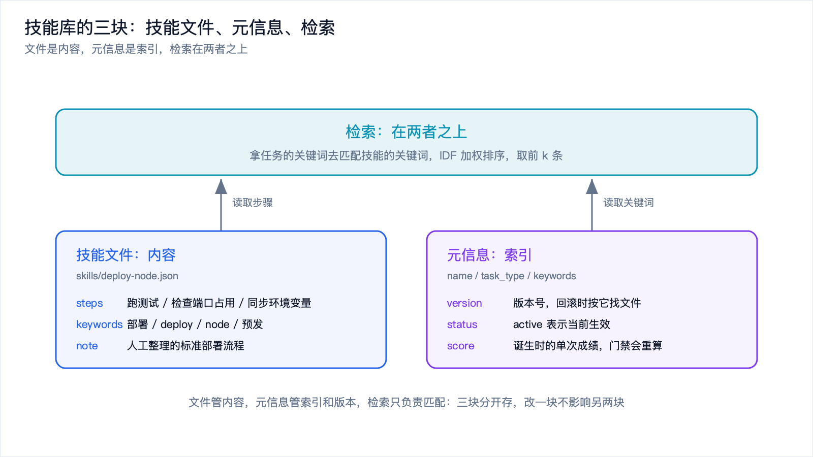
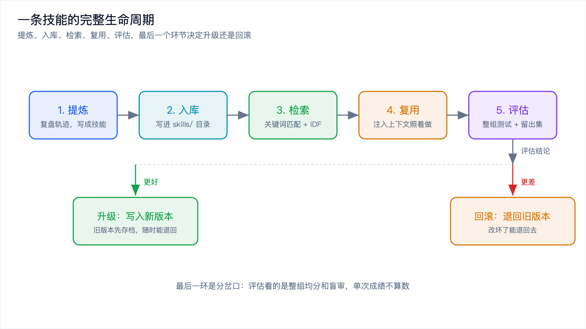
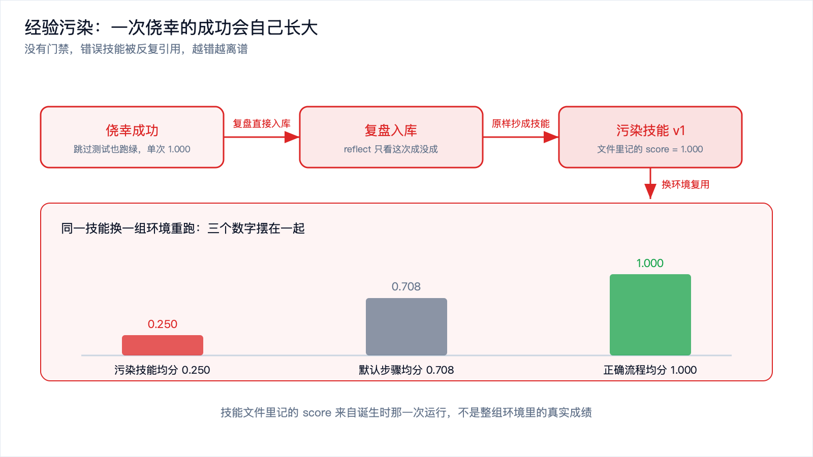
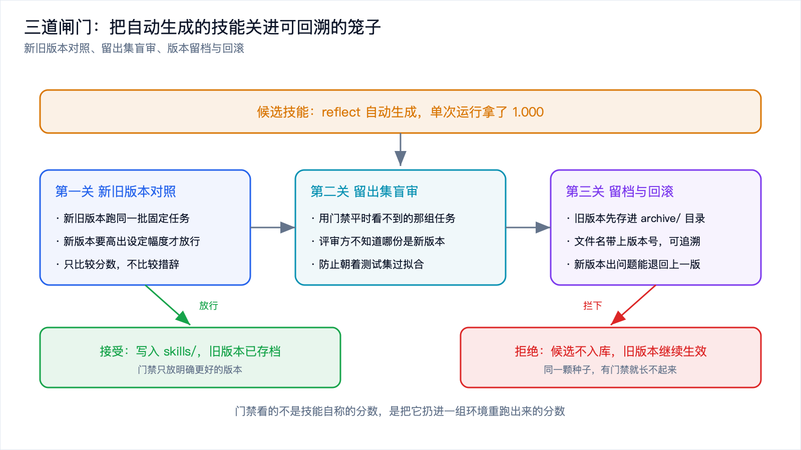

# 动手：给 Agent 加一个自进化技能库



*2026-11-10 · Harness 与自进化 Agent*

上一篇[《Agent 怎么从经验里长出技能：自进化的原理与代价》](self-evolving-skills.md)把原理讲完了：任务结束后复盘，把解法提炼成技能文件存进本地库，下次检索出来注入上下文直接复用。技能和记忆不是一回事，一个记「怎么做」，一个记「是什么」。文章收尾时留了一个警告，缺了对照验证，错误会沉淀成技能，被反复引用，越滚越大。

原理听懂是一回事，落到手上还是发虚。技能库具体怎么存？检索拿什么排序？「污染」这个东西在代码里到底长什么样？这篇给一段能直接跑的代码，把这条闭环搭出来，然后亲手制造一次污染，再亲手把它拦下来。

## 先把要搭的东西说清楚

一套真实的技能系统里，有两处是模型在干活：执行任务，复盘提炼。这两处都要 API Key，还带随机性，今天跑出 A 明天跑出 B，拿它演示工程机制会很难对齐。所以这两层换成规则化的 mock，把注意力全部压在技能库本身：存储、检索、复用、版本管理、回滚。

要判断一次执行好不好，得有个标尺。真实场景里这个标尺是评测基准，这里简化成一组固定的测试任务。每个任务声明两样东西，这次环境真正需要的步骤，以及哪些是已知的陷阱步骤。下面这段就是全部领域知识，加上给技能打分的两个函数。

```python
import json, math, shutil
from pathlib import Path

ROOT = Path("/tmp/skill_lab")

# 一次合格的部署应该覆盖这几步；"跳过测试"是已知的坏习惯
MUST = ["跑测试", "检查端口占用", "同步环境变量", "构建镜像", "健康检查"]
TRAPS = ["跳过测试"]

# 一组固定测试任务，给技能打分用
SUITE = [
    {"id": "S1", "needs": ["构建镜像", "健康检查"], "traps": TRAPS, "bites": False},
    {"id": "S2", "needs": ["检查端口占用", "构建镜像", "健康检查"], "traps": TRAPS, "bites": True},
    {"id": "S3", "needs": ["同步环境变量", "构建镜像", "健康检查"], "traps": TRAPS, "bites": True},
    {"id": "S4", "needs": ["检查端口占用", "同步环境变量", "构建镜像", "健康检查"],
     "traps": TRAPS, "bites": True},
]
# 留出集：门禁平时看不到，专门留给盲审
HELD_OUT = [
    {"id": "H1", "needs": ["检查端口占用", "同步环境变量", "构建镜像", "健康检查"],
     "traps": TRAPS, "bites": True},
    {"id": "H2", "needs": ["跑测试", "检查端口占用", "构建镜像", "健康检查"],
     "traps": TRAPS, "bites": True},
]

DEFAULT_STEPS = ["构建镜像", "部署", "健康检查"]     # 没技能可用时的默认做法
DEPLOY_KW = ["部署", "deploy", "node", "预发", "服务", "上线"]


def simulate(task, steps):
    """规则化的环境模拟：给定步骤，返回这次执行 0~1 的得分。"""
    need = task["needs"]
    hit = [s for s in need if any(s in st for st in steps)]
    score = len(hit) / len(need)
    if task.get("bites"):                            # 陷阱只在这条任务上才咬人
        for t in task.get("traps", []):
            if any(t in st for st in steps):
                score -= 0.7
    return max(0.0, min(1.0, score))


def evaluate(steps, suite=SUITE):
    """技能在一整组任务上的平均得分。"""
    return sum(simulate(t, steps) for t in suite) / len(suite)
```

`bites` 这个开关是整篇的戏眼。它代表「这次环境恰好没让错误暴露」。一次跳过了测试的执行，如果刚好赶上代码没出问题，它照样能跑绿，而且看起来跟一次认真执行没有区别。污染就是从这种「看起来没问题」里长出来的。



*图 1：技能库由三部分组成，技能文件是内容，元信息是索引，检索在两者之上。*

## 一、技能库长什么样

存储结构越简单越好。每个技能一个文件，JSON 就行，文件名就是技能名。目录分两层，`skills/` 放当前生效的版本，`archive/` 放旧版本，文件名带上版本号。

```python
class SkillStore:
    def __init__(self, root):
        self.root = Path(root)
        self.active = self.root / "skills"          # 当前生效的技能
        self.archive = self.root / "archive"        # 旧版本留档
        self.active.mkdir(parents=True, exist_ok=True)
        self.archive.mkdir(parents=True, exist_ok=True)

    def save(self, skill):
        p = self.active / (skill["name"] + ".json")
        p.write_text(json.dumps(skill, ensure_ascii=False, indent=2), encoding="utf-8")
        return p

    def get(self, name):
        p = self.active / (name + ".json")
        return json.loads(p.read_text(encoding="utf-8")) if p.exists() else None

    def list(self):
        return [json.loads(p.read_text(encoding="utf-8"))
                for p in sorted(self.active.glob("*.json"))]

    def archive_current(self, name):
        """把当前生效版本挪进 archive，文件名带上版本号。"""
        s = self.get(name)
        if s is None:
            return None
        dst = self.archive / ("%s.v%d.json" % (name, s["version"]))
        dst.write_text(json.dumps(s, ensure_ascii=False, indent=2), encoding="utf-8")
        (self.active / (name + ".json")).unlink()
        return dst

    def history(self, name):
        return [json.loads(p.read_text(encoding="utf-8"))
                for p in sorted(self.archive.glob(name + ".v*.json"))]

    def rollback(self, name, version):
        """回滚到某个历史版本：先把当前版本存档，再把目标版本提上来。"""
        src = self.archive / ("%s.v%d.json" % (name, version))
        target = json.loads(src.read_text(encoding="utf-8"))
        cur = self.get(name)
        if cur is not None and cur["version"] != version:
            (self.archive / ("%s.v%d.json" % (name, cur["version"]))).write_text(
                json.dumps(cur, ensure_ascii=False, indent=2), encoding="utf-8")
        target["status"] = "active"
        self.save(target)
        return target
```

写一条进去看看长什么样。这条是人工整理的，还没进入自动生成的流程。

```python
store = SkillStore(ROOT)
sample = {
    "name": "deploy-node", "task_type": "deploy", "keywords": DEPLOY_KW,
    "steps": ["跑测试", "检查端口占用", "同步环境变量", "构建镜像", "健康检查"],
    "version": 1, "status": "active", "source": "human", "score": 1.0,
    "created_at": "2026-11-10T09:00:00", "note": "人工整理的标准部署流程",
}
p = store.save(sample)
print("写入：%s" % p)
print(p.read_text(encoding="utf-8"))
```

输出：

```text
写入：/tmp/skill_lab/skills/deploy-node.json
{
  "name": "deploy-node",
  "task_type": "deploy",
  "keywords": [
    "部署",
    "deploy",
    "node",
    "预发",
    "服务",
    "上线"
  ],
  "steps": [
    "跑测试",
    "检查端口占用",
    "同步环境变量",
    "构建镜像",
    "健康检查"
  ],
  "version": 1,
  "status": "active",
  "source": "human",
  "score": 1.0,
  "created_at": "2026-11-10T09:00:00",
  "note": "人工整理的标准部署流程"
}
```

`keywords` 是给检索用的，`steps` 是技能的内容，剩下几个字段是管理用的：`version` 和 `status` 撑起版本管理，`source` 区分人工和自动，`score` 记录它诞生时的成绩。最后这两个字段后面会咬人一口。

## 二、让 Agent 复盘出自己的第一条技能

mock 的模型层就两个函数。一个假装完成任务，按给定步骤跑一遍，返回得分；一个假装复盘，把这次做过的步骤原样写成技能。

```python
def run_task(task, steps=None):
    """mock 的「完成任务」：按给定步骤执行一遍，返回轨迹与结果。"""
    if steps is None:
        steps = DEFAULT_STEPS
    score = simulate(task, steps)
    return {"steps": list(steps), "score": round(score, 3), "ok": score >= 0.8}


def reflect(task, run):
    """mock 的「复盘提炼」：把这次实际做过的步骤原样写成一份技能。"""
    return {
        "name": task["skill_name"], "task_type": task["type"],
        "keywords": list(task["keywords"]), "steps": list(run["steps"]),
        "version": 0, "status": "active", "source": "auto",
        "score": round(run["score"], 3), "created_at": "2026-11-10T10:00:00",
        "note": "复盘任务 %s 自动生成" % task["id"],
    }
```

现在跑第一个任务。这次环境里端口是空的，环境变量也齐，Agent 图省事，跳过测试直接构建，一路跑绿。

```python
lucky = {"id": "T1", "type": "deploy", "skill_name": "deploy-node",
         "keywords": DEPLOY_KW,
         "needs": ["构建镜像", "健康检查"], "traps": TRAPS, "bites": False}
run1 = run_task(lucky, ["跳过测试直接构建镜像", "部署", "健康检查"])
print("  执行步骤：%s" % " / ".join(run1["steps"]))
print("  结果得分：%.3f   是否成功：%s" % (run1["score"], run1["ok"]))
skill1 = reflect(lucky, run1)
skill1["version"] = 1
store.save(skill1)
```

输出：

```text
任务 T1：把 node 服务部署到预发（这次端口刚好空着）
  执行步骤：跳过测试直接构建镜像 / 部署 / 健康检查
  结果得分：1.000   是否成功：True
  没有门禁，复盘结果直接入库
  复盘提炼出技能：deploy-node（v1，source=auto）
  技能步骤：跳过测试直接构建镜像 / 部署 / 健康检查
```

得分 1.000，执行判定为成功。`reflect` 不管这次是运气好还是真的做对了，它只看到「做成了」，于是把实际步骤原样抄进技能文件，直接入库。这条技能从头到尾没有经过任何对照验证，它就是污染的第一颗种子。

真实的系统里，`reflect` 这一步是模型在读自己的执行轨迹，输出的是自然语言总结，比这里复杂得多。但它同样只看「这次成了没有」，同样缺少「换个环境还成立吗」这一问。复杂度变了，盲点没变。



*图 2：提炼、入库、检索、复用、评估，最后一个环节决定它是升级还是回滚。*

## 三、新任务来了，先检索再复用

新任务进来，先拿它的关键词去库里找技能。检索用关键词匹配加 IDF 加权，几行标准库代码就够，不用向量库。

```python
def retrieve(task, store, k=2):
    docs = store.list()
    n = len(docs)
    df = {}
    for d in docs:
        for t in set(d["keywords"]):
            df[t] = df.get(t, 0) + 1
    query = set(task["keywords"])
    ranked = []
    for d in docs:
        s = 0.0
        for t in query & set(d["keywords"]):
            s += math.log((n + 1) / (df[t] + 0.5))     # 越稀有的关键词权重越高
        if s > 0:
            ranked.append((round(s, 3), d))
    ranked.sort(key=lambda x: (-x[0], x[1]["name"]))
    return ranked[:k]
```

第二个任务来了，同样是把 node 服务部署到预发。检索结果：

```text
任务 T2 的关键词：部署 deploy node 预发 服务 上线
检索结果（技能名  匹配分）：
  deploy-node    1.726   步骤：跳过测试直接构建镜像 / 部署 / 健康检查
```

库里此刻只有一条技能，它必然被命中，匹配分 1.726。真实库里躺着几十上百条技能时，IDF 权重负责把稀有关键词的命中顶到前面去，避免一条泛泛的技能压过一条真正对口的技能。检索这一环的成败，直接决定注入上下文的是不是对的东西。

命中了就直接复用。技能步骤被拼进提示词，Agent 照着做。这里不写真实的提示词拼接，但机制就是一句话：把命中的技能文本塞进上下文，让模型按它给的流程走。

## 四、亲手制造一次经验污染

第二个任务的环境和第一个不同，这次端口被占用了。同一个技能，换一个环境再跑一遍。

```text
T2 复用了检索到的技能：deploy-node
  结果得分：0.000   是否成功：False
对照：同一任务，不用技能、走默认步骤
  默认步骤：构建镜像 / 部署 / 健康检查
  结果得分：0.667   是否成功：False
污染技能在整组测试上的均分：0.250
默认步骤在整组测试上的均分：0.708
正确流程在整组测试上的均分：1.000
```

三个数字摆在一起，污染是什么就清楚了。

复用这条技能，得分 0.000。它跳过了测试，又没有端口检查这一步，端口一被占用就彻底卡死，比什么都不做还差。不用技能、走默认步骤，反而有 0.667。放到整组测试上看，污染技能均分 0.250，连默认步骤的 0.708 都够不着，离正确流程的 1.000 差了一大截。

污染最阴的地方在这里：技能文件里记的 `score` 是 1.000，因为它是从一次得分 1.000 的运行里诞生的。这个数字骗过了系统，也骗过了看日志的人。只有把它扔到另一组环境里重跑，真实成绩 0.250 才会露出来。没有对照组，这个数字永远不会浮上来。

这就是上一篇讲的「一本不断加印的教材」。第一版混进一个错误知识点，后面每一版都照着它编。代码里它只发生了一次，真实系统里它每来一个同类任务就发生一次，而且新生成的技能还会继续进库，把噪声叠上去。



*图 3：一次错误执行被沉淀成技能，后续任务反复引用，越错越离谱。*

## 五、加一道门禁，把污染拦下来

问题出在「复盘结果直接入库」这一步。加一道门禁，让技能生效之前先过三关：新旧版本在固定测试集上对照、用留出集做盲审、只有明确更好才放行并给旧版本存档。

```python
def gate(store, candidate, suite=SUITE, held_out=HELD_OUT, margin=0.05):
    incumbent = store.get(candidate["name"])
    new_score = round(evaluate(candidate["steps"], suite), 3)
    candidate["score"] = new_score
    if incumbent is None:                       # 库里没有同类技能，直接收下
        candidate["version"] = 1
        store.save(candidate)
        return {"decision": "接受（库中无同类技能）", "new": new_score, "old": None,
                "new_ho": None, "old_ho": None}
    old_score = round(evaluate(incumbent["steps"], suite), 3)
    # 盲审：评审方不知道哪份是新版，只看两份匿名技能在留出集上的表现
    new_ho = round(evaluate(candidate["steps"], held_out), 3)
    old_ho = round(evaluate(incumbent["steps"], held_out), 3)
    better = (new_score >= old_score + margin) and (new_ho >= old_ho)
    if not better:
        return {"decision": "拒绝（新版本没有更好）", "new": new_score, "old": old_score,
                "new_ho": new_ho, "old_ho": old_ho}
    candidate["version"] = incumbent["version"] + 1
    store.archive_current(candidate["name"])    # 旧版本先存档，再上新的
    store.save(candidate)
    return {"decision": "接受（新版本更优）", "new": new_score, "old": old_score,
            "new_ho": new_ho, "old_ho": old_ho}
```

第一次放行，是新版本确实更好。第二个任务失败后人工纠正，Agent 按完整流程又跑了一遍，这次把测试、端口检查、环境变量同步全做了。

```text
T2 失败后，人工纠正，Agent 按正确流程又跑了一遍
  结果得分：1.000   是否成功：True
门禁判定：接受（新版本更优）
  新版本均分：1.0   旧版本均分：0.25
  留出集（盲审）：新版本 1.0   旧版本 0.0
技能库现状：
  skills/deploy-node    v2  score=1.000  source=auto+reviewed
  archive/deploy-node.v1.json  文件里记的 score=1.000，整组实测均分=0.250
```

门禁把旧版本 v1 挪进了 `archive/`，新版本 v2 顶上来。注意最后一行：存档里那条 v1，文件里写的 `score` 是 1.000，整组实测只有 0.250。门禁看的正是后者，也就是把技能扔进一组环境里重新跑出来的分数，而不是它自己声称的分数。

第二次放行就轮到拦截了。门禁开着的时候，又出现一次侥幸成功的偷懒执行，得分照样 1.000。

```text
门禁开着的时候，再来一次侥幸成功的偷懒执行：
  T3 结果得分：1.000   是否成功：True
  门禁判定：拒绝（新版本没有更好）
  新版本均分：0.25   旧版本均分：1.0
  留出集（盲审）：新版本 0.0   旧版本 1.0
```

这次 `reflect` 生成的候选技能被拦下了。单次运行它拿了 1.000，可门禁不认单次成绩，它看的是整组均分和留出集。新版本 0.25 对旧版本 1.0，盲审 0.0 对 1.0，两个口径都指向同一个结论，拒绝入库。同一颗种子，有门禁就长不起来。

留出集这一步值得单独说一句。门禁如果只用 `SUITE` 打分，技能迭代久了会朝着这组任务过拟合，分数虚高。所以盲审用一份门禁平时看不到的 `HELD_OUT`，评审方也不知道眼前两份哪份是新版。盲审在这里是 mock 的，真实系统里可以交给一个独立模型，或者交给人。



*图 4：三道闸门把自动生成的技能关进可回溯的笼子里，旧版本随时能退回去。*

## 六、版本留档与回滚

门禁拦下污染之后，重跑同类任务，再试试回滚。

```text
污染被拦住后，重跑同类任务 T2：
  检索到：deploy-node（v2）
  结果得分：1.000   是否成功：True

回滚到 v1（那个污染版本）：
  检索到：deploy-node（v1）
  结果得分：0.000   是否成功：False
再回滚到 v2（正确版本）：
  检索到：deploy-node（v2）
  结果得分：1.000   是否成功：True
```

拦下污染之后，同一个任务从 0.000 变成 1.000。回滚到 v1，它立刻又失败；再回滚到 v2，恢复正常。旧版本留档的价值就在这两行里：改坏了能退回去，也能顺着版本号查清楚是哪一版开始变坏的。技能库还在自我迭代，没有版本管理，你连「它是什么时候变坏的」都答不上来。

这段代码一共两百行左右，只用标准库，跑一遍几秒钟。它当然是个玩具，`simulate` 是规则不是真实环境，`reflect` 是模板不是模型，检索是最朴素的关键词加权。但这几个玩具零件对应的，正好是真实系统里最容易出事的几个位置：复盘直接入库、检索命中了错的技能、单次成绩冒充整体质量、改错了回不去。

真要把这套东西接到生产里，还差几步。自动生成的技能先进待审区，人过一眼再入库，而不是像这里一样自动放行。一次只改一个技能，出了事分得清是哪处动的手脚。定期合并重复、删掉长期不命中的条目，免得检索噪声把对的技能压下去。给每条技能标上来源，人工写的和自动生成的分开管，出事时能顺着来源找到污染源。这几条没有一条是新东西，全是版本控制、灰度、评审、回滚这些用了几十年的老办法。

## 写在最后

这篇用一段能跑的代码，把自进化技能库的核心机制过了一遍。技能一个文件一条，元信息里带关键词和版本；任务完成后复盘提炼，把解法写成技能入库；新任务来了按关键词和 IDF 检索，命中就注入上下文复用；门禁在生效前做新旧对照和盲审，旧版本存档，随时能回滚。整套闭环的重点不在「存」，在「存之前那一问」：这条新技能，换一组环境还成立吗？

污染不是靠更聪明的模型解决的，是靠一道不信任模型的闸门解决的。让 AI 负责提建议，把验证和决策留在闸门这一侧。代码里的 `bites` 开关只控制了一行扣分，它背后是现实里最贵的那件事：一次侥幸的成功，和一个从来不问「这次是运气还是本事」的系统。

技能库讲的是「怎么让 Agent 记住做事的方法」。再往前一步，绕不开一个更虚也更大的问题：这样一天天长大的 Agent，到底算不算在朝着通用智能走？下一篇[《AGI 到底是什么：一个没有公认定义的目标》](../agi/what-is-agi.md)，把这个被反复引用却始终没有定论的词拆开看看。
