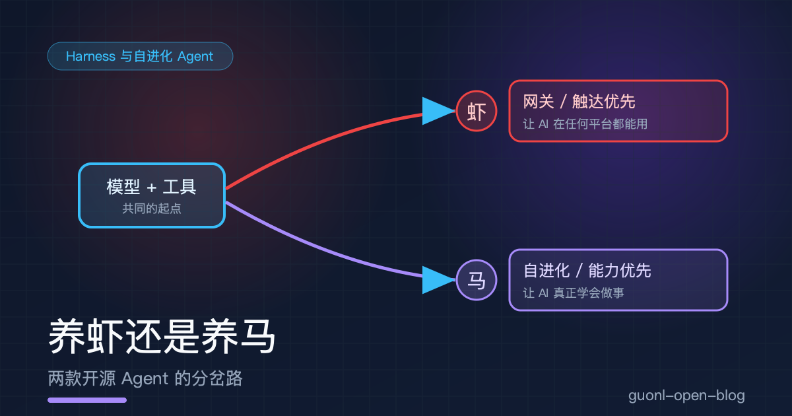
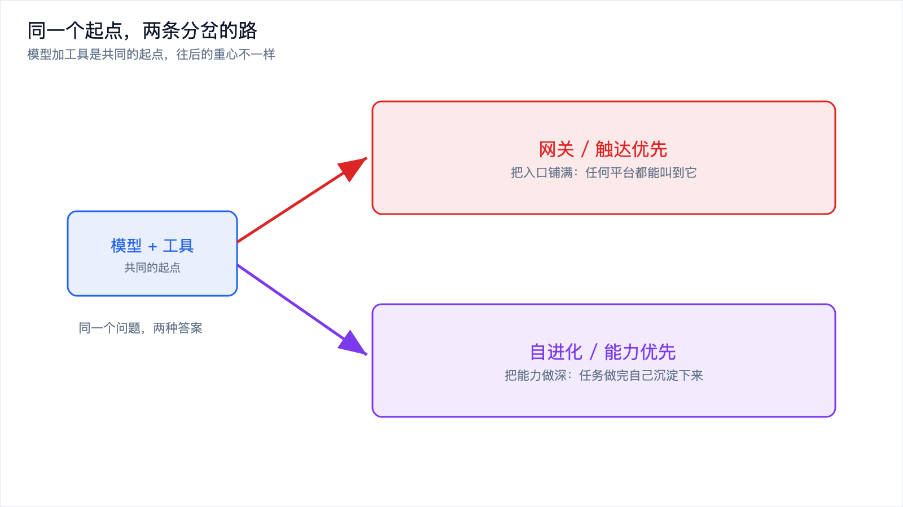
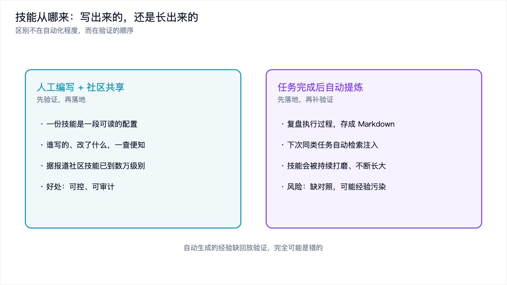
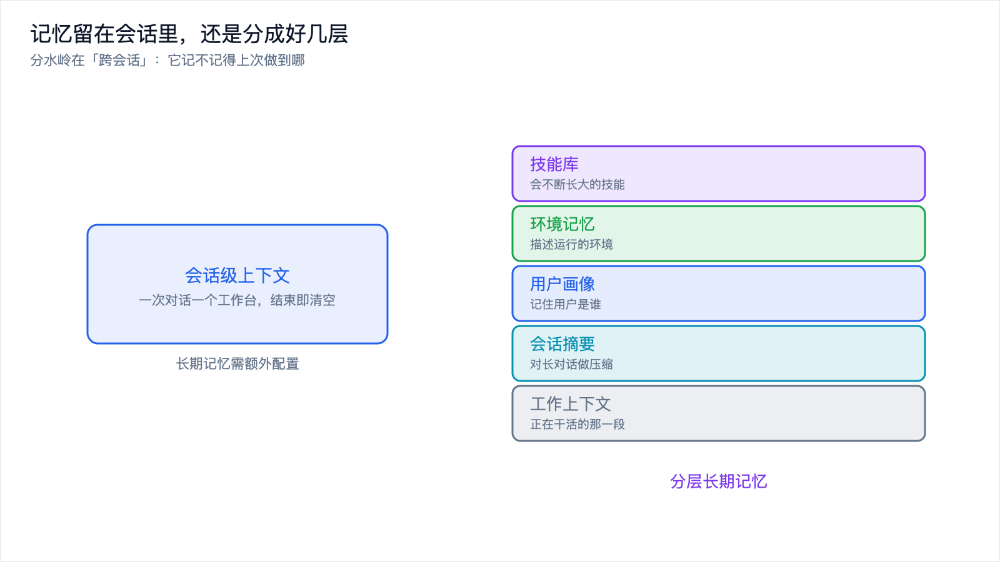
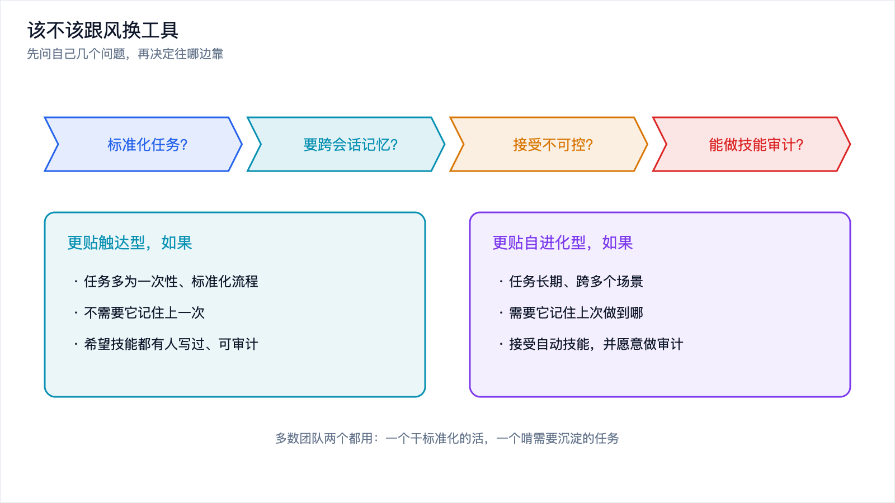

# 养虾还是养马：两款开源 Agent 的分岔路

*2026-11-10 · Harness 与自进化 Agent*

## 一个月换两次工具，换的到底是什么

有个挺有意思的现象。同一个小圈子里的人，上个月的群聊还在交流怎么把「龙虾」装到自己的机器上，这个月的话题已经变成了「马」怎么迁移、记忆怎么搬。工具确实换了，从一只换到了另一只。

但把这事只理解成「换了个更好的工具」，就把变化看小了。他们换的其实是一套对 Agent 该怎么长的判断：是把它当成一个铺得够广、随时能叫到的入口，还是当成一个会跟着你一起变聪明的搭档。前者是 OpenClaw 的路线，后者是 Hermes Agent 的路线。

这两条路线在同一个起点上分开，往后越走越远。这篇文章不评谁赢谁输，而是把这条分岔拆开，看看每个岔口上各自做了什么取舍，最后落到一个更实用的问题：你到底该不该跟着换。

## 先把两位主角摆上来

OpenClaw 是 2025 年底开源的项目，主导开发者是 Peter Steinberger，早期叫 Clawdbot。它的图标是一只红色小龙虾，所以部署和使用它被大家戏称为「养龙虾」「养虾」。它的设计哲学叫「触达优先」，本质上是一个网关型的连接中枢：基于 TypeScript 的网关型模块化架构，支持 50 个以上的消息渠道，微信、Telegram、Discord、Slack 这些都在里面。技能靠人工编写加社区共享，记忆则以会话级上下文为主。它的目标很直接，让 AI 在任何平台上都能用。

Hermes Agent 晚一步，2026 年 2 月开源，出自美国的 Nous Research，这家团队也做过 Hermes 系列的开源大模型。名字取自希腊神话里的众神信使，英文拼写和那个奢侈品牌一模一样，加上 2026 是马年，国内开发者就简称它「马」。它的哲学反过来，叫「能力优先」，官方口号是 the agent that grows with you，与你共同成长的智能体。架构基于 Python，走轻量路线，主打学习循环和个性化适配。它身上有两个标志性机制：自进化技能系统，和分层长期记忆。

两个名字、两套架构，指向的是同一个问题的两种答案。Agent 由哪些零件组成，前面[《从"对话"到"行动"》](../ai-agent/from-chat-to-action.md)已经拆过，这里不重复，只看这两款框架各自把力气花在了哪。

*图 1：同一个起点（模型加工具），一条路把入口做宽，一条路把能力做深。*

## 分岔一：触达优先，还是能力优先

先看第一个岔口，也是最根本的一个：把资源投在「让 AI 到处都能用」，还是投在「让 AI 真正会做事」。

触达优先解决的是一个入口问题。它假设模型本身的能力是够的，缺的是触点：人在微信里、在 Slack 里、在终端里，Agent 就得能在这些地方被叫到。于是它把 50 多个渠道一个个接上，把自己做成一个四通八达的中转站。代价也很清楚：它更擅长标准化、重复性的流程，比如总结一份公告、生成一份业绩报告；一旦任务跨了好几个场景、需要长期上下文，它就得靠人把信息重新喂进去，因为它不记得上次。

能力优先解决的是另一个问题。它假设入口早晚会被抹平，真正稀缺的是「会做复杂事」的能力。所以它把力气花在学习循环上：一件事做完，Agent 复盘一遍，把解法存下来，下次遇到同类任务直接调用。代价是复杂度被搬到了内部。技能会自己生长，你就得接受它长歪的可能，也要面对一层越来越厚的不透明。

两条路都不免费。一个是把广度做满、把深度留给外部；一个是把深度做进内部、把不透明也一起装进来。

## 分岔二：技能是写出来的，还是长出来的

第二个岔口，落到技能从哪来。

OpenClaw 的技能是人写的。开发者写，社区也写，据报道社区技能的数量已经到数万级别。这个模式的好处是可控：一份技能就是一段人能读懂的配置，谁写的、改了什么、什么时候改的，翻一翻就知道。它天生可审计。

Hermes 的技能是长出来的。它会在任务完成后自动复盘执行过程，把解法提炼成结构化的技能文件，通常是 Markdown，存在本地目录里；下次碰到同类任务，自动检索出来当上下文注入，直接复用。这些技能还会被持续打磨，据报道用的是 GEPA 这类离线优化方法，即遗传-帕累托提示词进化。有说法称它的样本效率最高能到传统强化学习方法的 35 倍，单次运行成本只要几美元，这些数字是厂商或专家的口径，听的时候要打个折。

两者的本质区别，不在自动化程度，而在验证的顺序。人写的技能是「先验证，再落地」，一份技能进仓库前，多少经过人的眼睛；自动提炼的技能是「先落地，再谈验证」，任务一结束技能就生成了，没人对照过。而自动生成的经验缺了对照实验和回放验证，完全可能是错的。错的经验一旦沉淀成技能，后续任务会反复引用它，越用越离谱，这就是所谓的经验污染。

有第三方评测称，智能体自动化知识积累的成功率只有大约六成，要不要把一段经验存下来，几乎完全取决于模型自己的主观判断。这也是为什么业内给的建议偏向保守：让 AI 负责提建议，验证和决策留给人或者独立的第三方；新增技能强制做新旧版本对照、盲审打分，用户确认之后才生效；一次只改一个技能，旧版本留档，方便回溯。

*图 2：技能来源的两条路，一条先验证再落地，一条先落地再补验证。*

## 分岔三：记忆留在会话里，还是分成好几层

第三个岔口是记忆。记忆系统本身怎么设计，前面[《Agent 的记忆系统》](../context-engineering/agent-memory.md)讲得很细了，这里只关心一件事：两款框架把记忆放在了什么位置。

OpenClaw 以会话级上下文为主。一次对话就是一个工作台，人在里面把任务说清楚，Agent 做完这一轮；对话结束，工作台也就清空了，长期记忆需要额外配置。对标准化流程来说，这完全够用，反正每次任务都是独立的。

Hermes 走的是分层长期记忆。不同报道的口径不太一致，大致能拼出这么几层：正在干活的工作上下文、对长对话做摘要压缩得到的会话记忆、记录用户是谁的用户画像、描述运行环境的环境记忆，再加上那个会不断长大的技能库。也有的报道提到「冷冻快照」机制，开工之前先把状态存一份，用牺牲实时同步来换稳定的性能。

这几层里，真正的分水岭是跨会话记忆。会话级的 Agent，每次见面都是第一次，你得从头交代你是谁、上次做到哪、环境什么样；有跨会话记忆的 Agent，这些它自己记着，同一件事不用反复说。这一点直接决定了它能承接多长的任务链。一个只做单次问答的助手，记忆分层是负担；一个要陪你跑几个月的复杂项目，跨会话记忆就是刚需。

*图 3：记忆架构的差别，落点在「跨会话」这三个字上。*

## 分岔四：渠道铺得广，还是门槛压得低

第四个岔口，看的是怎么把用户接进来。

OpenClaw 的思路是渠道数量取胜，50 多个渠道铺开，你在哪儿它就在哪儿。Hermes 的渠道也不算少，内置 40 多种工具，集成了 MCP，支持 Docker、SSH、无服务器 Modal 等多种终端后端，还内置了 cron 调度器，消息网关覆盖 Telegram、Discord、Slack、WhatsApp 和命令行，并且原生支持微信，扫码就能连上，私聊群聊都行，图片、视频、文件、语音全都兼容。

真正拉开差距的是迁移。Hermes 提供一键迁移，能把龙虾那边的设置、记忆、技能一股脑搬过来，几分钟就完成。这一步把「换工具」的心理成本压到了很低。

门槛一降，传播的样子就变了。当初装 OpenClaw 能催生出一门生意，早期上门安装据报被炒到 500 元；轮到 Hermes，因为门槛低加一键迁移，远程帮忙装的报价普遍不超过 50 元，下单的人还寥寥无几。生态侧的反应也快，据报道 2026 年 4 月小米 MiMo 率先接入并限时免费，随后腾讯云、阿里云、MiniMax 等跟进，MiniMax 还推出 MaxHermes，宣称「10 秒云养马」，优刻得等云厂商则直接提供一键部署镜像。同一批人换工具换得这么快，门槛低是绕不开的原因。

## 分岔五：token 账单上的差别

第五个岔口，落到最实在的地方：花多少钱。

Hermes 的记忆策略是选择性的，它会主动梳理、提炼关键信息，而不是把所有历史都原样带进上下文。长期用下来，这种取舍能降低 token 消耗。有开发者实测，它的词元消耗大约是 OpenClaw 的三分之一。这个数字来自个人实测，口径未必统一，不同任务差别可能很大，只能当个方向性的参考。

省 token 的代价，其实前面已经埋下了：选择性记忆意味着有些东西被主动丢掉了，丢掉的对不对，要靠它的判断。省下来的是账单，押上去的是它到底记住了什么。

## 分岔六：安全面上的差异

最后一个岔口是安全，而这两边的安全问题根本不是同一种。

据天融信方面的说法，2026 年 3 月到 4 月，龙虾被国家信息安全漏洞库采集到 155 个漏洞，其中超危和高危占比超过 40%，存在远程执行代码、权限提升这类隐患。渠道铺得越广，能碰到它的入口就越多，攻击面自然越大。

Hermes 这边的麻烦是另一种。有报道指出它仍处在 0.1 实验阶段，自动生成的技能容易变得冗余，非技术用户部署起来门槛还是不低。它的问题不是被谁打进来，而是自己还没站稳。

一个是门开得多、看得见风险；一个是门开得少、但地基还在打。这两种风险没法简单比大小，得看你更怕哪一种。

## 该不该跟风换工具

聊完六个岔口，回到最实际的问题。风口上的工具一天一个样，你要不要跟着换？

这里没有标准答案，但有几个问题可以拿来问自己。

你的任务是一次性的标准化流程，还是长期、跨场景的复杂任务？如果主要是前者，触达型的中枢更顺手；如果是后者，带自进化和跨会话记忆的方案更能接住。

你需不需要跨会话记忆？如果每次任务都是独立的，那分层记忆是多余的复杂度；如果你希望它记住上一次做到哪，这一条就是硬指标。

你愿不愿意接受自动生成技能带来的不可控？自动长技能意味着你不用自己写，也意味着它可能长歪，这个交换你认不认。

你的团队有没有能力做技能审计？如果新增技能都要人工对照、盲审、确认之后才生效，那你就得有人手做这件事。没这个人力，自动生成的技能库很容易变成一锅粥。

把这几个问题连起来看，选择就不再是「哪个更火」，而是「哪条路更贴你的任务」。多数团队最后会两个都用：让触达型的中枢负责日常那些标准化的活，让自进化的方案去啃需要沉淀的复杂任务。

*图 4：几个自问的问题，帮你在两条路之间定位，多数团队是两种都用。*

## 不是取代，是分工

圈内有个说法流传得挺广：龙虾负责干活，马负责动脑。这句话把两条路的分工说得很传神。龙虾擅长标准化的流程，总结公告、出业绩报告这类，交给它很稳；马擅长跨场景的复杂任务，深度分析、个性化服务这些，它更能接得住。

它们不是取代关系，而是共同构成一个数字生产力团队里的两种角色。风口从一只换到另一只，反映的是行业注意力的移动，不是简单的优劣更替。注意力先被「让 AI 到处都能用」吸引，再被「让 AI 真正会做事」吸引，这是很自然的顺序。理解了这条分岔，下次再看到新的框架冒出来，你至少能先问一句：它把力气花在了哪一头。

## 写在最后

两款开源 Agent，两条设计哲学。OpenClaw 触达优先，把入口铺满，代价是复杂任务要人补上下文；Hermes Agent 能力优先，把技能和记忆做进内部，代价是引入不可控和经验污染。技能一个靠人写一个靠自长，记忆一个留在会话里一个分成好几层，接入一个靠渠道广一个靠门槛低，成本和安全也各有各的账。该不该跟风换，答案不在谁更火，而在你的任务更像哪一类。

这一篇比较的是两款框架，但它们背后其实是同一件东西在起作用：模型外面那一圈，决定了 Agent 到底好不好用。下一篇[《Harness：决定 Agent 好不好用的，是模型外面那一圈》](agent-harness.md)，把这一圈拆开讲。
