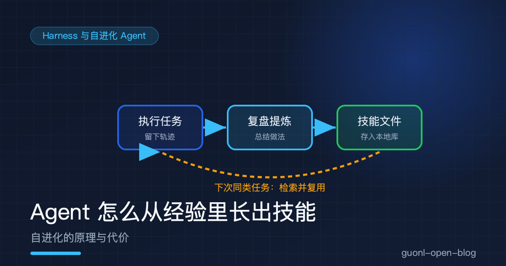
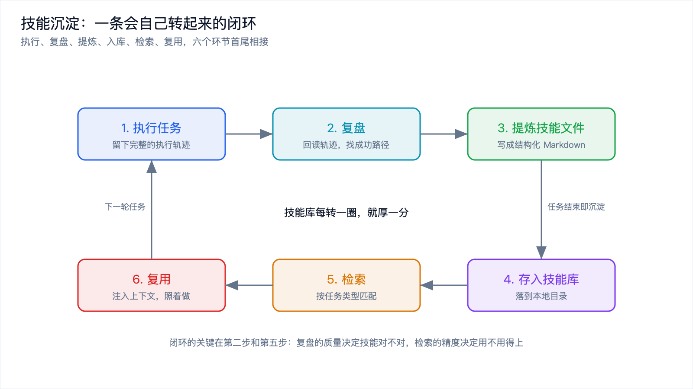
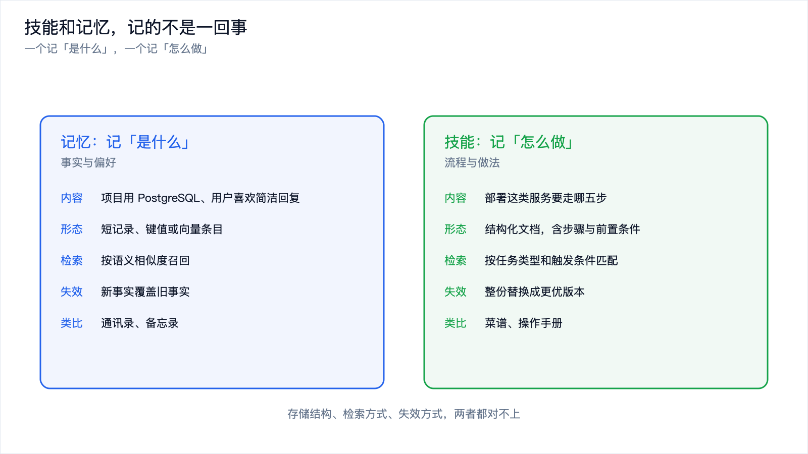
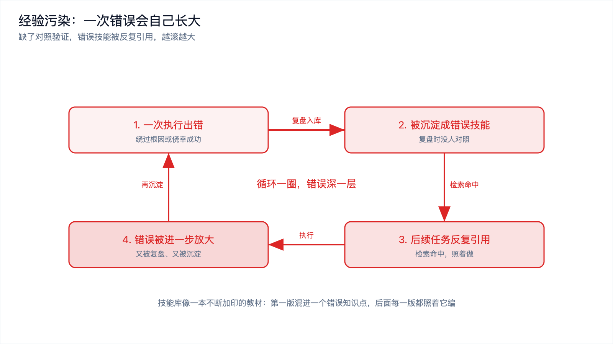
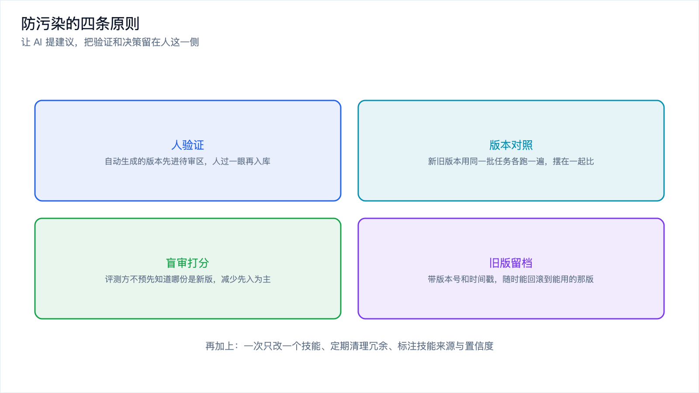

# Agent 怎么从经验里长出技能：自进化的原理与代价



*2026-11-10 · Harness 与自进化 Agent*

## 它很聪明，但每天都是第一天

你花了一整个下午，教会某个 Agent 把自己的项目部署上线：跑测试，构建镜像，推到仓库，更新部署，做一次健康检查。中间踩了两个坑，端口被占用、环境变量没生效，你逐一纠正，它终于跑通。

第二天你让它部署另一个同类服务，流程几乎一模一样。它像第一次见到这件事，重新开始摸索，又把昨天那两个坑踩了一遍。你再说一遍，它点头，然后再犯一次。

这种「聪明但健忘」的毛病，是所有只靠单次会话干活的 Agent 的通病。它的推理能力不差，问题出在经验留不下来。任务一结束，这一趟学到的东西就跟着上下文一起被清空。任务越复杂、踩的坑越多，这种浪费越让人难受。

很自然的想法就冒出来了：能不能让它在任务结束后自己复盘一遍，把「这类事情该怎么做」写成一份文档存下来，下次直接照着做？这个想法，就是自进化技能系统。它要解决的，是把一次性的经验变成可以反复取用的资产。

## 技能沉淀：一条会自己转起来的闭环

把上面那个想法拆成工程动作，大概是这样一条链。

任务先照常执行。Agent 留下的每一步思考、每一次工具调用、每一处报错，构成一份完整的执行轨迹，这是后面所有事情的原料。

任务收尾时，触发一次复盘。Agent 回读自己的轨迹，找出这次到底是怎么做成的：哪些步骤是必需的，哪些是弯路，哪个坑踩了、后来又是怎么绕过去的。这一步相当于人做完一件事之后的「回头想想」。

复盘的结果被提炼成一份结构化的技能文件，通常就是一份 Markdown。它不是流水账，而是压缩后的做法：这类任务什么时候适用、大致分几步、每一步的关键点是什么、有哪些已知的坑要绕开。文件存到本地的一个目录里，成为技能库的一员。

下次来一个同类任务，流程反过来走一遍。Agent 先拿当前任务的描述去技能库里检索，看有没有对得上的技能；命中的那几条被当作上下文注入到提示词里，它照着做，直接复用上次的成果。任务完成之后又会复盘、又会沉淀，闭环就这样转起来了。

据公开报道，Hermes Agent 就是按这个思路做的，技能文件一般落在本地的技能目录下，比如 `~/.hermes/skills/` 这类位置。



*图 1：执行、复盘、提炼、入库、检索、复用，六个环节首尾相接，转一圈技能就厚一分。*

一份技能文件长什么样，可以给个示意：

```markdown
# 技能：把一个 Node 服务部署上线

## 适用场景
- 目标服务是 Node.js 项目，且已接入 CI
- 需要部署到预发或生产环境

## 前置检查
- 确认端口未被占用（常见坑：上一次的进程没退干净）
- 确认 .env 里的环境变量已同步到部署环境

## 步骤
1. 跑测试，全绿再继续
2. 构建镜像，打上版本号标签
3. 推送到镜像仓库
4. 更新部署配置，指向新标签
5. 等健康检查通过，失败则回滚

## 已知的坑
- 环境变量没生效时，先查部署平台的注入顺序
```

这份文件把一次成功经历里可复用的部分固化下来，让下一个同类任务不必从零摸索。

## 技能和记忆，到底差在哪

讲到这儿有个容易混淆的地方。技能和记忆经常被当成一回事，其实它们记的东西根本不同。

记忆记的是事实和偏好。这个项目用 PostgreSQL，用户喜欢简洁的回复，上次部署失败是因为端口占用，这些都是「是什么」层面的信息。它的典型形态是一条条短记录，可能带时间戳，靠语义相似度被检索出来，一旦和新事实冲突，旧的那条就该失效。

技能记的是流程和做法。部署这类服务要走哪五步、每一步的坑在哪，这是「怎么做」层面的东西。它的典型形态是一份有结构的文档，有适用条件、有步骤、有注意事项，靠任务的类型和触发条件被匹配出来，迭代方式是整份替换成更好的版本，而不是被一条新事实覆盖。

用一个日常类比：记忆像你手机里的通讯录和备忘录，记的是具体的人和事；技能像厨房里的菜谱，记的是一套能照着做的流程。你会更新通讯录里的号码，但菜谱是整页换掉的。两者的存储结构、检索方式、失效方式，都对不上。

| 维度 | 记忆 | 技能 |
| --- | --- | --- |
| 记什么 | 事实与偏好（是什么） | 流程与做法（怎么做） |
| 典型形态 | 短记录、键值或向量条目 | 结构化文档，含步骤与前置条件 |
| 检索方式 | 按语义相似度召回 | 按任务类型和触发条件匹配 |
| 失效方式 | 新事实覆盖旧事实 | 整份替换成更优版本 |
| 生活类比 | 通讯录、备忘录 | 菜谱、操作手册 |

分清这一点很关键。记忆坏了，顶多是记错了你的偏好；技能坏了，它会拿一套错误的流程认真把事做错，做完还把错误再沉淀一遍。记忆系统本身怎么存、怎么取、怎么忘，前面[《Agent 的记忆系统》](../context-engineering/agent-memory.md)已经讲透了，这里只划线：记忆管「是什么」，技能管「怎么做」。



*图 2：记忆管「是什么」，技能管「怎么做」，两者的存储、检索、失效不在同一套逻辑上。*

## 技能不只是被存下来，还会被反复打磨

存下来只是第一步。真正让「自进化」这个名字站得住的，是技能会被持续优化。

据报道，有框架使用 GEPA 这类离线优化方法来迭代技能，也就是遗传加帕累托的提示词进化。这套方法的思路可以这样理解：把现有的技能当作一个候选解，让模型读任务的推理轨迹、分析失败日志，生成若干份改写的版本；再拿一批真实任务当测试集，让新旧版本各跑一遍，按效果打分；表现好的留下，表现差的淘汰，下一轮再基于留下的版本继续变异。所谓帕累托，是说当打分不止一个维度时，比如成功率、成本、步骤数，保留那些在任何一个维度上都不比别的版本差的解，避免为了一个指标把另一个指标搞垮。

这条路和训练模型是两回事。它改的是技能文本，也就是提示词层面的东西，模型权重一个字没动。「进化」用在这里，指的是外部资产在变好，而不是模型本身在学习。

有说法称这类方法的样本效率最高能到传统强化学习方法的 35 倍，单次运行成本只要几美元。这些数字来自厂商或专家的口径，任务类型、评测标准、算力环境一变，结论就可能差很远，只能当方向性的参考。能确定的是，它比训练一个模型便宜得多，因为它连模型都不训。

## 技能库的组织：越长大，越难找

技能攒到几十上百条，组织方式就成了新问题。

命名和分类决定了它能不能被找到。技能名最好直接描述「什么时候用它」，而不是「它是什么」。一份叫「deploy」的技能太宽，「部署 Node 服务到预发」就更容易对上。除了名字，技能文件里还需要一份显式的触发条件，写清楚它适用于哪些任务特征，检索时先按这个条件粗筛，再按语义相似度细排。

技能太多会带来两个具体后果。一个是检索噪声，库里躺着几十条半相关的技能，真正对的那条反而被压在下面，注入的是没用的东西。另一个是上下文被挤占，技能是要塞进提示词的，一次注入三条长文档，本就有限的上下文被吃掉一大块，留给任务本身的空间就小了。这和记忆系统遇到的检索噪声是同一类问题，只不过技能单条更长，挤占得更狠。

所以技能库和记忆库一样，不能只进不出。合并重复、删掉长期不命中的条目、把过宽的技能拆细或收敛，这些维护动作得有人做，或者有机制自动做。

## 代价与风险：错的经验会自己长大

前面讲的都是这套机制顺的时候的样子。真正需要盯住的，是它出错的那些情况，而且这几种错会互相放大。

### 经验污染：错误的教材会一直教下去

技能是自动生成的，生成过程里没有对照实验，也没有回放验证。模型复盘自己的轨迹，觉得「我这次是这么做成的」，就把它写成技能，可这个判断完全可能是错的：碰巧绕过了根因，或者在特殊环境下侥幸成功。

错误一旦沉淀成技能，麻烦才刚开始。后续每个同类任务都会检索到它、引用它、照着做，错误被执行一遍又一遍，又被复盘、又被沉淀。技能库像一本不断加印的教材，第一版里混进了一个错误的知识点，后面每一版都照着它编，错的越传越像真的。这就是经验污染。

有第三方评测称，智能体自动化知识积累的成功率只有大约六成，一段经验要不要存下来，几乎完全取决于模型自己的主观判断。十次里有四次判断可能出错，而每一次出错都可能变成一条长期存在的错误教材。



*图 3：一次错误执行被沉淀成错误技能，后续任务反复引用，错误在执行和沉淀之间越滚越大。*

### 不可逆：没有版本管理，改错了回不去

技能被自动打磨时，如果没有版本管理和回溯机制，一次糟糕的迭代就把旧版本覆盖掉了。新版本可能更差，而你已经没有旧版本可以退回去。这和代码没有 Git 是一样的处境：出了问题只能重写，查不出是哪一步改坏的。技能还会自我迭代，今天的版本明天又被改写，如果不留档，你连「它是什么时候变坏的」都说不清。

### 冗余：自动生成的东西容易重复，粒度还不齐

自动生成很难保证粒度一致。同一个「部署服务」的活，可能生成出三条技能：一条讲构建，一条讲发布，一条又讲全流程，彼此重叠。粒度不一会让检索更难：太粗的不精确，太细的又得凑好几条才够用。库里一半的条目是彼此的近似重复，检索质量自然被拖下去。

### 评估困难：怎么知道新的真的比旧的好

想判断一个新技能是不是比旧的好，得有可比的任务、可量化的指标、能复现的环境。这三样在真实场景里都难凑齐。同一件事跑两遍，模型自己的输出都有随机性；任务分布又在变，今天好用的技能下个月未必还合适。评测口径不统一，「更好」就只能靠感觉，而靠感觉判断，正是前面三种风险的总开关。这也引出一个更根本的问题：成长到底该怎么量，留到本专题后面单独讲。

## 一份可以照着做的原则清单

这些风险不是不能防，思路是把「自动」的边界划清楚：让 AI 负责提建议，把验证和决策留在人这一侧。落到具体动作，有这么几条。

- 新增或修改技能，必须做新旧版本对照，用同一批任务各跑一遍，结果摆在一起看，而不是凭生成时的自信度直接替换。
- 关键技能引入盲审打分，评测的人或模型不预先知道哪份是新版，减少先入为主。
- 技能在用户确认之后才生效，自动生成的版本先落到一个待审区，人过一眼再入库。
- 一次只改一个技能，避免一次迭代里动了一堆东西，出了问题分不清是哪处改的。
- 旧版本全部留档，带版本号和时间戳，随时能回滚到上一个能用的版本。
- 定期清理技能库，合并重复、删除长期不命中的条目，控制总量，保住检索质量。
- 给技能标上来源和置信度，人工写的和自动生成的区分开，出问题时能快速定位污染源。

这份清单里没有一条是新技术，全是软件工程用了几十年的老办法：版本控制、灰度、评审、回滚。自进化技能带来的新问题，最终还是要用这些老办法来收口。



*图 4：人验证、版本对照、盲审打分、旧版留档，四条原则把自动生成的技能关进可回溯的笼子里。*

## 把原理和代价收个尾

自进化技能系统要解决的是一个真问题：Agent 不该每天从零开始。它的做法也清楚，任务结束后复盘，把解法提炼成结构化的技能文件存进本地库，下次检索出来注入上下文直接复用，闭环就这样转起来。技能和记忆不是一回事，一个记「怎么做」，一个记「是什么」，存储、检索、失效都不同。技能还会被离线优化方法反复打磨，但那套「样本效率高、成本低」的说法是厂商口径，要打折扣。

真正要警惕的是它出错时的样子。缺了对照验证，错误会沉淀成技能，然后被反复引用、越滚越大；没有版本管理，改坏了回不去；自动生成带来冗余和粒度混乱；而「新技能是否真的更好」这件事，本身很难评。对策并不新鲜，就是把人验证、版本对照、盲审打分、旧版留档这几条落到实处，让自动提建议，让人做决策。

原理和代价讲完了，接下来该动手了。下一篇[《动手：给 Agent 加一个自进化技能库》](hands-on-skill-library.md)，会用代码把这条闭环搭出来：怎么存技能、怎么检索、怎么在写入之前加一道验证闸门。
